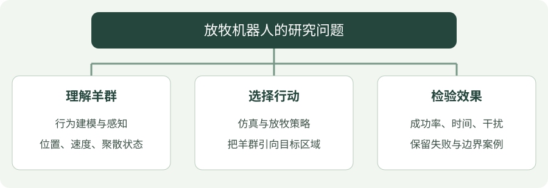

# 智能放牧研究概览

!!! tip "用一句话理解研究任务"

    让机器人影响羊群运动，把羊群引导到目标区域；既要看有没有到达，也要看过程中是否出现分散、干扰或不安全的动作。

> 研究问题：如何通过机器人的运动，引导羊群进入指定区域？

## 看图梳理

{ .learning-figure }

[打开大图](../assets/learning/herding-index.svg)

**理解羊群**：行为建模与感知，位置、速度、聚散状态；**选择行动**：仿真与放牧策略，把羊群引向目标区域；**检验效果**：成功率、时间、干扰，保留失败与边界案例。

## 任务与边界

以宇树 Go2 四足机器人为研究平台，先在仿真中研究放牧决策。将高层引导策略与底层运动控制分开，便于定位失败原因。以下是研究规划，尚未记录完成的实验结果。

## 从环境到策略

| 环节 | 需要明确的问题 | 建议产物 |
| --- | --- | --- |
| 羊群建模 | 个体如何聚集、避让和响应机器人？ | 行为规则与参数说明 |
| 仿真环境 | 场地、障碍和目标区如何定义？ | 可复现的场景配置 |
| 状态观测 | 是否使用真实位置或视觉估计？ | 观测字段与坐标系 |
| 动作空间 | 输出目标点还是机器人速度？ | 动作范围与控制频率 |
| 奖励设计 | 如何同时衡量到达、聚集和效率？ | 奖励项与权重记录 |
| 策略评估 | 不同初始条件下是否仍然有效？ | 多次运行的统计结果 |

## 建议实验顺序

1. 固定随机种子，建立少量羊只、无障碍的最小场景。
2. 实现一个规则策略，作为后续学习策略的比较基线。
3. 用 [PPO](../rl/ppo.md) 训练策略，分别记录各项奖励与终止原因。
4. 改变羊只数量、初始分布和行为参数，检查泛化表现。
5. 接入 [视觉估计](../vision/index.md)，评估观测误差和延迟的影响。

## 评估指标

- **成功率**：规定时间内达到任务条件的运行占比。
- **到达比例**：进入目标区域的羊只数占总数的比例。
- **完成时间**：成功运行所需时间，同时报告超时情况。
- **聚集程度**：羊群相对中心的距离分布。
- **控制代价**：机器人路径长度、动作变化和碰撞次数。

## 实验记录清单

每次实验保留场景配置、代码版本、随机种子、训练步数、奖励权重、评估次数与失败案例。先观察失败发生在哪个环节，再决定下一次只改变哪一个变量。
