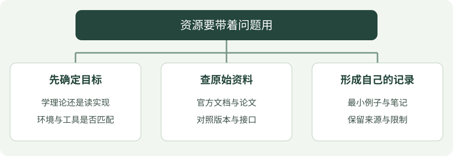

# 开源学习资料：带着问题查原始来源

先用本站的图解建立概念，再到原始资料核对公式与接口。资料的用途不同，不必同时读完所有入口。

---

## 看图梳理

{ .learning-figure }

[打开大图](../assets/learning/opensource-index.svg)

**先确定目标**：学理论还是读实现，环境与工具是否匹配；**查原始资料**：官方文档与论文，对照版本与接口；**形成自己的记录**：最小例子与笔记，保留来源与限制。

## 先按问题选择入口

零基础先读本站的短例子，再查下面入口对应的一小节。官方文档通常是查询工具，默认读者知道一些基础；遇到大量参数时，只先查当前例子用到的参数，不必从首页顺序读完。

| 你正在问什么 | 资料入口 | 建议怎么读 |
| --- | --- | --- |
| 强化学习算法的目标是什么？ | [Spinning Up](https://spinningup.openai.com/en/latest/spinningup/rl_intro2.html) | 先读关键方程，再把更新步骤与本站公式对照 |
| 库支持什么动作空间？ | [SB3 算法支持表](https://stable-baselines3.readthedocs.io/en/master/guide/algos.html) | 检查 Discrete / Box，再看对应算法参数；阅读即可 |
| C++ 的资源由谁负责？ | [C++ Core Guidelines](https://isocpp.github.io/CppCoreGuidelines/CppCoreGuidelines) | 带着所有权、生命周期的问题查条目 |
| 为什么像素不能直接当成米？ | [OpenCV 相机标定](https://docs.opencv.org/4.x/d9/d0c/group__calib3d.html) | 分清内参、外参、深度与坐标系 |
| 多文件程序怎样一起编译？ | [CMake 入门](https://cmake.org/cmake/help/latest/guide/tutorial/index.html) | 先理解目标、源文件、配置与构建四个词 |

官方文档可能展示比本教程更新的功能。核对版本、参数默认值和标准要求，不能只根据函数名称复制代码。

### 第一次查文档，跟着一个问题走

例如，你在 CMake 页看到 `add_executable(hello main.cpp)`，不清楚两项分别是什么。先记下自己的问题：“hello 是文件名吗，main.cpp 为什么放在后面？”再打开对应命令的官方说明，寻找目标名和源文件列表的定义。回来用自己的话写：“hello 是目标名，main.cpp 是组成它的源文件。”这样一次查询就解决一个问题。

不要把页面上的示例参数全部搬进自己的项目。先对照：示例用什么语言或工具版本，输入是什么，输出是什么，它是否依赖上一节已创建的文件。官方文档中的代码也可能是局部片段，而不是独立程序。

| 看到的东西 | 先理解什么 | 一个常见误会 |
| --- | --- | --- |
| README | 项目用途、依赖和使用入口 | 介绍很完整，不等于每项功能已经验证过 |
| API 文档 | 一个函数的输入、返回值和约定 | 参数名相同，不等于不同库的含义相同 |
| 示例代码 | 展示的是哪一步，前面需要哪些数据 | 把片段当成完整程序直接复制 |
| Issue | 使用者报告的问题和讨论 | 一条回复可能只适用于某个旧版本 |
| License | 使用、修改和分发的许可条款 | 公开能看到，不等于可以任意分发 |

**API**可以先理解为“程序提供给别人调用的接口”。例如环境的 `step(action)` 接收一个动作，返回下一观测、奖励和结束信息；接口文档说明字段的约定，不替你设计放牧任务。

### 文档里的函数格式，不一定是让你原样复制的代码

例如官方说明可能用 `name`、`sources` 或尖括号表示“在这里填目标名、源文件”。这些是说明位置的占位文字；教程中的 `add_executable(hello main.cpp)` 才是填入具体名称的例子。看到方括号时也先检查它表示“可选参数”，还是该语言真的需要写出的列表语法。

沿着一次接口查询，依次确认四件事：

1. **输入**：动作要几项、单位是什么、允许范围是多少？
2. **返回**：哪些值组成结果，它们对应动作前还是动作后？
3. **副作用**：调用会不会推进环境、修改对象或保存文件？
4. **出错与版本**：无效输入怎样处理，文档属于哪个版本？

“副作用”在这里指调用除了交回一个值，还改变了什么。比如 `step` 会推进环境状态，`save` 会写文件，预测接口的返回动作却不等于已经向机器人发送命令。将这些变化圈出来，才能知道一行代码执行后，下一行面对的还是不是原来的数据。

### 把一次查询变成自己的笔记

只需记录四项：我原来哪里不懂、查到的准确含义、适用版本或条件、一个能解释清楚的小例子。遇到别人项目里的复杂代码，先画“输入 → 核心处理 → 输出”，把暂时用不到的日志、界面和部署部分留到之后再读。

本页的外部资料是补充入口。第一遍可以留在本站读中文解释和图，不要求安装每个外部项目；能读懂一个函数的接口后，再扩展到一份完整项目。

## 01 · 机器人学习

### Robotics Tutorial

**一套系统化的机器人学习教程**

涵盖机器人数学基础、C++、SLAM、运动规划与控制、足式机器人及具身智能等技术方向，适合机器人领域的系统学习。

**📖 主要学习方向**

- 机器人数学基础与运动学
- C++ 编程与机器人软件开发
- SLAM 定位与建图
- 机器人路径规划与运动控制
- 足式机器人与具身智能

**🔗 资料入口**

[🌐 GitHub 开源项目 — Robotics Tutorial](https://github.com/Michael-Jetson/Robotics_Tutorial)

[📖 在线阅读教程](https://robotics-tutorial-wiki.vercel.app/)

---

## 02 · 机器人视觉

### rm.cv.fans · 配套零基础源码阅读课

`julyfun/rm.cv.fans` 是 RoboMaster 视觉工程仓库，包含通用视觉基础组件与比赛专用模块。它适合作为工程阅读材料，但不是从零编排的教材。本站为它增加了 **8 课入门路线**：从 C++ 语法、图像数字和矩阵开始，再阅读参数管理与共享对象。

先学会看懂，再沿接口读源码

每课都有图解、数字例子、中文解释与练习。独立 C++ 示例包含注释和预期输出；与原项目的实现分开说明。滤波基础采用静态温度例子；专用瞄准、弹道和发射控制部分仅辨认职责。

[进入配套教程 →](../vision/rm-cv-fans/index.md){ .md-button .md-button--primary }
[查看原仓库](https://github.com/julyfun/rm.cv.fans){ .md-button }

阅读基准为提交 [`6abd1bf`](https://github.com/julyfun/rm.cv.fans/tree/6abd1bf359356d1d603766c4b3bcabbb1d6432b2)，本次核对日期为 2026-10-15。该快照没有根目录 CMake 构建入口，作者也保留了已知问题说明；教程说明构建材料的限制，不承诺整套工程可直接运行。阅读不要求创建虚拟环境或安装原项目依赖，不提供下载包。

---

### 浙江大学 RoboMaster 视觉组学习资料

**浙江大学 RoboMaster 机甲大师视觉组入组培训教程**

面向机器人视觉开发，包含基础编程、计算机视觉、相机标定、目标跟踪及机器人自瞄系统等学习内容。

**📖 主要学习方向**

- Linux 与机器人开发环境
- OpenCV 计算机视觉
- 工业相机与相机标定
- PnP 位姿解算
- Kalman 滤波与目标跟踪
- 神经网络与 YOLO

**🔗 资料入口**

[🌐 在线阅读 — 浙大 RoboMaster 视觉组培训教程](https://hello-world-vision.github.io/Vision_Website/induction-training/)

[查看作者维护的网站与培训内容仓库](https://github.com/Hello-World-Vision/Vision_Website)

---

## 📝 学习记录

这些开源资料将作为个人学习与科研的参考资源，后续逐步整理相关知识点、算法原理、代码实践及实验总结。

*📌 声明：以上资料均来自公开项目，原始内容及版权归各项目作者所有。本页面仅用于学习资源整理与分享。*
