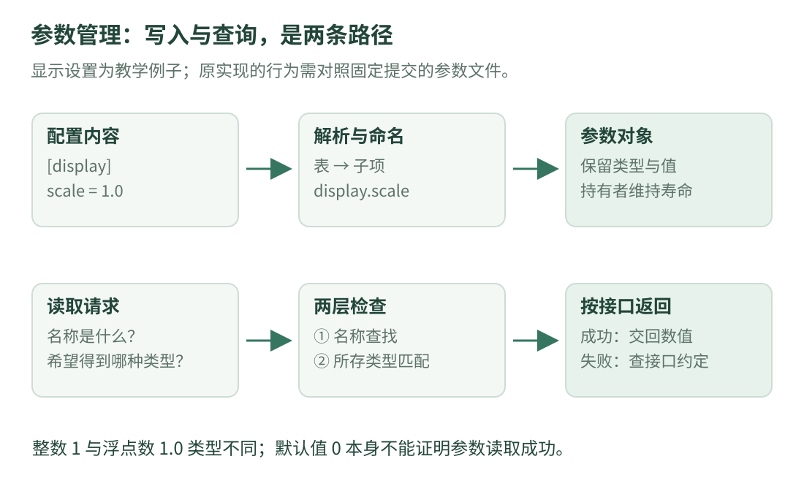

# 06 · 参数与共享对象：配置里的数怎样进入程序

现在带着前几课的语法回到真实文件。本课只研究通用的**参数管理**：给设置起名字、识别类型、查找数值和更新对象。

先读第三课。`Param`、`ParamManager` 是原项目的名称；下方完整小程序则是本站另写的示例，二者不要混为同一实现。

## 1. 配置文件不是 C++ 程序

配置通常把可调整的设置从业务代码中分离出来。例如下面这份 **TOML 教学配置**只有显示相关设置，不是原仓库参数表：

```toml title="假想的显示设置 · 只解释 TOML 格式"
[display]           # 一张叫 display 的表。
scale = 1.0         # 浮点数；写 1 会是整数类型。
enabled = true      # 布尔值，表示开或关。
title = "Preview"   # 字符串，需要引号。
```

`[display]` 把随后几个键归入同一张表。可以把 `display.scale` 理解成从 display 表中找到 scale 的路径。这个点号路径是访问 / 命名方式，**不是说这四行本来就是一张扁平 C++ map**。

TOML 的 `#` 是注释，C++ 的 `//` 是注释，两种语言的写法不要互换。格式与值类型以 [TOML 1.0 规范](https://toml.io/en/v1.0.0)为准；本例没有要求创建文件或运行解析器。

## 2. 看清两条不同的路径

{ .learning-figure }

[打开大图](../../assets/learning/rmcv-parameters.svg)

“读取配置文件”与“业务代码查询某个设置”是两个动作：

| 动作 | 输入 | 中间处理 | 输出 / 变化 |
| --- | --- | --- | --- |
| 解析和更新 | 配置内容 | 识别表、键、值类型 | 创建或修改参数对象 |
| 按名读取 | 名称和希望得到的类型 | 查找对象，再查类型 | 交回数值，或按接口约定处理失败 |

区分这两条路，才能回答“改了配置为什么没看到变化”：可能没解析成功，也可能查错名称、读错类型，或使用者只在初始化时复制过一次。

## 3. 原项目的参数能保存哪些类型

[参数头文件](https://github.com/julyfun/rm.cv.fans/blob/6abd1bf359356d1d603766c4b3bcabbb1d6432b2/base/param/parameter.hpp)用 `std::variant` 组成 `Param`：候选类型是布尔、64 位整数、`double`、字符串和 64 位整数列表。

`variant` 可以先理解成“有类型标签的盒子”：一个盒子当前存其中一种候选类型，读取时不能无视标签。它不是同时存下全部候选项，也不是“所有数据都先变成字符串”。

整数 1 与浮点数 1.0 在数学上数值相等，但在按精确类型读取的接口中可能不同。`std::get_if<double>` 不会自动把装着整数的 `variant` 转换成 `double`。标准接口可查 [C++ 草案的 variant 访问规则](https://eel.is/c++draft/variant.get)。

## 4. 把原实现翻译成自然语言

下面是对[参数实现文件](https://github.com/julyfun/rm.cv.fans/blob/6abd1bf359356d1d603766c4b3bcabbb1d6432b2/base/param/parameter.cpp)的阅读摘要，具体边界仍应对照函数体：

1. `get_value` 判断 TOML 节点的类型，将支持的值交回参数容器；它并不支持任意 TOML 数据结构的直接转换。
2. `parse` 遇到表就继续访问子节点，拼接名称；遇到值就查找同名对象，决定创建还是修改。
3. `load_and_update` 在循环里读文件、解析并更新，捕获异常后记录日志；每轮末尾有一秒休眠。

因此它是循环重读的更新方式，不能理解成“文件一保存就零延迟、原子地替换所有设置”。一轮还要包含文件读取和处理时间。删除的键、整组一致性、并发访问等行为，也不能仅凭“热更新”三个字作保证。

### 递归是什么：函数为什么会调用自己

配置表可以包含子表。处理一层时，若里面还有一张表，就对那张表重复相同规则；这叫递归。可以类比逐层打开文件夹，直到找到真正的文件。

`parse` 中的前缀就是“目前已经走过的名称”。走到 display 表，再遇到 scale 键，组合出类似 `display.scale` 的名称。递归不是魔法，它必须有停止展开、处理叶子值的分支。

## 5. 查不到和类型不对，是两种失败

[`get_param` 的当前实现](https://github.com/julyfun/rm.cv.fans/blob/6abd1bf359356d1d603766c4b3bcabbb1d6432b2/base/param/parameter.hpp)先查对象，再用指定类型访问。找不到或类型不符时会记录错误并返回相应类型的默认构造值；例如读取 `double` 失败可能得到 0。

这是一项**接口行为**，不是“0 一定说明配置中写了 0”。阅读日志与失败分支很重要。也不要说原函数返回 `optional`：它并没有采用上一课独立示例的返回设计。

### 用独立小程序把两种失败分别显示

下面程序把解析之后的结果直接写入 `map`；**它不解析 TOML，也没有线程或热更新**。我们只观察名称和类型：

```cpp title="按名称与类型读取显示设置 · 独立教学示例"
#include <iomanip>
#include <iostream>
#include <map>
#include <string>
#include <variant>

// 本例只选三种类型；并非原项目完整的 Param 定义。
using Setting = std::variant<bool, double, std::string>;
using Settings = std::map<std::string, Setting>;

void show_number(const Settings& settings, const std::string& name) {
    const auto found = settings.find(name);  // 先按名称找。
    if (found == settings.end()) {
        std::cout << name << ": missing\n";
        return;  // 没找到，就不要继续访问 found->second。
    }

    // map 中一项包含名称 first 和数值 second。
    // & 取得 variant 的地址；get_if 成功返回所存 double 的指针。
    const auto* number = std::get_if<double>(&found->second);
    if (number == nullptr) {
        std::cout << name << ": wrong type\n";
        return;
    }
    std::cout << name << ": " << *number << '\n';
}

int main() {
    Settings settings{
        {"display.scale", 1.0},
        {"display.enabled", true},
    };
    std::cout << std::fixed << std::setprecision(1);

    show_number(settings, "display.scale");    // 存在，而且类型匹配。
    show_number(settings, "display.enabled");  // 存在，但它是 bool。
    show_number(settings, "display.width");    // 名称不存在。

    // 显式更新已有设置，再次查询才能观察到新值。
    settings.at("display.scale") = 2.0;
    show_number(settings, "display.scale");
}
```

预期输出：

```text
display.scale: 1.0
display.enabled: wrong type
display.width: missing
display.scale: 2.0
```

`map` 可以先理解为按键查值的容器。`find` 返回迭代器，即访问容器元素的位置；`end()` 是没有找到 / 到达末尾的标志，不能解引用。它和空指针的角色不同。

## 6. 对象为什么能一直存在

原项目的 [`ObjManager`](https://github.com/julyfun/rm.cv.fans/blob/6abd1bf359356d1d603766c4b3bcabbb1d6432b2/UltraMultiThread/include/umt/ObjManager.hpp)按类型和名称管理共享对象，内部注册表保存弱指针。参数实现中的管理器另有一组共享指针，用来保留创建的参数对象。

结合第三课可读成：“查找表负责知道名字，持有者负责让对象活着。”两者职责不同。注册表加锁并不自动等于任何共享参数内容的读写都有同步保护；需要逐处确认对象访问与线程约定。

在[参数接口文件](https://github.com/julyfun/rm.cv.fans/blob/6abd1bf359356d1d603766c4b3bcabbb1d6432b2/base/param/entry.cpp)中，还能看到后台线程和 pybind11 导出。`[=]` 是 Lambda 的捕获写法，`detach()` 让线程脱离当前线程对象的管理；它不意味着任务立即完成，也不会自动提供关闭或等待完成的机制。这里先识别职责，不照抄作通用线程模板。

## 7. 练习：为什么 1 改成 1.0 会影响类型

完整教学程序里 `Setting` 暂未包含整数。先假设扩展它使其也能保存整数，再让 scale 存成整数。`get_if<double>` 能否因为数值相等就成功？另外，原项目的读取函数失败返回 0 时，能否只靠这个数判断成功？

??? example "展开答案"

    不能。get_if 按当前保存的类型匹配，不做整数到浮点数的自动读取转换。实际类型由写入方式与解析规则确定，需要保持读写约定一致。

    也不能只凭 0 判断原项目读取成功，因为合法值可能就是 0，而失败也可能返回 0。应理解原接口的日志和失败分支。本章教学程序分别打印 missing 与 wrong type，目的是把两个概念拆开。

[返回课程路线](index.md) · [上一课：矩阵与误差](math.md) · [下一课：07 · 测量与滤波 →](estimation.md)
