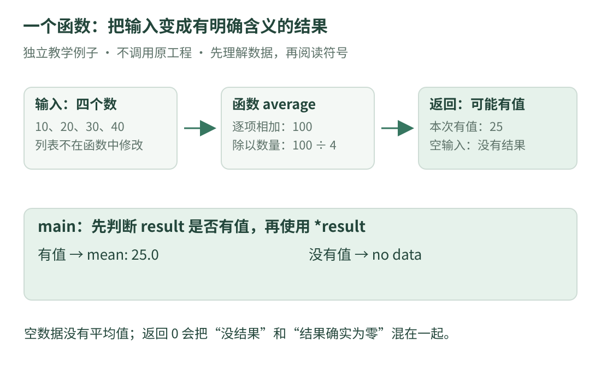

# 02 · C++ 第一眼：顺着一个小程序读

本课先把复杂工程放在一边。我们只问：**四个亮度数字，怎样被程序相加、平均并输出？** 读完后，再回到源码里的函数，会更容易找到输入和返回值。

只需会加减乘除。如果第一次见代码，先把程序想成“按规则依次处理数据的一份说明”，大多数示例语句以分号结束，大括号把一组语句放在一起。

## 1. 先认识执行路线

{ .learning-figure }

[打开大图](../../assets/learning/rmcv-cpp.svg)

本例输入固定为 `10、20、30、40`，和为 100，数量为 4，平均值为 25。空输入没有平均值，本例用“没有结果”表示，不把它写成 0。

## 2. 完整代码：先看注释，再看符号

下面是**本站独立教学示例**，使用 C++17 标准库，不调用原项目。整段是一个完整程序；`main()` 是它的执行入口，前面的函数提供可重复使用的处理步骤。

```cpp title="四个数字的平均值 · 独立教学示例"
#include <iomanip>   // 控制小数位数。
#include <iostream>  // 提供 std::cout，用来显示结果。
#include <optional>  // 提供“可能没有结果”的 std::optional。
#include <vector>    // 提供可保存一串数字的 std::vector。

// namespace 给名字分组，避免和其他地方的同名函数混淆。
namespace lesson {

// 返回类型：可能有一个 double，也可能没有平均值。
// const 引用：读取调用者的列表，不在这里修改，也不复制整个列表。
std::optional<double> average(const std::vector<double>& values) {
    if (values.empty()) {
        return std::nullopt;  // 没有输入，明确返回“没有结果”。
    }

    double sum = 0.0;  // 保存累加结果；double 是浮点数类型。
    for (double value : values) {
        sum += value;  // 相当于 sum = sum + value。
    }

    // 把数量显式转换为 double，再进行除法。
    return sum / static_cast<double>(values.size());
}

}  // namespace lesson

int main() {
    const std::vector<double> brightness{10.0, 20.0, 30.0, 40.0};
    const auto result = lesson::average(brightness);

    // result 有值才进入这个分支；*result 取出里面的平均值。
    if (result) {
        std::cout << std::fixed << std::setprecision(1);
        std::cout << "mean: " << *result << '\n';
    } else {
        std::cout << "no data\n";
    }
}
```

预期输出：

```text
mean: 25.0
```

这里假设输入是这四个正常、有限的数字。它没有宣称能处理任意大的数据或所有异常浮点值；第八课会补充数据有效性检查。

## 3. 一行定义里，哪些是类型，哪些是名字

拿 `double sum = 0.0;` 来看：

| 部分 | 意思 | 类比 |
| --- | --- | --- |
| `double` | 用浮点数保存数据 | 盒子的种类 |
| `sum` | 变量名 | 盒子上的标签 |
| `0.0` | 初始值 | 开始装进去的内容 |
| `;` | 这条语句结束 | 句号 |

变量不是数学中永远不变的量，程序可以更新它。加上 `const` 后，通过这个名称不能直接重新赋值。`const` 的限制还与类型有关，第三课会区分“指针本身”和“指向的数据”。

`std::vector<double>` 表示一个保存 `double` 的容器。`std` 是标准库使用的命名空间，`::` 用于说明名字属于哪里；`<>` 在这里给模板填类型，不是“小于、大于”的比较。

## 4. 函数怎样接收输入和交回结果

函数名是 `average`。圆括号中的 `values` 是输入参数的名字；函数体用 `return` 交回结果。一个函数可以调用很多次，每次接收不同输入。

执行遇到 `return` 后，本次函数调用立即结束。因此空列表先返回 `std::nullopt`，后面不会继续除以列表长度，避免除以零。

`lesson::average(brightness)` 表示调用 `lesson` 里的函数，把 `brightness` 作为输入。函数中的 `values` 是对同一列表的只读引用；这里两个名字不要求相同。

### `auto` 不代表“没有类型”

`const auto result = ...` 请编译器从右边推导类型。本例推导得到 `std::optional<double>`，仍然是确定的静态类型。它不会因为下次输入不同就随意变成字符串。

## 5. 把循环当成一张变化表

`for (double value : values)` 是“依次取列表中的每个数”。冒号左边是这一次取出的局部变量，右边是被遍历的容器。

| 刚取出的数 | 相加前的 sum | 相加后的 sum |
| --- | --- | --- |
| 10 | 0 | 10 |
| 20 | 10 | 30 |
| 30 | 30 | 60 |
| 40 | 60 | 100 |

循环结束，`values.size()` 为 4，返回 `100 / 4 = 25`。函数里的局部名字 `sum` 不会变成整个项目到处可用的全局变量。

## 6. 输出里的符号也有约定

`std::cout << ...` 向输出流写内容。本例的 `<<` 是输出运算符，不是在做数学上的“小于”。`'\n'` 是换行字符；`"mean: "` 是字符串。

`std::fixed` 和 `std::setprecision(1)` 一起让后续浮点输出保留一位小数。它们改变显示方式，不把内部计算“变精确”，也不修复错误输入。

### 为什么强调小数和整数

两个整数做 `/` 通常会得到整数商，例如 `5 / 2` 得到 2；若其中一个是浮点数，`5.0 / 2` 得到 2.5。负整数的商向零截断，不是总向下取整。示例用 `double` 累加，并显式转换数量，让读者看出平均数的类型。

## 7. 带着语法再看原项目

在[参数实现](https://github.com/julyfun/rm.cv.fans/blob/6abd1bf359356d1d603766c4b3bcabbb1d6432b2/base/param/parameter.cpp)里，你会再次看到命名空间、`const auto`、范围循环、判断和 `return`。先给它们标注“名字分组、保存结果、逐项处理、判断条件、结束并交回结果”，不要一开始就钻进每个外部库。

某些函数不会返回：例如实现中的循环更新函数。**不能把每个函数都想成马上交回一个值的计算器**；还要看返回类型和是否有持续循环。

## 8. 练习：改输入，先预测输出

把完整示例中的四个数改成 `10.0、11.0`，其他不变。再把列表改成空列表 `{}`，分别会显示什么？

??? tip "先自己算"

    第一组先加再除；第二组在函数开头就返回。不要对空列表求和后除以零。

??? example "展开答案"

    两个数的平均值为 10.5，输出 mean: 10.5。空列表返回没有结果，输出 no data。

    如果把“没有平均值”硬改成 0，别人无法区分“平均确实为零”与“根本没测到”。这也是工程代码要明确失败含义的原因。

进一步可读本站的[变量、判断与循环](../../programming/cpp/basics.md)、[函数与引用](../../programming/cpp/functions.md)；标准库与生命周期的设计原则可查 [C++ Core Guidelines](https://isocpp.github.io/CppCoreGuidelines/CppCoreGuidelines)。

[返回课程路线](index.md) · [上一课：仓库与文件](repository.md) · [下一课：03 · 类型与所有权 →](cpp-types.md)
