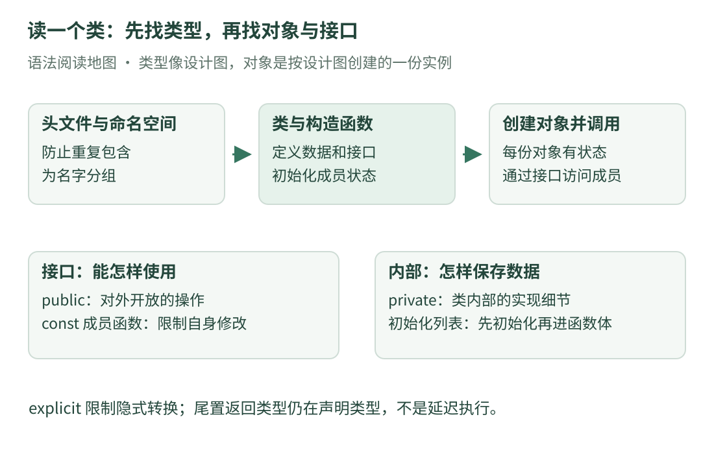

# 09 · 头文件、类与接口：逐词读懂工程 C++

上一课的小程序只有几十行，而真实项目会把声明、实现和调用分开放。第一次打开头文件，看到 `#ifndef`、`namespace`、`explicit`、`const` 连在一起，很容易觉得每行都不认识。这一课把它们拆开，只研究一个问题：**怎样给一组显示设置起名字、保存起来，再安全地读取？**

先读 [C++ 第一眼](cpp-basics.md)和[类型与所有权](cpp-types.md)。这里的“安全地读取”专指我们给出的访问规则和生命周期前提，不等于自动解决所有并发问题。本课完整程序只用 C++17 标准库，输入固定，不读取设备或原项目配置。

## 1. 先找到文件承担的任务

{ .learning-figure }

[打开大图](../../assets/learning/rmcv-source-basics.svg)

在固定版本的[参数头文件](https://github.com/julyfun/rm.cv.fans/blob/6abd1bf359356d1d603766c4b3bcabbb1d6432b2/base/param/parameter.hpp)中，可以找到头文件保护、命名空间、类型别名和参数管理类。我们只借它定位这些语法，不把下面独立编写的显示设置类说成原项目实现。

先区分两个词：

- **声明**：告诉编译器“这个名字存在，输入和输出是什么”。比如函数声明末尾是分号，还没有处理步骤。
- **定义**：提供实际内容。例如函数的大括号里写了处理步骤，或者类的定义列出了它有哪些成员。

`.hpp` 常用来放 C++ 头文件，`.cpp` 常用来放实现。这是常见工程约定，扩展名本身不会保证文件只包含声明。原项目的头文件也放了部分函数体和模板定义，不能看到 `.hpp` 就跳过大括号。

阅读时先回答三个问题：这个文件提供什么名字？别人给它什么数据？它保存数据、计算结果，还是只宣布接口？先看清这三点，再逐个查陌生词。

## 2. `#include` 与头文件保护：为什么开头有三种井号

`#include <string>` 的作用是让当前翻译单元能够使用字符串库提供的声明。**翻译单元**可以暂时理解成“一个 `.cpp` 文件，加上它通过包含指令引入的内容”。编译器按翻译单元处理代码，之后再把需要的目标文件链接起来。

下面是本站编写的头文件，不是完整的可执行程序。它先提供一个简单尺寸类型，下一节再用更完整的小程序解释类。阅读片段的上下文是：将这段内容作为一个头文件，由其他 `.cpp` 文件包含。

```cpp title="尺寸类型的头文件 · 阅读片段"
#ifndef LESSON_PREVIEW_SIZE_HPP
#define LESSON_PREVIEW_SIZE_HPP

namespace lesson {

// struct 把两个有关联的整数放在一个类型里。
struct PreviewSize {
    int width = 640;
    int height = 480;
};  // 定义 struct 后需要分号。

}  // namespace lesson

#endif  // LESSON_PREVIEW_SIZE_HPP
```

按顺序读：

1. `#ifndef` 是“如果尚未定义这个宏名”。宏名可以理解成预处理阶段使用的标记，不是普通 C++ 变量。
2. 第一次经过这里，标记还不存在，于是继续处理内容；`#define` 把它设为已定义。
3. 同一翻译单元里再次包含同一头文件时，标记已经存在，中间定义就被跳过。
4. `#endif` 结束这次条件处理。

它解决的是**同一翻译单元中的重复包含**。它不会自动修好所有跨文件重复定义，也不会让共享变量变得线程安全。比如在头文件中随意定义具有外部链接的普通函数，即使有包含保护，仍可能在多个 `.cpp` 文件链接时发生重复定义问题；需要结合 `inline`、单独的实现文件等正确组织代码。

保护宏应该足够独特，避免不同头文件误用同一个标记。这个例子使用项目自己的大写前缀，不用以下划线加大写字母开头的保留形式。`#pragma once` 也是许多编译器支持的常见做法，但这里先读懂原项目出现的条件包含形式。

## 3. 命名空间与 `using`：名字属于哪里

`namespace lesson { ... }` 给名字分组。上面定义的尺寸类型完整名称是 `lesson::PreviewSize`，`::` 可以读作“这个作用域里的”。当两个库都有名为 `Size` 的类型时，前面的命名空间能帮助区分它们。

这与文件夹有一点相似，但命名空间不是硬盘目录：把文件移动到别的文件夹，不会自动改变代码中的命名空间。反过来，不同文件也可以往同一个命名空间中添加声明。

常见的三种 `using` 长得相似，作用不同：

| 写法 | 这里做的事 | 初学时怎样读 |
| --- | --- | --- |
| `using LabelText = std::string;` | 给已有类型起别名 | LabelText 是 string 的另一个名字 |
| `using std::cout;` | 让某个已有名字在当前作用域可直接使用 | 这里可直接写 cout |
| `using namespace lesson;` | 允许该命名空间的名字参与未限定名称查找 | 这里查找名字时，也考虑 lesson 中的名字 |

类型别名不创建一种全新的类型。把 `double` 起名叫 `Seconds`，不代表编译器就能自动阻止你把米数传进去。若要检查单位，需要更严格的类型设计。

我们在教程中保留 `std::`，便于看出哪些名字来自标准库。特别是在头文件中，不建议为省几个字就写全局 `using namespace std;`：包含它的其他文件也会受到名字查找的影响，容易出现同名冲突。

## 4. 一个完整程序：对象怎样建立并被读取

先把输入和输出放在眼前。本程序创建名字为 `preview` 的标签，尺寸为宽 640、高 480。它不加载图片；这些数字只用于理解对象和接口。

```cpp title="显示标签与图像尺寸 · 独立教学示例"
#include <iostream>  // std::cout。
#include <string>    // std::string。

namespace lesson {

using LabelText = std::string;  // 类型别名，不是新的字符串种类。

struct PreviewSize {
    int width = 640;   // 成员的默认初始值。
    int height = 480;
};

class PreviewLabel {
public:
    // 构造函数与类同名，没有返回类型。
    // const 引用读取输入；text_ 自己保存一份字符串。
    explicit PreviewLabel(const LabelText& text) : text_(text) {}

    // 尾置返回类型：返回一个只读字符串引用。
    // 成员函数后的 const：通过这个函数不修改普通成员。
    auto text() const -> const LabelText& {
        return text_;
    }

private:
    LabelText text_;  // 只能按类允许的访问规则访问这个成员。
};

void show(const PreviewLabel& label, const PreviewSize& size) {
    // label、size 是对象的只读引用，使用点号访问成员。
    std::cout << "name: " << label.text() << '\n';
    std::cout << "size: " << size.width << 'x' << size.height << '\n';
}

}  // namespace lesson

int main() {
    const std::string input = "preview";
    const lesson::PreviewLabel label{input};  // 明确调用构造函数。
    const lesson::PreviewSize size{640, 480};

    lesson::show(label, size);

    // 普通对象使用点号；指向这个对象的指针使用箭头。
    const auto* pointer = &label;
    std::cout << "through pointer: " << pointer->text() << '\n';

    // std::string::size() 返回字符单元数；此处全是 ASCII 字符。
    std::cout << "length: " << label.text().size() << '\n';
}
```

预期输出：

```text
name: preview
size: 640x480
through pointer: preview
length: 7
```

不要把 `std::string::size()` 一律说成“汉字个数”。UTF-8 汉字往往由多个字节编码；这里使用 ASCII 的 `preview`，才可以直接数出 7。

如果只想读代码，按下一节给的路线追一遍就可以，不要求为此另装环境。如果已有 C++ 编译器，这段完整程序使用 C++17 标准即可；它不依赖 OpenCV、Eigen 或原项目。

## 5. 先追一次数据，别急着背关键字

从 `main()` 开始，真实发生的步骤是：

1. `input` 创建并保存字符串 `preview`。
2. `label{input}` 选择接收只读字符串引用的构造函数。
3. 构造函数的参数 `text` 暂时读取 `input`；成员 `text_` 则从输入复制出自己的字符串内容。
4. `show` 接收 `label`、`size` 的只读引用，显示名字和尺寸。
5. `pointer` 指向仍然存在的 `label`，因此可以通过箭头调用它的公开成员函数。
6. `main()` 结束时，局部对象按相应规则销毁。

这里特别区分**接收引用**和**保存引用**：构造函数接收只读引用，不代表对象内部也保存引用。本例成员的声明是字符串对象，所以它保存自己的字符串；后续修改外面的可写输入，也不会改掉这份已复制的内容。

名字末尾的 `_` 只是本例区分成员与局部变量的命名习惯，编译器没有“末尾带下划线就是成员”的规则。真实项目可能使用别的命名风格。

## 6. `class`、`struct` 与访问权限

可以把**类**理解成一种自定义类型：它规定“每个对象保存什么数据，以及可以做什么”。`PreviewLabel` 是类型，`label` 是一个具体对象，好比设计图和按设计图制造的一个物件。

`struct` 与 `class` 都能有数据成员、函数、构造函数和访问权限。它们不是“一个只能存数据、一个才能写函数”。主要语法区别包括默认成员访问权限与默认继承权限：`struct` 默认公开，`class` 默认私有。本例为了便于阅读，类显式写了 `public` 与 `private`。

- `public` 后的成员可以从外部按规则访问。例如 `label.text()` 可以调用公开的读取函数。
- `private` 后的成员不能由外部普通代码随意直接访问。`text_` 留给类自身及被允许的友元等访问。
- `protected` 常出现在继承代码中：类自身和适当的派生类可以访问，外部普通代码仍不能随便访问。

私有成员不是加密。它帮助组织接口、阻止不符合访问规则的源代码通过编译，不能代替权限系统或内存安全措施。

原项目的[共享对象管理器](https://github.com/julyfun/rm.cv.fans/blob/6abd1bf359356d1d603766c4b3bcabbb1d6432b2/UltraMultiThread/include/umt/ObjManager.hpp)使用了继承和受保护的构造函数。此时先读出两件事就够了：它借用一个基类的能力；对象创建需要走作者安排的入口。下一课会解释那个入口为什么出现模板和参数包。

## 7. 构造初始化列表：冒号为什么在大括号之前

看完整程序中的构造函数，可分成四段读：

| 部分 | 含义 |
| --- | --- |
| `explicit PreviewLabel` | 显式控制转换的构造函数，名字必须与类相同 |
| `(const LabelText& text)` | 输入是一个只读字符串引用 |
| `: text_(text)` | 在进入函数体前，用输入初始化成员 |
| `{}` | 本例函数体为空，准备工作已由初始化列表完成 |

冒号开始的部分叫**构造初始化列表**。它与容器的花括号列表不是同一个概念，也不是普通赋值语句。成员先被初始化，随后才执行构造函数体。如果在函数体里给字符串成员赋值，通常是它已经完成初始构造后，再做一次赋值。

成员的实际初始化顺序由**类中声明的先后顺序**决定，不由初始化列表的书写顺序决定。先声明宽、后声明面积，就应按这个顺序组织初始化，尤其不要让先初始化的成员依赖尚未初始化的成员。基类的初始化也有自己的规定。这个区别可核对 [C++ 草案的构造初始化规则](https://eel.is/c++draft/class.base.init)。

对于必须在创建时绑定的引用成员、某些 `const` 成员和没有默认构造函数的成员类型，初始化列表还关系到代码能否成立，不能把它一律当成可有可无的“提速技巧”。

### `explicit` 管什么，不管什么

假如构造函数能接受一个字符串，某些上下文原本可能借它把字符串隐式转换成标签对象。`explicit` 要求相应的转换场景明确表达创建意图。

本例中的 `PreviewLabel label{input}` 直接说明“创建一个标签”，可以使用这个显式构造函数。若写一个接收标签对象的函数，初学时应先明确创建标签再传入，不要依赖把字符串悄悄变成标签。

它不代表构造函数只能调用一次，不代表“禁止复制这个类”，也不会自动检查字符串是否为空。限制转换、管理复制、检查业务输入，是不同的问题。

## 8. 尾置返回类型与两个位置的 `const`

完整程序的读取函数使用尾置返回类型：函数名与参数在前，`->` 后面才写返回类型。这里的 `auto` 是这种声明形式的一部分，返回类型已经明确写在箭头右边，并非让程序运行时随意决定。

把 `auto text() const -> const LabelText&` 顺着读：

1. `text()`：函数名叫 text，没有普通输入参数。
2. 圆括号后面的 `const`：这是只读成员函数，可以通过只读对象调用；它不能通过当前对象修改普通非 `mutable` 成员。
3. 箭头后面的 `const LabelText&`：返回字符串的只读引用，避免为这次读取再复制整个字符串。

成员函数后的 `const` 不保证函数绝对没有外部影响。它还可能修改外部对象、进行输出，或涉及 `mutable` 成员；涉及指针成员时也要继续分析指向的数据。当前这个读取函数只是返回自身成员的只读引用，行为很简单。

### 返回引用后，对象必须继续活着

本例返回的是 `label` 内部的字符串，不是临时创建的局部字符串。只要读取时 `label` 仍存在，且使用方式满足其他有效性条件，这个引用才有意义。

如果保存了这个引用，却先销毁了 `label`，引用不会自动把主人留住。也不要返回某个函数内部普通局部字符串的引用：函数结束后局部对象销毁，调用者拿到的引用就失效了。零基础阶段可以用一句话自查：**这个引用指向谁，它什么时候销毁？**

## 9. 点号、箭头、双冒号，三种“找名字”

| 代码位置 | 在找什么 | 本例前提 |
| --- | --- | --- |
| `lesson::show` | 命名空间中的函数 | 名字已经声明且可访问 |
| `size.width` | 这个对象的数据成员 | size 是存在的对象 |
| `label.text()` | 这个对象的成员函数 | 函数公开且可在只读对象上调用 |
| `pointer->text()` | 通过指针访问成员函数 | 指针非空，并指向仍有效的对象 |

`pointer->text()` 在本例可以按 `(*pointer).text()` 理解：先找到指向的对象，再调用成员。括号用于避免运算符优先级带来的误解。

上一课的智能指针也支持箭头，但“都能用箭头”不等于拥有相同的所有权行为。这里的原始指针只是指向 `label`，不会替它延长寿命。

## 10. 回源码时，按这条路线标注

重新打开参数头文件，先给头文件保护标上“防止同一翻译单元重复包含”，给命名空间标上“名字分组”，给类型别名标上“已有类型的新名字”。然后找到类的构造函数：它收什么输入？初始化了哪个成员？类对外提供了哪些访问入口？

再看共享对象管理器时，先把成员分成“每个对象自己的数据”和“类型共享的静态成员”，暂时不要把全部模板语法一起展开。`static` 成员不属于某一个单独对象，后续还要结合注册表和锁分析；它不会因为叫“静态”就自动避免竞争。

本课的尾置返回形式用于帮助阅读现代 C++ 接口，不意味着所链接的两个头文件里每个函数都采用这种写法。**先识别语法，再依据具体文件确认它出现在哪里**，不要把独立例子的外观当成对原仓库的逐行复刻。

## 11. 练习：从一行调用反推要求

请回到完整程序，依次回答：`label` 为什么能是 `const`？为什么能从 `show` 中读取标签，却不能直接读私有成员？若把输入改成 `map`，名字与长度会怎样变化？

??? tip "先在代码上找三处证据"

    找读取函数圆括号后面的 const，找类中的访问权限分界，再看 input 在哪里被复制到成员。别先猜输出。

??? example "展开答案与理由"

    读取函数是 const 成员函数，因此可以通过 const 标签对象调用。show 只能使用公开接口；私有成员依旧受访问规则限制，接收只读引用不会绕过这个限制。

    输入改成 ASCII 字符串 map 后，name 和 through pointer 两行都显示 map，length 显示 3，尺寸仍为 640x480。两次读取访问同一个标签中的成员，不是重新从输入变量取值。

    进阶检查：如果 label 已销毁，之前保存的成员引用和指向它的原始指针都不能继续用。const 只约束相应的访问方式，不会让对象永久存在。

完整程序背后最值得保留的阅读顺序是：**输入进入构造函数，成员保存数据，公开接口交出结果，调用者遵守生命周期**。这比一次背下所有符号更有用。

[返回课程路线](index.md) · [上一课：带着问题读源码](reading-lab.md) · [下一课：模板、Lambda 与多类型参数 →](cpp-source-templates.md)
