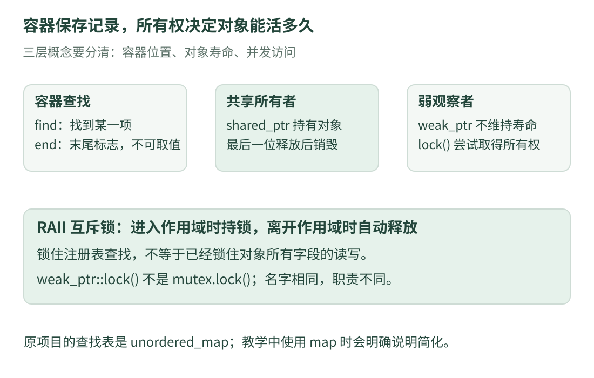

# 11 · 容器、对象与锁：看懂查找和共享所有权

前面认识了 `&`、`*`、`const`，这次把它们放回真实工程常见的句子里。目标不是背下一串符号，而是能回答四个问题：**数据放在哪里、按什么找、谁负责让它活着、谁保护同时访问？**

本课对应固定版本 `6abd1bf359356d1d603766c4b3bcabbb1d6432b2` 的两个通用组件：[`parameter.cpp`](https://github.com/julyfun/rm.cv.fans/blob/6abd1bf359356d1d603766c4b3bcabbb1d6432b2/base/param/parameter.cpp) 和 [`ObjManager.hpp`](https://github.com/julyfun/rm.cv.fans/blob/6abd1bf359356d1d603766c4b3bcabbb1d6432b2/UltraMultiThread/include/umt/ObjManager.hpp)。下方三个完整程序都是本站重写的 **C++17 标准库教学示例**，只处理显示设置与温度，不连接原工程、设备或 Python。

先看完 [C++ 第一眼](cpp-basics.md) 与 [类型和所有权](cpp-types.md)。首次阅读时，每次只完成一个完整程序：先预测输出，再对照解释。这里的“对象”指一份具有类型和生命周期的数据，例如一个整数、一段字符串或一个温度结构体。

## 1. 先把四件事分开

{ .learning-figure }

[打开大图](../../assets/learning/rmcv-source-objects.svg)

| 问题 | 本课出现的工具 | 温度例子里的意思 |
| --- | --- | --- |
| 要保存很多份数据吗？ | `vector`、`map`、`unordered_map` | 一串温度、按名字保存的设置 |
| 要寻找某一份数据吗？ | `find`、迭代器、`end` | 找名为 room 的那一项 |
| 对象应该活到什么时候？ | `shared_ptr`、`weak_ptr` | 还有使用者拥有它，就继续保留 |
| 多个执行流程同时访问会怎样？ | 互斥锁、约定好的同步方式 | 避免同时修改同一份共享数据 |

**“能找到”不等于“保证活着”，“活着”也不等于“任意并发读写都安全”。** 这三层需要分别检查。

## 2. `vector` 是一列元素，`map` 是按名字查值的表

容器可以先理解为“帮你管理多份同类元素的对象”。尖括号内填写元素类型等信息，例如 `std::vector<int>` 存整数。

| 写法 | 每一项是什么 | 常见用途 |
| --- | --- | --- |
| `std::vector<int>` | 一个整数 | 按顺序保存多次读数 |
| `std::map<std::string, double>` | 一个字符串键和一个数值 | 按设置名称查数值，按键的比较规则有序 |
| `std::unordered_map<std::string, double>` | 一个字符串键和一个数值 | 按设置名称查数值，不承诺按键排列 |

**键**是用来查找的名字；**值**是这个名字对应的数据。`"display.scale"` 可以是键，`1.5` 可以是值。这里的点号只是字符串内容，不会自动变成访问某个对象的成员。

原项目 `ObjManager` 的注册表实际使用 `unordered_map`；我们先用较直观的 `map` 学习查找语法。两者都有 `find` 和 `end`，但不能因此认为底层结构、查找复杂度、迭代顺序和迭代器失效条件都相同。

### `find` 交回的是“找到的位置”

**迭代器**是用来定位和访问容器元素的一种对象。可以先想成书页上的书签：它标记一个位置，不是自动复制一整项数据。

`find(name)` 查找键；成功时返回该元素的迭代器，失败时返回同一个容器的 `end()`。`end()` 表示尾后位置，不是最后一项，不能对它进行 `*it` 或 `it->...` 访问。

下面是自写的**阅读片段**，需要放在已有 `settings` 的函数中；下一节完整程序包含上下文：

```cpp title="先判断，再读取 · 阅读片段"
auto position = settings.find("display.scale");
if (position != settings.end()) {
    std::cout << position->second << '\n';
}
```

按从外到内的顺序读：

1. `auto` 让编译器根据右侧表达式推导变量类型，并非“这个变量可以随时换类型”。
2. `position` 是迭代器；`!=` 表示“不等于”。
3. `position->first` 是这一项的键，`position->second` 是对应的值。
4. 检查通过后再读取 `second`；若检查失败，整个花括号内的语句都不执行。

在这里，`position->second` 可以按 `(*position).second` 理解。不要把 `second` 误读成“表的第二项”：它是这一对键值中的值字段。

### 为什么纯查询通常先用 `find`

对于非 `const` 的 `map` 或 `unordered_map`，`table[key]` 不只会读取：**键不存在时，它会插入一项**。如果值类型是 `double`，新值会初始化为 `0.0`。这可能把“设置缺失”伪装成“设置为零”。

`find` 不会因为没找到而补一项。另一个接口 `at` 不会插入，但键缺失会抛出异常。它们行为不同，选择前先想清楚缺失时应当怎样处理。

## 3. 完整程序一：查设置，再汇总一串温度

温度只有四个整数，平均值应该是 `(20 + 21 + 22 + 23) / 4 = 21.5`。先手算，再读程序。程序不需要外部文件。

```cpp title="容器查询与顺序保存 · 独立教学示例"
#include <iostream>
#include <map>     // std::map：按键保存数据。
#include <string>  // std::string：文本。
#include <vector>  // std::vector：按顺序保存元素。

int main() {
    // 一项由键和值组成；这里只放一个显示设置。
    std::map<std::string, double> settings{
        {"display.scale", 1.5},
    };
    std::cout << std::boolalpha;  // bool 输出 true / false。

    const auto position = settings.find("display.scale");
    if (position != settings.end()) {
        std::cout << "scale: " << position->second << '\n';
    }

    // 查一个不存在的名字；find 不会偷偷插入新设置。
    const auto absent = settings.find("display.width");
    std::cout << "width missing: " << (absent == settings.end()) << '\n';
    std::cout << "setting count: " << settings.size() << '\n';

    std::vector<int> readings{20, 21};
    readings.push_back(22);     // 把一个值追加到末尾。
    readings.emplace_back(23); // 用参数在末尾构造一个元素。

    int total = 0;
    for (const auto& value : readings) {
        total += value;        // 等价于 total = total + value。
    }

    // 此处已知有四项；一般程序应先排除空容器，再求平均值。
    const double average = static_cast<double>(total) / readings.size();
    std::cout << "reading count: " << readings.size() << '\n';
    std::cout << "total: " << total << '\n';
    std::cout << "average: " << average << '\n';
}
```

预期输出：

```text
scale: 1.5
width missing: true
setting count: 1
reading count: 4
total: 86
average: 21.5
```

`size()` 返回元素个数。`static_cast<double>(total)` 显式把和转换成浮点数，让这里的除法保留小数；它不会改写 `total` 自身。这个小程序固定只有四个小数值；若汇总海量或极大数值，还要考虑整数溢出、浮点误差等问题。

### `for (const auto& value : readings)` 怎样一句一句读

这是**范围循环**：“依次取 readings 里的每一项，用 value 这个名字查看”。

| 部分 | 含义 | 为什么这样写 |
| --- | --- | --- |
| `auto` | 根据元素推导类型 | 不必重复写 `int` |
| `&` | 以引用访问当前元素 | 不额外复制这个元素 |
| `const` | 通过这个引用只读 | 避免循环中误改读数 |
| `:` | 左边的变量依次访问右边范围 | 不是除号或赋值号 |

对 `int` 这样很小的类型，按值循环通常也很合适。这里写引用是为了识别工程中处理字符串、大对象时常见的写法，并不表示引用永远更快。

### `push_back`、`emplace_back`、`emplace` 有何不同

`push_back` 接收一个可放入元素类型的值，把它复制或移动到末尾；`emplace_back` 把参数交给元素的构造过程，在容器尾部构造元素。对本例 `int` 的 22、23，两种写法都容易理解，不能从这个例子得出“emplace 必然更快”。

`vector` 的 `emplace_back` 总是追加到末尾；它的 `emplace` 需要提供插入位置。`map`、`unordered_map`、`set` 的 `emplace` 则是尝试插入元素，不是“往数组末尾加一项”；唯一键容器中，已有等价键时不会用新值覆盖旧值。需要“有则覆盖、无则插入”时，可以研究 C++17 的 `insert_or_assign`，不要自行猜测 `emplace` 的行为。

**追加后，旧迭代器还有效吗？** `vector` 扩容重新分配存储时，原有元素的指针、引用和迭代器会失效；即便没有重新分配，旧的尾后迭代器也会失效。本程序先追加、后遍历，循环中不改容器大小，避免了边读边扩容的问题。`unordered_map` 的重新散列也有它自己的迭代器失效规则，不能套用 `map` 的直觉。接口细节可查 [C++ 草案的容器规则](https://eel.is/c++draft/container.requirements)。

## 4. `const auto` 不能只翻译成“里面什么都不能改”

判断 `const` 保护哪一层，需要先知道变量的类型。“指针或迭代器对象自身能否改变”与“所访问的数据能否改变”是两个问题。

| 声明 | 自己能重新指向其他对象吗？ | 能通过它修改普通的 `int` 吗？ |
| --- | --- | --- |
| `int* p` | 能 | 能 |
| `const int* p` | 能 | 不能 |
| `int* const p` | 不能 | 能 |
| `const int* const p` | 不能 | 不能 |
| `const int& ref` | 引用不能改为绑定另一个对象 | 不能 |

对指针声明，从变量名出发辨认更稳妥：`p` 本身是不是 const？`*p` 所表示的对象是不是 const？`const int*` 与 `int const*` 在这里含义相同。

这里的“不能修改”指**通过这个访问入口**不能修改。若原对象本来可写，其他合法的可写入口仍可能改它。不要把 const 理解为整份数据已经被冻结或已经完成线程同步。

### `const` 迭代器对象与只读迭代器也不同

对一个非 const 的 `map` 调用 `find`，通常得到可以修改值的迭代器。将这个迭代器变量声明为 `const auto`，只是不能再给该迭代器变量赋其他位置；通常仍可以修改它指向的值。

要通过只读容器视图查询，可以先用 `const` 引用绑定容器，再调用 `find`，得到对应的只读迭代器。`map` 的键本身不能通过迭代器直接修改；值则取决于你是否具有可写访问。

## 5. 完整程序二：同一个 `const`，放的位置不同

先分清例子里的三个对象：温度整数 `room`、另一个整数 `outside`、保存地址的变量。最后再把同样的判断方法用于智能指针。

```cpp title="const 的层次与访问入口 · 独立教学示例"
#include <iostream>
#include <memory>

int main() {
    int room = 20;
    int outside = 10;

    const int* view = &room;  // 通过 view 只读；view 自身可改指向。
    view = &outside;         // 合法：没有修改 outside 的数值。
    std::cout << "view: " << *view << '\n';

    int* const fixed_address = &room; // 指针自身固定，所指整数可写。
    *fixed_address = 21;              // 改 room，不是改指针的指向。
    const int& read_only_alias = room;
    std::cout << "alias: " << read_only_alias << '\n';

    // const 放在 shared_ptr 外面：固定这个智能指针对象。
    const auto fixed_owner = std::make_shared<int>(30);
    *fixed_owner = 31; // 合法：所管理的 int 并没有被声明为 const。
    std::cout << "shared value: " << *fixed_owner << '\n';

    // const 放在模板参数里：通过此指针只读地访问 int。
    std::shared_ptr<const int> read_only_owner = fixed_owner;
    std::cout << "read-only value: " << *read_only_owner << '\n';

    // 另一个可写入口仍能改同一个 int。
    *fixed_owner = 32;
    std::cout << "read-only sees change: " << *read_only_owner << '\n';
}
```

预期输出：

```text
view: 10
alias: 21
shared value: 31
read-only value: 31
read-only sees change: 32
```

别把最后两行看成矛盾：`read_only_owner` 承诺的是“你不能通过我写入”，它仍在观察原来的那个整数。

对应原项目 [`parameter.cpp`](https://github.com/julyfun/rm.cv.fans/blob/6abd1bf359356d1d603766c4b3bcabbb1d6432b2/base/param/parameter.cpp) 的参数更新路径：局部 `found`、`ptr` 用 `const auto` 保存查找或创建得到的共享指针，而后续仍可对指向的参数对象赋值。它们的类型是 `const shared_ptr<Param>` 这一层含义，不是 `shared_ptr<const Param>`。

## 6. `shared_ptr` 管寿命，`weak_ptr` 只观察

普通局部变量在作用域结束时会销毁。如果一份对象要由多个使用者共同拥有，可以采用 `shared_ptr`。复制共享指针会增加一个共享所有者，**不会因此复制被管理的温度对象**。

当共享所有者都释放时，被管理对象会被销毁。可以类比多人保留同一份图书的使用资格：只要还有一个有效资格，图书就继续保留。这个类比只解释寿命，不代表读写内容已经同步。

`weak_ptr` 是弱观察者，不维持对象的寿命。它不能直接用 `->` 去读取对象，应先调用 `lock()`，尝试得到一个 `shared_ptr`：

- 对象还被共享拥有：得到非空共享指针；这一份返回值保留期间，对象有共享所有者。
- 对象已经失去所有共享所有者：得到空共享指针；先检查，不要解引用。

**`weak_ptr::lock()` 不是互斥锁。** 它尝试取得共享所有权，不会替你锁住温度字段。标准的成功 / 失败语义可对照 [weak_ptr 的观察接口](https://eel.is/c++draft/util.smartptr.weak.obs)。这里仅使用 C++17 已有接口；链接中的当前草案还可能列出更新标准才加入的成员。

### 为什么不要“先查过期，再当成一定可用”

如果其他线程正在释放最后一个共享所有者，两次操作之间状态可能变化。`expired()` 能告诉你检查时是否已无共享所有者，却不能凭这个结果保证稍后的访问。实际需要使用对象时，直接尝试 `lock()`，检查并保留返回的共享指针。

## 7. 完整程序三：名字目录不负责让对象一直活着

这个例子建立一个“小型温度目录”。目录保存名字与弱指针，外部的共享指针负责拥有温度对象。它用互斥锁保护目录操作，但**没有启动线程**。

先预测：`owner.reset()` 后，还有一份 `borrowed` 拿着对象，温度会不会立刻消失？再想：离开花括号后，又剩下谁？

```cpp title="弱指针目录、静态成员与 RAII · 独立教学示例"
#include <iostream>
#include <memory>
#include <mutex>
#include <string>
#include <unordered_map>

struct Temperature {
    int celsius;

    // 构造函数：创建对象时设置温度。
    explicit Temperature(int initial) : celsius(initial) {}
};

class ReadingBook {
public:
    // 静态成员函数：按类名调用，不需要先创建一本 ReadingBook。
    static void remember(const std::string& name,
                         const std::shared_ptr<Temperature>& value) {
        std::unique_lock<std::mutex> guard(mutex_);
        // 目录只保留弱指针；同名时显式覆盖旧登记。
        entries_.insert_or_assign(name, value);
    } // guard 销毁，自动释放 mutex_。

    static std::shared_ptr<Temperature> find(const std::string& name) {
        std::unique_lock<std::mutex> guard(mutex_);
        const auto position = entries_.find(name);
        if (position == entries_.end()) {
            return nullptr; // 即使提前 return，guard 也会正常释放锁。
        }
        return position->second.lock(); // 尝试取得对象的共享所有权。
    }

private:
    // C++17 inline 静态变量：本类共享一份目录和它对应的互斥锁。
    inline static std::mutex mutex_;
    inline static std::unordered_map<std::string,
                                     std::weak_ptr<Temperature>> entries_;
};

int main() {
    std::cout << std::boolalpha;
    auto owner = std::make_shared<Temperature>(20);
    std::weak_ptr<Temperature> observer = owner; // 不增加共享所有者。
    ReadingBook::remember("room", owner);

    {
        auto borrowed = ReadingBook::find("room");
        if (borrowed) { // 取得非空 shared_ptr 才读取。
            std::cout << "borrowed: " << borrowed->celsius << '\n';
            owner.reset(); // 释放 owner 的所有权，borrowed 仍然拥有。
            std::cout << "owner empty: " << (owner == nullptr) << '\n';
            std::cout << "still alive: " << borrowed->celsius << '\n';
        }
    } // borrowed 离开作用域，被管理对象已没有共享所有者。

    auto after = observer.lock(); // 已销毁，得到空共享指针。
    std::cout << "observer can own: " << static_cast<bool>(after) << '\n';
    std::cout << "lookup after release: "
              << static_cast<bool>(ReadingBook::find("room")) << '\n';
    std::cout << "unknown name: "
              << static_cast<bool>(ReadingBook::find("outside")) << '\n';
}
```

预期输出：

```text
borrowed: 20
owner empty: true
still alive: 20
observer can own: false
lookup after release: false
unknown name: false
```

### 再拆开创建对象的那一句

`Temperature` 与 `int` 一样，是这里可以使用的类型名，只是它由我们自己定义。`Temperature(int initial)` 与类型同名，是构造函数；它没有普通函数那样的返回类型。冒号后面的 `celsius(initial)` 表示在进入函数体之前，用 initial 初始化字段 celsius。末尾的空花括号表示初始化后不需要再做额外工作。

`explicit` 限制某些隐式转换，避免一个整数在你没有明确创建意图的地方悄悄变成温度对象；它并不禁止这里显式创建对象。`std::make_shared<Temperature>(20)` 创建一个共享管理的 Temperature，并把 20 作为构造参数传进去。

`static_cast<bool>(after)` 把共享指针是否非空明确转换成布尔值；`if (borrowed)` 则是在条件位置直接进行对应检查。两种写法都不是在检查温度是否为零。

### 对着作用域画时间线

| 时刻 | 共享所有者 | 弱观察者 / 目录 | 温度对象 |
| --- | --- | --- | --- |
| 创建后 | owner | observer、目录弱指针 | 活着 |
| find 成功后 | owner、borrowed | 同上 | 活着 |
| owner.reset 后 | borrowed | 同上 | 活着 |
| 离开内层花括号 | 无 | 弱指针还可以存在 | 已销毁 |
| 再次 lock | 得到空指针 | 弱指针不能把对象“复活” | 仍已销毁 |

本例中的弱目录会保留那个已经过期的名字。**原项目不是完全一样的实现**：原 `ObjManager` 的析构函数会从注册表删除自己的名字，且其 `create`、`find_or_create` 等函数另有各自的分支。这个教学程序只演示“弱目录与外部持有者”，不能代替原函数的完整语义。

## 8. `static` 与 `inline`：这份目录到底属于谁

第三个程序里，`ReadingBook::find(...)` 中的 `::` 表示“在这个类的作用域内查找成员”。`find` 是静态成员函数，不依赖某一个 ReadingBook 实例，因此不需要先写一个 `ReadingBook book`。

`entries_` 与 `mutex_` 是静态数据成员，归这个类共享；不是每调用一次函数就新建一份。把互斥锁与要保护的同一份目录对应起来，才有同步作用。

`inline static` 中的 `inline` 在这里解决**变量定义可以放在头文件、被多个编译单元包含**的语言规则问题：符合规则的定义表示同一个实体。它不表示“每处代码各自得到一份目录”，也不承诺运行速度更快。[静态数据成员规则](https://eel.is/c++draft/class.static.data)可作为进一步核对来源。

原项目把这些静态成员写在类模板相关的定义中。要额外记住：**不同模板实参形成的类类型，可以各自拥有自己的静态成员**。因此 `ObjManager<A>` 和 `ObjManager<B>` 不是天然共用一张所有类型的大表；对象的类型和名称共同参与区分。

源码里的 `__attribute__((visibility(...)))` 属于编译器相关写法，用于符号可见性；不要把它当成所有 C++17 编译器都支持的标准语法。本课完整程序没有使用它。

## 9. RAII 锁：离开房间时，为什么会自动交钥匙

**作用域**是一段变量能被使用、局部对象会在结束时正常销毁的代码范围，常见边界就是一对花括号。**析构函数**是在对象寿命结束时执行的清理操作。

RAII 是一种资源管理方式：把“取得资源”和“释放资源”绑定到对象的构造与析构。第三个程序的 `guard` 在构造时锁住互斥锁，在正常离开作用域时解锁；中间提前 `return`，或者异常传播导致正常的栈展开，也会执行这份清理。

你可以把互斥锁想成目录室的一把钥匙：遵守同一把锁的访问者轮流进入。`std::unique_lock<std::mutex>` 是负责保管这把钥匙的标准库对象。其基本约定见 [unique_lock 规则](https://eel.is/c++draft/thread.lock.unique)。

本例每次都向构造函数传入互斥锁，立即加锁；`unique_lock` 也有不持锁的默认构造、延迟加锁等其他用法，所以不要把名字本身当成“此时必然持锁”的证明。原工程里的 `std::unique_lock lock(...)` 省略了尖括号，依赖 C++17 的类模板实参推导；本例显式写出来，方便初学者看清锁类型。

### 为什么锁住目录，温度数值仍需另外检查

在 `ReadingBook::find` 返回后，局部 guard 已销毁，目录锁已经释放。调用者仍拥有返回的温度对象，**这只说明对象寿命仍受管理**。

如果接下来两个线程直接对 `Temperature::celsius` 并发读写，且其中至少一个执行写入，目录锁不会自动保护它们。是否需要对象自己的锁、原子变量或其他同步策略，要根据所有访问路径设计；不能在调用 `find` 时锁一下，就声称以后拿到的数据都线程安全。

| 看见的工具 | 可以得出的结论 | 还不能得出的结论 |
| --- | --- | --- |
| `shared_ptr` | 有共享所有权管理机制 | 里面每个字段都可随意并发读写 |
| `weak_ptr::lock()` 成功 | 返回值保留期间有共享所有权 | 已经锁住对象的数据 |
| 注册表操作持有互斥锁 | 遵守这把锁的注册表访问受到同步 | 查出对象后的所有操作也受到该锁同步 |

这也是阅读原参数组件时需要分开审查的层次：共享指针的控制块、名字注册表、参数值本身，不是同一份东西。

## 10. 回到原项目：怎样顺着类型找到真正的数据

此处只核对通用组件中可直接看见的结构，不展开专用功能。

| 位置 | 你会遇到的写法 | 用本课的方法怎样阅读 |
| --- | --- | --- |
| `parameter.cpp` 的整数列表转换 | `vector` 与尾部追加 | 一个个读取整数，再放进顺序容器 |
| `parameter.cpp` 的参数持有集合 | `set<shared_ptr<Param>>` | 集合中的元素是共享指针，它们维持相应参数对象的寿命 |
| `ObjManager.hpp` 的类型别名 | `sptr`、`wptr` | 分别指向共享指针类型、弱指针类型的别名，不是新关键字 |
| `ObjManager.hpp` 的名字注册表 | `unordered_map` | 键是名字，值是弱指针；每项不是参数值的直接副本 |
| `ObjManager.hpp` 的查找 | 迭代器、尾后检查、弱指针提升 | 先确认名字是否存在，再尝试取得共享所有权 |
| `ObjManager.hpp` 的静态锁 | 函数内局部锁对象 | 将这次注册表操作的锁寿命限制在函数作用域内 |

`set` 是保存互不等价元素的有序容器；这里它保存共享指针，而非一个“按字符串名称查参数”的表。为什么要保存这些共享指针？因为如果只有弱指针注册表，没有其他共享所有者，参数对象就无法仅靠名字目录维持寿命。具体持有时长仍要看保存它们的管理对象活多久。

### 嵌套表达式不必一次读完

看到“迭代器 → 值 → lock”的链条时，按类型拆成三步：迭代器定位键值项，`second` 取出弱指针，弱指针尝试交回共享指针。不是先拿到参数数值，更不是给参数字段加了互斥锁。

在 `names()` 里还会看见 `const auto& [n, w]`。方括号是 C++17 的**结构化绑定**：把一项的两个组成部分分别起名。这里 n 对应名字，w 对应弱指针；配合 `const auto&` 只读地引用原项，不是定义一个长度为二的数组。

### Python 接口宏先只识别边界

文件末尾的 `UMT_EXPORT_OBJMANAGER` 一类写法是项目定义的宏，不是 C++ 自带函数。宏用于生成一组 Python 绑定相关代码，`pybind11` 是承担 C++ / Python 接口衔接的库。

识别三个符号就够完成第一次阅读：宏定义末尾的反斜杠把定义续到下一行；`##` 用来拼接预处理记号；`#` 可把宏参数转成字符串字面量。它们属于编译前的预处理规则，不能照搬成普通 C++ 表达式。

先理解对象的类型与寿命，再读接口导出。看到 Python 模块声明不代表 C++ 函数已经自动完成数据同步，也不代表当前示例需要安装 Python 绑定库。

## 11. 练习：先预测，再解释原因

### 练习一：查不到，容器会不会变大

把完整程序一中的 `find("display.width")` 保留，再在打印 `setting count` 之前插入一行 `settings["display.width"];`。这一行故意使用下标接口。原先得到的 absent 仍表示“那次 find 没找到”，但现在容器元素个数是多少？新增值是多少？

??? tip "先想这两个动作发生的先后"

    那次 find 发生在插入之前；它的结果不等于一次未来查询。map 插入不会使现有迭代器失效，但原有尾后迭代器也不会神奇变成新元素的迭代器。不要用 absent 解引用。

??? example "展开答案"

    元素个数为 2，新键对应的 double 被初始化为 0.0。原先打印 missing 的位置仍在插入之前，因此那行依旧输出 true。若想知道插入后的查询结果，应重新调用 find。此题特意选用 map，不把结论推广到所有容器的所有修改方式。

### 练习二：是哪一层不能改

在完整程序二中，尝试分别判断 `view = &room`、`*view = 25`、`*fixed_address = 25`、`fixed_address = &outside` 是否允许。先只用纸笔作答；不需要把所有错误写法同时粘进程序。

??? example "展开答案"

    依次为：允许、不允许、允许、不允许。view 是指向 const int 的可变指针；fixed_address 是指向可变 int 的 const 指针。被禁止的写法应由编译器拒绝，不是留到运行时猜结果。

### 练习三：多保留一份共享所有权会怎样

在完整程序三的内层花括号之前，增加 `auto retained = owner;`。其余不变，最后三行输出会怎样？说明目录的弱指针是否负责维持对象寿命。

??? example "展开答案"

    observer can own 变成 true，lookup after release 变成 true，unknown name 仍是 false。因为 retained 一直活到 main 的作用域结束，内层 borrowed 销毁后仍有一个共享所有者。目录仍只保存弱指针；对象活着的原因是 retained，而非目录。

    修改后 after 成功取得共享所有权，它自身也会成为持有者。再次推演更晚的销毁时间时，不能漏掉 after。

## 12. 合上页面前，检查自己是否真的读懂

用自己的话解释下面四句话，能解释通再继续读原文件：

1. `find` 返回的位置需要与同一容器的 `end` 比较；end 不能当元素读取。
2. const 指针对象与只读数据入口不同，引用也不会自动复制一份数据。
3. 弱指针不保活；成功取得并保留共享指针，才有对应的共享所有权。
4. 目录锁、对象寿命和对象字段的并发访问，要分别核对。

本课三个程序都可以按 [C++ 环境教程](../../programming/cpp/setup.md)中的 C++17 方式独立编译；不用运行原仓库。若暂时不配置编译器，逐行跟踪表格与预期输出，也可以完成这次阅读练习。

[返回课程路线](index.md) · [上一课：模板、转发与 Lambda](cpp-source-templates.md) · [下一课：OpenCV 代码精读 →](opencv-reading.md)
