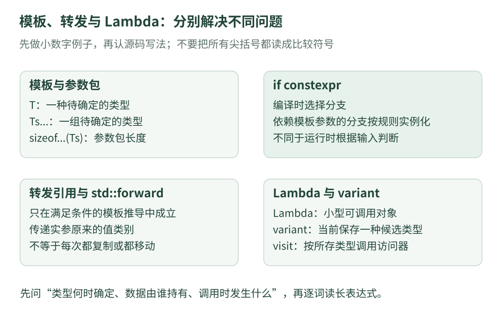

# 10 · 模板、转发与 Lambda：逐步读懂长表达式

读过上一课后，我们已经知道：类可以保存成员，函数通过参数接收输入。现在遇到新的问题：**同一套接口，为什么能处理不同类型、不同数量的输入？** 这就是模板与参数包要解决的事情。

本课顺着原项目的通用基础组件学习语法：参数管理中可以看到多类型参数和访问器，共享对象管理器中可以看到变参模板与转发。所有完整程序均为本站独立编写的 C++17 标准库示例，不包含原项目检测业务，也不要求安装或运行原工程。

本课内容比上一课多。零基础建议分三次读：先理解模板与参数包；再理解 Lambda；最后连接到 `variant`。每次只追踪一个示例的输入和输出，不需要一遍记住全部尖括号。

## 1. 一张图先区分这些工具的任务

{ .learning-figure }

[打开大图](../../assets/learning/rmcv-source-templates.svg)

| 工具 | 解决的问题 | 不要混淆成什么 |
| --- | --- | --- |
| 模板 | 相似操作能否按不同类型生成具体版本 | 运行中随意改变变量类型 |
| 参数包 | 能否接收数量不固定的一组参数 | 一个装满任意对象的普通容器 |
| 转发 | 中间函数能否保留调用者输入的有关类型与值类别信息 | 自动把所有输入都搬走 |
| Lambda | 能否在使用处写一个小的可调用对象 | 只能写一行的特殊函数 |
| `variant` | 一个值能否在有限几种类型中选择一种保存 | 同时保存全部候选值 |
| `if constexpr` | 模板的不同实例能否选择不同编译分支 | 根据每帧输入数据切换类型 |

先知道每个工具解决什么问题，读实际组合时才不会把所有符号挤成一团。

## 2. 模板：先把“类型空位”填好

假如有整数列表和小数列表，我们都想“有数据就取第一项，没有就用备用值”。把处理步骤写两遍容易漏改。**函数模板**允许先用 `T` 代表待确定的类型，编译器在需要时生成相应的函数实例。

```cpp title="同一规则读取整数与小数列表 · 独立教学示例"
#include <iostream>
#include <vector>

// T 是类型参数，不是程序运行时输入的某个数。
template<class T>
T first_or(const std::vector<T>& values, const T& fallback) {
    if (values.empty()) {
        return fallback;  // 返回一个 T 类型的值，不返回局部引用。
    }
    return values.front();  // 非空之后才取第一项。
}

int main() {
    const std::vector<int> counts{3, 5};
    const std::vector<double> empty_readings{};

    std::cout << "first count: " << first_or(counts, 0) << '\n';
    std::cout << "fallback: " << first_or(empty_readings, 1.5) << '\n';
}
```

预期输出：

```text
first count: 3
fallback: 1.5
```

第一处调用中，列表元素类型是 `int`，备用值 `0` 也是 `int`，因此推导出 `T` 为 `int`。第二处推导为 `double`。注意两次都按照已经确定的类型处理数据，不是一个函数执行到一半突然把整数变量变成小数变量。

`template<class T>` 中的 `class` 表示这里声明一个类型参数，不要求 `T` 一定是用 `class` 定义的类型。它可以是 `int`、`double` 或满足函数要求的自定义类型。在这里写 `typename T` 也可以。

类型推导需要一致。若列表是 `vector<double>`，备用值却写整数 `0`，这个模板的两处参数可能对 `T` 给出冲突信息，不会自动按照“数学上差不多”替你选一个。先写成 `0.0`，让意图清楚。

### 为什么模板函数经常放在头文件

调用处通常需要看见模板定义，编译器才能根据具体类型实例化相应代码。这解释了为什么很多 `.hpp` 文件不仅有声明，还有模板函数体。工程也可以使用显式实例化等组织方式，但初学时不要把模板函数体随意移到另一个 `.cpp` 后，期待所有新类型都自动链接成功。

在原项目的[参数头文件](https://github.com/julyfun/rm.cv.fans/blob/6abd1bf359356d1d603766c4b3bcabbb1d6432b2/base/param/parameter.hpp)中，按类型读取参数的接口也使用模板。读这种调用时，先分清尖括号里给的是类型，圆括号里给的是名称等实际输入；随后仍要检查缺失值和类型不符的分支。

## 3. 参数包：三个点不是省略没写完

真实的对象创建函数可能接收一个参数，也可能接收两个。**变参模板**用参数包表达“这里可以有零个或多个模板参数”。**参数包**不是 `vector`；它是一组在模板实例化时参与展开的参数。

下面完整程序里有一行 `template<class Object, class... Args>`。把它拆开读：

- `Object`：希望创建的对象类型。
- `Args`：一包参数类型，数量由这次调用决定。
- `Args&&... args`：与这些类型对应的一包函数参数。
- `args...` 或转发表达式后的 `...`：按这包参数逐项展开，形成一串实参。

不能把三个点都读成“后面还有随便写的代码”。它出现在声明和表达式中，职责不同，但都与参数包有关。完整规则可查 [C++ 草案的可变参数模板](https://eel.is/c++draft/temp.variadic)。

## 4. 转发：中间人别擅自改掉输入的性质

先用便于观察的定义：**左值**常见于有名字、可以明确标识的对象，例如变量 `original`；**右值**包括本例临时创建的字符串。完整值类别规则比“有名、无名”更丰富，这个类比先用于理解当前例子。

我们给字幕类型写两个构造函数：一个接收已有字符串的只读引用，一个接收字符串右值引用。它们都可以创建字幕，但会显示不同提示，让我们看到中间的创建函数有没有保留正确的调用方式。

```cpp title="经由工厂函数转交两项构造参数 · 独立教学示例"
#include <iostream>
#include <memory>   // std::shared_ptr、std::make_shared。
#include <string>
#include <utility>  // std::move、std::forward。

struct Caption {
    std::string text;
    int version;

    // 读取一个已有字符串；本例将内容复制进自己的成员。
    Caption(const std::string& source, int number)
        : text(source), version(number) {
        std::cout << "constructor: read existing text\n";
    }

    // 接收右值字符串；显式允许成员从它移动构造。
    Caption(std::string&& source, int number)
        : text(std::move(source)), version(number) {
        std::cout << "constructor: accept temporary text\n";
    }
};

template<class Object, class... Args>
auto create_object(Args&&... args) -> std::shared_ptr<Object> {
    // 把每项输入按推导到的类型信息转交给构造函数。
    return std::make_shared<Object>(std::forward<Args>(args)...);
}

int main() {
    std::string original = "alpha";

    auto first = create_object<Caption>(original, 1);
    auto second = create_object<Caption>(std::string{"beta"}, 2);

    std::cout << first->text << ':' << first->version << '\n';
    std::cout << second->text << ':' << second->version << '\n';
    std::cout << "source: " << original << '\n';
}
```

预期输出：

```text
constructor: read existing text
constructor: accept temporary text
alpha:1
beta:2
source: alpha
```

这不是原项目的对象注册表：没有名称查重、弱引用或互斥锁。我们保留的只有“创建入口把参数转交给构造函数”这一条语法线索。

### 把第一次调用完整展开到脑中

第一次调用明确给出要创建的类型是 `Caption`；剩下的输入类型由函数参数推导。它接收已有字符串 `original` 和整数 `1`，再把两项转交给 `make_shared`，后者负责构造并共享管理字幕对象。

`std::forward<Args>(args)...` 可以按“给这一包输入中的每项套上相应的转发操作，再用逗号隔开传进去”理解。它不创建一个名为 `args` 的数组，也不表示把所有参数揉成一个参数。

参数名 `args` 一旦写在函数体表达式里，它本身是有名字的表达式。即使调用者传来临时对象，单纯再次使用参数名，也不能自动保留原先的右值性质。`std::forward` 与模板推导配合，才把该保留的信息交给下一层。

### `&&` 为什么有时叫右值引用，有时叫转发引用

字幕构造函数中的 `std::string&&` 已经固定为一个具体类型的右值引用。创建函数中的 `Args&&` 则处在需要推导类型的模板参数位置，符合**转发引用**的情形，可以接住不同值类别的输入。

不要看到所有 `&&` 都叫转发引用。是否属于转发引用，要结合模板推导等具体条件判断。初学本例只需抓住：已知字符串类型的构造函数与可推导类型的工厂函数，承担不同任务。

`std::move` 也不是“现在立刻把字节搬走”的命令，而是把表达式转换为允许移动语义参与重载选择的形式。最终是否发生移动、由什么操作完成，要看后续选择的构造函数或赋值操作。这个示例的提示证明选中了哪一个构造函数，不声称测量了分配次数或性能。

原项目的[共享对象管理器](https://github.com/julyfun/rm.cv.fans/blob/6abd1bf359356d1d603766c4b3bcabbb1d6432b2/UltraMultiThread/include/umt/ObjManager.hpp)也出现相同类别的转交写法。先追清参数从入口流向哪里，再去读锁、注册表和继承，不要把三件事同时展开。

## 5. Lambda：在使用处写一个小的可调用对象

**可调用对象**是指可以像函数一样用圆括号调用的对象。Lambda 表达式会创建这种对象，适合把一小段处理规则交给另一个函数，例如比较、过滤或格式化。

它的基本外观是“捕获列表、参数列表、函数体”。捕获列表在方括号里，决定如何使用周围作用域的变量。下面特意让外部变量改变一次，观察两种捕获方式。

```cpp title="按值捕获与按引用捕获的区别 · 独立教学示例"
#include <iostream>

int main() {
    int limit = 10;

    // 按值捕获：创建 Lambda 时，保存 limit 当时的副本。
    auto fixed_rule = [limit](int value) {
        return value > limit;
    };

    // 按引用捕获：调用时读取仍然存在的那个外部变量。
    auto live_rule = [&limit](int value) {
        return value > limit;
    };

    limit = 20;
    std::cout << std::boolalpha;
    std::cout << "fixed: " << fixed_rule(15) << '\n';
    std::cout << "live: " << live_rule(15) << '\n';
}
```

预期输出：

```text
fixed: true
live: false
```

按值规则比较的是 `15 > 10`，按引用规则比较的是 `15 > 20`。本例两次调用都在 `limit` 仍然存在时完成。若把按引用捕获的 Lambda 交给更晚运行的任务，而 `limit` 已销毁，再访问就会出问题；Lambda 不会因为捕获引用就自动管理被引用变量的寿命。

空捕获列表 `[]` 表示不捕获周围的自动存储期局部变量。它仍可以使用自己的参数及相应可见的全局名字。看到 `[this]` 时，要继续确认原对象何时销毁：捕获当前对象的指针，不等于复制整个对象并保证它永远活着。

若参数写 `const auto&`，就是泛型 Lambda：编译器根据传来的类型生成相应的调用版本。它没有跳过静态类型检查；不适用于某类输入的操作，仍可能在实例化时被拒绝。

## 6. `variant` 与 `get_if`：先查标签，再取里面的值

参数文件可能有开关、小数和文字。把它们都强行改成字符串会丢掉类型信息。`std::variant<bool, double, std::string>` 表示一个对象可以保存其中一种候选类型；当前装哪种类型，访问时要区分。

先读下面程序的前半段：输入保存小数 2.5，用 `get_if<double>` 查询会成功，用 `get_if<std::string>` 查询会失败。失败用空指针表示，不会帮你把 2.5 自动转换成文字。

后半段使用 `visit` 选择合适的处理函数。**访问器**可以理解成“给每种候选值准备处理规则的一组入口”。先看运行结果，再解释 `Cases` 的写法。

```cpp title="查询类型并分别显示三种参数 · 独立教学示例"
#include <iostream>
#include <string>
#include <variant>

// 将几个可调用对象的调用入口放到同一个类型中。
// 这是通用的重载组合写法，名字 Cases 为本站示例所取。
template<class... Handlers>
struct Cases : Handlers... {
    using Handlers::operator()...;
};

// C++17 的推导指引：用传入的处理器类型形成 Cases 类型。
template<class... Handlers>
Cases(Handlers...) -> Cases<Handlers...>;

int main() {
    using Setting = std::variant<bool, double, std::string>;
    Setting item{2.5};

    // &item 取这个 variant 对象的地址。
    if (const double* number = std::get_if<double>(&item)) {
        std::cout << "double available: " << *number << '\n';
    }

    std::cout << std::boolalpha;
    std::cout << "string available: "
              << (std::get_if<std::string>(&item) != nullptr) << '\n';

    // 三个 Lambda 分别接收 bool、double 和字符串。
    const auto print = Cases{
        [](bool value) {
            std::cout << "bool: " << value << '\n';
        },
        [](double value) {
            std::cout << "number: " << value << '\n';
        },
        [](const std::string& value) {
            std::cout << "text: " << value << '\n';
        }
    };

    std::visit(print, item);  // 当前是 double，选择小数入口。

    item = std::string{"preview"};
    std::visit(print, item);  // 当前是字符串，选择文字入口。

    item = true;
    std::visit(print, item);  // 当前是 bool，选择开关入口。
}
```

预期输出：

```text
double available: 2.5
string available: false
number: 2.5
text: preview
bool: true
```

### `get_if` 的两个输入不是一回事

尖括号中的 `double` 表示“希望读到的候选类型”；圆括号中的 `&item` 表示“要检查哪个 variant”。检查成功时返回所存数值的指针，检查失败时返回空指针。

这个按类型查询的写法要求指定类型在候选项中恰好出现一次。本例候选表满足这个条件。拿到指针后，如果原 `variant` 被销毁或切换到其他候选值，先前指向所存值的指针可能失效，不应长期保存后无条件使用。标准规则可核对 [C++ 草案的 variant 访问接口](https://eel.is/c++draft/variant.get)。

本例赋值切换的是 `variant` 当前保存的候选值，`item` 自身的类型始终还是同一个 `Setting`。不要把它理解成绕开 C++ 类型系统的“万能变量”。

## 7. 把组合访问器的每个符号拆开

程序中 `Cases` 那几行可以暂时当成工具，但原项目的参数打印器使用了相同类别的构件，所以值得慢慢看清。

1. 每个 Lambda 都有自己的类型。我们传入三个 Lambda，就得到三个处理器类型。
2. `Handlers...` 表示这一包处理器类型。
3. 类名后面的冒号表示继承；`Handlers...` 在基类列表中展开，让这个新类型继承每个处理器。
4. `operator()` 是调用运算符的名字；一个对象能写成 `object(value)`，常与它提供这个调用入口有关。
5. `using Handlers::operator()...;` 把各个基类的调用入口引入同一作用域，供重载选择使用。
6. 推导指引告诉编译器：根据传入的处理器类型，推导这个类模板的参数，从而可以用 `Cases{...}` 这样的写法。

**重载**就是同一个调用名字拥有不同参数形式，编译器根据输入选择可用版本。本例三个处理器分别明确接收三种类型。真实工程有时会把泛型处理器与更具体的处理器组合起来，此时更要检查重载匹配，不能简单按“写在前面的先执行”理解。

`std::visit` 根据当前保存的候选值调用访问器，不是依次执行所有 Lambda。对普通的这项 `visit` 调用，处理规则需要能覆盖所有候选类型；如果返回结果，各候选分支还需要满足返回类型等接口要求。本例各入口都返回 `void`，也就是不交回结果，只显示一行。

在少数异常情况下，`variant` 还可能处于无值状态；那时访问有相应异常行为。本例仅做这些成功赋值，没有声称所有更复杂类型的构造与赋值都永不失败。接口细节可查 [C++ 草案的 visit 规则](https://eel.is/c++draft/variant.visit)。

## 8. `if constexpr`：让不同模板实例走不同分支

`if` 经常根据**这次运行的值**选择路径，例如是否为空。`if constexpr` 则要求条件是可以在编译时确定的常量表达式。它在模板中很有用：实例化某个类型时，可以不实例化被舍弃分支中依赖模板参数的内容。

先不用矩阵或图像，只给几个数求和。停止条件是“剩余参数的数量为零”。这是模板实例化时就确定的事，因此能用 `if constexpr`。

```cpp title="用参数包逐项相加并在空尾部停止 · 独立教学示例"
#include <iostream>

template<class First, class... Rest>
auto add_values(First first, Rest... rest) {
    // sizeof... 得到参数包中的项数，不是数据占用的字节数。
    if constexpr (sizeof...(rest) == 0) {
        return first;  // 只有这一项时，直接返回，不继续递归。
    } else {
        // 先求后面这些数的和，再加上当前的第一项。
        return first + add_values(rest...);
    }
}

int main() {
    std::cout << "sum: " << add_values(3, 4, 5) << '\n';
    std::cout << "single: " << add_values(2.5) << '\n';
}
```

预期输出：

```text
sum: 12
single: 2.5
```

第一次调用的思路是：`3 + (4 + 5)`。最后一层只有 `5`，剩余参数为零，就返回 5。编译器为对应的参数数量实例化相应版本，不会在最后一层继续要求一个“没有第一个参数”的调用。

若这里改成普通 `if`，即使条件在你看来总能算出真假，模板实例中的另一条分支仍会参与相应检查，不能利用相同的舍弃分支规则；最终会碰到没有匹配的空参数调用。

这不是“舍弃分支里随便写错都没关系”。代码仍要满足适用的语法和模板规则；尤其模板之外的 `if constexpr` 不能当成关闭所有检查的开关。并且 `constexpr` 这个词不代表程序必然在编译时计算出所有最终数值，本例主要用它选择合法的模板分支。

这个求和例子只接受至少一个参数，且要求相关加法与返回推导成立。它没有处理整数溢出，也没有承诺任意类型都能相加。对于本例小整数，手算和输出一致；换成不同浮点数据，还要考虑精度与求和顺序。

原仓库的[通用归约辅助函数所在文件](https://github.com/julyfun/rm.cv.fans/blob/6abd1bf359356d1d603766c4b3bcabbb1d6432b2/aimer/auto_aim/detector_opencv/TRTModule.cpp)可用于定位 `if constexpr`、参数包长度与转发这一组语法。这里仅用普通数字说明语言机制，不复刻那个文件的专用检测流程。参数管理的访问器则是另一种组合方式，不能把两处实现混为同一个函数。

## 9. 回到真实代码，先问“类型何时确定”

现在可以把源码阅读分成三层：

- **编译时的类型层**：模板参数、参数包、别名、继承和 `if constexpr`，决定生成哪些合法的具体版本。
- **运行时的数据层**：哪个参数名存在、某个 `variant` 当前保存什么值、查找是否成功。
- **对象寿命与共享层**：输入是否被复制、引用指向谁、共享对象还由谁持有、读写是否同步。

例如，按 `double` 查询参数时，希望得到的类型在编译时已明确；这个名称是否存在、盒子当前是否装着 `double`，则要运行时检查。看到 `get_if` 返回空指针，不能只归结为模板写错，也可能只是当前保存类型不符。

在[参数实现文件](https://github.com/julyfun/rm.cv.fans/blob/6abd1bf359356d1d603766c4b3bcabbb1d6432b2/base/param/parameter.cpp)中，访问器用于把值交给适合它的打印处理。它与 `variant` 的当前候选值有关。对象注册入口中的转发则与输入如何交给构造函数有关。名字里都有参数，不代表它们解决同一个问题。

## 10. 练习：把输出先写在纸上

依次尝试三道题：

1. Lambda 示例中，不改变 `limit`，两次输入都为 15，会显示哪两个布尔值？
2. `variant` 示例先保存 `true`，紧接着按 `double` 查询，会自动得到 1.0 吗？
3. 求和示例传入 `3、4、5、6`，需要在哪一层停止，最后是多少？

??? tip "先找判断依据"

    第一题区分捕获时的副本与调用时的原变量。第二题看候选类型而不是数学转换。第三题逐项剥去第一个参数，直到只剩一个数。

??? example "展开答案与理由"

    第一题两个规则都比较 15 与 10，因此都是 true。

    第二题不会自动变成 1.0。按 double 查询，当前 bool 不匹配，返回空指针。需要先检查，不能直接解引用。

    第三题在只剩 6 时停止，计算为 3 + (4 + (5 + 6))，结果为 18。不是等待某个数值等于零才停止，而是参数包为空时停止继续展开。

    再回想工厂示例：把已有字符串交进去，不应因为中间人出现，就无条件强行移动走它。转发的目的正是保留合适的调用性质，而不是保证所有输入走同一个构造函数。

[返回课程路线](index.md) · [上一课：头文件、类与接口](cpp-source-basics.md) · [下一课：容器、对象与锁 →](cpp-source-objects.md)
