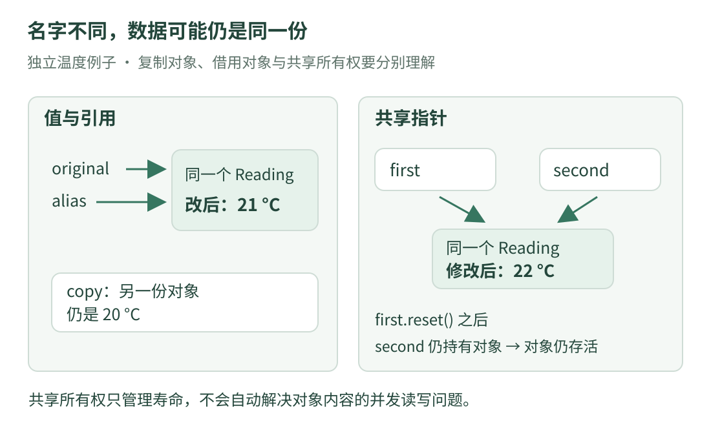

# 03 · 类型与所有权：读懂 &、* 和尖括号

这一课解决源码阅读中最容易卡住的一件事：**两个变量名字不同，它们会不会在修改同一份数据？** 先用普通对象理解，再看原项目中的共享指针。

先读完[第二课](cpp-basics.md)。本课的温度对象是独立例子，跟原项目设备没有连接。

## 1. 值、别名和指针，分开画

{ .learning-figure }

[打开大图](../../assets/learning/rmcv-ownership.svg)

- **值复制**：通常得到另一份对象；修改新对象不修改原来的这个对象。对象若内部持有共享资源，还需继续看资源是否共享。
- **引用**：给已有对象另起一个名字；不是自动产生第二份数据。
- **指针**：保存能指向对象的信息；可能为空，访问前要确认对象存在且仍然有效。
- **共享指针**：除了指向对象，还参与共享所有权管理；最后一个共享所有者释放后，被管理对象通常随之销毁。

“引用就像别名”是入门理解。它不意味着随意引用局部变量后，变量就能永远活着。

## 2. 完整例子：修改后谁跟着变

```cpp title="复制、引用与共享对象 · 独立教学示例"
#include <iostream>
#include <memory>  // std::make_shared 与 std::shared_ptr。

// struct 把相关数据放在一起；这里仅有一个摄氏温度字段。
struct Reading {
    double celsius;
};

int main() {
    Reading original{20.0};
    Reading copy = original;     // 复制这个只含 double 的对象。
    Reading& alias = original;   // 给 original 起一个别名。

    alias.celsius = 21.0;  // 修改的是 original，并非 copy。
    std::cout << "original: " << original.celsius << '\n';
    std::cout << "copy: " << copy.celsius << '\n';

    auto first = std::make_shared<Reading>(Reading{20.0});
    const auto second = first;  // 两个 shared_ptr 共享同一 Reading。

    // const 限定 second 自身；此处所指向的 Reading 仍可修改。
    second->celsius = 22.0;
    std::cout << "shared: " << first->celsius << '\n';

    // 释放 first 的所有权，second 仍然拥有该对象。
    first.reset();
    std::cout << std::boolalpha;
    std::cout << "first empty: " << (first == nullptr) << '\n';
    std::cout << "second still owns: " << second->celsius << '\n';
}
```

预期输出：

```text
original: 21
copy: 20
shared: 22
first empty: true
second still owns: 22
```

`Reading{20.0}` 创建一个对象，把字段初始化为 20。`struct` 定义最后的分号不能省略；`celsius` 是本例自己起的成员名，不是 C++ 关键字。

## 3. 同一个符号，位置不同含义不同

| 写法 | 这里的含义 | 读法 |
| --- | --- | --- |
| `Reading& alias` | 声明引用 | alias 是 Reading 的引用 |
| `&object` | 取对象地址 | 得到指向 object 的指针 |
| `Reading* ptr` | 声明指针 | ptr 的类型是 Reading 指针 |
| `*ptr` | 解引用 | 访问 ptr 指向的对象，前提是指针有效 |
| `object.celsius` | 对象成员访问 | 读取这个对象的温度字段 |
| `ptr->celsius` | 通过指针访问成员 | 在此等价于 `(*ptr).celsius` |
| `a * b` | 数值乘法等 | 具体行为还取决于 a、b 的类型 |

不要把源码里的所有 `*` 一律读成乘号。先看它出现在类型声明、表达式开头，还是两个数之间。

本例 `first`、`second` 是智能指针类对象，也提供 `->` 和 `*` 的访问方式。语法相似不代表它们就是原始指针；所有权行为不同。

## 4. `const` 到底保护哪一层

`const Reading&` 表示通过这个引用不能修改所引用的普通字段；调用者仍可能通过其他可写引用修改原对象。

`const std::shared_ptr<Reading>` 表示这个智能指针对象自身不能重新指向别处或调用 `reset()`；它管理的 `Reading` 仍可修改。上面 `second->celsius = 22.0` 正是在演示这一点。

`std::shared_ptr<const Reading>` 则通过该智能指针提供只读的对象访问。这几个 `const` 的位置不能互换着理解。只读也不等于其他线程绝不会改同一数据。

### 一个必须记住的生命周期问题

函数里的普通局部对象在其作用域结束后会销毁。返回指向它的原始指针或引用，不会使它活得更久；之后使用就可能访问已经失效的对象。

共享指针只有在正确共享同一个所有权控制块时才管理好寿命。不要把同一个原始指针分别交给多个独立的共享指针接管，那可能导致重复释放。初学阶段优先理解 `make_shared` 创建并复制共享指针的正常用法。

## 5. `optional` 不是“能拥有对象的指针”

第二课的 `std::optional<double>` 把“有一个 double”或“没有值”放进一个对象中。它不因为使用 `*result` 取值，就变成了指向远处数据的原始指针。

| 类型 | 解决什么问题 | 没有结果时 |
| --- | --- | --- |
| `double` | 必须有一个数 | 需要另外约定状态 |
| `std::optional<double>` | 数值可能不存在 | `std::nullopt` |
| `std::shared_ptr<Reading>` | 多处共享对象所有权 | 可以是空指针 |
| `std::weak_ptr<Reading>` | 观察共享对象而不维持其寿命 | `lock()` 可能得不到对象 |

对空 `optional` 解引用也不安全。能用 `*` 取值，不代表没检查就能取。

## 6. 模板、类型别名和类，先看用途

`std::vector<double>` 中的 `double` 指定容器存什么类型；`std::shared_ptr<Reading>` 中的 `Reading` 指定共享管理什么对象。**模板**可以先理解为“一套写法，按类型等参数生成具体版本”，不是运行时从字符串猜类型。

`using Temperature = double;` 给现有类型起别名，不创建一种能自动检查摄氏度单位的新类型。名字表达意图，真正的单位约束还需要类型设计与检查。

`class` 与 `struct` 都可以定义自定义类型，默认成员访问权限不同：`class` 默认私有，`struct` 默认公开。`public` 表示对外可访问；`private` 把实现细节留在类内部。

## 7. 回到原项目，只核对这两个事实

在[参数头文件](https://github.com/julyfun/rm.cv.fans/blob/6abd1bf359356d1d603766c4b3bcabbb1d6432b2/base/param/parameter.hpp)里，参数查找接口返回共享指针，因此阅读者要继续看是否为空以及对象由谁保留。

在[共享对象管理器](https://github.com/julyfun/rm.cv.fans/blob/6abd1bf359356d1d603766c4b3bcabbb1d6432b2/UltraMultiThread/include/umt/ObjManager.hpp)里，注册表保存的是弱指针，查找会尝试取得共享所有权。这解释了为什么“名字存在”和“对象还活着”需要区分。第六课再连接到参数管理中的持有者。

**共享指针不自动保护对象字段的并发读写。** 计数管理、注册表查找、对象内容的同步是不同层次；不要因为看见 `shared_ptr` 就认定所有数据访问都已同步。进一步可读本站[智能指针](../../programming/cpp/ownership.md)与[并发基础](../../programming/cpp/concurrency.md)，并核对 [C++ Core Guidelines 的资源管理原则](https://isocpp.github.io/CppCoreGuidelines/CppCoreGuidelines#S-resource)。

## 8. 练习：再释放一个名字，会发生什么

完整例子里 `first.reset()` 后为什么还能访问 `second`？如果希望这个对象不再被任何共享指针持有，还需要满足什么条件？

??? example "展开解释"

    first 放弃自己的所有权，但 second 仍然是共享所有者。只有所有共享所有者都释放，所管理对象才会被销毁。弱指针不算共享所有者，不能单独维持对象寿命。

    本例 second 自身是 const，不能直接调用它的 reset。可以等作用域结束，让它析构。不要为了做练习而通过失效指针继续访问对象。

[返回课程路线](index.md) · [上一课：C++ 第一眼](cpp-basics.md) · [下一课：04 · 图像其实是数字 →](images.md)
