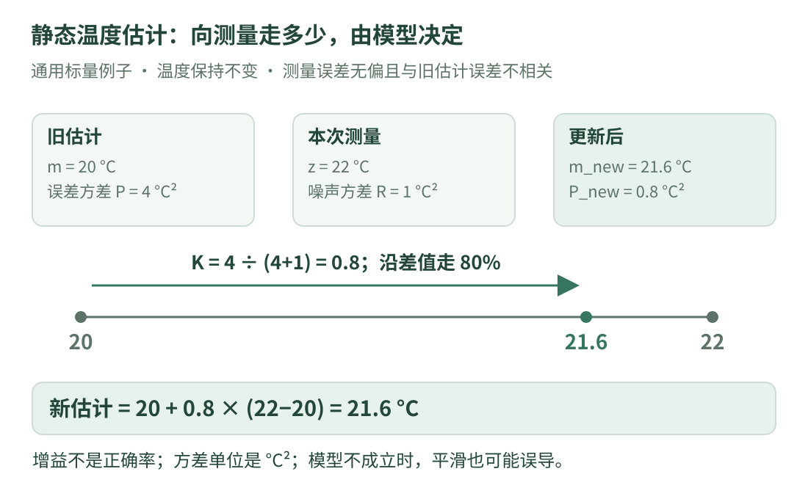

# 07 · 测量与滤波：用温度数字理解“相信多少”

仓库介绍中出现了滤波器。零基础先不要从复杂状态和大矩阵开始：本课只学习一个**与设备无关的静态温度估计**，回答“旧估计和新测量不一样，怎样合并”。

先读第五课的误差概念。本章是通用算法基础，**不是原仓库 EKF 的复现或调参说明**。

## 1. 先把观测、估计和真值分开

假设一个物体的温度在本次短实验中保持不变。我们不知道真实温度，手里有旧估计 20 °C，以及新测量 22 °C。两者不一致时，不能仅凭“更新”就认定 22 必然正确。

| 名称 | 本章含义 | 本例 |
| --- | --- | --- |
| 真值 | 希望知道但无法直接确认的实际量 | 未知的固定温度 |
| 测量 z | 传感器给出的带误差数值 | 22 °C |
| 先验估计 m | 融合本次测量之前的估计 | 20 °C |
| 后验估计 m_new | 融合这次测量后的估计 | 待计算 |

“先验 / 后验”的先后，是相对于这次更新。下一次测量到来时，这次的结果又可以成为下一次的起点。

## 2. 怎样表达“不确定”

本例用方差描述估计或测量误差的波动大小，单位是 **°C²**，不是 °C。标准差是方差的平方根，才与温度使用相同单位。

我们人为设旧估计误差方差 `P=4 °C²`、测量误差方差 `R=1 °C²`；对应标准差为 2 °C 和 1 °C。在本模型里，测量比旧估计更稳定，因此合并时应更偏向测量。

这些方差是**教学设定**，不是用两个读数临时算出来的，也不是通用推荐值。方差小描述模型中的不确定性较小，不保证没有系统偏差。

## 3. 看图：从旧估计向测量走一部分

{ .learning-figure }

[打开大图](../../assets/learning/rmcv-estimation.svg)

先写成通俗规则：

**新估计 = 旧估计 + 权重 ×（测量 − 旧估计）。**

差值 `22−20=2 °C` 叫本次创新 / 测量残差；与第五课相比，这里明确采用“测量减估计”的符号约定。不同公式可以选不同符号，但对应更新公式要一致。

## 4. 一个标量 Kalman 更新，逐项计算

本例假设：被估量为常数；测量直接反映这个温度；旧估计误差与本次测量误差不相关；测量噪声无偏，方差已知且 R 为正。在线性高斯模型下，下面可得到对应后验均值与方差。

$$
K=\frac{P}{P+R},\qquad
m_{\mathrm{new}}=m+K(z-m),\qquad
P_{\mathrm{new}}=(1-K)P.
$$

| 符号 | 一句话解释 | 本次手算 |
| --- | --- | --- |
| P | 融合前估计的不确定性 | 4 |
| R | 本次测量噪声的不确定性 | 1 |
| K | 向测量移动的比例，称为增益 | 4/(4+1)=0.8 |
| z−m | 测量与旧估计的差 | 22−20=2 |
| m_new | 更新后的估计 | 20+0.8×2=21.6 |
| P_new | 更新后的误差方差 | (1−0.8)×4=0.8 |

增益 0.8 表示在本次规则下沿差值走 80%，**不是“正确率 80%”**。不确定性被分配得更合理，不等于我们突然知道了真值。

公式依据可查 [Welch 与 Bishop 的 Kalman 滤波讲义（Cornell 课程保存版本）](https://www.cs.cornell.edu/courses/cs4758/2012sp/materials/kalman_notes.pdf)。本课选取直接观测一个静态标量的特殊情况，省去通用矩阵和动态模型。

## 5. 第二次观测，为什么权重变了

再来一次测量 `z=21 °C`，其噪声方差仍为 1，且假设这次测量误差与前面的测量独立。现在旧估计已经变成 21.6，方差变成 0.8：

1. 新增益为 `0.8/(0.8+1)=4/9≈0.444`。
2. 差值为 `21−21.6=−0.6`。
3. 新估计为 `21.6+(4/9)×(−0.6)≈21.333`。
4. 新方差为 `(1−4/9)×0.8=4/9≈0.444`。

它比第一次更少地被单次观测拉动，是因为本例旧估计已经积累了信息。不要每次把 P 重置成 4；那相当于丢掉这份更新历史。

## 6. 完整代码：只合并两个固定读数

```cpp title="静态温度的标量更新 · 独立教学示例"
#include <array>
#include <cmath>     // 检查数值是否有限。
#include <iomanip>
#include <iostream>

int main() {
    double estimate_c = 20.0;           // 融合前的温度估计，单位 °C。
    double variance_c2 = 4.0;           // 估计误差方差，单位 °C²。
    const double noise_variance_c2 = 1.0;  // 两次测量的噪声方差。
    const std::array<double, 2> readings_c{22.0, 21.0};

    std::cout << std::fixed << std::setprecision(3);
    for (double measured_c : readings_c) {
        if (!std::isfinite(measured_c)) {
            std::cout << "invalid reading\n";
            continue;  // 不把 NaN 或无穷送进本例更新。
        }

        // 本例常温模型不增加过程噪声；此前的估计就是本次先验。
        const double prior_variance = variance_c2;
        const double gain = prior_variance /
                            (prior_variance + noise_variance_c2);
        const double innovation_c = measured_c - estimate_c;

        estimate_c += gain * innovation_c;
        variance_c2 = (1.0 - gain) * prior_variance;

        std::cout << "gain: " << gain
                  << ", estimate: " << estimate_c
                  << ", variance: " << variance_c2 << '\n';
    }
}
```

预期输出：

```text
gain: 0.800, estimate: 21.600, variance: 0.800
gain: 0.444, estimate: 21.333, variance: 0.444
```

先保存 `prior_variance` 再算更新，能看清每个公式引用的是更新前的方差。输出保留三位小数，内部计算仍使用 `double`，并没有在每一步强制舍入到三位。

## 7. 为什么不能把这个小例子当作通用滤波器

| 本例假设 | 若实际不成立 | 应先查什么 |
| --- | --- | --- |
| 温度不变 | 温度确实持续变化 | 模型是否应描述变化 |
| 噪声无偏 | 温度计始终偏高 | 标定和偏差来源 |
| 测量误差独立 | 连续读数共享同一误差 | 相关性与重复信息 |
| 方差合理 | 手动填了极小方差 | 方差如何估计与检验 |
| 输入都是同一种量 | 把其他传感器读数混进来 | 单位、测量含义和来源 |

本例没有随时间增加过程不确定性，长时间反复更新会越来越相信“温度固定”。实际温度变化时，它可能反应迟钝，甚至过度自信。让曲线更平滑，并不自动让模型更正确。

## 8. KF 与 EKF，先理解区别

**KF** 通常指线性 Kalman 滤波：状态怎样变化、怎样被测量，都用线性关系表示。常见流程是先根据模型预测，再用观测更新。本例常量模型使预测数值不变，并明确设过程噪声为零。

**EKF** 是扩展 Kalman 滤波：面对非线性关系，在当前估计附近做局部线性近似。描述局部变化率的矩阵叫**雅可比矩阵**，可以先理解为多变量版本的局部斜率表。

“扩展”不表示总比 KF 准。初值、非线性强度、误差模型和数值问题都会影响结果。看到项目中有 EKF 名字，只能说明用了这种工具，不能据此断言整体估计没有问题。

本课到这里建立通用概念；原工程专用状态模型、业务参数和设备联动不在这套入门课的实现范围。

## 9. 练习：测量更不可靠时，应该更靠向谁

仍取旧估计 20、P=4、新测量 22，但把 R 从 1 改成 4。只计算第一轮的 K、新估计、新方差。

??? example "展开手算"

    K=4/(4+4)=0.5，新估计为 20+0.5×2=21，新方差为 (1−0.5)×4=2。

    与原来 21.6 相比，这次更少地向 22 靠近，因为我们给测量分配了更大的误差方差。它不是测量数值本身变小，而是测量被分配的权重改变了。

[返回课程路线](index.md) · [上一课：参数与共享对象](configuration.md) · [下一课：08 · 带着问题读源码 →](reading-lab.md)
