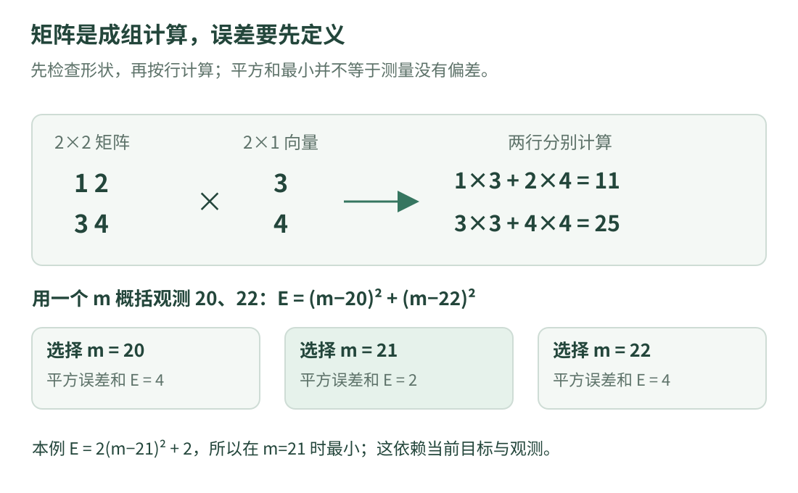

# 05 · 矩阵与误差：公式先用小数字算一遍

视觉代码里的一串矩阵，不需要一开始就用“高深数学”来理解。先解决两个问题：**怎样一次计算多个数？怎样描述计算结果与观测的差别？**

只需会加法和乘法。本课的数字不带物理单位，用来解释运算；不能直接当作相机标定参数。

## 1. 标量、向量、矩阵分别是什么

| 名称 | 入门解释 | 例子 |
| --- | --- | --- |
| 标量 | 一个数 | 3 |
| 向量 | 按约定排列的一组数 | 两项列向量 `[3, 4]` |
| 矩阵 | 按行、列排好的数表 | 两行两列的数表 |
| 维度 / 形状 | 有几行、几列 | 2×2，读作“两行两列” |

向量里的数字不是天然就有位置含义。`[3, 4]` 可以表示两个普通量，也可以在明确约定后表示二维坐标；必须看使用场景和单位。

{ .learning-figure }

[打开大图](../../assets/learning/rmcv-math.svg)

## 2. 一次矩阵乘法，实际上做了什么

设：

$$
A=\begin{bmatrix}1&2\\3&4\end{bmatrix},\qquad
x=\begin{bmatrix}3\\4\end{bmatrix}.
$$

左边矩阵的每一行，分别和右边向量对应项相乘再相加：

$$
Ax=\begin{bmatrix}1\times3+2\times4\\3\times3+4\times4\end{bmatrix}
=\begin{bmatrix}11\\25\end{bmatrix}.
$$

这里 `Ax` 是数学中的矩阵乘法，不是把同一位置的两个数字分别相乘。第一行生成第一个输出，第二行生成第二个输出。

### 为什么有的矩阵不能直接相乘

若左边有 m 行、n 列，右边必须有 n 行，才能逐项配对。结果有左边的行数、右边的列数。本例是 `(2×2) × (2×1) → (2×1)`。

`(2×3) × (2×1)` 的中间两个数 3 和 2 不相等，普通矩阵乘法没有定义。不要靠删除某一项把程序“改到不报错”，先查状态和观测各有几项。

## 3. 用 C++ 把刚才的手算写出来

```cpp title="手写两行矩阵乘法 · 独立教学示例"
#include <array>
#include <iostream>

int main() {
    using Row = std::array<double, 2>;
    const std::array<Row, 2> matrix{{Row{1.0, 2.0}, Row{3.0, 4.0}}};
    const Row input{3.0, 4.0};
    Row output{0.0, 0.0};  // 累加前，把两个结果明确初始化为 0。

    for (std::size_t row = 0; row < matrix.size(); ++row) {
        for (std::size_t col = 0; col < input.size(); ++col) {
            // 第 row 行的每项，乘以输入中对应的一项。
            output.at(row) += matrix.at(row).at(col) * input.at(col);
        }
    }

    std::cout << "result: " << output.at(0) << ' ' << output.at(1) << '\n';
}
```

预期输出：

```text
result: 11 25
```

外层循环选“正在计算哪个输出”，内层循环完成这个输出所需的两次乘法。不要把两个循环合成“每个数字随便乘一下”；每个下标都有对应关系。

## 4. 在 Eigen 代码里找到相同含义

Eigen 是 C++ 线性代数库。`Eigen::Matrix<double, 2, 2>` 表示以 `double` 为元素的两行两列矩阵，`Eigen::Vector2d` 是两项 `double` 列向量的常用名称。

对 Eigen 的矩阵类型，`A * x` 可以表达上面的矩阵乘法。库替我们完成循环等实现工作，**不会替我们判断数据是否采用了正确单位和坐标约定**。

类型和运算规则可对照 [Eigen 3 的 Matrix 教程](https://libeigen.gitlab.io/eigen/docs-3.3/group__TutorialMatrixClass.html)；本课用标准库手写计算，便于看清每一步，不要求把 Eigen 加进环境。

### 转置和求逆，先记住边界

转置把行与列互换，常写为上标 T；求逆不是把每个元素各自取倒数。不是每个方阵都有逆，非方阵也不能直接谈普通的双侧逆矩阵。

实际解线性方程通常应选择合适的分解 / 求解方法，不能把“遇到矩阵就求逆”当作通用做法。当前先学会核对形状和含义，不急着实现复杂求解器。

## 5. 误差是怎样算出来的

想用一个数 m 概括两次静态温度观测 `20、22`。这里假设两次观测同样可信，且测的是同一个不变的量。

先把“残差”定义为“当前估计减去观测”：第一项是 `m−20`，第二项是 `m−22`。残差可以有正负；直接相加会互相抵消，所以我们考察平方和：

$$
E(m)=(m-20)^2+(m-22)^2.
$$

| 当前选择 m | 两项残差 | 平方误差和 E |
| --- | --- | --- |
| 20 | 0、−2 | 0+4=4 |
| 21 | 1、−1 | 1+1=2 |
| 22 | 2、0 | 4+0=4 |

在这三个选择中 21 的平方和最小；进一步整理得到 `E(m)=2(m−21)²+2`，因为平方不能小于 0，所以所有实数候选中最小值也在 m=21。这就是一个极小的**最小二乘**问题：寻找让残差平方和尽量小的参数。

## 6. 平方和最小，不等于找到了真值

如果两次测量都整体偏高，最小二乘也可能给出偏高结果；如果一个是严重异常值，平方会放大它的影响。要先说明误差来源、可信程度和适用模型。

原项目的构建片段中能看到对 Ceres 的依赖。Ceres 是用于非线性最小二乘等问题的库；理解它之前，先分清“观测是什么、未知参数是什么、残差怎样定义”。可以查 [Ceres 官方仓库中的建模入门](https://github.com/ceres-solver/ceres-solver/blob/master/docs/source/nnls_tutorial.rst)，但本课没有配置或运行 Ceres。

“优化”在这里指寻找使目标函数变小的参数，不是保证现实效果更好。目标设错、单位混用或观测有偏，求解得再认真也可能解决了错误的问题。

## 7. 看公式时，把符号翻译成四个问题

1. **每项是什么**：数字、向量还是矩阵？包含哪些量？
2. **形状和单位是什么**：维度能否相乘？温度、时间、像素是否混用？
3. **输入从哪里来**：观测、上一步估计，还是人为给定参数？
4. **依赖哪些假设**：静止、同一对象、误差模型，是否真的成立？

记住公式名字无法替代这四件事。读不懂时，先把矩阵缩小成 1×1 或 2×2 的纸笔例子，通常就能找到理解卡在哪里。

## 8. 练习：只改输入，会发生什么

完整程序里把输入改成 `{1.0, 0.0}`。两个输出分别是多少？再问：如果当前温度估计等于 21，是否说明两次观测都等于 21？

??? example "展开答案"

    输出是 1 和 3：第一项为 1×1+2×0，第二项为 3×1+4×0。结果等于矩阵第一列，注意不是第一行。

    估计 21 不意味着观测都为 21。本例观测仍是 20 和 22，21 是在指定目标与假设下得到的概括。观测、估计和真值必须分开。

[返回课程路线](index.md) · [上一课：图像其实是数字](images.md) · [下一课：06 · 参数与共享对象 →](configuration.md)
