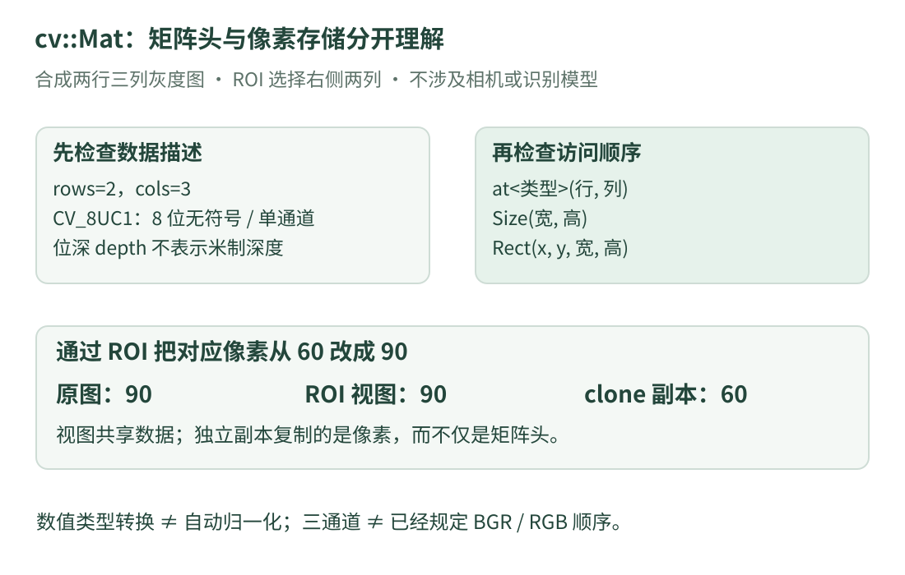

# 12 · OpenCV 代码精读：一张图在 C++ 里是什么

已经认识变量、引用和模板后，再看视觉代码里的 `cv::Mat` 就容易一些。本课把**图像容器的语法**与**图像算法的功能**分开讲：先确认手里的数据是什么，再讨论怎样处理。

先读[图像其实是数字](images.md)和[类型与所有权](cpp-types.md)。`cv` 是 OpenCV 常用的命名空间，`Mat` 是它的数组类；`cv::Mat` 是一个类型名，不是“调用识别算法”的命令。

## 1. 从源码确认：类名不能替代数据解释

原仓库的 [OpenCV 模块](https://github.com/julyfun/rm.cv.fans/blob/6abd1bf359356d1d603766c4b3bcabbb1d6432b2/aimer/auto_aim/detector_opencv/TRTModule.cpp)使用了 OpenCV 图像与 DNN 接口。这里先认识通用的数据容器，不展开它的专用检测输出或设备联动。

同一个 `cv::Mat` 类型可以承载灰度图、彩色图或数值矩阵等。**只看到类型名，还不知道像素顺序、元素类型、通道数、形状和含义。** 需要继续查看创建它或写入它的接口。

## 2. 一份图像描述，至少回答四个问题

{ .learning-figure }

[打开大图](../../assets/learning/rmcv-opencv-reading.svg)

| 问题 | 常见写法 | 通俗理解 |
| --- | --- | --- |
| 有几行、几列？ | `image.rows`、`image.cols` | 这张表的高度和宽度 |
| 每个分量用什么类型？ | `image.depth()` | 例如 8 位无符号整数，或浮点数 |
| 每个位置有几项分量？ | `image.channels()` | 一个亮度，或几个颜色分量等 |
| 表是否有数据？ | `image.empty()` | 先确认有内容，再访问元素 |

`depth()` 的“深度”在这里是**元素位深 / 数值类型类别**，不是物体距离相机多少米。学习视觉时，“depth”会出现在不同语境；看到同一个英文词，不代表同一个物理量。

`rows` 和 `cols` 在这些写法中是数据成员；`channels()` 和 `empty()` 是成员函数调用，所以带圆括号。区别不是英语单词长短，而是类提供的接口不同。

## 3. 把一个创建表达式逐项拆开

下面是放在函数体内的 **OpenCV 4 API 阅读片段**。它需要包含 `<opencv2/core.hpp>` 并正确链接 OpenCV；这里没有创建环境或执行它，也没有把它伪装成独立程序。

```cpp title="创建一张合成灰度小图 · OpenCV API 阅读片段"
// 创建两行、三列的 8 位单通道图，每个像素先填为 0。
cv::Mat image(2, 3, CV_8UC1, cv::Scalar(0));

// 按“行、列”访问一个像素，并把它改为 60。
image.at<unsigned char>(1, 2) = 60;
```

这一行创建语句可以按下表读：

| 部分 | 表达什么 | 容易混淆的地方 |
| --- | --- | --- |
| `cv::Mat` | 对象类型 | `cv::` 表示名称所属空间 |
| `image` | 本例自取的变量名 | 改名字不会改变图像类型 |
| `(2, 3, ...)` | 调用构造函数，传入初始设置 | 此处先行数，再列数 |
| `CV_8UC1` | 8 位、无符号、单通道 | 不能把它读成三个尺寸参数 |
| `cv::Scalar(0)` | 填充用的初始数值 | 初始化像素，不是初始化坐标 |

`at<unsigned char>` 中，`<>` 给成员函数模板指定访问类型；`(1, 2)` 才是传入的行、列。**类型实参与函数实参**是不同层次：前者说明“用哪种数值类型读”，后者说明“读哪个位置”。

本例的逻辑结果是一张两行三列的小表：第一行为 `0、0、0`，第二行为 `0、0、60`。坐标 `(x,y)` 若按横纵表达，是 `(2,1)`；行列访问顺序是 `(1,2)`。

## 4. 类型必须与真实数据匹配

`CV_8UC1` 的单个像素可用 `unsigned char` 访问。若数据是三通道 `CV_8UC3`，一个像素通常需要三分量类型，例如 `cv::Vec3b`；若是 `CV_32FC1`，通常按 `float` 访问。

不能因为“想要一个小数”，就把一张 8 位图直接用 `at<float>` 读取。访问类型不匹配，不是数值转换；它破坏了对存储数据的解释，可能触发检查或产生错误行为。

真正需要转换数值类型时，应使用相应转换接口，并明确是否缩放。比如从整数 100 变成浮点数 100.0，与从 100 归一化到约 0.392，是两种不同的处理。**类型变成浮点数，并不自动意味着范围变成 0～1。**

同理，三通道只说明每个位置有三项分量，不保证顺序必然为 BGR；顺序由采集、解码和处理接口约定。

## 5. `Size`、`Rect` 和数组的参数顺序不同

读取一个像素常按 `(row, col)`，而 `cv::Size(width, height)` 常按宽、高。`cv::Rect(x, y, width, height)` 则描述一块区域：左上角位置加宽高。

本例在两行三列的图上选择 `Rect(1, 0, 2, 2)`，意思是从横坐标 1、纵坐标 0 开始，选宽 2、高 2 的区域。整数索引覆盖列 1、2 和行 0、1，不包含列 3 或行 2。

这块区域称为 **ROI**，即感兴趣区域。可以先理解成“从整张图中选出的一个窗口”。创建 ROI 本身不等于已经识别出其中是什么物体。

## 6. 赋值和选区域，为什么会改到原图

接着前面的 `image` 读这一段；依然是有上下文的 API 阅读片段：

```cpp title="ROI 共享与独立副本 · 接着上文 image 的阅读片段"
// view 选择原图右侧的两列；默认共享这些像素的存储。
cv::Mat view = image(cv::Rect(1, 0, 2, 2));

// snapshot 拥有独立复制的像素，记录此刻这块区域的内容。
cv::Mat snapshot = view.clone();

// view 中第 1 行、第 1 列，对应原图第 1 行、第 2 列。
view.at<unsigned char>(1, 1) = 90;
```

逐步推算：

1. 创建 `view` 前，原图右下角为 60。
2. `view` 的右下角也对应这一份存储，所以当前为 60。
3. `snapshot` 复制了当时的像素，自己的右下角为 60。
4. 通过 `view` 写入 90 后，原图右下角变为 90；`snapshot` 的对应像素仍为 60。

`image(...)` 在这里不是普通的“函数变量 image”；`cv::Mat` 重载了调用运算符，让选区域可以写成类似函数调用的形式。**运算符重载**是类为某种符号定义操作含义；看到符号仍需结合对象类型判断。

`clone()` 返回独立的像素副本，目的与普通复制矩阵头不同。上述容器与访问行为可核对 [OpenCV Mat 的基本说明](https://docs.opencv.org/4.13.0/d6/d6d/tutorial_mat_the_basic_image_container.html)和 [Mat 接口文档](https://docs.opencv.org/4.13.0/d3/d63/classcv_1_1Mat.html)。

## 7. 还有两个容易漏掉的内存问题

**第一，行与行之间可能有间隔。** 从大图中取出的 ROI 不一定连续。不能只看到像素数，就假设整块内存是无间隔的“行数×列数×通道数”字节。读到 `data`、`step` 或 `ptr` 时，先确认类型、行跨度和连续性要求。

**第二，外部内存有自己的寿命。** 如果矩阵只是包装了别人提供的缓冲区，并不自动拥有那块外部数据。提供者已经释放内存后，矩阵头还存在也不表示可以继续访问。

这里与 C++ 所有权课是同一个问题：名字、视图和底层数据的寿命要分开考虑。只读 `const cv::Mat&` 也不构成“整个系统没有其他可写别名”的证明。

## 8. 从数据容器走向算法，先保留记录

阅读任何图像处理调用前，先给输入写四项说明：“尺寸、类型、通道含义、是否共享”。调用后再检查输出的这四项有没有变化。

例如：裁剪改变可见范围；缩放改变采样网格；类型转换改变数值表示；颜色转换改变分量含义。它们都不是天然的“识别”。下一课用小数值解释图像重新采样，不复现原项目的专用检测流程。

## 9. 练习：副本为什么没有跟着变

上文最后一次修改后，原图、`view`、`snapshot` 各自的对应像素是多少？如果把创建副本那一行改成 `cv::Mat snapshot = view;`，结果会有什么不同？

??? tip "先画数据，再看名字"

    画出原图那块像素存储，再标出哪些名字访问同一块存储。clone 才增加一份独立像素副本。

??? example "展开推算"

    使用 clone 时，原图为 90，view 为 90，snapshot 为 60。若 snapshot 也直接共享 view 的数据，则三者对应位置都能看到 90。

    修改的是同一份像素，而不是程序偷偷把一条赋值语句重复执行了三次。这个区别会影响调试、缓存快照和线程间传递图像时的理解。

[返回课程路线](index.md) · [上一课：容器、对象与锁](cpp-source-objects.md) · [下一课：图像采样与插值 →](vision-sampling.md)
