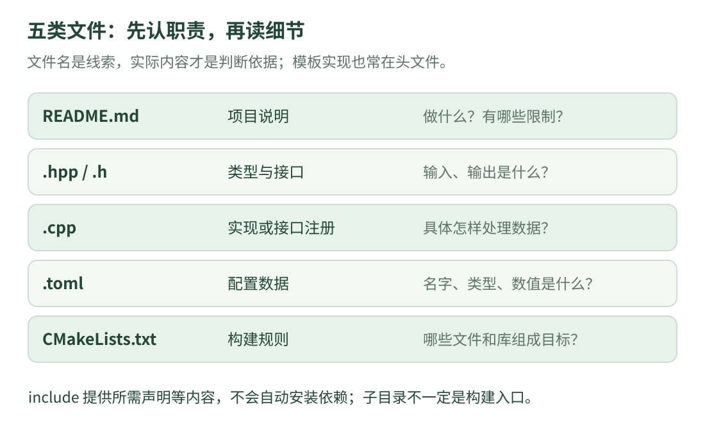

# 01 · 打开仓库后，先看什么

本课只解决一个问题：**面对一堆文件，怎样知道它们各自负责什么？** 先会找路，比一开始逐行背代码更有用。

不要求编程基础。先把“仓库”理解为项目的文件集合；GitHub 是查看这些文件和改动记录的网站；Git 是记录版本的工具。看到 GitHub 链接，不代表你必须先把项目安装起来。

## 1. 用五类文件建立地图

{ .learning-figure }

[打开大图](../../assets/learning/rmcv-files.svg)

| 文件形式 | 通俗理解 | 阅读时先问 |
| --- | --- | --- |
| `README.md` | 项目的介绍与说明 | 项目做什么？有什么限制？ |
| `.hpp` / `.h` | 常用于放类型和函数接口 | 需要什么输入？会返回什么？ |
| `.cpp` | 常用于实现具体步骤 | 输入怎样变成输出？ |
| `.toml` | 本项目使用的一种配置文件 | 数值是什么类型、属于哪个名称？ |
| `CMakeLists.txt` | 组织构建的说明 | 哪些源文件组成哪个目标？依赖哪些库？ |

这是常见习惯，不是“文件后缀决定一切”。模板函数常把实现放在头文件；一个 `.cpp` 也可能只负责把函数开放给别的语言。看实际内容才能确定职责。

**声明与定义**可以类比餐单与做法：声明先说明能提供什么，定义给出怎么完成。普通函数可以在头文件声明、在 `.cpp` 定义；模板有额外的可见性要求，第三课再解释。

## 2. 本仓库有哪些主要目录

下表来自[固定版本的目录](https://github.com/julyfun/rm.cv.fans/tree/6abd1bf359356d1d603766c4b3bcabbb1d6432b2)。这是阅读导航，不是程序调用顺序图。

| 目录 | 当前能看到什么 | 第一遍怎样处理 |
| --- | --- | --- |
| `base/param` | 参数类型、读取与更新、语言接口 | 本课之后的主要源码阅读对象 |
| `base/debug` | 日志等辅助代码 | 先认出它负责展示信息 |
| `UltraMultiThread` | 共享对象、消息等基础设施 | 先理解“数据由谁持有、怎样查找” |
| `aimer/base` | 数学、滤波及专用坐标处理等 | 通用数学先用独立例子学习 |
| `aimer/auto_aim` | 比赛视觉及专用业务模块 | 第一遍只认职责与模块边界 |
| `assets` | 配置资源 | 不把资源目录误认成算法实现 |
| `docs/auto_aim` | 作者的专题说明 | 确认前提和版本后再读 |

同样叫 `base` 的目录可能位于不同层级。`base/param` 和 `aimer/base` 是不同路径；搜索文件时保留完整的仓库相对路径，避免读错。

## 3. 先完成一次不用运行的阅读

打开[参数头文件](https://github.com/julyfun/rm.cv.fans/blob/6abd1bf359356d1d603766c4b3bcabbb1d6432b2/base/param/parameter.hpp)，不必立刻理解尖括号。第一遍只找名字：

1. 找到 `namespace base`：知道下面的名称被放进一个命名空间，类似给同名文件分文件夹。
2. 找到 `Param`：知道项目给一组可选参数类型起了简称。
3. 找到 `find_param`：先记“按名字找一个参数对象”。
4. 找到 `get_param`：先记“调用者还需要指定希望读取的类型”。

第二遍再看：名字用字符串表达，查找可能失败，读取也可能因类型不同而失败。第三课补齐这些语法，第六课沿实现看失败分支。**不用在这一页把所有内容一次看懂。**

## 4. `include` 不等于安装，编译不等于链接

“库”是别人写好的可复用功能集合。OpenCV 提供图像相关功能，Eigen 提供线性代数工具。**依赖**是当前项目需要它们提供的接口或实现。

可以把构建拆成三个动作：

1. **配置**：CMake 查依赖、生成构建规则；此时发现缺少工具也可能停止。
2. **编译**：编译器分析 C++ 源码及包含的头文件，生成目标文件。
3. **链接**：把目标文件与所需库组合起来，解决函数实现来自哪里的问题。

`#include` 让当前源文件获得声明等内容，不会自动下载或安装那个库。头文件找不到，常在编译时出错；函数声明有了但相应实现没链接上，常在链接时报错。文件名拼错、版本不匹配也可能造成类似现象，需看具体诊断。

## 5. 这个快照能否直接照着命令构建

在本课固定的[仓库根目录](https://github.com/julyfun/rm.cv.fans/tree/6abd1bf359356d1d603766c4b3bcabbb1d6432b2)，没有根目录 `CMakeLists.txt`。部分子目录有自己的构建片段；例如 [`base/CMakeLists.txt`](https://github.com/julyfun/rm.cv.fans/blob/6abd1bf359356d1d603766c4b3bcabbb1d6432b2/base/CMakeLists.txt)查找 OpenCV 4、Eigen3，并引用项目目标；[`aimer/base/CMakeLists.txt`](https://github.com/julyfun/rm.cv.fans/blob/6abd1bf359356d1d603766c4b3bcabbb1d6432b2/aimer/base/CMakeLists.txt)还查找 Ceres。

[`parameter.cpp`](https://github.com/julyfun/rm.cv.fans/blob/6abd1bf359356d1d603766c4b3bcabbb1d6432b2/base/param/parameter.cpp)包含 `third_party/tomlplusplus/toml.hpp`，但该快照的根目录没有 `third_party` 目录。这里只能确认这份快照没有包含这个路径，不能据此断言作者其他环境也缺失。

因此，本课**不把一条通用 CMake 命令写成原工程的完整安装方案**。完整构建还要核对上层入口、第三方材料、工具链、模型与运行配置。我们的目标先是读懂能核对的源码，独立小例子使用标准库即可。

### 为什么不能随便在某个子目录里运行 CMake

子目录可能假设上层已经定义目标或变量。文件里有 `cmake_minimum_required` 也不意味着它就是完整入口；只有理解它依赖的上下文，才能判断独立配置是否合理。

`UltraMultiThread` 的[构建文件](https://github.com/julyfun/rm.cv.fans/blob/6abd1bf359356d1d603766c4b3bcabbb1d6432b2/UltraMultiThread/CMakeLists.txt)明确设置了 C++17。这是该子项目的设置，不能据此声称所有未提供的上层工程都使用完全相同的构建选项。

## 6. 英文名字，先翻译成一个动作

| 名称 | 本课先怎样理解 | 还需要继续确认什么 |
| --- | --- | --- |
| `get` | 取得一个值 | 是否复制？失败怎样表示？ |
| `find` | 按条件查找 | 没找到返回什么？ |
| `create` | 创建对象 | 同名对象存在时怎么办？ |
| `update` | 更新已有内容 | 修改谁？是否影响其他使用者？ |
| `entry` | 对外接口所在文件的常见命名 | 不一定是 `main()` 或独立启动入口 |
| `predict` | 根据模型推算 | 不是对未来必然正确的保证 |

不要只靠英文猜行为。名称提供线索；参数、返回类型和函数体才是证据。

## 7. 练习：头文件是不是必然只有声明

打开前面的参数头文件，寻找 `get_param` 后面是否有大括号包住的具体步骤。它能否证明“所有函数实现一定在 `.cpp`”这句话不成立？

??? tip "先看提示"

    找到 template 附近的函数。观察它是否只以分号结束，还是包含判断和 return。

??? example "展开解释"

    `get_param` 是模板函数，头文件里有具体实现，包括查找、类型检查和返回。常见组织方式是把模板定义放在调用处能看到的位置，因此“头文件只有声明”不是可靠规则。

    这不等于所有普通函数都应该在头文件里直接定义；还要考虑重复定义、inline 与工程组织。先学会根据实际内容判断。

本课可核对的阅读记录：“我在参数头文件找到一个模板；它按名称查找对象，并检查希望读取的类型。构建材料需要另外核对。”这比记住一串库名更有用。

[返回课程路线](index.md) · [下一课：02 · C++ 第一眼 →](cpp-basics.md)
