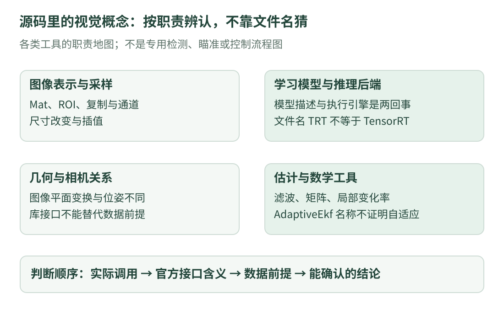

# 14 · 源码里的视觉算法：先分清它们各自解决什么

前面的像素平均、亮度阈值和静态温度例子，都是为了补基础而单独写的。**它们是本站独立设计的教学示例，不代表原检测模块采用了这些方法。** 本课对照固定版本，把源码中确实出现的视觉方法按职责说明，再指出学习它们需要哪些基础。

这是一张算法阅读地图，配合前几课的详细语法和图像例子使用。项目包含专用瞄准与火控；这些业务只辨认职责，不展开其检测解码、目标模型、弹道、调参或设备联动实现。

## 1. 先区分五个经常混用的词

| 词 | 通俗解释 | 本课的例子 |
| --- | --- | --- |
| 数据结构 / 容器 | 数字怎样放、怎样访问 | 图像存储在 `cv::Mat` 里 |
| 算法 | 为解决问题采用的计算规则 | 双线性插值、位姿估计 |
| 模型 | 对数据规律或关系的数学描述 | 已训练的神经网络、状态估计模型 |
| 接口 | 程序怎样请求一项功能 | 函数的参数、返回值与约定 |
| 后端 | 谁负责实际执行相关计算 | 某个推理执行引擎 |

一份 C++ 文件可能把这些东西放在一起。能编译、能得到一个输出，只说明某些操作完成了，不自动证明模型适合当前数据、几何前提满足或现实效果可靠。

{ .learning-figure }

[打开大图](../../assets/learning/rmcv-vision-algorithms.svg)

## 2. 已从源码确认哪些内容

下表按类别索引，**不是原系统的复现步骤或数据流图**。文件链接固定在本次核对的提交，方便区分接口事实与后续改动。

| 类别 | 源码证据 | 本课可以确认什么 |
| --- | --- | --- |
| 图像表示与基本操作 | [OpenCV 模块](https://github.com/julyfun/rm.cv.fans/blob/6abd1bf359356d1d603766c4b3bcabbb1d6432b2/aimer/auto_aim/detector_opencv/TRTModule.cpp) | 使用图像容器、缩放、区域选择、复制及颜色转换 |
| 网络推理 | [同文件的模型载入位置](https://github.com/julyfun/rm.cv.fans/blob/6abd1bf359356d1d603766c4b3bcabbb1d6432b2/aimer/auto_aim/detector_opencv/TRTModule.cpp#L72) | 调用 OpenCV DNN 载入和执行模型 |
| 候选结果处理 | [同一 OpenCV 文件](https://github.com/julyfun/rm.cv.fans/blob/6abd1bf359356d1d603766c4b3bcabbb1d6432b2/aimer/auto_aim/detector_opencv/TRTModule.cpp) | 有分数、排序及重复候选处理；不据此等同于任一标准实现 |
| 相机几何 | [pnp.cpp](https://github.com/julyfun/rm.cv.fans/blob/6abd1bf359356d1d603766c4b3bcabbb1d6432b2/aimer/auto_aim/predictor/pnp/pnp.cpp) | 出现位姿求解、畸变点处理、旋转表示转换 |
| 投影工具 | [math.cpp](https://github.com/julyfun/rm.cv.fans/blob/6abd1bf359356d1d603766c4b3bcabbb1d6432b2/aimer/base/math/math.cpp) | 包含调用 `projectPoints` 的几何辅助功能 |
| 线性估计 | [kalman.hpp](https://github.com/julyfun/rm.cv.fans/blob/6abd1bf359356d1d603766c4b3bcabbb1d6432b2/aimer/base/math/filter/kalman.hpp) | 使用 Eigen 矩阵表达滤波计算 |
| 扩展估计与数学工具 | [adaptive_ekf.hpp](https://github.com/julyfun/rm.cv.fans/blob/6abd1bf359356d1d603766c4b3bcabbb1d6432b2/aimer/base/math/filter/adaptive_ekf.hpp) | 使用 Eigen 与 Ceres Jet；源码注释明确它并非自适应滤波 |

## 3. 图像缩放：改变网格，不是识别物体

图像缩放需要为新的像素网格计算数值。原 OpenCV 文件调用 `cv::resize` 时没有显式传入插值参数；按 [OpenCV 4 的接口约定](https://docs.opencv.org/4.13.0/da/d54/group__imgproc__transform.html)，默认插值方式为 `INTER_LINEAR`。

它是双线性插值，与[上一课](vision-sampling.md)用四个邻居混合得到新数值的原理相联系。上一课的代码只计算指定位置，不包含库的完整采样网格、边界和取整规则，因此不能声称与库对任意图像逐像素完全一致。

裁剪选择可见区域，复制决定是否产生独立像素存储，缩放改变采样网格。这三项不等价；只看到“处理了一张图”还不足以说明做了什么。

### 颜色通道转换，又是另一件事

在 RGB 与 BGR 之间转换，主要涉及颜色分量顺序。它不是“把三个颜色求平均变成灰度”，也不是去掉图像噪声。`CV_8UC3` 本身只表示位深与通道数，不包含哪一项是红色的约定。

读源码时，把**数据格式**与**数据内容**分开记录。相同尺寸、相同数值类型的两张图，通道含义仍可能不同。

## 4. 神经网络推理：使用模型，与训练模型不同

可以先把训练好的网络理解成“有很多已确定内部参数的计算规则”。给定符合约定的输入，推理计算输出；模型学得好不好，还需要用独立数据与合适指标评价。

**训练**会根据数据、损失等调整参数；**推理**通常用现有参数计算结果。源码出现一次 `forward()`，不能据此说这一段在训练模型。

**ONNX** 是模型交换格式。**OpenCV DNN** 是 OpenCV 的深度网络相关模块。**推理后端**决定怎样执行支持的运算。这三者分别是模型表示、软件接口与执行机制，不能当作同一个名词。

原文件虽然叫 `TRTModule.cpp`，但这里实际调用 OpenCV DNN。文件名只能帮助定位，不能单独证明用了 TensorRT。执行接口与后端概念可核对 [OpenCV DNN 官方文档](https://docs.opencv.org/4.13.0/d6/d0f/group__dnn.html)。

### 为什么不能凭“读了 ONNX”就写成某一代 YOLO

ONNX 可以表示许多不同的模型。只看到载入格式和推理接口，无法确认具体网络版本、训练类别、数据集或精度。需要对应模型与训练材料的证据，不能根据项目领域猜一个熟悉的算法名补进去。

本课不展开专用输出布局与解码。先理解最基础的一点：**网络输出的数字需要按模型约定解释，不是天然就带着人类理解的单位、类别与正确性保证。**

## 5. 结果处理：分数、排序与去重各有含义

想象一张普通书桌照片：同一本书可能对应多个候选框。后续处理需要表达哪些结果更值得保留、哪些可能重复。分数用于比较或筛选，排序改变先后次序，去重尝试减少重复结果。

这三件事都不等于“已经证明识别正确”。分数高仍可能是误检，去重也可能误删本应分开的相邻物体。评价需要人工标注和清楚的匹配规则。

另一个常见误会是：“源码里有去重，所以它一定是某种教科书里的 IoU-NMS。”**仅凭功能相近不能确认算法相同**；必须核对重叠定义、比较对象和实际规则。本课只确认这类处理存在，不复现该自瞄工程的专用逻辑。

需要补检测、跟踪、精确率与召回率的区别时，阅读独立的[计算机视觉课程](../../vision/index.md)。其中的羊群例子是独立任务说明，也不冒充本仓库的模型能力。

## 6. 相机几何：二维图片与三维位置之间有前提

**投影**可以先理解为：给定三维点及相机关系，计算它在图像里的位置。**位姿估计**则要在给定对应关系与相机条件下，估计物体相对于相机的位置和朝向。

原几何文件里出现 `solvePnP`。PnP 是一类利用已知空间点与图像对应点等条件估计位姿的问题。这里的结果不是凭一张普通图片无条件获得所有真实三维信息；输入条件、尺度与坐标约定都很重要。

`undistortPoints` 处理点坐标的镜头畸变关系，不等于“自动识别正确角点”。处理过点坐标，也不意味着整张图片已经被重建为无畸变图像。

**畸变**是成像关系相对于理想模型的偏离；**位姿**是两个坐标系之间的位置和朝向关系。这两个问题有关，但不能用“修正坐标”一词把它们混成同一种操作。

相关接口定义可查 [OpenCV 相机标定与三维重建文档](https://docs.opencv.org/4.13.0/d9/d0c/group__calib3d.html)。本课不提供该系统的点序、求解参数、专用坐标转换与执行机构接入。

### 旋转向量，不是三个独立欧拉角

`Rodrigues` 与旋转矩阵、旋转向量之间的表示转换有关。旋转向量可以用方向表达旋转轴、用长度表达旋转角，角度单位为弧度；零旋转时轴的方向没有唯一意义。

它与依次绕轴旋转的欧拉角不是同一种编码，不能看到三个分量就直接分别当成横滚、俯仰和偏航。理解编码，是读懂类型和接口的前提；编码转换也不等于改变了实际物体的朝向。

## 7. Eigen、自动微分与滤波之间怎样区分

**Eigen** 提供矩阵、向量与相关运算工具；矩阵里每项表达什么，由使用者定义。`cv2eigen` 这类转换改变数据的库表示，不能单靠转换函数就获得新的物理坐标系或单位。

**Ceres Jet** 是自动微分相关工具。微分可以先理解成“某个输入在当前位置稍微改变，输出会怎样变化”；自动微分按运算规则同时传播数值和导数信息，并不是靠神经网络猜一个斜率。

看一个与工程无关的小函数 `f(t)=t²`：在 t=3 附近，局部斜率为 6。若 t 从 3 改成 3.01，线性近似给出 `9+6×0.01=9.06`，真实平方为 9.0601，相差 0.0001。**局部近似在小范围内有意义，不是把所有曲线都变成一条全局直线。**

多输入、多输出时，把这些局部变化率排成矩阵，就得到雅可比矩阵。自动微分是计算这种信息的工具，滤波则是利用模型和观测更新估计的方法；工具与算法不是同一层次。Jet 的用途可查 [Ceres 自动微分说明](https://github.com/ceres-solver/ceres-solver/blob/master/docs/source/automatic_derivatives.rst)。

### 名叫 AdaptiveEkf，不代表会自动学出噪声参数

原文件的注释明确说明它并非自适应。教学中应把这个类名当作定位符号，不能解释为“会自动调好所有误差参数”。通用 KF 与 EKF 的区别，先用[静态温度课](estimation.md)中的估计、方差和局部近似建立理解。

使用滤波类、矩阵库或自动微分，都不单独保证最终系统准确。输入、模型、假设、单位与数值实现仍需分别验证。

## 8. 把 C++ 语法和算法概念放在同一张阅读表

| 看到的写法 | 先解释语法 | 再解释数据含义 |
| --- | --- | --- |
| `cv::Mat` | 命名空间里的一个类类型 | 形状、通道、元素类型与数据来源 |
| `at<...>(...)` | 成员函数模板的显式类型实参和调用实参 | 正在按哪种类型访问哪个位置 |
| `const ...&` | 通过只读引用借用对象 | 是否有其他别名共享底层数据 |
| `Eigen::Matrix<...>` | 为类模板指定元素类型与尺寸等 | 每个分量和矩阵形状代表什么 |
| `T` 同时参与不同运算 | 泛型代码按具体类型实例化 | 类型是否携带导数等额外信息 |
| `operator()` | 可以让对象按函数形式调用 | 具体调用执行的是哪种计算 |

语法看懂后，才能准确追踪数据；算法概念清楚后，才能知道一行运算为何存在。两者需要来回对照，而不是先把整本语法书背完再碰图像。

## 9. 自测：这几句话有哪些越界推断

判断并解释：“文件叫 TRT，所以这段一定在使用 TensorRT。”“图像变成浮点数，所以一定归一化到 0～1。”“用了 EKF，所以肯定比任何线性方法准确。”“图片里的均值例子就是原检测算法。”

??? example "展开解释"

    四句都不能成立。后端需看实际调用；类型改变不自动定义缩放；估计效果依赖问题与模型；均值例子是本站独立教学材料。

    再补两项：三通道类型本身不说明 RGB 顺序；把 OpenCV 矩阵转成 Eigen 矩阵，本身不等于做了坐标系变换。结论要有与它同一层次的证据。

读完这一课，再回到一个具体符号，写出“语法含义、数据含义、能确认的行为、尚未确认的前提”。这才是一份可继续积累的源码笔记。

[返回课程路线](index.md) · [上一课：图像采样与插值](vision-sampling.md) · [返回开源资料](../../opensource/index.md)
