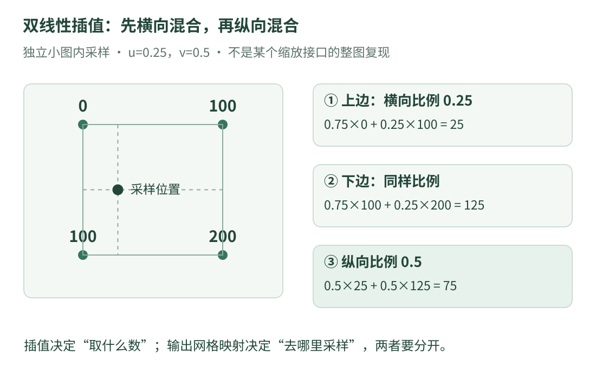

# 13 · 图像采样与插值：新像素的数值从哪里来

视觉代码中常见尺寸调整和几何变换。即使图像只是几个数，也会遇到一个问题：**新位置落在两个像素之间，该填什么值？** 这就是插值要回答的问题。

本课是通用图像基础，使用自己设计的灰度小图，**没有采用原工程的专用尺寸、变换参数或处理链路**。先读[图像表示](opencv-reading.md)，会加减乘除即可开始。

## 1. 图像不是随处都存着像素值

一行里记录了两个灰度值：位置 0 存 0，位置 1 存 100。现在想知道位置 0.25 应该显示多亮，但文件里并没有预先存下“第 0.25 个像素”。

必须引入一条假设：附近亮度怎样变化。取最近的已知样本，或在邻居之间平滑变化，是两种不同规则；它们都不能凭空证明真实场景在那个位置的亮度。

{ .learning-figure }

[打开大图](../../assets/learning/rmcv-vision-sampling.svg)

## 2. 最近邻：先选一个邻居

**最近邻插值**可以理解成：找距离当前位置最近的已知采样点，直接取它的值。位置 0.25 靠近 0，所以取 0。

如果恰好在 0.5，两边一样近，就必须规定如何处理并列。本课约定选择较大的整数索引；这是教学规则，不能推断所有库、所有模式都采用相同的并列处理方式。

最近邻不会通过加权产生新的中间类别值，因此常适用于离散标签图等情形。比如类别编码 0 和 2 之间，数值 1 不一定是有意义的“中间类别”。但最近邻也可能出现阶梯状边缘，它不是所有照片处理的最佳选择。

## 3. 一维线性插值：按距离混合

位置 0 的值为 a，位置 1 的值为 b；当前位置在二者之间，用 u 表示距离左侧的比例：

$$
L(u)=(1-u)a+ub,\qquad 0\leq u\leq1.
$$

u=0.25 时，a 的权重是 0.75，b 的权重是 0.25。代入 a=0、b=100：结果为 `0.75×0 + 0.25×100 = 25`。

| 位置 u | 左侧权重 | 右侧权重 | 插值结果 |
| --- | --- | --- | --- |
| 0 | 1 | 0 | 0 |
| 0.25 | 0.75 | 0.25 | 25 |
| 0.5 | 0.5 | 0.5 | 50 |
| 1 | 0 | 1 | 100 |

权重之和为 1；在这个范围内，它得到的是两个数之间的加权结果。若 u 超出 0～1，这已经是在做外推，不能继续沿用“只在邻居之间取值”的解释。

## 4. 二维双线性插值：横着一次，竖着一次

现在给一张 2×2 小图：上行为 `0、100`，下行为 `100、200`。横向位置 u=0.25，纵向位置 v=0.5，二者都以左上角为零点、相邻样本间隔为 1。

按三步算：

1. 上边一行按 u 混合：`0.75×0 + 0.25×100 = 25`。
2. 下边一行按 u 混合：`0.75×100 + 0.25×200 = 125`。
3. 在上、下两个结果之间按 v 混合：`0.5×25 + 0.5×125 = 75`。

用 `I00、I10、I01、I11` 分别表示左上、右上、左下、右下四个值：

$$
I(u,v)=(1-v)\big((1-u)I_{00}+uI_{10}\big)
+v\big((1-u)I_{01}+uI_{11}\big).
$$

这里的下标明确采用“横向索引在前、纵向索引在后”的数学记号；代码数组仍采用先行后列。不要把公式下标的含义不加说明地搬到数组访问里。

“双线性”表示固定一个方向时，对另一个方向是线性的；不表示一定要先做两张完整的新图。实现可以直接算出四个权重并累加。

## 5. 完整程序：只计算小图内一个位置

下面是本站独立 C++17 教学程序，只使用标准库。输入位置限制在闭区间 `[0,1]×[0,1]`，因此不需要讨论图外补边；它不是 OpenCV `resize` 的复现。

```cpp title="两种插值处理同一个位置 · 独立教学示例"
#include <array>
#include <cmath>
#include <iomanip>
#include <iostream>
#include <stdexcept>

using Row = std::array<double, 2>;
using Image = std::array<Row, 2>;  // 数组访问始终先行、后列。

void check_position(double u, double v) {
    // 本例只接受小图内部的有限坐标，避免外推或越界。
    if (!std::isfinite(u) || !std::isfinite(v) ||
        u < 0.0 || u > 1.0 || v < 0.0 || v > 1.0) {
        throw std::invalid_argument("position must be inside the small image");
    }
}

double nearest(const Image& image, double u, double v) {
    check_position(u, v);
    // 对非负坐标用 floor(x+0.5)；本课并列时选择较大的索引。
    const auto col = static_cast<std::size_t>(std::floor(u + 0.5));
    const auto row = static_cast<std::size_t>(std::floor(v + 0.5));
    return image.at(row).at(col);
}

double bilinear(const Image& image, double u, double v) {
    check_position(u, v);
    const double top = (1.0 - u) * image.at(0).at(0) + u * image.at(0).at(1);
    const double bottom = (1.0 - u) * image.at(1).at(0) + u * image.at(1).at(1);
    return (1.0 - v) * top + v * bottom;
}

int main() {
    const Image image{{Row{0.0, 100.0}, Row{100.0, 200.0}}};
    const double u = 0.25;
    const double v = 0.5;
    std::cout << std::fixed << std::setprecision(1);
    std::cout << "nearest: " << nearest(image, u, v) << '\n';
    std::cout << "bilinear: " << bilinear(image, u, v) << '\n';
}
```

预期输出：

```text
nearest: 100.0
bilinear: 75.0
```

最近邻中，u=0.25 选择列 0，v=0.5 按本例规则选择行 1，所以读到 100。双线性则混合四个样本，得到 75。两者不同来自所选规则，不是谁把加法算错了。

## 6. 顺便读懂这一段 C++

`using Image = ...` 给嵌套数组类型起简称；`const Image&` 让函数借用并读取同一小图。函数并没有把“原图”变成一份全局共享变量。

`std::floor` 返回不大于输入的整数值，结果仍以浮点类型表示，所以后面再转成数组索引类型。我们先检查范围，才允许转换和访问；不能把任意负数或无穷直接转换成索引。

`throw` 在这里报告非法输入，当前调用不会正常返回数值。完整程序使用固定合法输入，因此会走普通输出路径；如果自行加入非法坐标，需按所需交互在调用处捕获并处理异常，不能把异常当作一个亮度值。

## 7. 为什么手算对了，还不能断言与某个库逐像素相同

实际图像缩放还需要决定三件事：

- **采样位置**：输出像素中心对应输入的哪个连续位置？不同约定会改变坐标。
- **边界规则**：邻居落在原图外时，复制边缘、填常数还是采用其他处理？
- **数值规则**：浮点结果何时取整、怎样饱和到合法范围、具体模式是否有精度约定？

本章只讲在已知连续位置求样本值。它没有定义整张输出图的网格，因此不能拿程序结果冒充某个 OpenCV 模式对整图缩放的全部结果。

OpenCV 的几何变换接口通常根据输出位置寻找输入采样位置；插值和几何映射是两件相关但不同的事。接口约定可查 [OpenCV 几何图像变换文档](https://docs.opencv.org/4.13.0/da/d54/group__imgproc__transform.html)。

## 8. 缩放、仿射、透视，先区分改变了什么

**缩放**改变图像采样网格的尺寸。**仿射变换**可以组合平移、旋转、缩放、错切等，平行线仍保持平行。**透视变换**可以描述更一般的平面投影关系，例如斜拍纸张形成的梯形；它也不负责凭空恢复纸张上原先不可见的内容。

这些变换决定“去哪里取样”，插值决定“那里没有恰好一个存储像素时取什么值”。把两者分开，才能理解为什么同一个几何变换可以搭配不同插值方式。

这里的平面图像变换不能随意当成一般三维场景的重建；不同深度的物体、遮挡和镜头畸变需要额外模型。下一篇算法地图会说明哪些名称是源码中出现的概念，哪些只是入门补充。

## 9. 练习：四个角点与中心

保持小图不变，分别计算 `(u,v)=(0,0)`、`(1,1)` 和 `(0.5,0.5)` 的双线性结果。再把四个角点全改成 80，问图内任一合法位置的结果会是多少？

??? tip "先检查权重"

    在角点，三个权重为零，另一个为一；在中心，四个权重各为四分之一。

??? example "展开答案"

    左上角为 0，右下角为 200，中心为 (0+100+100+200)/4=100。四个角点都为 80 时，权重和为 1，因此结果始终为 80。

    这些是检查插值理解的好例子：保留已知角点、保持常量图。它们不能验证任意缩放接口的坐标映射是否与你的预期相同，那还需要另外检查采样网格约定。

[返回课程路线](index.md) · [上一课：OpenCV 代码精读](opencv-reading.md) · [继续：源码中的视觉算法地图](vision-algorithms.md)
