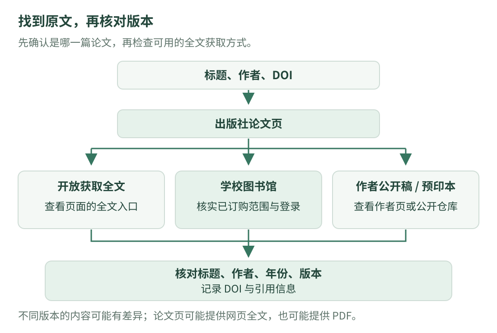

# 03 · 怎样检索与获取论文全文

<div class="course-intro" markdown="1">
<p class="course-label">文献入门 · 检索与全文 · 核验日期：2026-10-16</p>

你在参考文献里看到一个题目，接下来该去哪里找？这一篇从“确认是不是同一篇论文”开始，带你找到正文、判断访问权限，再核对读到的版本。每一步都有可检查的结果，遇到付费提示也能知道下一步该做什么。

[先分清期刊、索引与分区](publication-basics.md){ .md-button }
[查看机器人与放牧相关发表渠道](venues.md){ .md-button }
</div>

## 1. 先看图：从一个题目走到可以阅读的正文

{ .learning-figure }

[打开大图](../assets/learning/papers-access-flow.svg)

一条常用路线是：**确认题目和作者 → 找到原文详情页 → 查看全文入口和权限 → 核对版本 → 保存阅读记录。** 搜索结果只显示标题和摘要时，你还没有拿到正文；打开 PDF 后，也要确认它究竟是哪一篇、哪个版本。

### 手里只有一个研究主题，怎么开始？

假设你想研究“机器人引导羊群”，可以先试中文词“放牧机器人”“机器人 羊群引导”，再试英文词 `robotic shepherding`、`robot herding`。这些词是检索起点，不是已经确定的论文题目。

1. 先用一组较短的词搜索，阅读几条结果的题目和摘要，观察本领域常用什么词。
2. 结果太杂时，再加一个限制词，例如 `sheep`、`vision` 或 `reinforcement learning`。一次加太多词，反而可能错过相关研究。
3. 找到一篇相关论文后，看它的参考文献，也查看有哪些后续论文引用了它。这样能逐步找到同一问题的不同做法。
4. 将值得读的题目记下来，再按下面的方法定位全文。先找得到，再慢慢筛选，不要求第一次搜索就找齐。

平台默认可能按相关性排序，也可能提供年份筛选；“搜索排第一”不能直接解释成“质量最高”或“最新”。Google Scholar 的[官方检索帮助](https://scholar.google.com/intl/en/scholar/help.html)说明了排序、时间筛选与引用追踪的方法。

## 2. 第一步：确认自己找的是同一篇论文

论文可能有很相近的标题，也可能同时出现预印本、会议版和扩展期刊版。不要只看一个关键词就保存。至少核对下面这些信息：

| 核对项 | 到哪里看 | 为什么要核对 |
| --- | --- | --- |
| 完整题目 | 原文详情页、PDF 首页 | 搜索结果可能截短标题；同一问题可能有多篇不同论文 |
| 作者 | 详情页、PDF 首页 | 相似题目不能证明是同一项研究 |
| 发表载体与年份 | 期刊或会议页面、出版信息 | 预印本上传年份、在线发表年份、卷期年份可能不同 |
| DOI | 原文详情页、PDF 或参考文献 | 可以帮助定位已登记的文献对象，但部分文献没有 DOI |
| arXiv 编号及版本 | arXiv 摘要页、版本记录 | 同一编号的不同版本可能修改了文字、方法和实验 |

核对时，先比较题目和作者，再看 DOI、载体与年份。网页与 PDF 信息不一致时，先查版本说明，不要立刻把其中一个删掉：差异可能来自预印本更新、正式出版、勘误，也可能确实是另一篇文章。

### DOI 是定位标识，打开后不一定直接出现 PDF

**DOI（Digital Object Identifier，数字对象标识符）**可以理解为文献对象的长期编号。常见写法包含 `10.` 开头的前缀和斜杠后的部分。将完整 DOI 接在 `https://doi.org/` 后，浏览器通常会把你带到对应页面；那个页面可能是出版商详情页，而不是 PDF 文件。[DOI Foundation 官方说明](https://www.doi.org/the-identifier/what-is-a-doi/)

跟着做时注意三件事：

1. 从参考文献或详情页复制完整 DOI，避免漏掉斜杠后的字符。
2. 若 DOI 来自一句话的结尾，检查末尾的句号、逗号是否属于正文标点，别把它们误复制进去。
3. 到达页面后，重新核对题目和作者，再找全文入口。DOI 能帮助定位，**不会自动替你获得订阅权限**。

一篇文献暂时没有 DOI，也可以用完整题目、作者和发表信息检索；“没有 DOI”不等于“没有论文”。

## 3. 第二步：通过学校资源确认访问权限

论文详情页能打开、摘要能读，并不表示正文一定免费。你可能通过三种常见途径读到全文：文章本身开放获取、学校已经订阅相应内容，或作者在允许的平台公开了相应版本。

### 校内：从图书馆入口进入数据库

以内蒙古大学为例，先打开[图书馆官网](https://lib.imu.edu.cn/index)，找到数字资源或数据库入口，再进入要使用的平台。校内接入学校授权网络时，有些平台可以通过 IP 自动识别机构；进入后检查页面是否显示机构身份或全文访问状态。

**身处校园，与设备已接入学校授权网络，是两件事。** 例如，使用手机流量打开网页，不一定会被识别为校园网访问。即使机构身份已经识别，具体期刊、年份和内容类型也仍取决于学校的采购与授权范围。

### 校外：按学校 CARSI 指南登录

内蒙古大学网络信息中心在 2026 年发布的[CARSI 使用说明](https://nic.imu.edu.cn/info/1042/2006.htm)给出了校外访问步骤。CARSI 可以用学校身份帮助确认你是谁；它不会把所有学术平台的全部内容都变成可读。

1. 从[图书馆官网](https://lib.imu.edu.cn/index)或[网络信息中心官网](https://nic.imu.edu.cn/)找到 **CARSI 校外访问**入口。
2. 按跳转提示，在学校统一身份认证页面完成本人身份认证。
3. 阅读授权提示，确认后进入资源门户。
4. 搜索所需数据库，选择对应资源，按页面提示访问。
5. 进入数据库后，检查机构标识及目标文章的全文状态。能否阅读某篇论文，仍以该资源的当前授权为准。

也可以直接从 [CARSI 官方资源门户](https://ds.carsi.edu.cn/)开始，选择“内蒙古大学”后按学校页面提示认证。校内直接访问、CARSI 校外访问适用的情形，以学校当前指南为准。

如果学校门户里没有找到某个平台，或者某篇文章仍没有权限，先查看图书馆的数据库说明和覆盖范围；账号认证问题与资源采购问题，需要分别核对。下面的知网、IEEE 与 Science 步骤介绍平台用法，**不代表已经确认学校订阅了每个平台的所有内容**。

## 4. 中国知网：先检索记录，再选择页面提供的全文格式

入口：[中国知网](https://www.cnki.net/)。在学校资源中使用时，建议先经图书馆或学校规定的校外入口进入，方便平台识别机构权限。

1. **已有完整题目时**，优先按“篇名”等相应字段检索；只有研究方向时，先用主题词检索。
2. 点开一条结果，核对题目、作者、来源、年份和摘要。需要的是期刊论文时，也要注意别把学位论文或会议记录当成同一种文献。
3. 在详情页寻找“全文”“PDF”“在线阅读”等入口。具体按钮、格式和可用权限会随内容与页面变化，以当前页面为准。
4. 打开正文后，再看首页是否与详情页对应；确认正文、图表和参考文献是否完整。
5. 保存文件时用自己能识别的名字，例如“年份_第一作者_题目短名”，并记下详情页链接。

知网有不同内容类型和阅读格式，不要预先假定每条记录都提供同一种 PDF 下载方式。如果只有摘要、出现购买提示或没有预期的全文按钮，先回到机构权限和数据库覆盖范围排查，不要把它判断成“搜索失败”。学校图书馆与[学校 CARSI 指南](https://nic.imu.edu.cn/info/1042/2006.htm)提供了进入知网等已授权资源的流程。

## 5. IEEE Xplore：机构访问与个人账号有什么区别？

入口：[IEEE Xplore](https://ieeexplore.ieee.org/)。它是数字图书馆，包含期刊、会议论文及其他内容；检索结果出现一条记录，不等于这条记录的正文已经向你开放。

1. 用完整题目或 DOI 检索。题目较长时，可以先复制其中一段明显的短语，再核对完整题目。
2. 打开文章详情，查看题目、作者、期刊或会议名、年份、DOI 和摘要。
3. 寻找 PDF、HTML 或其他全文入口，查看是否标为开放获取或已经取得机构访问。
4. 若需要机构认证，按学校资源入口或平台的 **Institutional Sign In / Access Through Your Institution** 等提示操作。学校是否提供该资源及采用何种认证方式，以学校和平台的说明为准。
5. 正文打开后，确认文章信息；引用时同时保存 DOI 与原文详情页。

**IEEE 个人账号与学校订阅权限用途不同。** 个人账号可以提供收藏、检索保存等功能；注册或登录个人账号，并不自动意味着你购买了某篇论文，也不等于学校为你开通了该文献。[IEEE 机构认证说明](https://ieeexplore.ieee.org/Xplorehelp/authentication-and-access/saml-authentication)

若已识别机构仍提示无法访问，可能是该内容不在订阅范围内。此时可以继续找开放版本或咨询图书馆；[IEEE 全文访问说明](https://ieeexplore.ieee.org/Xplorehelp/accessing-content/purchasing-documents)也区分了已有权限与未订阅内容。

## 6. Science：先分清三个长得相似的名字

| 名称 | 指什么 | 找全文时应怎样做 |
| --- | --- | --- |
| Science | 一本学术期刊；Science 系列还包含其他刊物 | 到 [Science 期刊页](https://www.science.org/journal/science)或文章的正式链接查找 |
| SCI / SCIE | 文献索引相关名称 | 通过索引记录确定论文，再到对应出版商原文页；它不是单一的全文下载网站 |
| ScienceDirect | Elsevier 的文献平台 | 到 [ScienceDirect](https://www.sciencedirect.com/)查找对应内容；它与 Science 期刊网站不是同一个平台 |

ScienceDirect 的用途可参阅 [Elsevier 官方平台介绍](https://elsevier.libguides.com/sciencedirect)。当你想找 *Science Robotics* 的文章时，应核对该刊及文章的正式页面，不能因为它名字包含 Science，就转去 ScienceDirect 随意搜索并认为两者是一回事。

### 在 Science 网站上查找文章

1. 打开 [Science 网站](https://www.science.org/)，用题目或关键词搜索；已有 DOI 时也可以从 DOI 链接进入。
2. 核对具体刊名：*Science*、*Science Robotics*、*Science Advances* 等是不同刊物，不能只记一个“Science”。
3. 确认文章类型。网站除了研究论文，还可能有新闻、评论等内容，不能把页面上的每条结果都当作原创研究论文。
4. 在文章页查看正文、PDF 等当前可用入口，并检查开放获取或机构访问情况。
5. 若提示订阅或购买，回学校图书馆核对该刊及年份的授权；也可以继续查作者公开版本。这里不预设学校具备该刊的全文权限。

页面显示摘要时，先保存文章详情和 DOI，仍然能继续做检索与版本核对；但不能仅凭摘要声称已经阅读了整篇实验与方法。

## 7. arXiv：打开摘要页、选择版本、再读正文

入口：[arXiv](https://arxiv.org/)。它提供研究稿件的公开存储与传播，平台本身不进行期刊式同行评审。上面的文章可能尚未正式发表，也可能已经有期刊或会议版本，需要逐篇核对。[arXiv 平台说明](https://info.arxiv.org/about/index.html)

1. 用题目、作者或 arXiv 编号搜索，打开摘要页。
2. 先看题目、作者、摘要和提交信息，确认是否是目标文章。
3. 查看 **Submission history / 版本记录**。编号后的 `v1`、`v2` 等表示不同版本；版本更新可能改变实验、结论或表述。
4. 根据页面提供的 PDF、HTML 等阅读入口打开正文；不是每篇文章都提供完全相同的阅读格式。[arXiv 阅读说明](https://info.arxiv.org/help/view.html)
5. 查看是否有 **Journal reference、DOI** 或正式发表信息。若有，再进入正式页面核对；作者可在发表后为 arXiv 条目补充这些信息。[arXiv 正式发表信息说明](https://info.arxiv.org/help/jref.html)

初次学习时，公开版本常能帮助你先读懂方法。但做笔记时要写“阅读 arXiv v2”，不能因为同题文章已经发表，就默认为自己手里的 v1 与正式出版版完全一致。

## 8. Google Scholar：帮助发现论文，也帮助寻找不同来源

入口：[Google Scholar](https://scholar.google.com/?hl=zh-cn)。它是学术搜索工具，能指向出版商、机构知识库、作者公开页面等不同来源。**点标题后可能进入摘要页，也可能进入正文；不是每个结果都有可直接保存的 PDF。** [Google Scholar 官方帮助](https://scholar.google.com/intl/en/scholar/help.html)

1. 已有完整题目时，试着把题目放在英文双引号里检索，减少相近题目的干扰。
2. 阅读结果中的题目、作者、来源和年份，点开正式详情核对。搜索摘要本身可能截断，不要直接拿它代替全文。
3. 查看结果旁边是否有 **[PDF]**、**[HTML]** 或图书馆入口；有则打开并确认文件与版本。
4. 若没有合适的入口，点击 **“所有版本 / All versions”**，查看是否有机构知识库或作者公开版本。
5. 用 **“被引用 / Cited by”** 寻找后续研究，用参考文献回溯前面的工作。它们帮助扩展阅读路线，不是正文下载按钮。

Google Scholar 能检索到论文，不保证该文献免费，也不保证覆盖某个平台的全部内容。若官方入口暂时无法打开，可以改用学校数据库、出版商检索、DOI 或 arXiv 继续查找。优先保存可核验的官方与机构来源。

## 9. 拿到正文后：你读的是哪个版本？

同一项研究在不同阶段可能有不同文件。下面按常见用法区分；具体平台和出版社的命名仍须查看说明。

| 常见名称 | 通俗解释 | 阅读和引用时注意什么 |
| --- | --- | --- |
| 预印本 / Preprint | 通常是在正式同行评审完成前公开的稿件 | 核对版本日期、后来是否发表；不要自动当成已审定结论 |
| 作者接收稿 / Accepted manuscript | 已被接收的作者稿，通常尚未经过出版社最终排版 | 与正式版的页码、排版甚至部分内容可能不同；查看接收及版本说明 |
| 正式出版版 / Version of Record | 出版商发布的正式记录版本 | 核对正式题目、作者、年份、卷期、页码或文章号，以及勘误等更新 |

这些版本的定义可以参阅 [IEEE 作者中心](https://journals.ieeeauthorcenter.ieee.org/become-an-ieee-journal-author/publishing-ethics/guidelines-and-policies/post-publication-policies/)和 [Elsevier 文章版本说明](https://www.elsevier.com/about/policies-and-standards/sharing/policy-faq)。版本不同也可能对应不同的分享条件，应按具体出版协议与许可核对。

“作者接收稿”通常意味着已经完成相应接收流程；“作者网站上的 PDF”却不一定就是接收稿，还要看文件自身说明。不要仅凭它有没有出版社页眉来判定。

引用前再检查：

1. 你要引用的具体结论或实验，是否出现在实际读过的这个版本里？
2. 正式版是否已经发表？若要引用正式版，应核对正式记录，并确认所引内容仍然一致。
3. 文内提到的页码、图号、表号是否与所用版本一致？预印本的“图 3”可能已经改变。
4. 导出的引用是否正确？题目、作者顺序、年份、卷期、页码或文章号、DOI 都要检查；搜索工具生成的引用也可能有误。

若读的是预印本特有的新结果，就应明确对应的预印本与版本信息，不能把它悄悄归给较早的正式版。开放可读也不自动等于允许任意转载全文；分享时可以先分享文章详情或 DOI 链接，复用图表、文本时再查看具体许可。[出版商关于文章分享与许可的说明示例](https://www.elsevier.support/sciencedirect/answer/do-i-need-permission-to-share-an-article-or-chapter)

## 10. 遇到问题：按现象逐步排查

| 你看到的情况 | 先检查什么 | 接下来怎么做 |
| --- | --- | --- |
| 只看到标题和摘要 | 当前页面是不是文章详情页；是否另有全文入口 | 查看 PDF、HTML、Full text 等当前入口及其权限提示 |
| 提示登录，个人账号登录后仍不能读 | 是否需要机构认证；是否只登录了个人账号 | 按学校官网流程重新进入资源，再检查机构识别与覆盖范围 |
| 已显示学校名称，但目标文章仍收费 | 具体期刊、年份、文献类型是否在授权内 | 查数据库说明；向图书馆提供题目、DOI 和错误提示 |
| 校外可以打开网站，却读不到订阅正文 | 打开网站与获得机构权限是两步 | 经学校 CARSI 等规定入口认证后再试 |
| DOI 链接打不开 | DOI 是否复制完整；是否混入标点 | 去除多余标点，再用题目、作者在出版社或数据库检索 |
| 搜到多个同题文件 | 作者、年份、版本号与发表载体 | 分别标注版本，比较正式发表链接和文件说明 |
| 找到论文，仍没有全文权限 | 是否有作者公开版本或机构知识库版本 | 查看 arXiv、Scholar 的所有版本、作者或机构页面；需要时向图书馆咨询文献传递 |
| 页面跳转异常 | 是否从官方入口进入；当前浏览器是否支持页面 | 使用学校指南建议的主流浏览器，记录错误页面，按问题类型咨询 |

请图书馆协助时，可以一次提供“完整题目 + DOI + 出版年份 + 当前入口 + 错误提示”。这样比只说“我下载不了”更容易定位。需要作者帮助时，也可以通过其公开联系方式询问是否有可分享版本；这不代表作者一定可以提供出版社 PDF。

## 11. 留一份文字记录，下一次不用重新找

下面是填写模板，`待填` 表示你需要实际核对的内容。将它保存为自己的阅读笔记即可，不必安装额外工具。

```text title="论文检索与版本记录模板"
完整题目：待填
作者：待填
发表载体与年份：待填
DOI / arXiv 编号：待填
正式详情页链接：待填
实际阅读的全文来源：待填
阅读版本及版本日期：待填
获取方式：开放获取 / 学校授权 / 作者公开版本 / 其他待说明
正式发表状态与核验日期：待填
我要理解的问题：待填
已经读到的方法与证据（记录页码、图表或章节）：待填
还没弄懂的词或公式：待填
是否核对过引用信息：待填
下一步阅读：待填
```

??? example "跟着练：搜索到了摘要，还没有 PDF，该做什么？"

    先记下题目、作者、DOI 和详情页。查看全文入口与访问状态；需要机构权限时，从学校入口认证，再检查覆盖范围。仍不能读时，查看作者公开版本、arXiv 或 Google Scholar 的所有版本，也可以咨询图书馆文献传递。拿到文件后，核对版本并记录实际阅读的来源。不要把“看过摘要”写成“读完论文”。

[返回论文学习](index.md) · [上一篇：机器人与放牧相关期刊、会议](venues.md) · [回看期刊、会议与分区入门](publication-basics.md)
