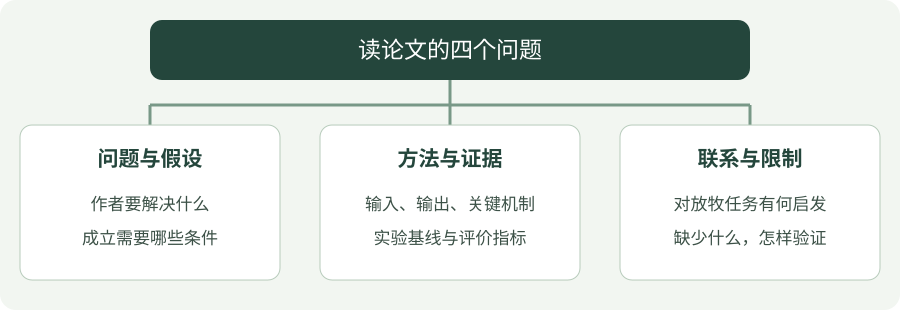

# 论文阅读记录

!!! tip "读完后先尝试讲给别人听"

    用三句话说明：作者解决什么问题、为什么这个方法可能有效、实验能支持到什么程度。说不清时，回到对应图表和假设，暂时不用背所有公式。

围绕具体研究问题阅读文献，保留方法、证据与可复现信息。目前本页提供阅读框架，具体论文笔记待整理。

## 看图梳理

{ .learning-figure }

[打开大图](../assets/learning/papers-index.svg)

**问题与假设**：作者要解决什么，成立需要哪些条件；**方法与证据**：输入、输出、关键机制，实验基线与评价指标；**联系与限制**：对放牧任务有何启发，缺少什么，怎样验证。

## 三遍阅读路线

### 第一篇论文，不要求第一次读懂每个公式

先找一个能画出来的问题：输入给了什么，方法做了什么，输出得到什么，实验怎样判断好坏。把陌生词分成“理解这篇必须知道”和“可以之后再查”两列，先补前一列。

例如读放牧方法时，先确认作者假设能拿到羊的真实位置，还是只能拿到相机估计；动作是目标点还是速度；羊群行为来自仿真还是真实观测。条件不同，方法即使名字相同也未必可以直接搬到自己的任务。

读完后尝试画“输入 → 方法 → 输出 → 评价”的四格图，并在每格写一句话。说不清输入输出时先返回任务定义，暂时不用强行抄完所有公式。

1. **判断相关性**：阅读摘要、问题定义与结论，明确它解决什么问题。
2. **理解方法**：梳理输入、输出、关键假设和方法结构。
3. **检查证据**：阅读实验设置、基线、消融与失败案例。

## 单篇论文记录模板

| 字段 | 要记录的内容 |
| --- | --- |
| 基本信息 | 标题、作者、年份、原文与代码入口 |
| 研究问题 | 场景、目标以及现有方法的不足 |
| 核心方法 | 输入输出、关键步骤与必要假设 |
| 实验证据 | 数据、指标、基线与主要结果 |
| 方法局限 | 失败条件、成本与适用范围 |
| 复现条件 | 依赖、硬件、参数与数据获取方式 |
| 研究启发 | 与智能放牧任务的联系及下一步实验 |

## 阅读后的三个问题

### 看到“提升 10%”，先问分母是什么

假设基线成功率为 60%，新方法为 70%：提高了 **10 个百分点**，相对提升约为 `(70−60)/60 = 16.7%`。这两个说法不是同一个量。只写“提升 10%”容易误导。

还要检查测试场景是否一致、每种方法评估了多少次、训练预算是否相同，以及是否报告不同训练种子的变化。单次最高分不能代替平均表现；均值相同，失败分布也可能不同。这些数字仅用于阅读练习，不是论文结果。

??? example "阅读练习：两个方法能直接比较吗？"

    方法 A 在 10 个简单场景成功 9 次；方法 B 在 100 个混合难度场景成功 85 次。不能仅凭 90% 与 85% 判断 A 更强：场景不同、样本数不同。先找共同测试集、成功定义与预算，再比较统计结果，并保留原始成功次数。

- 方法的改进来自哪里，是否有消融实验支持？
- 实验条件与自己的任务有哪些差异？
- 可以通过哪个最小实验验证自己的理解？

优先围绕羊群行为建模、机器人引导、多智能体决策与策略泛化整理文献。将论文原文的结论与个人推测分开记录。

[回到智能放牧研究](../herding/index.md)
