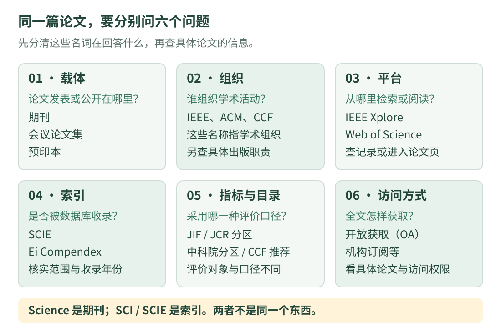

# 01 · 期刊、会议与分区：先把几个名字分清

<div class="course-intro" markdown="1">
<p class="course-label">文献入门 · 概念与查询方法 · 核验日期：2026-10-16</p>

第一次找论文，可能会同时看到 IEEE、SCI、Q1、CCF 和 OA。它们回答的是不同问题。先知道论文发表在哪里、被什么索引收录，再查评价口径和全文入口，就不会把一串标签误当成同一个“等级”。

[查看期刊与会议导航](venues.md){ .md-button .md-button--primary }
[学习怎样获取全文](access.md){ .md-button }
</div>

## 1. 看图：一篇论文可以同时有多种标签

{ .learning-figure }

[打开大图](../assets/learning/papers-publication-map.svg)

例如，一篇文章可以发表在某本 IEEE 期刊中，在 IEEE Xplore 上阅读，被某个索引收录，而期刊在某一年度、某一学科类别中有一个分区。这些信息能够同时成立，但不能互相替代。

| 你正在问什么 | 应查的东西 | 初学者容易混淆的地方 |
| --- | --- | --- |
| 论文发表在哪里？ | 期刊、会议论文集；或先在预印本平台公开 | 把上传预印本当成已经通过期刊审稿 |
| 谁在组织或出版？ | 学会、出版社、主办单位 | 把 IEEE 当成一本期刊 |
| 在哪里检索或阅读？ | IEEE Xplore、Web of Science、Scopus 等平台 | 把检索入口当成全文订阅权限 |
| 被哪个文献索引收录？ | SCIE、Ei Compendex 等 | 把会议宣传的“拟送检索”当成已经收录 |
| 用什么口径比较期刊或会议？ | JIF、JCR 分区、中科院分区、CCF 推荐目录 | 把 Q1、中科院 1 区、CCF A 当成同一个标签 |
| 全文怎样访问？ | 开放获取、机构订阅、作者公开版本等 | 把 OA 写成“代码开源” |

## 2. 期刊、会议和预印本分别是什么？

### 期刊：持续出版的一种学术载体

期刊可以理解为长期出版的学术刊物，例如 *IEEE Transactions on Robotics*。作者投稿后，通常经历编辑检查、同行评审、修改和决定；接收后再进入出版流程。实际步骤因刊物和文章类型而异。

期刊文章可以是完整研究、综述或 Letters（通常指较短的研究论文）。不要只凭页数判断水平，也不要认为所有期刊都比会议慢。**接收、在线发表、分配卷期和数据库收录是不同时间点。**

### 会议：学术交流活动与论文出版安排

会议是定期举办的学术交流活动。它可能征集研究论文、组织报告与海报，也可能有教程、竞赛和 Workshop（专题研讨会）。会议名称本身，不足以说明某项活动是否提供正式论文出版。

在机器人、计算机视觉和机器学习领域，有很重要的会议论文交流传统，例如 ICRA、RSS、CoRL、CVPR。比较一篇会议论文时，要进一步确认是正式研究论文、短文、摘要，还是 Workshop 稿件，不能只看它挂在哪个大会名下。

期刊与会议各有发表方式和评审安排，不能简单排成“期刊永远高于会议”。看具体研究内容、文章类型、审稿规则和证据，才有可比较的信息。

### arXiv：公开稿件的平台，平台审核不等于同行评审

[arXiv](https://arxiv.org/)提供研究稿件的公开存储与传播服务。上传要遵守其审核规则，但 arXiv 的审核并不是期刊或会议的同行评审。平台上既可能有尚未评审的预印本，也可能有后来已发表论文的作者版本；因此不能把所有 arXiv 稿件都说成“从未通过同行评审”。应查看具体文章的版本记录、期刊信息和正式发表链接。[arXiv 官方说明](https://info.arxiv.org/about/index.html)

读到一篇预印本时，可以先学习其方法，同时记录“我读的是哪个版本，正式发表状态是否已核对”。

## 3. IEEE、ACM、CCF、SCI 和 EI 怎样区分？

| 名称 | 它是什么 | 应怎样使用 |
| --- | --- | --- |
| IEEE | 专业技术组织，也开展期刊、会议论文等出版工作 | 查具体刊名、会议名和文章；[IEEE Xplore](https://ieeexplore.ieee.org/)是其数字图书馆入口 |
| ACM | 计算领域的专业学会，也开展学术出版 | 查具体刊物与会议；[ACM Digital Library](https://dl.acm.org/)是数字图书馆入口 |
| CCF | 中国计算机学会 | 查[官方推荐目录](https://www.ccf.org.cn/Academic_Evaluation/By_category/)的版本、领域与条目；它不是一个文献收录数据库 |
| SCI / SCIE | Science Citation Index / Science Citation Index Expanded 相关索引名称；当前期刊核验中常查 SCIE | 到 [Master Journal List](https://mjl.clarivate.com/)核对具体索引；不能把整个 Web of Science 平台都简称为 SCI |
| Ei Compendex | 工程领域的文献索引，包含期刊论文和会议论文等文献 | 通过 Engineering Village 等相应入口核对；收录范围与全文访问权限不是一回事 |

**Science 是学术期刊名称，SCI 是索引名称。** Nature 也是期刊名称；二者的出版品牌还包含其他刊物。不要把“Science 论文下载”写成“SCI 论文下载”：被 SCIE 收录的文章可能来自很多不同出版社，需要分别找到原文平台。

“本刊被收录”和“这篇文章已经能在数据库中查到”也不是完全相同的陈述。核对一篇文章时，还要看收录覆盖年份、文章类型和实际检索记录。[Clarivate 期刊核验入口](https://mjl.clarivate.com/)、[Ei Compendex 官方介绍](https://www.elsevier.com/products/engineering-village/databases/compendex)

## 4. “几区”和“多少分”，为什么必须带年份？

### JIF：期刊层面的引用指标

日常说的期刊“影响因子”常指 Clarivate 在 Journal Citation Reports（JCR）中发布的 **Journal Impact Factor，简称 JIF**。它是特定数据年度的期刊指标；不同年份、学科和统计口径的数字不能随意混在一起。

JIF 不是某篇文章的质量分，也不是稿件录用概率。期刊的指标较高，不能替代对这篇论文方法和实验的阅读。[Clarivate 对 JIF 使用范围的说明](https://clarivate.com/academia-government/scientific-and-academic-research/research-funding-analytics/journal-citation-reports/)

**CiteScore 是另一套基于 Scopus 数据的来源指标，计算窗口与 JIF 不同。** 网页上的 CiteScore、JIF、h-index、用户评分和查看次数，应分别记录；不能把其中某个数直接填进“影响因子”一栏。[Elsevier 的 CiteScore 定义](https://service.elsevier.com/app/answers/detail/a_id/14880/supporthub/scopus/)

其中，**h-index（h 指数）**同时涉及论文数量与引用次数：例如某个统计对象的 h 指数为 10，表示它至少有 10 篇论文各被引用至少 10 次，且没有达到“11 篇各被引用至少 11 次”的门槛。它可能用于作者、期刊等不同对象，结果还取决于数据库与统计范围；不能拿不同口径的 h 指数直接比较。[Elsevier 的指标说明](https://www.elsevier.com/en-gb/researcher/author/tools-and-resources/measuring-a-journals-impact)

### JCR Q1 与中科院 1 区是两套口径

JCR 的 Q1～Q4 描述期刊在特定年度、特定学科类别中的相对位置。以基于 JIF 的分区为例，Q1 通常对应该类别中排名靠前的约四分之一；并列等规则要看报告。一份期刊若属于多个类别，可能有不同的排名与分区。[Clarivate 分区说明](https://support.clarivate.com/ScientificandAcademicResearch/s/article/Journal-Citation-Reports-Quartile-rankings-and-other-metrics?language=en_US)

中国科学院文献情报中心的[期刊分区表](https://www.fenqubiao.com/)则有自己的分区方法，并提供大类、小类等查询维度。可以把大类理解为较宽的学科范围，小类理解为更具体的学科类别；以查询页实际列出的名称为准。它不是把 JCR 的 Q1 直接改写成“中科院 1 区”。查询时记录使用的年度与版本、大类名称及分区、小类名称及分区；不要把大类和小类交叉拼接。

因此，“这本刊是一区”还不够完整。应继续问：**哪一套体系、哪一年、哪个类别？**

### CCF A/B/C 是推荐类别，不是期刊分区

CCF 推荐目录按领域列出会议与期刊，并给出 A、B、C 推荐类别。它与 JCR 分区、中科院分区的对象和方法不同，也不覆盖所有研究领域。

查会议时，要核对当年采用的目录版本和论文类型，正式长文与 Workshop、Demo 等不应混算。CCF 自身也说明，目录是推荐参考，不宜简单用作单篇成果评价依据。[CCF 官方目录及使用说明](https://www.ccf.org.cn/Academic_Evaluation/By_category/)

## 5. 怎样查期刊信息：工具各有用途

### LetPub：先看汇总，再回到原始来源核对

[LetPub](https://www.letpub.com.cn/)提供期刊信息查询及相关服务，可用来查找刊名、ISSN、出版信息和投稿参考内容。各期刊页面提供的字段可能不同，用户投稿经验也可能来自不同年份与稿件类型。

可以先用它快速了解候选期刊，但正式记录 JIF、分区、收录状态与收费时，应继续核对对应数据库和期刊官网。用户评分、浏览次数和个人审稿经历，不是官方期刊等级。

如果按缩写查不到，先尝试完整刊名，再用 **ISSN** 查。ISSN 是识别连续出版物的标准编号；纸刊与电子版可能使用不同 ISSN。某个第三方页面没有结果，不能据此断言期刊不被收录。

### IEEE Publication Recommender：帮你找匹配对象

[IEEE Publication Recommender](https://publication-recommender.ieee.org/)用于寻找可能匹配稿件主题的 IEEE 发表渠道。可以按工具支持的方式输入关键词或稿件信息，再阅读候选刊物的研究范围与作者指南。入口改版时，可从[当前 IEEE 作者中心的查刊页面](https://journals.ieeeauthorcenter.ieee.org/create-your-ieee-journal-article/authoring-tools-and-templates/tools-for-ieee-authors/find-a-journal/)进入推荐工具或 Publishing Portal。

它的推荐结果不等于“官方给所有期刊和会议排出了统一等级”，也不保证你的稿件会被接收。看到某个指标时，同样要核对年份、定义和来源。[IEEE 对推荐工具用途的说明](https://open.ieee.org/how-to-choose-the-right-publication-for-your-submission/)

### 跟着做：用 Engineering Structures 练习查刊

1. 搜完整刊名 **Engineering Structures**，避免把标题相近的期刊当成同一本。
2. 打开[出版社期刊页](https://www.sciencedirect.com/journal/engineering-structures)，确认刊名、出版信息与研究范围。它面向结构工程，不能仅因名字含 Engineering 就认为所有机器人论文都对口。
3. 到 Master Journal List 核对索引，到相应年度 JCR 查 JIF 和类别分区；需要中科院分区时，另查对应年度分区表。
4. 把年份、类别和来源一起记下。查 *IEEE Transactions on Industrial Electronics* 时也使用同样顺序，不能只复制“7.5 分、一区、约半年”这类脱离口径的句子。

## 6. OA 是开放获取，不是“代码开源”

**开放获取（Open Access，OA）**关注论文是否能公开阅读及其许可条件；**开源**通常讨论代码是否按相应许可证开放。论文 OA，不代表作者一定公布代码；代码公开，也不保证论文出版社版本免费。

有的期刊全部开放获取，有的订阅期刊同时提供单篇 OA 选项。阅读免费不等于发表一定免费；有的 OA 刊物收取文章处理费（APC），也有不收 APC 的方式。APC 可能由作者、机构或资助方承担；具体金额、减免、许可和资助协议应查该刊当前作者指南，不能只根据一个 OA 占比推断。[IEEE 的 OA 介绍](https://open.ieee.org/about/)、[文章处理费说明](https://open.ieee.org/for-authors/article-processing-charges/)

## 7. 审稿周期：先确认“在计哪一段时间”

| 页面上可能看到的词 | 它通常想表达什么 | 使用时要核对什么 |
| --- | --- | --- |
| 首次决定时间 | 从投稿到第一次编辑决定 | 是否包含未送外审的直接退稿；是否只是某一统计时段的数据 |
| 外审后决定时间 | 送外审后获得决定所需的时间 | 起止点、统计方法，以及是不是中位数 |
| 接收时间 | 从投稿到稿件被接收 | 是否包含多轮修改及作者返修时间 |
| 在线发表时间 | 从接收或其他起点到上线 | 出版社实际采用哪个起点 |
| 会议通知日期 | 某届会议公布论文决定的日期 | 该届征稿与日程，而不是往年的月份 |

所以“平均三个月”本身不能成为保证。先查官网当前口径，再看个人经历作补充；录用比例、年发文量也必须带统计年度和文章范围。

## 8. 留下一份别人能复查的记录

以下是填写模板，`待填`不是实际查询结果：

```text title="期刊信息核对模板"
完整刊名 / 纸刊与电子版 ISSN：待填
出版社与官方期刊页：待填
研究范围与文章类型：待填
索引名称、覆盖情况与核验日期：待填
JIF 数据年度、数值与来源：待填
JCR 年度、类别、分区：待填
中科院分区年度与版本、大类 / 小类：待填
OA 方式、许可与作者费用：待填
审稿统计名称、统计口径与来源日期：待填
与自己论文的匹配点：待填
```

??? example "自测：看到“IEEE、Q1、OA”，已经知道这篇文章的所有信息了吗？"

    还没有。IEEE 说明组织或出版背景；Q1 还缺年度、分区体系与学科类别；OA 还要核对这篇文章的访问方式和许可。它们都没有直接说明实验是否可信、代码是否公开、稿件一定多久接收。

[返回论文学习](index.md) · [下一篇：机器人与放牧相关期刊、会议 →](venues.md)
