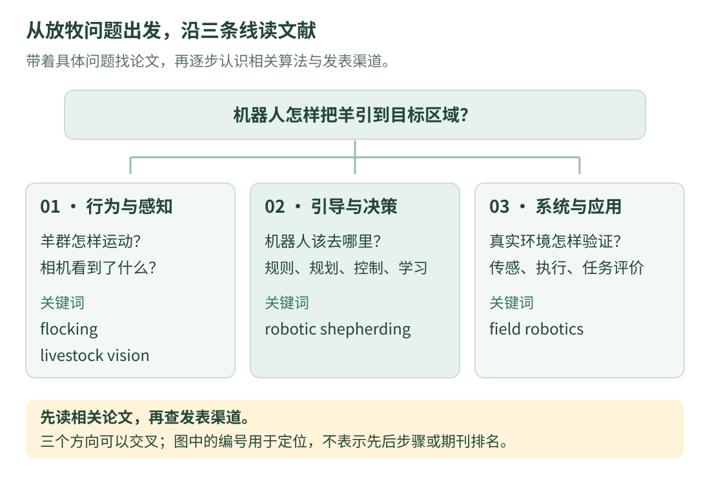

# 02 · 机器人与放牧相关期刊、会议

<div class="course-intro" markdown="1">
<p class="course-label">文献导航 · 先看研究问题，再看发表渠道 · 核验日期：2026-10-16</p>

不知道从哪里找论文时，可以先认识几类常见发表渠道。这里保留原稿中的主要期刊和会议，补全名称与官方入口，并按“我想学什么”解释用途。表格是查找文献的起点；排列顺序不代表排名。

[先了解期刊、会议和分区](publication-basics.md){ .md-button }
[找到文章后怎样获取全文](access.md){ .md-button .md-button--primary }
</div>

## 1. 先用一句话说出自己的问题

{ .learning-figure }

[打开大图](../assets/learning/papers-venues-map.svg)

“我研究放牧机器人”还是有点宽。把它拆开，才知道该找哪一类文章。下面的问题是检索示例，不代表某种方法已经在你的系统中实现。

| 当前想弄懂的问题 | 先找哪类文献 | 可尝试的英文关键词 |
| --- | --- | --- |
| 羊群会怎样移动、聚集或分散？ | 群体行为建模、动物行为与仿真 | collective behaviour、flocking、sheep behaviour |
| 怎样从相机中找到羊，并持续区分同一只？ | 目标检测、跟踪、农业视觉 | livestock detection、sheep tracking |
| 机器人该去哪里，才能把羊引向目标区？ | 机器人规划、控制与学习 | robotic shepherding、robotic herding、herding control |
| 遇到地形变化、遮挡或位置误差怎么办？ | 野外机器人、定位、系统验证 | field robotics、terrain、localization |
| 实验怎样说明方法在牧场里有用？ | 农业机器人、畜牧应用与评价 | agricultural robotics、precision livestock farming |

**例如：**你想研究“机器人怎样收拢掉队的羊”。可以先搜 `robotic shepherding` 找任务背景，再加 `collecting` 缩小范围。只搜 `PPO` 会漏掉规则方法、控制方法和其他学习方法；只搜 `robotics` 又会得到太多不相关结果。

如果一次搜不到，不必把所有关键词都塞进去。先用两个核心词，再从相关论文的题目、摘要和参考文献中找更准确的叫法。英文里的 `herding` 也可能出现在金融或人群研究中，要检查摘要是不是在说动物与机器人。

## 2. 常见国际机器人期刊

读表时先看第三列：它告诉你可能从这些期刊中学到什么。是否适合投稿，还要结合具体稿件的贡献、文章类型及期刊当前研究范围判断。

表中的期刊名称均链接到学会或出版者页面，便于继续查 **Aims and Scope**（收什么方向）、**Guide for Authors / Author Information**（怎样投稿）以及近期文章。

| 期刊与常见简称 | 主要关注什么 | 初学者阅读时可以带着的问题 |
| --- | --- | --- |
| [Science Robotics](https://www.science.org/journal/scirobotics) | 机器人科学、技术及其跨学科研究 | 作者提出了什么机器人问题？关键设计为什么能解决它？ |
| [IEEE Transactions on Robotics（T-RO）](https://www.ieee-ras.org/publications/t-ro/t-ro-information-for-authors/) | 机器人设计、感知、规划、控制与系统研究 | 方法的假设是什么？理论、算法和实验怎样对应？ |
| [IEEE Transactions on Industrial Electronics（TIE）](https://www.ieee-ies.org/pubs) | 工业电子，以及控制、仪器、计算方法等在工业系统中的应用 | 方法与具体电子、驱动或控制系统怎样结合？ |
| [IEEE/ASME Transactions on Mechatronics（TMECH）](https://www.ieee-asme-mechatronics.info/) | 机械、电子、计算与控制相结合的机电系统 | 机械结构、传感器和控制器为什么要一起设计？ |
| [Soft Robotics](https://journals.sagepub.com/home/srba) | 柔性、可变形的机器人及相关材料、驱动和感知 | 身体会变形时，怎样建模、驱动和测量？ |
| [IEEE Robotics and Automation Letters（RA-L）](https://www.ieee-ras.org/publications/ra-l/ra-l-information-for-authors/) | 以较简洁的文章形式报告机器人与自动化研究 | 在有限篇幅内，作者怎样讲清问题、方法与核心证据？ |
| [Journal of Field Robotics（JFR）](https://onlinelibrary.wiley.com/journal/15564967) | 非结构化、动态环境中的机器人，包括农业等野外场景 | 系统怎样应对地形、感知误差与真实环境变化？ |
| [Robotics and Autonomous Systems（RAS）](https://www.sciencedirect.com/journal/robotics-and-autonomous-systems) | 机器人与自主系统的理论、计算方法及实验 | 感知、决策与控制怎样形成一个自主系统？ |
| [The International Journal of Robotics Research（IJRR）](https://journals.sagepub.com/home/ijr) | 机器人领域的跨学科理论与实验研究 | 作者怎样把机器人问题讲成可分析、可验证的研究？ |
| [Autonomous Robots](https://link.springer.com/journal/10514/aims-and-scope) | 机器人的自主性、适应、交互、移动与操作等 | 机器人在没有人逐步指挥时，怎样作出可靠行动？ |
| [Robotica](https://www.cambridge.org/core/journals/robotica/information/about-this-journal) | 运动学、动力学、规划、感知、控制及机器人应用 | 模型中的变量代表什么？它怎样对应到真实机器人？ |

不用一次读完十一种期刊。比如你正在看“仿真方法怎样走向牧场实验”，可以先从 JFR 的相关文章入手，再沿参考文献寻找规划、控制或感知方法。

### RA-L 与会议展示：先分清“在哪里发表”

RA-L 是期刊，ICRA、IROS 是会议。在会议上展示一篇已被 RA-L 接收的论文，不等于同一研究又作为一篇新的会议论文发表。

按目前的[RA-L 官方常见问题说明](https://www.ieee-ras.org/publications/ra-l/faq/)，符合条件的已接收 RA-L 论文可以依规定申请相关会议展示，论文仍在 RA-L 出版；不能把同一稿件同时投给 RA-L 和会议。申请对象、时间窗口与展示安排，应查看当届会议及 RA-L 的最新说明，不沿用旧教程中的月份。

## 3. 常见国际机器人会议

会议名称后面的年份很重要，例如“某会议 2026”和“某会议 2027”有不同的截止时间、举办地点和征稿规则。下面链接优先使用学会长期导航或会议主页；进入后再找对应届次。

| 简称与全称 | 主要方向 | 怎样用它找论文 |
| --- | --- | --- |
| [RSS · Robotics: Science and Systems](https://roboticsconference.org/) | 机器人科学问题、算法与系统 | 从当届或往届论文列表中，寻找与你的问题相近的工作 |
| [ICRA · IEEE International Conference on Robotics and Automation](https://www.ieee-ras.org/conferences-workshops/fully-sponsored/icra/) | 机器人与自动化的广泛主题 | 按规划、控制、感知、机器人学习等主题查找 |
| [IROS · IEEE/RSJ International Conference on Intelligent Robots and Systems](https://www.ieee-ras.org/conferences-workshops/financially-co-sponsored/iros/) | 智能机器人与系统 | 留意导航、感知、学习及系统集成的相关文章 |
| [CoRL · Conference on Robot Learning](https://www.corl.org/) | 机器人与机器学习的交叉研究 | 阅读学习方法时，同时检查机器人任务、训练数据和评估条件 |
| [CASE · IEEE International Conference on Automation Science and Engineering](https://www.ieee-ras.org/conferences-workshops/fully-sponsored/case/) | 自动化科学与工程 | 从自动化、调度、制造与机器人系统中寻找相关方法 |

不要只看“会议很有名”，就跳过论文类型。主会研究论文、Workshop（专题研讨会）论文、海报摘要、竞赛报告和受邀报告，可能有不同的评审与出版安排。查论文时应核对作者给出的正式出版记录。

### 原稿中提到的机器学习与视觉会议

机器人研究还会引用机器学习和视觉领域的成果。这些领域中的方法可以成为工具，但图像分类实验做得好，不代表已经解决了机器人放牧问题：还要检查输入、动作、时间延迟、安全约束和任务评价是否适用。

| 会议官方入口 | 可以先了解的主题 |
| --- | --- |
| [NeurIPS](https://neurips.cc/) | 神经信息处理与机器学习 |
| [ICML](https://icml.cc/) | 机器学习方法及相关研究 |
| [ICLR](https://iclr.cc/) | 表征学习、深度学习及相关方法 |
| [CVPR](https://cvpr.thecvf.com/) | 计算机视觉与模式识别 |

进入官网后，同样要选择届次并阅读 **Call for Papers**（征稿说明）及论文列表。任务相关性比单独记住会议缩写更有助于阅读。

## 4. 常见国内相关期刊

中文期刊可以帮助初学者先建立术语与问题框架。读中文不代表可以省略对方法、实验和结论的核对；仍然使用[三遍阅读路线](index.md)。

| 期刊与英文名称 | 主要阅读方向 |
| --- | --- |
| [《机器人》 · Robot](https://robot.sia.cn/) | 机器人机构、控制、感知、规划与系统 |
| [《自动化学报》 · Acta Automatica Sinica](https://www.aas.net.cn/news/jibenxinxi.htm) | 自动控制、人工智能、机器人、模式识别与图像处理 |
| [《控制理论与应用》 · Control Theory & Applications](https://jcta.ijournals.cn/cta_cn/ch/first_menu.aspx?parent_id=20260108091216001) | 系统建模、辨识、估计、控制与优化等 |
| [《控制与决策》 · Control and Decision](https://kzyjc.alljournals.cn/) | 控制、决策优化、协同与无人系统等 |
| [《机械工程学报》 · Journal of Mechanical Engineering](https://www.cjmenet.com.cn/) | 机构、动力学、机械与机电系统等 |
| [《中国机械工程》 · China Mechanical Engineering](https://www.cmemo.org.cn/CN/home) | 机械装备、制造与机器人应用等 |

**注意相近刊名：**中文《自动化学报》与 *IEEE/CAA Journal of Automatica Sinica* 不是同一本期刊；中文《机械工程学报》与 *Chinese Journal of Mechanical Engineering* 也不能混为一刊。检索时核对完整刊名、ISSN 与官网。

原稿中的“机器人方向 2 区”“自动化领域 1 区”等写法没有交代评价体系、年度与类别，这里不作为固定结论保留。北大核心、CSCD、科技核心、Ei Compendex 等也有各自的目录或覆盖范围，正式使用前应查相应版本和实际收录记录。

### 常见国内学术会议与交流活动

下面既有征集研究论文的会议，也有以主题报告、论坛等为主要形式的大会。**“可以参加交流”“可以提交摘要”“论文被正式出版”是三件不同的事。**

| 名称 | 主要交流主题 | 官方材料与使用提醒 |
| --- | --- | --- |
| CCRS · 中国机器人学术年会 | 机器人控制、规划、感知、系统等 | [承办高校的会议介绍](https://robot.hnu.edu.cn/info/1051/1912.htm)可帮助认识活动；当届征集方式和安排需另查 |
| CCIR · 中国智能机器人大会 | 智能机器人的感知、学习、控制与系统 | [2026 届官网](http://www.ccir2026.com.cn/)；缩写与名称按当届官方写法核对 |
| CAC · 中国自动化大会 | 自动化、信息与智能技术 | [学会介绍](https://www.caa.org.cn/Content/21.html)、[会议入口](https://cac.org.cn/)；查看对应届次的征稿与出版安排 |
| CCC · 中国控制会议 | 控制理论、算法、建模与系统 | [中国科协的 2026 届会议报道](https://www.cast.org.cn/xw/qgxh/ZHXX/art/2026/art_470d809044ff41c8924dc95391c28c7f.html)用于了解活动；投稿应查目标届次的征稿文件 |
| CCAI · 中国人工智能大会 | 人工智能与相关交叉方向的学术交流 | [学会往届档案](https://dl.caai.cn/home/Activity/index.html?activity_id=2)用于了解活动；当前届次的投稿与出版政策需另行核对 |
| CEAI · 中国具身智能大会 | 具身智能、机器人及相关模型与应用 | [官方入口](https://ceai.caai.cn/)；报告、论坛、论文征集分别核对，不预设都有会议论文集 |

看会议介绍时，可依次找：主办单位、届次、征集对象、审稿方式、文章类型、出版去向，以及是否有可核实的往届论文。宣传中写“拟提交某数据库检索”，也不等于每篇文章已经被该数据库收录。

## 5. 放牧机器人：按贡献选择交叉领域

“放牧方向期刊”不是一个统一的期刊分区。放牧机器人同时涉及动物行为、感知、决策、控制和农业应用，应先说清论文的新贡献在哪里。原稿这一节误放了重复的国内期刊表，这里改成与研究问题有关的入口。

| 你的工作主要在解决什么 | 可以先阅读的期刊 | 还应补查哪些证据 |
| --- | --- | --- |
| 农业、畜牧任务中的计算、电子、传感或机器人方法 | [Computers and Electronics in Agriculture](https://shop.elsevier.com/journals/computers-and-electronics-in-agriculture/0168-1699) | 是否有明确技术创新？数据、农业任务与评价条件是什么？ |
| 专家系统、智能系统或相关方法在实际问题中的应用 | [Expert Systems with Applications](https://shop.elsevier.com/journals/expert-systems-with-applications/0957-4174) | 方法相对已有工作的改进在哪里？比较是否充分？ |
| 野外环境中的机器人系统与实验 | [Journal of Field Robotics](https://onlinelibrary.wiley.com/journal/15564967) | 环境变化、误差、失败案例和系统表现是否被检验？ |
| 自主系统的决策、学习与控制方法 | [Robotics and Autonomous Systems](https://www.sciencedirect.com/journal/robotics-and-autonomous-systems) | 假设、方法和机器人任务之间是否有清楚联系？ |

前两本都不是专门发表“放牧机器人”的期刊。期刊范围与自己的题目有交集，只是继续阅读的理由，不能直接推断“这个工作一定适合投这里”。

**用一个假想选题练习：**同样是让机器人把羊引到目标区，文章重心可以不同。

- 若主要研究羊群行为模型，就要查动物行为相关文献，检验模型依据；不能只看机器人动作是否跑通。
- 若主要提出新的引导策略，就要和相关控制、规划或学习方法比较，检查成功率、安全性和适用条件。
- 若主要完成牧场系统，就要说明传感、定位、动作执行与环境变化怎样影响任务结果。

这些是选文献和设计研究的思路，并不是对期刊接收标准的替代。正式投稿前，应阅读候选期刊的最新范围与近期相近论文，再与导师讨论匹配性。

## 6. 不背排名：完成一次能复查的查找

1. **写问题**：例如“怎样在有位置误差时引导羊群”。
2. **找相关文章**：搜索任务关键词，先读摘要，确认动物、机器人、输入输出和实验条件。
3. **顺着来源扩展**：看文章发表在哪里、引用了谁、又被哪些工作引用。不要把所有搜索限制在一张期刊表里。
4. **核对正式信息**：期刊查范围与作者指南；会议查当届征稿、文章类型、出版安排和关键日期。
5. **需要评价信息时再查**：把体系、数据年度、学科类别和来源一起记录，方法见[上一篇](publication-basics.md)。

```text title="期刊 / 会议候选记录模板：待填项不是实际结果"
自己的研究问题与主要贡献：待填
期刊完整名称 / 会议名称与届次：待填
官方入口、访问日期：待填
与本课题相近的论文：待填
研究范围为什么匹配：待填
文章类型、篇幅与投稿要求：待填
会议截止与通知日期、对应时区（如适用）：待填
出版与检索说明、是否已核实：待填
OA、作者费用和资助要求：待填
尚不确定的地方：待填
```

??? example "小练习：做放牧强化学习，只找 PPO 论文够吗？"

    不够。先查放牧任务、羊群模型与已有引导方法，再查与你的决策问题相关的学习算法。基线可能是规则控制、规划或其他学习方法。算法名称相同，也要核对观察信息、动作形式、奖励、训练预算与评估条件，才能判断比较是否公平。

[返回论文学习](index.md) · [上一篇：期刊、会议与分区入门](publication-basics.md) · [下一篇：检索与获取论文全文 →](access.md)
