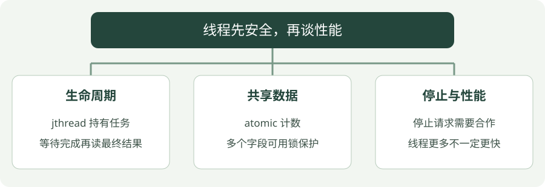

# 13 · 并发与线程

**示例标准：C++20**

并发让多项工作在时间上交错推进。线程可能并行执行，但线程越多不一定越快；共享数据如果没有协调，还可能得到错误结果。


!!! tip "读完这页，你应该能做到"

    检查共享数据如何同步，读取最终结果前如何等待。

    **先会这些就够了**：Lambda、生命周期。


## 看图梳理

{ .learning-figure }

[打开大图](../../assets/learning/cpp-concurrency.svg)

**生命周期**：jthread 持有任务，等待完成再读最终结果；**共享数据**：atomic 计数，多个字段可用锁保护；**停止与性能**：停止请求需要合作，线程更多不一定更快。


## 两个人同时记数，为什么会漏掉一次

普通的“加一”可以理解为读取旧值、计算新值、写回。如果两个线程都先读到 0，各自算出 1，再各自写回 1，总共做了两次工作，计数却只增加一次。在 C++ 中没有同步的这种冲突访问还构成数据竞争，不能把这张示意表当作唯一可能结果。

atomic 的 fetch_add 把这次读、改、写组成一个原子操作：其他线程不能插进这个计数操作中间。它保护计数，却不表示全部工作已经结束，所以最后还要等线程完成。

| 要保证的事情 | 本例用什么实现 |
| --- | --- |
| 计数更新不发生数据竞争 | atomic 的 fetch_add |
| 读最终结果时两份工作都做完 | 内部作用域结束，jthread 等待 |
| 工作期间计数器始终存在 | samples 创建在外层作用域 |

每个线程做 1000 次，总共 2000 次。哪个先完成并不重要，计数同步与等待条件才重要。并发不等于加速：任务太小，创建线程和协调的成本可能比计算更高。


## 先保证生命周期，再保护共享数据

`std::jthread` 在析构时请求停止并等待线程结束，减少忘记 `join` 的风险。但停止请求是合作式的：工作函数必须主动检查停止标记，不能强制打断任意阻塞操作。

`mutex` 像同一份资料的一把锁，`lock_guard` 用 RAII 在作用域内持锁。`atomic` 适合独立计数等原子操作；多个字段一起维持不变量时，一个原子计数器并不能替代整体同步设计。

两个线程没有同步地读写同一普通变量，且至少一个写，可能构成数据竞争，这是未定义行为。不要凭“只加一下”判断它安全。

## 完整示例

```cpp
#include <atomic>
#include <iostream>
#include <thread>

// 程序入口；下面按顺序执行示例步骤。
int main() {
    // 共享计数器，用原子操作避免竞争导致的丢失更新。
    std::atomic<int> samples{0};
    {
        // 引用捕获计数器；计数器必须比工作线程活得久。
        const auto collect = [&samples] {
            for (int i = 0; i < 1000; ++i) {
                // 原子的读—改—写，默认使用顺序一致的内存序。
                samples.fetch_add(1); // Default sequentially consistent ordering.
            }
        };
        // 启动工作；对象析构会请求停止并等待线程结束。
        std::jthread first{collect};
        // 启动工作；对象析构会请求停止并等待线程结束。
        std::jthread second{collect};
    } // Both jthreads join before reading the final count.
    // 内部作用域已结束，两个线程完成后读取最终计数。
    std::cout << "samples: " << samples.load() << '\n';
}
```

## 编译与运行

在示例目录执行。Windows 使用 PowerShell；Linux/macOS 将 `./concurrency.exe` 换成 `./concurrency`，并把输出文件名的 `.exe` 去掉。

```powershell
g++ -std=c++20 -Wall -Wextra -Wpedantic -pthread concurrency.cpp -o concurrency.exe
./concurrency.exe
```

预期输出：

```text
samples: 2000
```

## 怎样读这段代码

两个线程各增加 1000 次。`fetch_add` 是原子的读—改—写，所以不会丢掉某次增加。我们保留默认内存顺序，初学不急着换成 relaxed。

内部作用域结束时，先销毁第二个线程对象，再销毁第一个，二者都会等待各自任务完成。计数器在外部作用域，仍然存在，所以引用捕获有效。最终读取发生在线程全部结束之后，结果稳定为 2000。

本例工作函数不接收停止令牌，也不会响应停止请求，但任务是有限循环，可以正常结束。它不是实时采集系统。

## 常见错误

- 把 atomic 换成普通 int，即使偶尔输出 2000，也不能证明程序正确。
- `volatile` 不提供线程同步，不能代替 atomic 或 mutex。
- jthread 等待不代表一定很快退出；工作线程一直阻塞时析构也可能一直等待。

## 动手练习

<div class="practice-card" markdown="1">

<p class="practice-kicker">接着正文做一个小改动</p>

<p class="practice-title">等三个线程结束再看总数</p>

原例的两个线程各加 1000 次。这次改变工作量和线程数量，练习用同步条件解释结果，而不是猜哪条线程先完成。

**从哪里开始**：修改 concurrency.cpp 的 collect 循环上限，并在原来的内部作用域中增加第三个 jthread。

**按这几步做**：

1. 把每个线程的循环上限改为 500。
2. 三个线程调用同一个 collect，并使用同一个 atomic 计数器。
3. 保留最终输出在内部作用域结束之后。

??? tip "需要一点提示？"

    总数是 3 × 500。计数器先创建、后销毁；线程结束前不要把局部变量释放掉。

??? example "查看参考修改与解释"

    三个 jthread 在内部作用域退出时等待完成，再读取计数得到 1500。atomic 防止加一过程中的竞争，等待保证最终工作都已完成。

    **放在哪里**：用这段替换 main 内的原演示；保留 atomic、iostream、thread 头文件。

    ```cpp
    std::atomic<int> samples{0};
    {
        const auto collect = [&samples] {
            for (int i = 0; i < 500; ++i) {
                samples.fetch_add(1);
            }
        };
        std::jthread first{collect};
        std::jthread second{collect};
        std::jthread third{collect};
    } // 三个线程都结束后，才读取最终总数。
    std::cout << "samples: " << samples.load() << '\n';
    ```

    **核对这段修改的结果**：

    ```text
    samples: 1500
    ```

</div>


## 延伸阅读

[规范或官方指南](https://eel.is/c++draft/thread.jthread.class)。标准草案会继续更新，查阅时注意条款可能包含晚于本章示例的功能。


---

[返回学习路线](index.md) · [上一章：12 · C++23：用 expected 表达失败](cpp23.md) · [下一章：14 · CMake 与调试 →](tooling.md)
