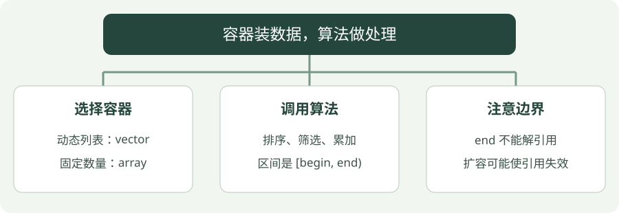

# 05 · 容器与标准算法

**示例标准：C++17** · [下载完整代码](examples/containers.cpp)

容器负责装数据，算法负责处理数据。优先组合标准库工具，通常比自己维护数组容量和排序循环更容易检查。


## 看图梳理

{ .learning-figure }

[打开大图](../../assets/learning/cpp-containers.svg)

**选择容器**：动态列表：vector，固定数量：array；**调用算法**：排序、筛选、累加，区间是 [begin, end)；**注意边界**：end 不能解引用，扩容可能使引用失效。


## 先选合适的容器

| 容器 | 适合的场景 | 注意 |
| --- | --- | --- |
| `std::vector<T>` | 数量会变化的连续列表 | 扩容可能使旧引用和指针失效 |
| `std::array<T, N>` | 编译时知道固定数量 | 大小是类型的一部分 |
| `std::map<K, V>` | 按键查找，并按键有序遍历 | 通常查找为对数复杂度 |
| `std::unordered_map<K, V>` | 按键快速查找，不要求顺序 | 平均常数查找，最坏可线性 |

迭代器像指向容器元素的位置标记。`begin()` 指向起点，`end()` 指向末尾之后，不能解引用。常见算法使用半开区间 `[begin, end)`。

## 完整示例

```cpp
#include <algorithm>
#include <iostream>
#include <numeric>
#include <vector>

// 程序入口；下面按顺序执行示例步骤。
int main() {
    std::vector<double> distances{4.0, 1.0, 3.0, 2.0};
    // 对半开区间 [begin, end) 排序，修改原容器。
    std::sort(distances.begin(), distances.end());
    // 统计满足条件的元素，不生成另一个列表。
    const auto close_count = std::count_if(
        distances.begin(), distances.end(),
        // 无捕获 Lambda：每个距离小于等于 2 才算接近。
        [](double d) { return d <= 2.0; });
    // 初值 0.0 让累加保持浮点类型。
    const double sum = std::accumulate(
        distances.begin(), distances.end(), 0.0);
    for (const auto distance : distances) {
        // 把结果输出到终端，便于与正文中的示例结果对照。
        std::cout << distance << ' ';
    }
    // 把结果输出到终端，便于与正文中的示例结果对照。
    std::cout << "\nclose: " << close_count << ", sum: " << sum << '\n';
    // at 带范围检查，非法位置会抛异常。
    std::cout << "first: " << distances.at(0) << '\n';
}
```

## 编译与运行

在示例目录执行。Windows 使用 PowerShell；Linux/macOS 将 `./containers.exe` 换成 `./containers`，并把输出文件名的 `.exe` 去掉。

```powershell
g++ -std=c++17 -Wall -Wextra -Wpedantic containers.cpp -o containers.exe
./containers.exe
```

预期输出：

```text
1 2 3 4 
close: 2, sum: 10
first: 1
```

## 怎样读这段代码

`sort` 修改原列表，把距离从小到大排列；`count_if` 对每个元素执行条件函数，统计满足条件的数量；`accumulate` 从 `0.0` 开始求和。

`[](double d) { return d <= 2.0; }` 是一个就地写出的短函数，第 08 章会详细讲 Lambda。

`at(0)` 带越界检查，访问非法位置会抛 `std::out_of_range`；`operator[]` 在本教程的 C++17/20/23 示例中不提供这种异常检查，越界属于未定义行为。

## 常见错误

- `reserve(100)` 只预留容量，不会产生 100 个元素；`resize(100)` 才改变元素数量。
- 不要在范围循环里随意 `push_back` 到正在遍历的 `vector`。
- `map[key]` 在键不存在时会插入默认值；只想查询时使用 `find`，或在 C++20 用 `contains`。

## 动手练习

统计严格大于 2 米的数量，并求最大距离。

??? tip "展开参考答案"

    条件改为 `[](double d) { return d > 2.0; }` 得到 2；非空列表用 `*std::max_element(distances.begin(), distances.end())` 得到 4。空列表返回 `end()`，不能直接解引用。

## 延伸阅读

[规范或官方指南](https://isocpp.github.io/CppCoreGuidelines/CppCoreGuidelines)。标准草案会继续更新，查阅时注意条款可能包含晚于本章示例的功能。


---

[返回学习路线](index.md) · [上一章：04 · 类与 RAII](classes.md) · [下一章：06 · 指针与智能指针 →](ownership.md)
