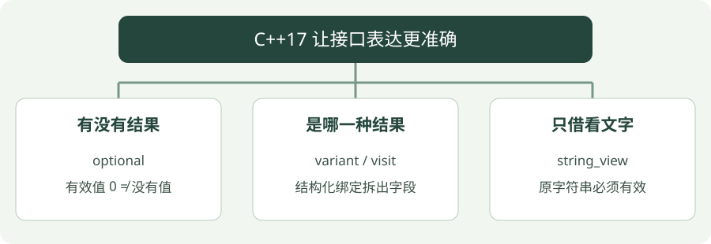

# 10 · C++17 常用工具

**示例标准：C++17**

C++17 有一批实用工具，让接口更准确地表达“可能没有结果”“几种结果之一”和“只读地看一段文字”。


!!! tip "读完这页，你应该能做到"

    分清“有效值是 0”和“没有结果”，检查字符串借用的有效期。

    **先会这些就够了**：引用、容器。


## 看图梳理

{ .learning-figure }

[打开大图](../../assets/learning/cpp-cpp17.svg)

**有没有结果**：optional，有效值 0 ≠ 没有值；**是哪一种结果**：variant / visit，结构化绑定拆出字段；**只借看文字**：string_view，原字符串必须有效。


## 为什么“查不到”和“查到 0”必须分开

位置 0 米是正常数据；若用 0 表示没有位置，调用者就不知道是找到了起点，还是根本没收到记录。optional 给返回值增加一个“有没有”的状态，数字本身仍保留原意义。

| 查询 | 有值吗？ | 值或处理方式 |
| --- | --- | --- |
| 编号 1 | 有 | 0.0，不应当作缺失 |
| 编号 2 | 有 | 3.5 |
| 编号 9 | 没有 | 走缺失处理分支 |

`if (auto x = lookup(...))` 可以分两步理解：先调用函数，把 optional 存入 x；再检查 x 有没有值。条件成立后 `*x` 才取出里面的 double。`value_or(-1.0)` 是为了示范默认值接口，真实数据里要避免 −1 与正常位置混淆。

本章后半的 variant 解决“是哪一种类型”，string_view 解决“借看一段文字”。先弄懂 optional，再分别阅读另外两段，不必把四项新功能同时背下来。


## 四个先学会的功能

| 功能 | 通俗解释 | 重点 |
| --- | --- | --- |
| `std::optional<T>` | 可能有 T，也可能没有 | 空结果不同于数值 0 |
| `std::variant<A, B>` | 当前保存其中一种类型 | 用 `visit` 或 `get_if` 处理 |
| 结构化绑定 | 将组合结果拆成命名变量 | `const auto& [key, value]` 可避免复制 |
| `std::string_view` | 借看文字，不拥有文字 | 原文字必须仍然有效 |

`std::filesystem` 也在 C++17 中进入标准库，可操作路径、遍历目录；文件操作可能失败，需处理异常或 `error_code`。本章先把没有值与字符串借用讲清。

## 完整示例

```cpp
#include <iostream>
#include <map>
#include <optional>
#include <string>
#include <string_view>
#include <variant>

// 返回可选位置：0.0 是有效值，空 optional 才是没找到。
std::optional<double> lookup(const std::map<int, double>& positions, int id) {
    // 只查询不插入，避免 positions[id] 意外添加键。
    if (const auto it = positions.find(id); it != positions.end()) {
        return it->second;
    }
    // 返回“没有结果”，不要把缺失数据当作有效的零值。
    return std::nullopt;
}

// 程序入口；下面按顺序执行示例步骤。
int main() {
    const std::map<int, double> positions{{1, 0.0}, {2, 3.5}};
    // 结构化绑定拆出键和值，并以引用避免复制。
    for (const auto& [id, x] : positions) {
        std::cout << "sheep " << id << ": " << x << '\n';
    }
    std::cout << "missing fallback: " << lookup(positions, 9).value_or(-1.0) << '\n';
    // 检查有没有值，而不是里面的数是不是非零。
    if (auto x = lookup(positions, 1)) {
        std::cout << "valid zero: " << *x << '\n';
    }
    const std::string name{"herding"};
    // 只借看 name 的字符，name 必须保持有效。
    const std::string_view view{name};
    std::cout << "view: " << view << '\n';
    // 当前保存一种类型，不是同时存两种结果。
    const std::variant<int, std::string> message{std::string{"ready"}};
    // 根据 variant 当前类型调用可接受它的 Lambda。
    std::visit([](const auto& value) { std::cout << value << '\n'; }, message);
}
```

## 编译与运行

在示例目录执行。Windows 使用 PowerShell；Linux/macOS 将 `./cpp17.exe` 换成 `./cpp17`，并把输出文件名的 `.exe` 去掉。

```powershell
g++ -std=c++17 -Wall -Wextra -Wpedantic cpp17.cpp -o cpp17.exe
./cpp17.exe
```

预期输出：

```text
sheep 1: 0
sheep 2: 3.5
missing fallback: -1
valid zero: 0
view: herding
ready
```

## 怎样读这段代码

`optional` 的真假表示有没有值，不是里面的数字是不是 0。所以查询编号 1 的位置 0.0 仍然成功。`value_or` 在缺失时使用默认值，但实际业务别用容易与正常数据混淆的哨兵值作为唯一错误机制。

带初始化语句的 `if` 把迭代器的使用范围限制在这个判断里。结构化绑定把键值对拆成 `id` 和 `x`。

`string_view` 依赖 `name` 的存储。本例先创建 `name`，后创建 `view`，使用时原字符串未被销毁或改动到使存储失效。`visit` 根据 variant 当前类型调用同一 Lambda。

## 常见错误

- 对空 `optional` 直接 `*value` 不安全，先检查；`value()` 在无值时会抛异常。
- 不要返回指向局部 `std::string` 的 `string_view`；也不要把临时字符串的 view 长期保存。
- `string_view` 不保证以空字符结尾；向需要 C 字符串的接口传 `data()` 前必须检查接口要求。

## 动手练习

<div class="practice-card" markdown="1">

<p class="practice-kicker">接着正文做一个小改动</p>

<p class="practice-title">给“查不到”一个明确的输出</p>

正文已经把“位置为 0”与“没有位置”分开。现在沿用 lookup，让调用方分别处理找到和没找到的编号。

**从哪里开始**：在 cpp17.cpp 的 main 中，positions 声明之后加入查询循环；保留 main 外的 lookup 定义。

**按这几步做**：

1. 只查询编号 2 和 3，不修改 positions。
2. 先检查 optional 是否有值，有值才读取 *x。
3. 没有值时输出 missing，不用 -1 伪装成位置。

??? tip "需要一点提示？"

    原表只有编号 1 和 2：编号 2 的位置是 3.5，编号 3 没有记录。

??? example "查看参考修改与解释"

    if (auto x = lookup(...)) 检查的是“有没有结果”，不是结果是不是非零。else 分支把缺失明确报告出来。

    **放在哪里**：这是局部修改片段，不是独立完整程序；不要放到 main 外面。

    ```cpp
    // 放在 main 内、positions 声明之后。
    for (int id : {2, 3}) {
        if (auto x = lookup(positions, id)) {
            std::cout << *x << '\n';
        } else {
            std::cout << "missing\n";
        }
    }
    ```

    **核对这段修改的结果**：只看新增或替换部分的输出；保留的正文演示可能还有其他输出。

    ```text
    3.5
    missing
    ```

</div>


## 延伸阅读

[规范或官方指南](https://isocpp.github.io/CppCoreGuidelines/CppCoreGuidelines)。标准草案会继续更新，查阅时注意条款可能包含晚于本章示例的功能。


---

[返回学习路线](index.md) · [上一章：09 · 移动语义](move.md) · [下一章：11 · C++20：概念、范围与 span →](cpp20.md)
