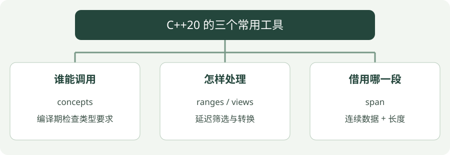

# 11 · C++20：概念、范围与 span

**示例标准：C++20** · [下载完整代码](examples/cpp20.cpp)

C++20 让类型要求更清楚，让数据处理更像描述步骤。concepts 限制“谁能调用”，ranges 组织“怎么处理”，span 表示“借用哪一段”。


## 看图梳理

{ .learning-figure }

[打开大图](../../assets/learning/cpp-cpp20.svg)

**谁能调用**：concepts，编译期检查类型要求；**怎样处理**：ranges / views，延迟筛选与转换；**借用哪一段**：span，连续数据 + 长度。


## 三个功能解决三个问题

**Concepts（概念）**是编译期类型约束。`std::floating_point T` 要求 `T` 是浮点类型，传整数会在编译期被拒绝。概念能检查语法或类型要求，不能证明单位、业务逻辑和数值精度正确。

**Ranges（范围）**把一段可遍历的数据作为整体。`views::filter` 筛选，`views::transform` 转换，管道 `|` 将步骤组合。很多 view 延迟到遍历时才算，并没有立即创建新容器。

**span** 借用连续内存，同时保存元素数量，不拥有数据。`span<const double>` 不能通过它修改元素；原数据仍必须有效。它并不是自动管理生命周期的智能指针。

## 完整示例

```cpp
#include <concepts>
#include <iostream>
#include <ranges>
#include <span>
#include <stdexcept>
#include <vector>

// concepts 约束 T 为浮点类型，整数调用会被拒绝。
template<std::floating_point T>
T meters_to_centimeters(T meters) {
    return meters * T{100};
}

// 借用连续数据并带长度，不拥有数据，也不延长生命周期。
double mean(std::span<const double> values) {
    if (values.empty()) {
        // 输入不符合函数约定，报告原因而不继续计算。
        throw std::invalid_argument("empty samples");
    }
    double total{0.0};
    for (double value : values) { total += value; }
    return total / static_cast<double>(values.size());
}

// 程序入口；下面按顺序执行示例步骤。
int main() {
    const std::vector<double> distances{1.0, 3.0, 5.0};
    // view 保存处理规则，不立即生成结果列表；不能盲目声明为 const。
    auto far_cm = distances
        // 保留大于 2 米的元素，遍历时筛选。
        | std::views::filter([](double d) { return d > 2.0; })
        // 把筛选后的米转换为厘米，遍历时计算。
        | std::views::transform([](double d) { return meters_to_centimeters(d); });
    // 开始遍历才触发延迟筛选与转换。
    for (double value : far_cm) {
        // 把结果输出到终端，便于与正文中的示例结果对照。
        std::cout << value << ' ';
    }
    // 把结果输出到终端，便于与正文中的示例结果对照。
    std::cout << "\nmean: " << mean(distances) << '\n';
}
```

## 编译与运行

在示例目录执行。Windows 使用 PowerShell；Linux/macOS 将 `./cpp20.exe` 换成 `./cpp20`，并把输出文件名的 `.exe` 去掉。

```powershell
g++ -std=c++20 -Wall -Wextra -Wpedantic cpp20.cpp -o cpp20.exe
./cpp20.exe
```

预期输出：

```text
300 500 
mean: 3
```

## 怎样读这段代码

先筛选大于 2 米的 3、5，再乘 100 输出厘米数。`far_cm` 保存处理规则和对数据的访问关系，不是一份拥有所有结果的 `vector`。

`mean` 可接收满足要求的连续容器，例如本例的 `vector<double>` 或 `array<double, N>`。长度与数据一起传递，比单独传裸指针和数量更明确。

其他 C++20 功能包括 `std::jthread`、`std::format`、协程和模块。线程在第 13 章实践；协程不是自动创建线程，而是支持挂起与恢复的函数机制。模块不是简单把所有 `#include` 改成 `import`，构建工具与编译器支持也必须配套。这两个高级主题先理解用途，再做独立专题。

## 常见错误

- 不要返回依赖局部容器的 view，离开函数后底层数据会销毁。
- 本例的 view 不能声明为 const：filter_view 的遍历可能更新内部缓存，const 底层数据和 const view 是不同的限制。
- view 不是必然更快；实际性能需要测量。
- 本章标准的 span 下标访问没有 `at()` 异常检查，不要把“带长度”误解成“自动防越界”。

## 动手练习

把筛选改为 `d >= 3.0`，输出米的平方而不是厘米。再试 `meters_to_centimeters(3)`。

??? tip "展开参考答案"

    筛选结果仍是 3 和 5，transform 改为 `[](double d) { return d * d; }`，输出 9 和 25。整数 3 不满足 floating_point 约束，无法编译；传 3.0 可以。

## 延伸阅读

[规范或官方指南](https://eel.is/c++draft/range.adaptors)。标准草案会继续更新，查阅时注意条款可能包含晚于本章示例的功能。


---

[返回学习路线](index.md) · [上一章：10 · C++17 常用工具](cpp17.md) · [下一章：12 · C++23：用 expected 表达失败 →](cpp23.md)
