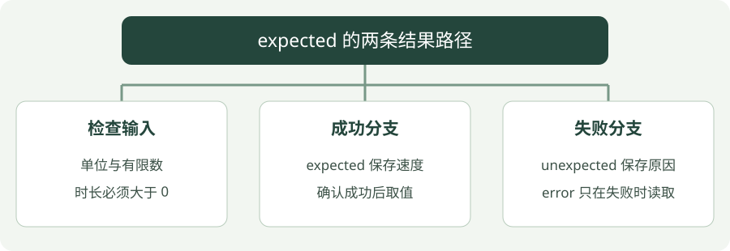

# 12 · C++23：用 expected 表达失败

**示例标准：C++23**

“计算成功得到速度”与“计算失败得到原因”是两种结果。`std::expected<T, E>` 把它们放进同一个返回类型：成功装 T，失败装 E。


!!! tip "读完这页，你应该能做到"

    只在成功分支取值，只在失败分支读取错误原因。

    **先会这些就够了**：optional、判断分支。


## 看图梳理

{ .learning-figure }

[打开大图](../../assets/learning/cpp-cpp23.svg)

**检查输入**：单位与有限数，时长必须大于 0；**成功分支**：expected 保存速度，确认成功后取值；**失败分支**：unexpected 保存原因，error 只在失败时读取。


## 把成功和失败都当成接口的正常输出

算速度时，4 米除以 2 秒可以得到 2 米/秒；除以 0 秒不符合输入约定。调用者需要知道失败原因，不能把 0 速度或 −1 速度当成万能错误标记。

`std::expected<double, std::string>` 可以先读成：“成功得到一个小数，失败得到一段说明”。它在某一时刻处于其中一个状态。`std::unexpected(...)` 用来标记返回的是失败说明，而不是正常结果。

| 函数里 | 调用者里 |
| --- | --- |
| 输入合法，返回 result | if 成立，读取 *result |
| 时长为 0，返回 unexpected | else 分支，读取 error() |

先检查状态，再读对应内容。`if (result)` 判断成功与否，不是判断速度是否大于 0；有效速度为 0 也仍然成功。expected 只是表达结果的方式，是否需要限制最大速度等业务条件，要由你定义并检查。


## optional、expected 和异常怎么选

| 方式 | 适合什么 | 调用者如何处理 |
| --- | --- | --- |
| `optional<T>` | 没有值就够了，不需要原因 | 检查有没有值 |
| `expected<T, E>` | 失败是正常可能性，需要解释 | 检查成功，读值或错误 |
| 异常 | 不能正常完成操作，需要跨调用层报告 | 匹配的 catch 处理 |

这是接口选择，不是某一种永远最好。`expected` 不阻止被调用代码抛异常，也不会替你检查所有输入。

本章的 `expected` 和 `std::to_underlying` 属于 C++23。编译器接受 `-std=c++23` 不代表配套标准库实现了每个功能；若找不到 `<expected>`，检查编译器和标准库版本。

## 先按顺序走过一个成功输入和一个失败输入

完整示例把 distance_m 固定为 4 米，依次试 2 秒、0 秒。把函数里的三个检查当作三道依次通过的关卡：

| 检查顺序 | speed(4.0, 2.0) | speed(4.0, 0.0) |
| --- | --- | --- |
| 距离有限、非负吗 | 是，继续 | 是，继续 |
| 时长有限、严格为正吗 | 是，继续 | 否，返回时长错误，到此结束 |
| 计算 distance_m / seconds | 得到 2.0 | 不执行，因此没有除以零 |
| 结果有限吗 | 是，返回成功值 2.0 | 不执行 |
| main 如何处理 | if 分支输出速度 | else 分支输出错误原因 |

每条 return 都结束**当前这一次函数调用**。错误输入不会先返回一条说明、再继续计算速度；后面那些行根本不会执行。理解这个顺序，才能判断检查是否放在危险操作之前。

## 返回类型、成功结果和错误标记，分开看

`expected<double, std::string>` 的两个类型参数按顺序表示成功类型和错误类型。函数返回 `result` 这个 double 时会建立成功状态；返回 `std::unexpected(std::string{...})` 时会建立失败状态。unexpected 不是 throw，它不会自行跳到 catch。

| 操作 | 前提 | 目的 |
| --- | --- | --- |
| `if (result)` | 无需先知道状态 | 问这次计算是否成功 |
| `*result` | 已确认成功 | 取出速度 |
| `result.error()` | 已确认失败 | 取出错误说明 |
| `result.value()` | 若失败会抛异常 | 以带失败检查的接口获取值；本例用 if 分支更直观 |

不要用“我看到函数最后返回 double”判断每次都能成功；函数还有多个提前返回点。调用者的 else 也不是可以省略的装饰，它定义失败时程序接下来如何做。

## “数值合法”与“物理上合理”还隔着一层

零距离除以正时长得到零速度，仍是成功。负距离不符合本例把输入解释为“走过的路程”的约定；若描述有方向的位移，接口约定应重新设计，不能直接复制这个非负检查。

两个有限数相除，结果也可能过大而超出 double 可表示范围，所以还检查 result。代码没有设置实际机器人的速度上限，那是后面练习加入的业务规则；“有限”不等于“适合机器人执行”。

### 最后一行枚举与速度函数没有依赖关系

`enum class Mode : unsigned` 定义了有名字的状态，idle 为 0，tracking 为 1；unsigned 指定底层整数类型。`Mode::tracking` 让代码表达“跟踪状态”，`std::to_underlying(...)` 在需要编码时明确得到整数 1。这里示范的是 C++23 的另一个小工具，先读懂 expected，再回来看这一行即可。

## 再检查零速度与一份失败原因

下面片段放在完整程序 main 中，保留 speed 的定义与头文件。它没有危险的除法，而是让函数先检查输入，再通过状态分支读取：

```cpp title="main 内片段 · 成功的零与失败分开"
const auto stopped = speed(0.0, 2.0); // 路程为 0、时长为正，成功得到速度 0。
if (stopped) {
    std::cout << "valid zero speed: " << *stopped << '\n';
}
const auto bad = speed(4.0, -1.0); // 负时长在除法之前被拒绝。
if (!bad) { // 确认失败之后才读错误字段。
    std::cout << "reason: " << bad.error() << '\n';
}
```

新增输出为 `valid zero speed: 0` 和 `reason: duration must be positive`。expected 的状态检查是一次有无成功结果的询问，并非测试 double 是否非零。

在失败状态调用 value() 会抛出带错误值的 bad_expected_access 异常；这与直接 *bad 是不同接口。本页采用 if/else，使初学者先看清两种状态对应的读取路径。string 分配等底层操作依然可能抛异常，因此 speed 返回 expected 并不表示它已承诺永不抛异常。

## 完整示例

```cpp title="cpp23.cpp · 完整示例"
#include <cmath>
#include <expected>
#include <iostream>
#include <string>
#include <utility>

// 给工作状态起名字；它是状态标签，不参与速度计算。
enum class Mode : unsigned { idle = 0, tracking = 1 };

// 成功时装速度，失败时装字符串原因。
std::expected<double, std::string> speed(double distance_m, double seconds) {
    // 距离允许为 0，但不允许负数、NaN 或无穷大。
    if (!std::isfinite(distance_m) || distance_m < 0.0) {
        // expected 的失败分支：明确返回错误原因。
        return std::unexpected(std::string{"invalid distance"});
    }
    // 时长必须严格大于 0，通过本关之后才执行除法。
    if (!std::isfinite(seconds) || seconds <= 0.0) {
        // expected 的失败分支：明确返回错误原因。
        return std::unexpected(std::string{"duration must be positive"});
    }
    const double result = distance_m / seconds;
    // 两个输入有限，也不能保证相除后的结果一定在 double 可表示范围内。
    if (!std::isfinite(result)) {
        // expected 的失败分支：明确返回错误原因。
        return std::unexpected(std::string{"speed overflow"});
    }
    // 返回普通 double，由 expected 包装为“成功并持有速度”。
    return result;
}

// 程序入口；下面按顺序执行示例步骤。
int main() {
    for (const double seconds : {2.0, 0.0}) {
        const auto result = speed(4.0, seconds);
        // 先确认成功，成功时才能使用 *result。
        if (result) {
            std::cout << "speed: " << *result << " m/s\n";
        } else {
            // 只在失败分支读取错误原因。
            std::cout << "error: " << result.error() << '\n';
        }
    }
    // 显式取枚举的底层值，避免不受控制的隐式转换。
    std::cout << "mode code: " << std::to_underlying(Mode::tracking) << '\n';
}
```

## 编译与运行

把上面的完整程序保存为 `cpp23.cpp`，在保存这个文件的目录打开终端。短片段与练习修改不要额外拼在完整程序后面；按正文标明的位置替换或追加。Windows 使用 PowerShell；Linux/macOS 将 `./cpp23.exe` 换成 `./cpp23`，并把输出文件名的 `.exe` 去掉。

```powershell
g++ -std=c++23 -Wall -Wextra -Wpedantic cpp23.cpp -o cpp23.exe
./cpp23.exe
```

预期输出：

```text
speed: 2 m/s
error: duration must be positive
mode code: 1
```

## 怎样读这段代码：一次调用只走成功或失败的一条路

main 固定距离 4 米，分别测试 2 秒与 0 秒。每次 speed 调用都会重新检查输入并创建它自己的结果；第二次失败不会覆盖或改变第一次已经输出的结果。

| 输入 | 经过哪些检查 | speed 返回什么 | main 怎样处理 |
| --- | --- | --- | --- |
| 4 米、2 秒 | 距离有限非负，时长有限正数，商有限 | 成功值 2 米/秒 | if 为真，*result 输出速度 |
| 4 米、0 秒 | 距离通过，时长检查失败 | unexpected 包装错误文字 | if 为假，error() 输出原因 |

`std::expected<double, std::string>` 的两个类型依次是成功时的值类型、失败时的原因类型。返回普通 double 时，由 expected 包装成成功状态；返回 unexpected 字符串时，明确选择错误状态。因此 0.0 速度也可以是成功值，不等于失败。

函数一旦 return，就结束这次调用。0 秒在除法之前被拒绝，所以后面不会再尝试计算 4 / 0。成功分支读取 *result，失败分支读取 result.error()；不能因为两种成员都写在同一个类型里，就在任何状态下随意调用。

### expected 与异常的执行路径有何不同？

expected 把成功或失败装进普通返回值，由调用者检查。异常则通过 throw 改变控制流，寻找匹配的处理位置。选择哪种方式，要看接口如何组织失败；expected 不会强制调用者认真检查，错误处理习惯仍需要自己建立。

最后的 Mode 是独立演示：tracking 的底层值为 1，to_underlying 将它明确取出来。这个数字是状态编码，不是计算出来的速度，也不会改变前两次调用的成功或失败。

## 常见错误

- 在失败的 expected 上直接 `*result` 不安全；`value()` 会在无值时抛异常。
- `expected<double, string>` 不是同时拥有一个有效速度和一个错误原因；它表示其中一种状态。
- 即便数值有效，也必须另行验证单位和业务限制。

## 动手练习

<div class="practice-card" markdown="1">

<p class="practice-kicker">接着正文做一个小改动</p>

<p class="practice-title">计算成功，还要检查业务限制</p>

原 speed 函数检查数值是否合法。现在再加入最大速度要求，区分“除法能算”与“结果符合约定”。

**从哪里开始**：在 cpp23.cpp 的 speed 函数中，result 的非有限检查之后、return result; 之前插入限制检查。

**按这几步做**：

1. 约定最大速度为 2 m/s，恰好 2 仍允许。
2. 大于上限时返回 unexpected，保留已有输入检查。
3. 比较 speed(4.0, 1.0) 与 speed(4.0, 2.0)。

??? tip "需要一点提示？"

    速度是距离除以时长：4 / 1 = 4，4 / 2 = 2。不要把条件写成 >= 2。

??? example "查看参考修改与解释"

    前者因 4 m/s 超过上限而失败；后者得到有效的 2 m/s。时长为 0 仍应走原来的非法输入分支。

    **放在哪里**：这是 speed 内的插入片段；调用者仍须先检查 expected 的成功状态。

    ```cpp
    // 放在 result 已检查有限之后，成功返回之前。
    if (result > 2.0) {
        return std::unexpected(std::string{"speed limit exceeded"});
    }
    ```

    **核对这段修改的结果**：

    | 调用 | 应有结果 |
    | --- | --- |
    | `speed(4.0, 1.0)` | 失败，原因是 speed limit exceeded |
    | `speed(4.0, 2.0)` | 成功，速度为 2 m/s |

</div>


## 延伸阅读

[规范或官方指南](https://eel.is/c++draft/expected)。标准草案会继续更新，查阅时注意条款可能包含晚于本章示例的功能。


---

[返回学习路线](index.md) · [上一章：11 · C++20：概念、范围与 span](cpp20.md) · [下一章：13 · 并发与线程 →](concurrency.md)
