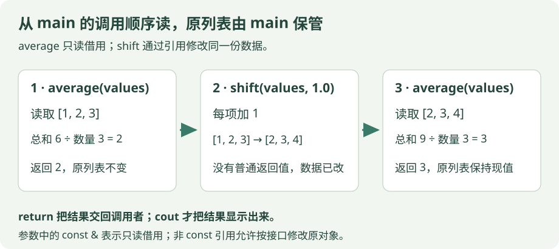

# 03 · 函数、引用与 const

**示例标准：C++17**

函数把一件事包装成可以重复调用的步骤。参数是输入，返回值是输出；引用则是给已有对象起一个别名。


!!! tip "读完这页，你应该能做到"

    指出哪些函数只读数据，哪些会修改调用者的对象。

    **先会这些就够了**：变量、循环。


## 看图梳理

{ .learning-figure }

[打开大图](../../assets/learning/cpp-functions.svg)

**按值传参**：double x，得到一个值的副本；**只读借用**：const vector＆，不复制，不通过它修改；**可修改借用**：vector＆，明确会改变原数据。


## 先写一个简单的数值函数

第一遍暂时不引入引用、容器和异常，认识“定义 → 调用 → 返回”的顺序。这是独立的短示例，可以单独保存为 hello_function.cpp：

```cpp title="hello_function.cpp · 独立短例"
#include <iostream>

// 这里只定义做法，程序执行到 main 前不会自动调用它。
double add_offset(double distance_m, double offset_m) {
    return distance_m + offset_m; // 交回计算结果，结束这次调用。
}

int main() {
    const double original{2.0};
    // 两个实参按顺序交给两个形参：distance_m 得到 2，offset_m 得到 0.5。
    const double corrected = add_offset(original, 0.5);
    std::cout << corrected << '\n'; // 结果为 2.5。
    std::cout << original << '\n';  // 原来的 2.0 没有被修改，输出 2。
}
```

**形参**就是定义里接收输入的名字，**实参**就是调用时真正提供的值。它们不必同名，按位置对应。`add_offset` 是函数名，`add_offset(...)` 才是调用；每调用一次，就使用那次传入的值重新计算。

## 为什么要把计算包装成函数

给十组距离求平均时，每次复制一遍“求和 → 数数量 → 相除”容易漏改；写一个 average 函数后，每次只传不同列表。它的定义描述做法，main 中的调用才真正让它做一次。

下面开始让函数接收**整组数据**。先分清“得到一份副本”与“暂时借用原对象”，再看求和工具和失败处理。这样不会在一行接口里同时猜六个新符号。


## 三种传参方式

| 接口 | 意思 | 适合什么 |
| --- | --- | --- |
| `double x` | 得到一个值的副本 | 小的基本类型 |
| `std::vector<double>& x` | 可以修改调用者的列表 | 确实需要原地修改 |
| `const std::vector<double>& x` | 借用列表，只读 | 读较大的对象 |

`&` 在参数声明里表示引用。它与表达式中的取地址符号长得一样，但语境不同。引用绑定后不能改为另一对象；给引用赋值是在修改原对象。

把“计算结果”和“修改输入”分清，调用者就不容易误解函数。


## 把“复制一个值”和“借用原对象”分开

下面三个声明只用于对照含义，不需要一起复制到程序里：

| 参数写法 | 函数拿到什么 | 函数内给 x 赋值，调用者会怎样 |
| --- | --- | --- |
| `double x` | 一个小数的副本 | 原数不变 |
| `double& x` | 原数的别名 | 原数跟着改变 |
| `const double& x` | 只读别名 | 不允许通过 x 赋值，编译器会拒绝 |

把类型换成 `std::vector<double>` 时，区别仍然成立，但复制整个列表可能更贵。因此 average 用 const 引用只读借用，shift 用非 const 引用明确要求修改。调用 shift 不会出现特殊的 `&` 标记，借用关系写在**函数参数类型**里。

## average 里面的新名字分别在做什么

| 代码 | 这次求平均时的含义 |
| --- | --- |
| `values.empty()` | 问“列表里是不是一个元素也没有” |
| `values.begin(), values.end()` | 告诉累加工具从哪里开始、到哪里停止 |
| `std::accumulate(..., 0.0)` | 从小数 0.0 开始，逐个加上列表中的数 |
| `values.size()` | 列表的元素数量，本例为 3 |
| `static_cast<double>(...)` | 明确把数量转换成小数类型参与计算 |
| `throw std::invalid_argument(...)` | 无法按约定计算，报告非法输入并离开当前正常路径 |

空列表既没有总量可分给的元素，也没有合理的平均值，所以先检查再除。`try` 是“在这里尝试”，匹配的 `catch` 是“这类问题发生时在这里处理”。从 throw 到 catch 之间的正常语句被跳过；程序不会从 throw 的下一句接着算。

这个平均值版本是理解函数的教学例子，只拒绝空列表。普通有限数相加也可能在极端输入下溢出，NaN 也会传播；若用于真实测量数据，需要额外检查有效性并选择合适的数值算法，不能把“有异常处理”理解成“所有错误都已处理”。

### 函数返回以后，局部数据去了哪里？

add_offset 的参数属于这次调用，函数结束后它们就不再是可用的局部对象；返回的 double 值已经交给 corrected，因此 corrected 仍可以使用。**按值返回一份结果**与**返回某个局部对象的引用**是两种事情，后者会留下指向已结束生命周期的借用。

对 shift，结果不是通过 return 带出来的，而是直接写进调用者的 vector。调用前先问一句：这个接口是在“算一份结果”，还是在“改变已有数据”？这能解释为什么两个函数的参数与返回类型不同。

## 完整示例

```cpp title="functions.cpp · 完整示例"
#include <iostream>
#include <numeric>
#include <vector>
#include <stdexcept>

// 只读借用列表，不复制整个容器。
double average(const std::vector<double>& values) {
    // 空列表不能取平均，否则会除以零。
    if (values.empty()) {
        // 输入不符合函数约定，报告原因而不继续计算。
        throw std::invalid_argument("empty samples");
    }
    // 从浮点 0.0 开始累加，避免整数累加造成截断。
    return std::accumulate(values.begin(), values.end(), 0.0)
        / static_cast<double>(values.size());
}

// 可修改引用：这个函数会改变调用者的数据。
void shift(std::vector<double>& values, double offset) {
    // 绑定真实元素；去掉 & 只会修改副本。
    for (auto& value : values) {
        // 给每个元素加同样偏移量。
        value += offset;
    }
}

// 程序入口；下面按顺序执行示例步骤。
int main() {
    std::vector<double> values{1.0, 2.0, 3.0};
    std::cout << "before: " << average(values) << '\n';
    // 调用结束后原列表变为 {2.0, 3.0, 4.0}，所以第二次平均值是 3。
    shift(values, 1.0);
    std::cout << "after: " << average(values) << '\n';
    // try 圈出需要处理失败的操作；异常发生后不会继续执行该路径剩余语句。
    try {
        const std::vector<double> empty;
        std::cout << average(empty) << '\n';
    } catch (const std::invalid_argument& error) {
        // catch 接住前面报告的非法输入，what() 读取说明文字。
        std::cout << error.what() << '\n';
    }
}
```

## 编译与运行

把上面的完整程序保存为 `functions.cpp`，在保存这个文件的目录打开终端。短片段与练习修改不要额外拼在完整程序后面；按正文标明的位置替换或追加。Windows 使用 PowerShell；Linux/macOS 将 `./functions.exe` 换成 `./functions`，并把输出文件名的 `.exe` 去掉。

```powershell
g++ -std=c++17 -Wall -Wextra -Wpedantic functions.cpp -o functions.exe
./functions.exe
```

预期输出：

```text
before: 2
after: 3
empty samples
```

## 怎样读这段代码：调用前、调用中、返回后

{ .learning-figure }

[打开调用过程大图](../../assets/learning/cpp-function-call.svg)

main 创建的是同一份 values，开始为 {1.0, 2.0, 3.0}。程序先调用 average 输出平均值，再调用 shift 修改这份列表，最后再次调用 average。函数在文件上方的排版顺序，不是它们实际执行的顺序。

| 这时执行什么 | 函数内发生什么 | 调用回到 main 后 |
| --- | --- | --- |
| average(values) | 只读借用列表，求和 6、数量 3，返回 2 | values 仍是 {1, 2, 3}，输出 before: 2 |
| shift(values, 1.0) | 依次把原元素加 1 | values 变成 {2, 3, 4}；void 没有普通返回值 |
| 再次 average(values) | 读取修改后的列表，求和 9、数量 3 | 返回 3，输出 after: 3 |
| average(empty) | 首先发现列表为空，抛出异常 | 正常路径中断，进入 catch，输出 empty samples |

average 的 `const std::vector<double>&` 可以从三个问题读：输入是什么类型？一组小数；是否复制？通过引用借用；能否通过这个参数改原列表？不能。调用时写 average(values)，引用要求写在定义的参数类型里，不是在调用位置加星号。

shift 中的 `auto& value` 是对**当前真实元素**起的别名。第一轮改变 values[0]，第二轮改变 values[1]，第三轮改变 values[2]。如果删除这个 &，每轮修改的只是取出来的副本，原列表不会留下修改。

average 通过 return 交回一个数字，cout 才显示它。异常则改变执行路径：`throw` 后面的正常语句不继续执行，匹配的 catch 用 `error.what()` 取得说明文字。它们解决的是“怎样计算”和“无法按约定计算时怎么办”两件事。

### 为什么累加从 0.0 开始？

accumulate 的累计类型由初始值决定。0.0 是 double，本例的 1、2、3 按浮点累计。若用整数 0 累计小数列表，部分小数会在中间结果转换中被截断；仅在最后把答案转成 double 不能补回。数量转换为 double 则明确表达了除法的数值类型。

## 常见错误

- 不要返回局部变量的引用或指针：函数结束时局部对象已经销毁。
- `const` 引用限制的是通过该引用的修改，不代表其他代码绝对不能修改原对象。
- 返回局部 `std::vector` 的值是正常写法，编译器可消除复制或使用移动；无需返回悬空引用。

## 动手练习

<div class="practice-card" markdown="1">

<p class="practice-kicker">接着正文做一个小改动</p>

<p class="practice-title">确认函数修改的是原数据</p>

正文中的 shift 用引用修改列表。这次先理解去掉引用会发生什么，再用原函数完成一次减法。

**从哪里开始**：先看 shift 中的 for (auto& value : values)，再看 main 里怎样调用它。

**按这几步做**：

1. 只在纸上将 auto& 想成 auto，预测原列表会不会改变。
2. 实际参考修改保留 auto&，让每个元素减去 0.5。
3. 从原始 {1.0, 2.0, 3.0} 开始，不先执行原例的加 1 操作。

??? tip "需要一点提示？"

    auto 是副本，auto& 是原元素的别名。两次比较必须使用相同初始列表。

??? example "查看参考修改与解释"

    如果循环变量是副本，修改不会留在原列表，平均仍是 2。保留引用并减去 0.5，平均从 2 变成 1.5。

    **放在哪里**：保留 average 与 shift 定义，用这段替换 main 内原来的演示。

    ```cpp
    // 从原始输入重新开始，避免叠加原例的 +1 修改。
    std::vector<double> values{1.0, 2.0, 3.0};
    std::cout << "before: " << average(values) << '\n';
    shift(values, -0.5);
    std::cout << "after: " << average(values) << '\n';
    ```

    **核对这段修改的结果**：

    ```text
    before: 2
    after: 1.5
    ```

</div>


## 延伸阅读

[规范或官方指南](https://isocpp.github.io/CppCoreGuidelines/CppCoreGuidelines)。标准草案会继续更新，查阅时注意条款可能包含晚于本章示例的功能。


---

[返回学习路线](index.md) · [上一章：02 · 变量、判断与循环](basics.md) · [下一章：04 · 类与 RAII →](classes.md)
