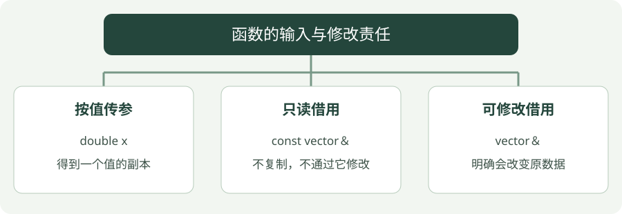

# 03 · 函数、引用与 const

**示例标准：C++17** · [下载完整代码](examples/functions.cpp)

函数把一件事包装成可以重复调用的步骤。参数是输入，返回值是输出；引用则是给已有对象起一个别名。


!!! tip "读完这页，你应该能做到"

    指出哪些函数只读数据，哪些会修改调用者的对象。

    **先会这些就够了**：变量、循环。


## 看图梳理

{ .learning-figure }

[打开大图](../../assets/learning/cpp-functions.svg)

**按值传参**：double x，得到一个值的副本；**只读借用**：const vector＆，不复制，不通过它修改；**可修改借用**：vector＆，明确会改变原数据。


## 为什么要把计算包装成函数

假设你要给十组距离求平均。每次复制一遍求和与除法，很容易漏改某个位置；写一个 average 函数后，每次只传入不同列表。函数的“定义”描述做法，“调用”才真正让它做一次。

把 `double average(const std::vector<double>& values)` 从外向里拆开：

| 部分 | 含义 |
| --- | --- |
| 开头的 `double` | 算完返回一个小数 |
| `average` | 这项操作的名字 |
| 括号里的 `values` | 函数内给输入起的名字 |
| `std::vector<double>` | 输入是一组小数 |
| `&` | 借用调用者的列表，不复制整个列表 |
| `const` | 这个接口不允许通过 values 改列表 |

传入 {1, 2, 3}，求和得到 6，数量是 3，所以返回 2；调用者可以把 2 存入变量，也可以立即输出。`return` 会结束这次函数调用并交回结果，不是只打印一个数字。

下面另一个函数 shift 没有 const：它要修改原列表。这种函数返回 void，意思是没有普通返回值；结果体现为输入列表被改变。不要把“没有返回值”理解成“没有做事情”。


## 三种传参方式

| 接口 | 意思 | 适合什么 |
| --- | --- | --- |
| `double x` | 得到一个值的副本 | 小的基本类型 |
| `std::vector<double>& x` | 可以修改调用者的列表 | 确实需要原地修改 |
| `const std::vector<double>& x` | 借用列表，只读 | 读较大的对象 |

`&` 在参数声明里表示引用。它与表达式中的取地址符号长得一样，但语境不同。引用绑定后不能改为另一对象；给引用赋值是在修改原对象。

把“计算结果”和“修改输入”分清，调用者就不容易误解函数。

## 完整示例

```cpp
#include <iostream>
#include <numeric>
#include <vector>
#include <stdexcept>

// 只读借用列表，不复制整个容器。
double average(const std::vector<double>& values) {
    // 空列表不能取平均，否则会除以零。
    if (values.empty()) {
        // 输入不符合函数约定，报告原因而不继续计算。
        throw std::invalid_argument("empty samples");
    }
    // 从浮点 0.0 开始累加，避免整数累加造成截断。
    return std::accumulate(values.begin(), values.end(), 0.0)
        / static_cast<double>(values.size());
}

// 可修改引用：这个函数会改变调用者的数据。
void shift(std::vector<double>& values, double offset) {
    // 绑定真实元素；去掉 & 只会修改副本。
    for (auto& value : values) {
        // 给每个元素加同样偏移量。
        value += offset;
    }
}

// 程序入口；下面按顺序执行示例步骤。
int main() {
    std::vector<double> values{1.0, 2.0, 3.0};
    std::cout << "before: " << average(values) << '\n';
    shift(values, 1.0);
    std::cout << "after: " << average(values) << '\n';
    try {
        const std::vector<double> empty;
        std::cout << average(empty) << '\n';
    // 处理对应类型的异常；通过 const 引用避免复制异常对象。
    } catch (const std::invalid_argument& error) {
        std::cout << error.what() << '\n';
    }
}
```

## 编译与运行

在示例目录执行。Windows 使用 PowerShell；Linux/macOS 将 `./functions.exe` 换成 `./functions`，并把输出文件名的 `.exe` 去掉。

```powershell
g++ -std=c++17 -Wall -Wextra -Wpedantic functions.cpp -o functions.exe
./functions.exe
```

预期输出：

```text
before: 2
after: 3
empty samples
```

## 怎样读这段代码

`average` 借用数据而不修改；累加的初值 `0.0` 使累加结果为 `double`。`static_cast<double>` 明确把数量转换成浮点数。

`shift` 中的 `auto&` 指向真实元素，所以修改会留下来。若写 `auto value`，就只修改每次复制出来的临时变量。

空列表无法计算平均值，因此抛出异常。`try` 内发生异常时，控制流进入匹配的 `catch`；`what()` 给出说明。异常不是普通的返回值。

## 常见错误

- 不要返回局部变量的引用或指针：函数结束时局部对象已经销毁。
- `const` 引用限制的是通过该引用的修改，不代表其他代码绝对不能修改原对象。
- 返回局部 `std::vector` 的值是正常写法，编译器可消除复制或使用移动；无需返回悬空引用。

## 动手练习

<div class="practice-card" markdown="1">

<p class="practice-kicker">接着正文做一个小改动</p>

<p class="practice-title">确认函数修改的是原数据</p>

正文中的 shift 用引用修改列表。这次先理解去掉引用会发生什么，再用原函数完成一次减法。

**从哪里开始**：先看 shift 中的 for (auto& value : values)，再看 main 里怎样调用它。

**按这几步做**：

1. 只在纸上将 auto& 想成 auto，预测原列表会不会改变。
2. 实际参考修改保留 auto&，让每个元素减去 0.5。
3. 从原始 {1.0, 2.0, 3.0} 开始，不先执行原例的加 1 操作。

??? tip "需要一点提示？"

    auto 是副本，auto& 是原元素的别名。两次比较必须使用相同初始列表。

??? example "查看参考修改与解释"

    如果循环变量是副本，修改不会留在原列表，平均仍是 2。保留引用并减去 0.5，平均从 2 变成 1.5。

    **放在哪里**：保留 average 与 shift 定义，用这段替换 main 内原来的演示。

    ```cpp
    // 从原始输入重新开始，避免叠加原例的 +1 修改。
    std::vector<double> values{1.0, 2.0, 3.0};
    std::cout << "before: " << average(values) << '\n';
    shift(values, -0.5);
    std::cout << "after: " << average(values) << '\n';
    ```

    **核对这段修改的结果**：

    ```text
    before: 2
    after: 1.5
    ```

</div>


## 延伸阅读

[规范或官方指南](https://isocpp.github.io/CppCoreGuidelines/CppCoreGuidelines)。标准草案会继续更新，查阅时注意条款可能包含晚于本章示例的功能。


---

[返回学习路线](index.md) · [上一章：02 · 变量、判断与循环](basics.md) · [下一章：04 · 类与 RAII →](classes.md)
