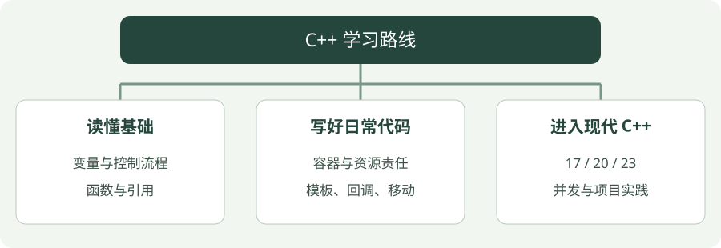

# C++ 与现代 C++：从读懂代码到写出小项目

C++ 可以用于机器人节点、传感器接口和性能敏感的数据处理。这里从零解释语法，再讲怎样用现代 C++ 写清接口、管理资源、减少常见错误。示例借用放牧机器人中的距离和位置数据，不代表已经完成相应研究或控制系统。

[从第一个程序开始 →](setup.md){ .md-button .md-button--primary }

## 看图梳理

{ .learning-figure }

[打开大图](../../assets/learning/cpp-index.svg)

**读懂基础**：变量与控制流程，函数与引用；**写好日常代码**：容器与资源责任，模板、回调、移动；**进入现代 C++**：17 / 20 / 23，并发与项目实践。

## 零基础先走这条小步路线

第一次阅读不需要同时安装机器人软件或配置复杂项目。先准备一个文本编辑器和一套 C++ 编译器，按第 01 章把一句文字显示在终端上。第一次成功后，再一章一章增加能力。

| 你现在的疑问 | 先读哪一章 | 一次只完成的任务 |
| --- | --- | --- |
| 代码到底往哪里写 | 01 环境 | 建文件、保存、编译，看到 Hello |
| 大括号、等号、循环都陌生 | 02 基础 | 手算三个距离的计数 |
| 函数输入和返回有什么区别 | 03 函数 | 跟着一次调用看数据怎样传递 |
| 类和对象是什么 | 04 类 | 跟踪一个对象的创建、使用、结束 |
| 一堆数据怎么保存和处理 | 05 容器 | 放入、取出、排序，再读算法 |
| 指针、星号、引用分不清 | 06 所有权 | 先画对象和地址，再读智能指针 |
| 初步语法已经能看懂 | 07–13 | 分开学模板、回调、移动、现代工具、线程 |
| 想把多个练习组织成项目 | 14–15 | 先学构建，再追踪一帧位置数据 |

每章的**短示例**用于拆开理解某一个动作，**完整示例**是一整个可保存的程序，**练习片段**需要按文字说明替换或追加。三种代码不要全部连着复制进同一个文件，否则容易出现重复 main、重复变量或片段位置错误。

先用语言解释“这份输入经过哪些步骤，应该输出什么”，再复制代码对照。遇到不认识的词，回到本页术语表或章节中的逐句拆解；能解释清楚一个小例子，比一次翻完所有版本功能更有帮助。

## “现代 C++”具体学什么

现代 C++ 不只是某个版本号，更是一套写法：优先使用标准容器；用 RAII 和智能指针表达资源责任；用 const、明确类型和编译期约束表达接口；确有需要时才处理底层细节。这些原则参考 [C++ Core Guidelines](https://isocpp.github.io/CppCoreGuidelines/CppCoreGuidelines)。

本教程以 **C++17 为基础，C++20 为进阶，补充 C++23 实用功能**。每页明确示例所需标准，不能把所有示例都用 `-std=c++17` 编译。语言标准支持和标准库支持是两件事，尤其是新特性。

## 推荐学习顺序

!!! tip "零基础先完成前三章，不用急着进入 C++20"

    第 01 章先看到自己写的文字输出；第 02 章用列表、判断和循环完成计数；第 03 章把计算写成函数。每次只学一章，先能用自己的话解释输入、过程和结果，再继续。后面的智能指针、模板与并发都是在这些基础上展开。

| 阶段 | 章节 | 学完能做什么 |
| --- | --- | --- |
| 基础 | [01 环境](setup.md)、[02 语法](basics.md)、[03 函数](functions.md) | 编译程序，处理列表，清楚传入与传出 |
| 日常代码 | [04 类](classes.md)、[05 容器](containers.md)、[06 所有权](ownership.md) | 封装数据，自动清理资源，理解借用 |
| 现代写法 | [07 模板](templates.md)、[08 Lambda](lambdas.md)、[09 移动](move.md) | 写可复用逻辑，理解回调与资源转移 |
| 标准进阶 | [10 C++17](cpp17.md)、[11 C++20](cpp20.md)、[12 C++23](cpp23.md) | 表达缺失与错误，使用 concepts、ranges、span |
| 项目实践 | [13 并发](concurrency.md)、[14 构建与调试](tooling.md)、[15 数据小项目](project.md) | 同步线程，用 CMake 构建，检查一帧位置数据 |

不必先背完全部语法。每章先读短例，把输入和输出说清楚，再阅读完整程序与执行表；愿意动手时按编译步骤对照输出，最后修改一个条件或参数做练习。代码中的英文输出用于减少终端编码问题，讲解和练习使用中文。

## 每章怎么学

每章“怎样读这段代码”按完整程序实际执行顺序追踪。先读章首的小任务与短例，再圈出完整 main 中的输入，跟着执行表指出每次调用改变了什么，最后核对输出。语法表遇到时就查，不要求先背完再看代码。

如果只能照抄，还说不出哪份数据变化，就先停在当前章的小例子。比如“调用 shift 以后，为什么下一次 average 得到 3？”能讲清同一列表从 {1,2,3} 变到 {2,3,4}，才算把函数与引用接起来。练习答案中出现的代码片段，也应按“放在哪里”的说明使用。

### 不认识术语时，先查这张表

| 词 | 先这样理解 | 在哪里展开 |
| --- | --- | --- |
| 源码 / 源文件 | 人写的程序文字，通常放在 .cpp 里 | 第 01 章 |
| 编译 / 链接 | 检查并转换源码，再把所需定义组成程序 | 第 01、14 章 |
| 类型 | 一份数据是什么、允许什么操作 | 第 02 章 |
| 作用域 | 名字可以使用的一段代码范围 | 第 02、03 章 |
| 函数 / 调用 | 一份处理步骤 / 执行这份步骤一次 | 第 03 章 |
| 对象 / 成员 | 一份具体数据与其操作 / 属于它的内容 | 第 04 章 |
| 标准库 / std | C++ 规定的一组现成工具 / 常用命名空间 | 第 05 章 |
| 生命周期 | 对象从创建到销毁的时间段 | 第 04、06 章 |
| 所有权 / 借用 | 谁负责资源释放 / 暂时使用别人的数据 | 第 06 章 |
| 编译期 / 运行期 | 程序生成时 / 程序启动执行时 | 第 07 章 |
| 异常 | 操作无法正常完成时的一条报告路径 | 第 03、12 章 |
| 线程 / 同步 | 并发执行的工作 / 协调共享数据与先后关系 | 第 13 章 |

这张表是入口，不是完整定义。比如对象不一定来自用户自定义的类，命名空间也不只是标准库才有；先带着当前例子读，后续再扩大理解范围。

每页的练习都接着正文做一个小改动。先读“从哪里开始”，再按照步骤尝试，遇到困难先展开提示，最后对照参考修改。**完整示例是一整个程序；练习里的代码通常是替换或追加片段**，不要把它单独当作完整程序编译，也不要重复添加 main。答案会标明放置位置和应该核对的结果。

1. 先说出这个工具解决什么问题，例如“optional 区分没有位置和位置为 0”。
2. 读完整代码，指出数据由谁拥有、哪里可能失败。
3. 编译并对照预期输出，不只看有没有报错。
4. 修改输入，检查空数据、边界值和错误路径。
5. 做练习后再展开答案，解释为什么。

## 读现代代码时，用这些问题检查自己

| 写法 | 先问自己什么 | 例子中的含义 |
| --- | --- | --- |
| `const auto& value` | 是副本，还是只读借用？ | 从容器借用元素，不通过它修改 |
| `std::optional<double>` | 没有结果如何表达？ | 0.0 可以是有效结果，空状态才是缺失 |
| `std::move(owner)` | 谁接手资源？源对象之后怎么用？ | 转换允许移动，接收方的构造或赋值完成转移 |
| `std::span<const T>` | 数据由谁拥有，还能活多久？ | 带长度的只读借用，不延长源数据生命周期 |
| `if (result)` | 判断数值，还是判断状态？ | optional 判断有值，expected 判断成功 |

这些问题比背英文名更实用。读代码时先找数据创建的位置，再找借用和修改的位置，最后看数据何时销毁；这样能把引用、智能指针和 view 联系起来。

基础与日常示例使用 C++17；cpp20、concurrency、project 使用 C++20；cpp23 使用 C++23。每份 `.cpp` 独立包含 main，不依赖 ROS、仿真器或外部库。完整代码直接展示在各章正文中；按章节复制到对应 .cpp 文件即可。多文件构建步骤与 CMake 配置见 [第 14 章](tooling.md)，其中提供可选的 C++23 构建开关。

## 不急着把所有新工具放进同一个程序

前三章足够写一个简单的距离计数与换算程序。第 04–09 章解释组织数据和资源责任，之后再挑第 10–12 章中解决实际问题的工具。并发不是必须步骤：先把单线程的逻辑说清楚，再学等待和同步。

遇到长示例时可以分轮阅读：先只追踪输入与输出，再追踪函数调用，最后标出谁拥有、谁借用和哪里失败。比如 project 先手算 (2,1) 的中心，再读 summarize 的两遍循环；cpp20 先读普通循环，再对照 filter 和 transform。每轮任务具体，才不会把所有陌生语法一次挤在一起。

“编译成功”只证明这套工具接受了程序，不证明业务含义、单位、输入有效性都正确。网页给出预期结果与边界检查，读者用它们验证理解；未经定义的输入不靠猜测处理。

## 学到这里之后

这套教程覆盖入门与常用现代特性，不是完整语言标准教材。协程、模块、复杂模板元编程、无锁算法和实时系统内存策略需要独立深入学习。先把生命周期、边界与错误处理练熟，再用实际项目决定哪些进阶工具值得引入。
