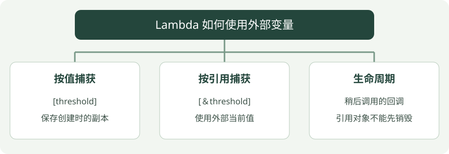

# 08 · Lambda 与回调

**示例标准：C++17** · [下载完整代码](examples/lambdas.cpp)

Lambda 是写在使用位置附近的函数。像“把大于阈值的距离留下来”这种短规则，用 Lambda 就不用跳到另一个文件找函数定义。


## 看图梳理

{ .learning-figure }

[打开大图](../../assets/learning/cpp-lambdas.svg)

**按值捕获**：[threshold]，保存创建时的副本；**按引用捕获**：[＆threshold]，使用外部当前值；**生命周期**：稍后调用的回调，引用对象不能先销毁。


## 一行语法拆开看

`[threshold](double d) { return d > threshold; }`

1. `[threshold]`：捕获外部变量，这里保存阈值的副本。
2. `(double d)`：输入参数。
3. `{ ... }`：函数体。

`[&threshold]` 按引用捕获，访问原变量；`[]` 不捕获外部局部变量。回调是“交给别人、稍后由别人调用的函数”。Lambda 是写回调的一种方式。

`auto` 可以保存具体 Lambda 类型。`std::function` 可以保存符合签名的不同可调用对象，但有类型擦除开销，有些情况还会动态分配，别无条件套一层。

## 完整示例

```cpp
#include <algorithm>
#include <iostream>
#include <vector>

// 程序入口；下面按顺序执行示例步骤。
int main() {
    double threshold{2.0};
    // 保存此刻阈值的副本，之后外部修改不会同步进去。
    const auto by_value = [threshold](double d) { return d > threshold; };
    // 借用外部阈值，使用时必须确保原变量还活着。
    const auto by_reference = [&threshold](double d) { return d > threshold; };
    // 修改原变量，用来展示两种捕获方式的差别。
    threshold = 4.0;
    // 把结果输出到终端，便于与正文中的示例结果对照。
    std::cout << std::boolalpha;
    // 把结果输出到终端，便于与正文中的示例结果对照。
    std::cout << "value capture: " << by_value(3.0) << '\n';
    // 把结果输出到终端，便于与正文中的示例结果对照。
    std::cout << "reference capture: " << by_reference(3.0) << '\n';
    const std::vector<double> distances{1.0, 3.0, 5.0};
    // 把结果输出到终端，便于与正文中的示例结果对照。
    std::cout << "above current threshold: "
              // 算法会调用传入的 Lambda 检查每个元素。
              << std::count_if(distances.begin(), distances.end(), by_reference)
              << '\n';
}
```

## 编译与运行

在示例目录执行。Windows 使用 PowerShell；Linux/macOS 将 `./lambdas.exe` 换成 `./lambdas`，并把输出文件名的 `.exe` 去掉。

```powershell
g++ -std=c++17 -Wall -Wextra -Wpedantic lambdas.cpp -o lambdas.exe
./lambdas.exe
```

预期输出：

```text
value capture: true
reference capture: false
above current threshold: 1
```

## 怎样读这段代码

按值捕获保存创建 Lambda 时的 2.0；以后外部变量改成 4.0，并不会同步更新那份副本。按引用捕获读到当前 4.0。

`count_if` 调用回调检查三个距离，只有 5.0 大于当前阈值，所以结果是 1。两个 Lambda 都在 `threshold` 仍存在的 `main` 内调用，引用没有悬空。

## 常见错误

- 返回一个捕获局部变量引用的 Lambda 后，局部变量销毁，再调用会访问悬空引用。
- 异步任务中捕获引用要特别检查生命周期；捕获 `this` 也没有自动延长对象生命周期。
- 大对象按值捕获可能复制很多数据。`[data = std::move(data)]` 可转移到闭包里，但调用者应理解所有权已经改变。

## 动手练习

在创建两个 Lambda 后，把阈值改成 0.5，对 1.0 调用它们会输出什么？

??? tip "展开参考答案"

    按值捕获仍保存 2.0，所以输出 false；按引用捕获看到 0.5，所以输出 true。

## 延伸阅读

[规范或官方指南](https://isocpp.github.io/CppCoreGuidelines/CppCoreGuidelines)。标准草案会继续更新，查阅时注意条款可能包含晚于本章示例的功能。


---

[返回学习路线](index.md) · [上一章：07 · 模板与泛型编程](templates.md) · [下一章：09 · 移动语义 →](move.md)
