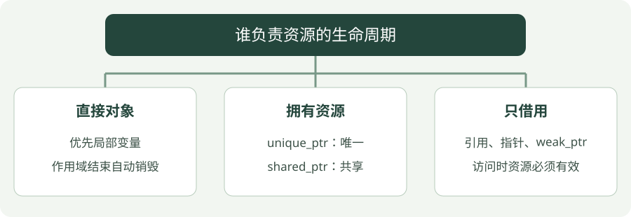

# 06 · 指针与智能指针

**示例标准：C++17**

普通指针记录对象的地址，但地址本身不说明“谁负责销毁对象”。现代 C++ 把这个责任写进类型：单独拥有用 `unique_ptr`，确有共同所有权才用 `shared_ptr`。


!!! tip "读完这页，你应该能做到"

    用一句话指出资源的拥有者和借用者，并检查谁先销毁。

    **先会这些就够了**：类、作用域。


## 看图梳理

{ .learning-figure }

[打开大图](../../assets/learning/cpp-ownership.svg)

**直接对象**：优先局部变量，作用域结束自动销毁；**拥有资源**：unique_ptr：唯一，shared_ptr：共享；**只借用**：引用、指针、weak_ptr，访问时资源必须有效。


## 地址、对象和清理责任不是同一件事

传感器对象像一份真实资料，指针像写着资料存放位置的纸条。复制纸条不等于复制资料，也不说明谁负责收拾资料。拥有者负责资源生命周期，借用者只在资料有效期间访问它。

下面先用 make_unique 创建资源并交给 owner；再把资源转交给 new_owner。转交后资料仍存在，改变的是负责人：owner 变空，new_owner 可以继续访问。不是两个指针各自拥有一份传感器。

| 操作 | owner | new_owner |
| --- | --- | --- |
| 创建后 | 拥有传感器 | 尚未创建 |
| 移动转交后 | 空 | 拥有原来的传感器 |
| new_owner 销毁后 | 空 | 资源被释放 |

`show(*new_owner)` 中，星号不是乘法，而是通过指针取出对象交给 show。`new_owner->field` 则通过指针访问成员。先确认非空再使用。weak_ptr 的 lock 会尝试取得一个临时 shared_ptr；失败表示已没有可访问的对象。


## 所有权与借用


| 类型 | 直觉 | 是否负责清理 |
| --- | --- | --- |
| `T&` / `const T&` | 借用一个已有对象 | 否 |
| `T*` | 地址，可以为空 | 本身不自动清理 |
| `std::unique_ptr<T>` | 唯一资源管理员 | 是，可转移所有权 |
| `std::shared_ptr<T>` | 多个管理员共同计数 | 最后一个拥有者释放 |
| `std::weak_ptr<T>` | 观察共享资源 | 否，访问前需 `lock()` |

`*p` 取指针指向的对象，`p->field` 访问其成员。不要解引用空指针。单纯需要一个局部对象时直接写 `Sensor sensor{...}`，不必为了“现代”而动态分配。

## 完整示例

```cpp
#include <iostream>
#include <memory>
#include <utility>

// 简单数据对象，成员默认公开。
struct Sensor {
    double distance_m;
};

// 这里只借用传感器，不获得销毁它的责任。
void show(const Sensor& sensor) {
    std::cout << "distance: " << sensor.distance_m << '\n';
}

// 程序入口；下面按顺序执行示例步骤。
int main() {
    // 创建资源并交给唯一拥有者，离开作用域自动释放。
    auto owner = std::make_unique<Sensor>(Sensor{2.5});
    show(*owner);
    // 转移 unique_ptr 所有权；之后原 owner 保证为空。
    auto new_owner = std::move(owner);
    std::cout << std::boolalpha << "old owner empty: " << !owner << '\n';
    show(*new_owner);
    // 共享所有权：最后一个强拥有者离开时销毁对象。
    auto shared = std::make_shared<Sensor>(Sensor{1.0});
    // 弱观察者不延长资源的生命周期。
    std::weak_ptr<Sensor> observer = shared;
    // 释放这里最后一个强拥有者，传感器随之销毁。
    shared.reset();
    std::cout << "resource expired: " << observer.expired() << '\n';
}
```

## 编译与运行

在示例目录执行。Windows 使用 PowerShell；Linux/macOS 将 `./ownership.exe` 换成 `./ownership`，并把输出文件名的 `.exe` 去掉。

```powershell
g++ -std=c++17 -Wall -Wextra -Wpedantic ownership.cpp -o ownership.exe
./ownership.exe
```

预期输出：

```text
distance: 2.5
old owner empty: true
distance: 2.5
resource expired: true
```

## 怎样读这段代码

`make_unique` 创建传感器并交给一个拥有者；`show` 只借用，所以不会夺走资源。移动后 `new_owner` 接手，原 `unique_ptr` 保证为空。

`weak_ptr` 不增加强引用计数。`shared.reset()` 释放最后一个强拥有者后，对象销毁，观察者变为过期。真实访问时写 `if (auto p = observer.lock()) { show(*p); }`：`lock()` 成功获得临时强拥有者才访问。

离开 `main` 时，`new_owner` 自动释放它拥有的资源。

## 常见错误

- 两个 `shared_ptr` 如果相互强引用，可能形成环；应把适当的一条关系改为 `weak_ptr`。
- 不要用同一个裸地址分别构造两个独立智能指针，可能重复释放。
- 智能指针管理生命周期，不自动让对象的成员读写具有线程安全性。

## 动手练习

<div class="practice-card" markdown="1">

<p class="practice-kicker">接着正文做一个小改动</p>

<p class="practice-title">转交资源后，先检查再访问</p>

正文把资源从 owner 转给 new_owner。这次检查原拥有者的状态，理解智能指针如何表达“已经交出去了”。

**从哪里开始**：在 ownership.cpp 中 auto new_owner = std::move(owner); 后添加判断。

**按这几步做**：

1. 预测 owner 是否还有资源。
2. 写一个 if，只有非空时才调用 show(*owner)。
3. 在空分支输出说明，继续用 new_owner 访问资源。

??? tip "需要一点提示？"

    对 unique_ptr，移动后的源指针保证为空；不能在检查之前先解引用。

??? example "查看参考修改与解释"

    原 owner 已经为空，会走 else；new_owner 仍拥有距离为 2.5 的 Sensor。

    **放在哪里**：这是追加片段，放在转移之后；列出的输出只对应新加的片段。

    ```cpp
    if (owner) {
        show(*owner); // 非空才解引用。
    } else {
        std::cout << "owner is empty\n";
    }
    show(*new_owner); // 资源现在由 new_owner 保管。
    ```

    **核对这段修改的结果**：只看新增或替换部分的输出；保留的正文演示可能还有其他输出。

    ```text
    owner is empty
    distance: 2.5
    ```

</div>


## 延伸阅读

[规范或官方指南](https://isocpp.github.io/CppCoreGuidelines/CppCoreGuidelines)。标准草案会继续更新，查阅时注意条款可能包含晚于本章示例的功能。


---

[返回学习路线](index.md) · [上一章：05 · 容器与标准算法](containers.md) · [下一章：07 · 模板与泛型编程 →](templates.md)
