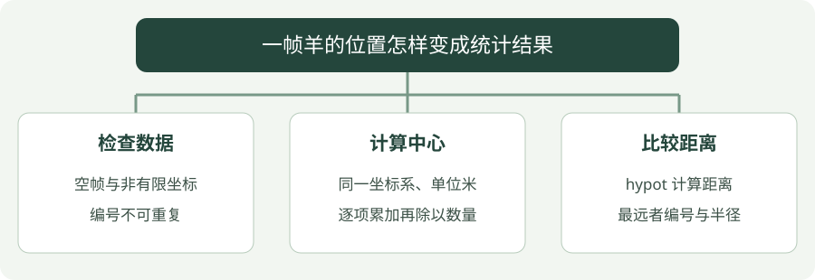

# 15 · 放牧场景的数据处理小项目

**示例标准：C++20** · [下载完整代码](examples/project.cpp)

把前面知识串起来：输入一帧羊的位置，检查数据，算羊群中心和最远的羊。这个程序用于练习数据处理接口，不直接生成机器人控制指令。


## 看图梳理

{ .learning-figure }

[打开大图](../../assets/learning/cpp-project.svg)

**检查数据**：空帧与非有限坐标，编号不可重复；**计算中心**：同一坐标系、单位米，逐项累加再除以数量；**比较距离**：hypot 计算距离，最远者编号与半径。


## 先把输入和输出说清楚

输入是同一个二维坐标系中的位置，单位米。输出包含中心位置、最远羊的编号、它到中心的距离。这里每只羊权重相同，中心取算术平均。


`struct` 表示简单数据；`span<const Sheep>` 借用整帧；`optional` 表示“这帧无法得到统计结果”；`hypot(dx, dy)` 计算二维距离。本例拒绝空帧、非有限坐标和重复编号，计算后也检查非有限结果。

## 完整示例

```cpp
#include <cmath>
#include <iomanip>
#include <iostream>
#include <optional>
#include <span>
#include <unordered_set>
#include <vector>

// 同一个二维坐标系中的位置，单位米。
struct Point { double x_m; double y_m; };
struct Sheep { int id; Point position; };
// 统计结果：中心、最远个体编号、到中心的距离。
struct Summary { Point center; int farthest_id; double radius_m; };

// 只读借用一帧，无法统计时返回没有值。
std::optional<Summary> summarize(std::span<const Sheep> sheep) {
    // 返回“没有结果”，不要把缺失数据当作有效的零值。
    if (sheep.empty()) { return std::nullopt; }
    Point center{0.0, 0.0};
    // 用集合检查编号唯一，不依赖数据先排序。
    std::unordered_set<int> ids;
    for (const auto& item : sheep) {
        if (!std::isfinite(item.position.x_m)
            || !std::isfinite(item.position.y_m)
            // insert 的 second 表示是否新插入；重复编号会得到 false。
            || !ids.insert(item.id).second) {
            // 返回“没有结果”，不要把缺失数据当作有效的零值。
            return std::nullopt;
        }
        // 累加所有 x 坐标，之后除以数量得到平均值。
        center.x_m += item.position.x_m;
        // y 坐标用同样的方法累加。
        center.y_m += item.position.y_m;
    }
    const auto count = static_cast<double>(sheep.size());
    center.x_m /= count;
    center.y_m /= count;
    if (!std::isfinite(center.x_m) || !std::isfinite(center.y_m)) {
        // 返回“没有结果”，不要把缺失数据当作有效的零值。
        return std::nullopt;
    }
    // 半径从 -1 开始，即使全部重合也能选出第一个编号。
    Summary result{center, sheep.front().id, -1.0};
    for (const auto& item : sheep) {
        // 用二维坐标差计算欧氏距离。
        const double distance = std::hypot(
            item.position.x_m - center.x_m, item.position.y_m - center.y_m);
        // 返回“没有结果”，不要把缺失数据当作有效的零值。
        if (!std::isfinite(distance)) { return std::nullopt; }
        // 发现更远个体才替换；平局保留输入中先出现的个体。
        if (distance > result.radius_m) {
            result.farthest_id = item.id;
            result.radius_m = distance;
        }
    }
    return result;
}

// 程序入口；下面按顺序执行示例步骤。
int main() {
    // 示例帧，不是实时采集或机器人控制输入。
    const std::vector<Sheep> frame{{1, {0.0, 0.0}}, {2, {2.0, 0.0}}, {3, {4.0, 3.0}}};
    if (const auto result = summarize(frame)) {
        // 把结果输出到终端，便于与正文中的示例结果对照。
        std::cout << std::fixed << std::setprecision(3);
        // 把结果输出到终端，便于与正文中的示例结果对照。
        std::cout << "center: (" << result->center.x_m << ", "
                  << result->center.y_m << ") m\n";
        // 把结果输出到终端，便于与正文中的示例结果对照。
        std::cout << "farthest id: " << result->farthest_id << '\n';
        // 把结果输出到终端，便于与正文中的示例结果对照。
        std::cout << "radius: " << result->radius_m << " m\n";
    } else {
        // 把结果输出到终端，便于与正文中的示例结果对照。
        std::cout << "invalid frame\n";
    }
    const std::vector<Sheep> empty;
    // 把结果输出到终端，便于与正文中的示例结果对照。
    std::cout << "empty frame accepted: " << std::boolalpha
              << summarize(empty).has_value() << '\n';
}
```

## 编译与运行

在示例目录执行。Windows 使用 PowerShell；Linux/macOS 将 `./project.exe` 换成 `./project`，并把输出文件名的 `.exe` 去掉。

```powershell
g++ -std=c++20 -Wall -Wextra -Wpedantic project.cpp -o project.exe
./project.exe
```

预期输出：

```text
center: (2.000, 1.000) m
farthest id: 3
radius: 2.828 m
empty frame accepted: false
```

## 怎样读这段代码

中心的 x 是 `(0 + 2 + 4) / 3 = 2`，y 是 `(0 + 0 + 3) / 3 = 1`。第三只羊到中心的距离是 `sqrt(2² + 2²)`，约 2.828 米，比第一只的约 2.236 米更远。

最大距离的初值设为 -1，确保即使所有羊都在同一点，也能选出第一只羊。如果最远距离相同，代码保留输入中先出现的编号，这是一条明确的平局规则。

输出只是几何统计，不能据此声称实现了放牧策略。接入真实机器人还需要时间戳、坐标变换、定位误差、速度约束、障碍物与安全控制。

## 常见错误

- 不同坐标系的数据不能直接求平均；“都是米”也不意味着坐标系相同。
- 数据陈旧与数据缺失不同，真实接口应保存时间戳。
- optional 没有解释失败原因；练习时可升级为 C++23 expected，保留具体错误。

## 动手练习

测试单只羊、三只羊重合、重复编号和空帧。预测结果；再把错误原因改成 expected 返回。

??? tip "展开参考答案"

    单只羊的中心就是自身、半径 0；全部重合时半径 0 且选第一个编号；重复编号和空帧都返回空。升级 expected 时分别返回 empty frame、duplicate id、non-finite coordinate 等，不要把失败伪装成正常的零半径。

## 延伸阅读

[规范或官方指南](https://isocpp.github.io/CppCoreGuidelines/CppCoreGuidelines)。标准草案会继续更新，查阅时注意条款可能包含晚于本章示例的功能。


---

[返回学习路线](index.md) · [上一章：14 · CMake 与调试](tooling.md)
