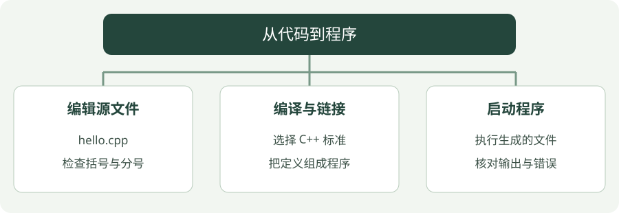

# 01 · 环境与第一个程序

写 C++ 需要两类工具：编辑器负责写代码，编译器把代码变成可执行程序。VS Code 是编辑器，安装 C++ 扩展不等于已经安装编译器。


!!! tip "读完这页，你应该能做到"

    分清编辑器和编译器，知道编译失败后不能用旧程序验证新代码。

    **先会这些就够了**：无需 C++ 基础。


## 看图梳理

{ .learning-figure }

[打开大图](../../assets/learning/cpp-setup.svg)

**编辑源文件**：hello.cpp，检查括号与分号；**编译与链接**：选择 C++ 标准，把定义组成程序；**启动程序**：执行生成的文件，核对输出与错误。


## 从保存文件到看到文字，中间发生了什么

把写程序分成三步：**源码是你写的文字，编译器把文字变成程序，终端启动程序**。保存 hello.cpp 只完成了第一步；双击源码并不会自动完成另外两步。编辑器里的运行按钮，也是在背后调用这些工具。

第一次操作时，先创建一个单独的文件夹，把 hello.cpp 放进去，再在该文件夹打开终端。终端的“当前位置”决定相对文件名从哪里找：编译器提示找不到 hello.cpp 时，先检查所在文件夹，不必急着改代码。

| 看到的写法 | 按人话理解 |
| --- | --- |
| `hello.cpp` | 输入：保存好的源文件 |
| `-o hello.exe` | 输出：把生成的程序命名为 hello.exe |
| `./hello.exe` | 从当前文件夹启动生成的程序 |
| `Hello, C++!` | 程序输出的文字，不是需要再输入的命令 |

下面每个命令框都要按行读。先等待编译结束，确认没有错误，再执行启动命令；程序没有更新时，检查是否保存、重新编译，以及启动的是否是刚生成的文件。


## 选择一条安装路线

| 平台 | 一条常见路线 | 检查 |
| --- | --- | --- |
| Windows | [MSYS2 官方安装](https://www.msys2.org/)后使用 UCRT64 环境 | UCRT64 终端执行 `g++ --version` |
| Windows | [Visual Studio C++ 工具](https://learn.microsoft.com/en-us/cpp/build/vscpp-step-0-installation) | 开发者命令提示符执行 `cl` |
| Linux | 使用发行版包管理器安装 GCC/G++ | `g++ --version` |
| macOS | 安装 Xcode 命令行开发工具，使用 Apple Clang | `clang++ --version` |

本教程命令主要用 G++。如果用 MSYS2，在 **UCRT64** 终端安装 `mingw-w64-ucrt-x86_64-gcc`；不要把 MSYS、MINGW64、UCRT64 的不同工具链混在一起。照 [MSYS2 入门文档](https://www.msys2.org/docs/environments/)选对应终端。

PowerShell 找不到 g++ 时，把实际安装目录的 `ucrt64/bin` 加入 PATH 并重新打开终端，或直接使用编译器完整路径。编译与运行应能找到同一工具链的 DLL，不要从其他来源随意复制 DLL 来凑。

## 第一次操作：先把“在哪儿写、在哪儿输入”分开

先选上面表格里的一条路线。本页下面以 **Windows、MSYS2 UCRT64、G++** 为例，另外两种系统照各自命令即可，不需要把所有编译器都安装一遍。

1. 按官方安装向导完成 MSYS2，打开开始菜单里的 **MSYS2 UCRT64** 终端。
2. 在这个终端输入 `pacman -S mingw-w64-ucrt-x86_64-gcc`，按提示安装编译器。`pacman` 是这个环境的包管理工具，这一行不是 C++ 代码，也不在普通 PowerShell 中输入。
3. 仍在 UCRT64 终端输入 `g++ --version`。能看到版本文字，说明这个终端找到了编译器；若提示命令不存在，先解决安装问题。
4. 在资源管理器中新建练习文件夹，例如 `D:\cpp-study`。在编辑器里新建文件，把下一节的完整代码保存为 `hello.cpp`，编码选择 UTF-8。
5. 打开一个能找到同一 G++ 的终端，进入这个文件夹，再输入“编译与运行”中的命令。若 PowerShell 还找不到 G++，可以先继续使用 UCRT64 终端。

位置切换在两个终端里写法不同，只选择你正在使用的一栏：

| 正在使用的终端 | 切换到练习文件夹 | 查看文件是否在这里 |
| --- | --- | --- |
| Windows PowerShell | `Set-Location 'D:\cpp-study'` | `Get-ChildItem` |
| MSYS2 UCRT64 | `cd /d/cpp-study` | `ls` |

路径只是示例，换成你自己创建的目录。不要把 `D:\cpp-study` 原封不动输到没有 D 盘的电脑上。在 UCRT64 中，Windows 的 D 盘通常以 `/d` 开头。

!!! note "先找到文件，再排查代码"

    资源管理器打开“显示文件扩展名”，确认文件是 hello.cpp，而不是 hello.cpp.txt。查看目录后，应能看见这个源文件；编译成功后才会多出 hello.exe。网页代码块右上的复制按钮只复制代码，不需要手工复制围栏或语言名。

## 第一段代码的标点，也逐个认识

| 写法 | 作用 | 容易误会的地方 |
| --- | --- | --- |
| `#include <iostream>` | 让编译器知道标准输入输出工具的声明 | 不是在屏幕上打印一行文字；末尾不加分号 |
| `int main()` | 定义程序启动后进入的函数 | `int` 是返回给系统的状态码类型；`()` 表示这里没有参数 |
| `{` 和 `}` | 把函数内的语句围成一组 | 开括号与闭括号必须配对 |
| `std::cout` | 标准输出对象，通常连接终端 | `std::` 说明这个名字来自标准库命名空间 |
| `<<` | 把一项内容送到输出对象 | 可以连续写多项；这里不是数学小于号 |
| `"Hello, C++!\n"` | 双引号里是一段文字，末尾换行 | `\n` 是两个源码字符组成的转义写法，输出时是一次换行 |
| `;` | 结束这一条语句 | 普通输出语句需要它；函数最后的 `}` 后不额外要求它 |
| `// ...` | 给人看的单行注释 | 不参与程序计算；适合解释这一行为什么这样写 |

电脑不会理解“我本来想这样写”。英文半角 `;` 与中文全角 `；` 是不同字符；括号、引号和分号使用英文输入法，注释内可以放心写中文。

第一次学不需要理解所有编译选项。先看到正确输出，再改一小处文字、保存、重新编译、重新启动。能反复完成这四步，就已经掌握后面所有章节的基本操作。

## 第一个程序

新建 `hello.cpp`：

```cpp
#include <iostream>

int main() {
    // cout 输出文字，\n 表示换行。
    std::cout << "Hello, C++!\n";
    // 返回 0 告诉操作系统：程序正常结束。
    return 0;
}
```

`#include` 让程序看得到输出工具的声明；`main` 是入口；`std::cout` 输出文本；`return 0` 表示正常结束。main 走到末尾也会隐式返回 0。

Windows PowerShell：

```powershell
g++ -std=c++17 -Wall -Wextra -Wpedantic hello.cpp -o hello.exe
./hello.exe
```

Linux/macOS：

```bash
g++ -std=c++17 -Wall -Wextra -Wpedantic hello.cpp -o hello
./hello
```

macOS 可把 g++ 换成 clang++。输出应是 `Hello, C++!`。`-std=c++17` 选择标准，`-Wall -Wextra -Wpedantic` 开启常见警告，`-o` 指定输出文件。选项含义见 [GCC 官方文档](https://gcc.gnu.org/onlinedocs/gcc/C_002b_002b-Dialect-Options.html)。

MSVC 用户请在开发者终端执行：

```text
cl /std:c++17 /EHsc /W4 /utf-8 hello.cpp /Fe:hello.exe
hello.exe
```

C++20 示例可改为 `/std:c++20`。C++23 开关与功能支持请按所装 MSVC 版本查 [官方 /std 文档](https://learn.microsoft.com/en-us/cpp/build/reference/std-specify-language-standard-version)，不要把 G++ 的参数直接传给 cl。

## 出错时先分清阶段

| 阶段 | 常见现象 | 先检查 |
| --- | --- | --- |
| 找工具 | g++ 不是可识别命令 | 是否装编译器、PATH 是否正确 |
| 编译 | expected 不存在、语法错误 | 标准开关、头文件、库版本、第一条错误 |
| 链接 | undefined reference | 是否漏编源文件或库 |
| 运行 | 找不到 DLL、输出异常 | 运行环境、输入、边界和生命周期 |

编译失败后不要直接运行上次留下的 exe，旧程序会造成“修改没有生效”的错觉。

## 动手练习

<div class="practice-card" markdown="1">

<p class="practice-kicker">接着正文做一个小改动</p>

<p class="practice-title">让第一段程序说出你的实验信息</p>

你已经认识了 main 和 cout。这次只改输出文字，练习“编辑源码 → 重新编译 → 查看新结果”。

**从哪里开始**：在 hello.cpp 的 main 里，替换原来的 Hello 输出语句，保留函数括号和 return。

**按这几步做**：

1. 让第一行输出实验名称，第二行输出研究方向。
2. 先检查每条语句的分号，再重新编译。
3. 可选：临时漏掉一个分号，观察第一条报错后恢复。

??? tip "需要一点提示？"

    字符串里的 \n 表示换行；编译失败时不要运行上次留下的 exe。

??? example "查看参考修改与解释"

    先让输出正确，再用一个小错误认识编译提示。错误位置有时落在下一行，因此也要检查上一行。

    **放在哪里**：只替换 main 内的输出语句，不另写一个 main。

    ```cpp
    // 两次输出分别占一行，放在 main 内。
    std::cout << "Viktor research notes\n";
    std::cout << "Herding robotics\n";
    ```

    **核对这段修改的结果**：

    ```text
    Viktor research notes
    Herding robotics
    ```

</div>


[继续：变量、判断与循环 →](basics.md)


---

[返回学习路线](index.md) · [下一章：02 · 变量、判断与循环 →](basics.md)
