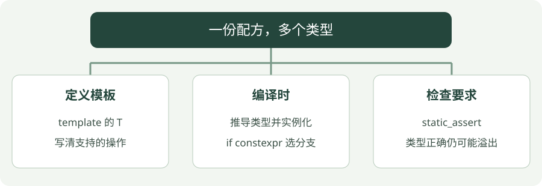

# 07 · 模板与泛型编程

**示例标准：C++17**

模板像带“类型空位”的函数配方。你写一份逻辑，编译器在调用时根据类型生成对应版本。它不是运行时自动猜类型。


!!! tip "读完这页，你应该能做到"

    分清编译期类型配方与运行时变量。

    **先会这些就够了**：函数、基本类型。


## 看图梳理

{ .learning-figure }

[打开大图](../../assets/learning/cpp-templates.svg)

**定义模板**：template 的 T，写清支持的操作；**编译时**：推导类型并实例化，if constexpr 选分支；**检查要求**：static_assert，类型正确仍可能溢出。


## 为什么不分别写整数版与小数版

整数 3 的平方是 9，小数 1.5 的平方是 2.25，计算步骤都是 x × x。模板让步骤写一次，把类型留作一个空位 T。调用时，编译器根据输入填上这个空位。

| 调用 | 推导出的 T | 计算与结果 |
| --- | --- | --- |
| `square(3)` | int | 整数乘法，返回整数 9 |
| `square(1.5)` | double | 浮点乘法，返回小数 2.25 |

`typename T` 在这里声明“接下来 T 代表一种类型”；它不是一个叫 T 的数据变量。函数里的 value 才是具体输入值。编译器检查该类型能否使用乘法，模板并不会自动让所有类型都支持同一操作。

先理解“同样步骤、不同类型”，再看 constexpr。写成 constexpr 是允许满足条件时在编译期计算；static_assert 则要求在编译时核对条件。if constexpr 用类型信息挑分支，不是根据运行时输入大小作判断。


## 从模板到编译期判断

`template<typename T>` 引入类型参数 `T`。例如 `square(3)` 推导 `T` 为 `int`，`square(1.5)` 推导为 `double`。

`constexpr` 函数在满足要求且用于常量表达式时可以在编译期执行，也可以在运行时执行；它不是“每次必定提前算好”。`static_assert` 在编译期检查条件。

C++17 的 `if constexpr` 根据编译期条件选择分支，在模板实例化中丢弃另一分支；普通 `if` 没有同样的效果。

## 先把 T 换成具体类型，模板就不神秘了

可以把模板版本暂时当作下面两份普通函数的共同配方。这两个函数只是对照用，不必加入后面的完整程序：

```cpp
int square_int(int value) { return value * value; }
double square_double(double value) { return value * value; }
```

两份代码变化的是类型，计算步骤没变。写成 `template<typename T>` 后，把开头返回类型和参数类型都换成 T，就可以让编译器根据调用确定具体类型。

| 看到的文字 | 它是什么 | 不是什么 |
| --- | --- | --- |
| `T` | 类型参数的名字，可代表 int、double 等 | 不是运行时保存数值的变量 |
| `value` | 这次调用收到的数据 | 不必与调用者的变量同名 |
| `square(3)` | 由整数实参推导出 T 为 int | 不会先把 3 自动升级成 double |
| `square<double>(3)` | 明确要求 double 版本，3 会转换为 double | 尖括号里不是另一个普通数值参数 |

同一个模板要求类型支持代码里使用的操作。`std::string` 没有这里需要的乘法，不能因为它也是类型就用它求平方。读模板报错时先看**哪次调用、推导出什么类型、哪项操作不支持**，不必从第一天就看懂所有编译器内部类型名。

## constexpr、static_assert、if constexpr 分三次理解

| 工具 | 负责的事情 | 在本章里的例子 |
| --- | --- | --- |
| constexpr 函数 | 允许符合要求的调用用于常量表达式 | square 可以在编译时用于计算 |
| static_assert | 要求条件在编译时可检查且为真 | 确认 square(3) 等于 9，否则编译失败 |
| if constexpr | 用编译期条件选分支 | 根据 T 是否整数决定输出文字 |

`std::is_integral_v<T>` 是标准库提供的类型问题，回答“这个 T 是否属于整数类型”。`square(3.0)` 得到的数值虽然是 9，但类型仍然是 double，仍走非整数分支。这个工具看类型，不看“小数点后碰巧是不是 0”。

`if constexpr` 在模板实例化时可丢弃不选的、依赖类型的分支，但源码仍需要符合基本语法。例如括号漏写，不会因为分支没被选中就自动合法。先用它表达类型差异，不把它当作随意藏错误代码的开关。

### 类型检查通过，不代表数值范围无限大

平方和立方增长很快。`square(3)` 安全，不等于任意 int 输入都安全；有符号整数超出可表示范围属于未定义行为。double 的结果也可能超范围或发生舍入。模板复用的是计算规则，输入范围的约定与检查仍然需要自己设计。

## 完整示例

```cpp
#include <iostream>
#include <type_traits>

// T 是编译期类型参数，可复用同一份配方。
template<typename T>
// 满足常量表达式要求时可在编译期求值，也可运行时计算。
constexpr T square(T value) {
    // 要求类型支持乘法；整数溢出仍需另外考虑。
    return value * value;
}

// 这里根据 T 的类别选择输出格式，数值仍由每次调用传入。
template<typename T>
void describe(T value) {
    // 按类型选择分支，在模板实例化时丢弃另一分支。
    if constexpr (std::is_integral_v<T>) {
        std::cout << "integer: " << value << '\n';
    } else {
        // 本例传入 double；else 本身并不保证任意 T 都是数值类型。
        std::cout << "other number: " << value << '\n';
    }
}

// 程序入口；下面按顺序执行示例步骤。
int main() {
    // 编译时检查结论；条件不满足时无法生成程序。
    static_assert(square(3) == 9);
    // 先调用 square 得到 9，再把这个 int 结果交给 describe。
    describe(square(3));
    // 1.5 使 T 推导为 double，返回 2.25，走非整数分支。
    describe(square(1.5));
}
```

## 编译与运行

把上面的完整程序保存为 `templates.cpp`，在保存这个文件的目录打开终端。短片段与练习修改不要额外拼在完整程序后面；按正文标明的位置替换或追加。Windows 使用 PowerShell；Linux/macOS 将 `./templates.exe` 换成 `./templates`，并把输出文件名的 `.exe` 去掉。

```powershell
g++ -std=c++17 -Wall -Wextra -Wpedantic templates.cpp -o templates.exe
./templates.exe
```

预期输出：

```text
integer: 9
other number: 2.25
```

## 怎样读这段代码

`std::is_integral_v<T>` 在编译期告诉我们类型是否属于整数类型。`describe` 的输出分支由类型决定；数值则可以来自运行时。

模板的定义通常放在头文件中，让使用它的源文件能看到完整定义。仅在头文件声明、把定义藏到普通 `.cpp`，可能导致链接错误，除非专门做显式实例化。

本例的 `square` 没有限制所有可用类型：类型必须支持乘法并能返回 `T`，否则会编译失败。第 11 章用 concepts 让要求更明确。

## 常见错误

- 泛型不等于适用于一切类型；整数平方仍可能溢出，有符号整数溢出是未定义行为。
- `square(3)` 与 `square(3.0)` 的返回类型不同。
- 在非模板上下文里，不能指望 `if constexpr(false)` 隐藏所有非法代码。

## 动手练习

<div class="practice-card" markdown="1">

<p class="practice-kicker">接着正文做一个小改动</p>

<p class="practice-title">把平方配方改成立方配方</p>

正文的 square 已经是一份类型配方。这次沿用相同结构，练习函数定义与调用应该分别放哪里。

**从哪里开始**：在 templates.cpp 的 main 前新增 cube；验证语句和输出语句放到 main 内。

**按这几步做**：

1. 保留 template<typename T>，把返回表达式改为三个 x 相乘。
2. 用 static_assert 检查 cube(2) 为 8。
3. 对 0.5 调用同一函数，预测结果。

??? tip "需要一点提示？"

    模板函数定义不放进 main；static_assert 和演示输出可以放在 main 中。

??? example "查看参考修改与解释"

    整数 2 的立方为 8，浮点 0.5 的立方为 0.125。这里用两段代码分别标明定义和调用位置。

    **放在哪里**：先添加这个函数；main 内的调用见下面第二个代码块。

    ```cpp
    // 放在 main 之前：定义模板函数。
    template<typename T>
    constexpr T cube(T x) {
        return x * x * x;
    }
    ```

    **再放到 main 里面**：

    ```cpp
    static_assert(cube(2) == 8);
    std::cout << cube(0.5) << '\n';
    ```

    **核对这段修改的结果**：只看新增或替换部分的输出；保留的正文演示可能还有其他输出。

    ```text
    0.125
    ```

</div>


## 延伸阅读

[规范或官方指南](https://isocpp.github.io/CppCoreGuidelines/CppCoreGuidelines)。标准草案会继续更新，查阅时注意条款可能包含晚于本章示例的功能。


---

[返回学习路线](index.md) · [上一章：06 · 指针与智能指针](ownership.md) · [下一章：08 · Lambda 与回调 →](lambdas.md)
