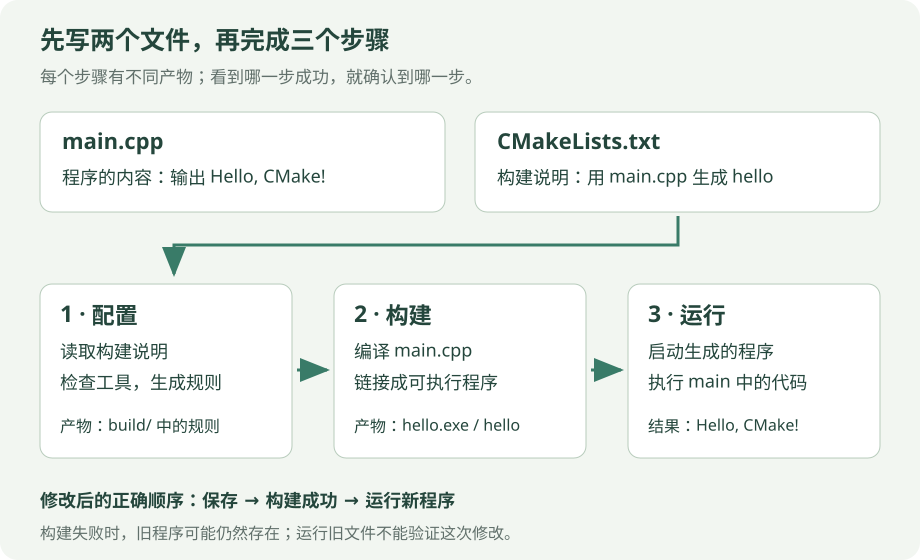

# 14 · CMake：从两个文件开始，学会构建与排错

假设你刚写好 `main.cpp`，想让它显示一行文字。CMake 要解决的第一个问题很具体：**把“用哪些文件生成哪个程序”记下来，下次不用重新拼编译命令。** 本章先做这个最小项目，再把一个函数拆到另一个文件里。

!!! tip "本章分两遍读"

    第一遍读到“修改代码后怎么办”，只需要两个文件、三步操作。第二遍再学多文件、警告和调试。最后的全部示例配置是进阶阅读，不需要一开始就理解。

    **先会这些**：能读懂第 01 章的 `main` 和输出语句，知道文件夹与文件的区别。尚未装好编译器时，先看 [环境与第一个程序](setup.md)。

## 1. 先分清四种工具

| 名称 | 它具体做什么 | 本章中的例子 |
| --- | --- | --- |
| 编辑器 | 写下并保存文字 | VS Code 保存 `main.cpp` |
| 编译器 | 检查 C++，把源码编译成机器能处理的文件 | G++、MSVC、Clang |
| 构建工具 | 按依赖关系安排编译、链接，重新处理需要更新的部分 | Make、Ninja、MSBuild |
| CMake | 读取构建说明，生成构建工具需要的规则；也提供统一的构建命令 | 读取 `CMakeLists.txt` |

**链接**是把各个编译结果和所需的库组合成程序。只安装 CMake，不会自动获得一个 C++ 编译器。`cmake --build` 会调用选定的构建工具，构建工具再安排编译和链接。

{ .learning-figure }

[打开大图](../../assets/learning/cmake-first-project.svg)

图中上半部分是你保存的文件，下半部分是工具生成的内容。先配置，再构建，最后启动程序。看到“配置成功”时，程序通常还没有生成。

## 2. 准备一个只有两个文件的文件夹

创建自己的 `hello-cmake` 文件夹。里面两个文件的名字先与下图保持一致。`CMakeLists.txt` 中的大小写要准确，注意不要保存成 `CMakeLists.txt.txt`。

```text
hello-cmake/            ← 你新建的项目文件夹
├── CMakeLists.txt      ← 用 CMake 语法写的构建说明
└── main.cpp            ← 用 C++ 写的程序
```

### 文件一：main.cpp

把下面整段保存进 `main.cpp`。它是完整的 C++ 程序。

```cpp title="main.cpp · 完整文件"
#include <iostream>  // 声明标准输出工具 std::cout。

int main() {  // 程序从 main 开始执行。
    std::cout << "Hello, CMake!\n";  // 输出文字；\n 表示换行。
    return 0;  // 返回 0 表示程序正常结束。
}
```

### 文件二：CMakeLists.txt

把下面整段保存进 `CMakeLists.txt`。这是构建配置，用 `#` 写注释，不是 C++，不要放进 `main.cpp`。

```cmake title="CMakeLists.txt · 最小完整配置"
# 需要 CMake 3.20 或更新版本；这里不是 C++ 的版本号。
cmake_minimum_required(VERSION 3.20)

# 为整个项目命名，并检查 C++ 编译器；CXX 表示 C++。
project(HelloCMake LANGUAGES CXX)

# 建立名为 hello 的可执行目标，由 main.cpp 这个源文件组成。
# Windows 上默认生成的程序文件名为 hello.exe。
add_executable(hello main.cpp)

# hello 至少需要 C++17 编译模式；PRIVATE 表示只给这个目标使用。
target_compile_features(hello PRIVATE cxx_std_17)
```

**目标（target）**可以先理解成“一份成品的名字和制作要求”。这里的目标叫 `hello`，要求是“用 `main.cpp` 做一个程序，至少支持 C++17”。`HelloCMake` 是整个项目的名字，`hello` 才是目标名，它们不必相同。

`add_executable` 不会立刻执行你的程序，它只是登记要生成什么。`target_compile_features` 中的 `hello` 必须对应前面已经建立的目标，不能误写成项目名。它声明最低语言要求，不保证所有 C++17 标准库功能在任意旧工具链中都已实现。

## 3. 在正确的文件夹打开终端

终端是输入命令的地方。先在编辑器中打开 `hello-cmake` 文件夹，再打开终端；或者在终端中切换到自己实际创建的目录。

Windows PowerShell 用 `Get-Location` 查看当前位置，用 `Get-ChildItem` 查看里面的文件。Linux/macOS 对应 `pwd` 和 `ls`。**确认能看到 `main.cpp` 与 `CMakeLists.txt` 后再继续。**

命令里的 `.` 表示终端的当前文件夹；`build` 是相对于当前位置的子文件夹。命令要逐行执行，确认上一条成功，再输入下一条。

### Windows：沿用第 01 章的 UCRT64 / G++ 路线

在能够找到 UCRT64 工具链的 PowerShell 中检查：

```powershell
cmake --version
g++ --version
mingw32-make --version
```

这三条只显示工具版本。如果其中一个提示“无法识别”，先补齐对应工具并检查 PATH。PATH 是系统查找命令所在文件夹的列表。UCRT64 的编译器和 Make 应来自同一套工具链；相应包名为 `mingw-w64-ucrt-x86_64-gcc` 和 `mingw-w64-ucrt-x86_64-make`。安装路线见 [第 01 章](setup.md)，CMake 的安装说明见 [官方入口](https://cmake.org/download/)。

**第一步：配置。** 在 `hello-cmake` 目录输入：

```powershell
cmake -S . -B build -G "MinGW Makefiles" -DCMAKE_BUILD_TYPE=Debug
```

| 命令中的部分 | 本例里准确的意思 |
| --- | --- |
| `cmake` | 启动 CMake 工具 |
| `-S .` | 源码目录是当前位置，里面应有 `CMakeLists.txt` |
| `-B build` | 把生成的构建文件放进 `build`；没有时会创建 |
| `-G "MinGW Makefiles"` | 选择与这套 Windows G++ 工具链对应的构建规则格式 |
| `-DCMAKE_BUILD_TYPE=Debug` | 对这个单配置生成器，选择便于调试的配置 |

“生成器”决定 CMake 生成哪种构建规则。`-D` 是设置 CMake 配置变量，不是向 C++ 程序传参数。成功时通常能看到 `Configuring done`、`Generating done`，以及构建文件所在目录。

**第二步：构建。** 配置成功后输入：

```powershell
cmake --build build
```

这时才编译 `main.cpp` 并链接出 `hello.exe`。成功日志通常出现 `Built target hello`。不同工具链的进度文字可能不同，重点看命令是否成功退出以及有没有错误。

**第三步：运行。** 构建成功后输入：

```powershell
./build/hello.exe
```

预期输出只有一行：

```text
Hello, CMake!
```

### Linux/macOS：使用本机已安装的编译器与构建工具

在同样的项目目录下，逐条执行并确认成功：

```bash
cmake -S . -B build -DCMAKE_BUILD_TYPE=Debug
cmake --build build
./build/hello
```

这里假设使用 Unix Makefiles 或 Ninja 这样的单配置生成器，并且对应构建工具已安装。程序文件通常没有 `.exe` 后缀。macOS 可以使用 Apple Clang，CMake 会识别所配置的编译器。

??? note "如果我用 Visual Studio / MSVC 呢？"

    先安装 Visual Studio 的 C++ 桌面开发工具。在对应的开发者终端中，让 CMake 选择匹配的 Visual Studio 生成器；配置日志会显示选择结果。

    ```text
    cmake -S . -B build-vs
    cmake --build build-vs --config Debug
    ./build-vs/Debug/hello.exe
    ```

    上面的运行路径适用于 Visual Studio 生成器的常见布局。它属于多配置生成器：同一个构建目录可包含 Debug、Release 等配置，构建时通过 `--config Debug` 选择。`CMAKE_BUILD_TYPE` 不负责选择这种生成器的配置。

    如果日志选到了其他生成器，按实际生成器使用对应命令和输出目录；不要把 MinGW 与 MSVC 的编译文件混进同一个构建目录。

## 4. 修改代码后怎么办？

把 `main.cpp` 中的文字改为 `I understand the build steps!`，保存，再执行构建和运行命令。一般不必每改一句 C++ 都手动重新配置，构建工具会检查哪些源文件变了。

| 你改了什么 | 下一步 |
| --- | --- |
| `main.cpp` 中的一句输出 | 保存 → `cmake --build build` → 运行新程序 |
| 新增源文件并修改了 `CMakeLists.txt` | 保存 → 用原配置命令重新配置 → 构建 → 运行 |
| 换了编译器或生成器 | 用一个新的构建目录配置，例如 `build-other` |
| 只是想重看程序输出 | 直接运行已生成的程序 |

`build` 内会出现 `CMakeCache.txt`、`CMakeFiles` 等工具生成的内容。**主要修改项目目录中的源文件和 `CMakeLists.txt`，不需要手改生成的 Makefile。** 若编译失败，旧的 `hello.exe` 可能仍在；启动它不能验证这次修改。

到这里，你已完成第一轮学习：能指认两个手写文件、配置命令、构建命令和程序位置。下面再解决“多个文件怎样组成一个程序”。

## 5. 第二个小项目：把计算函数单独放一个文件

任务是把 2.5 米换成厘米。主程序显示结果，另一个文件负责计算。创建新文件夹 `distance-cmake`，避免覆盖前面的练习：

```text
distance-cmake/
├── CMakeLists.txt
├── main.cpp       ← 程序入口和输出
├── distance.hpp   ← 声明：函数叫什么、接收什么、返回什么
└── distance.cpp   ← 定义：具体怎样计算
```

**声明**说明“有一个这样的函数可用”；**定义**写出实际计算步骤。头文件让调用者知道接口，实现文件提供函数体。下面三个 C++ 代码框分别保存为三个文件，不能连成一个文件复制。

```cpp title="distance.hpp · 完整文件"
// 防止头文件在同一编译单元内被重复处理。
// 这是常见的 include guard；宏名要避免与其他头文件重复。
#ifndef DISTANCE_CMAKE_DISTANCE_HPP
#define DISTANCE_CMAKE_DISTANCE_HPP

// 声明：输入米，返回厘米；输入输出均为小数类型。
double to_centimeters(double meters);

#endif
```

```cpp title="distance.cpp · 完整文件"
#include "distance.hpp"  // 包含自己的接口声明，便于核对声明与定义。

double to_centimeters(double meters) {
    return meters * 100.0;  // 1 米 = 100 厘米；本例演示普通数值换算。
}
```

```cpp title="main.cpp · 本项目的完整文件"
#include <iostream>      // 标准库头文件通常用尖括号。
#include "distance.hpp"  // 本项目头文件用双引号。

int main() {
    const double distance_m{2.5};  // 输入，单位米。
    const double distance_cm = to_centimeters(distance_m);  // 调用另一文件中的函数。
    std::cout << distance_cm << " cm\n";  // 预期输出 250 cm。
    return 0;
}
```

对应配置如下：

```cmake title="distance-cmake/CMakeLists.txt · 完整文件"
cmake_minimum_required(VERSION 3.20)
project(DistanceDemo LANGUAGES CXX)

# 一个程序需要两个 .cpp：一个提供 main，一个提供换算函数。
# 换行只是为了易读，这仍是一条 add_executable 命令。
add_executable(distance_demo
    main.cpp
    distance.cpp
)
target_compile_features(distance_demo PRIVATE cxx_std_17)
```

在 distance-cmake 目录打开终端。这个项目有自己的构建目录，不能直接跑前一个 hello-cmake 的程序。Windows G++ 路线逐行执行：

```powershell title="在 distance-cmake 目录执行"
cmake -S . -B build -G "MinGW Makefiles" -DCMAKE_BUILD_TYPE=Debug
cmake --build build
./build/distance_demo.exe
```

Linux/macOS 用前面的单配置路线，把最后一行改成 `./build/distance_demo`。成功输出为 `250 cm`。三个步骤的职责仍是配置、构建、运行，只改变了源文件列表与成品名字。

`#include "distance.hpp"` 让编译器知道函数如何调用，**不会自动替你编译 `distance.cpp`**。配置中漏掉它，`main.cpp` 可能编译通过，之后却出现找不到 `to_centimeters` 定义的链接错误。

头文件可以列在目标中方便编辑器展示，但不必把它当作单独的 `.cpp` 编译。不要用 `#include "distance.cpp"` 来补漏。这个拆分方法针对普通函数；模板定义通常需要在使用处可见，参见 [模板一章](templates.md)。

## 6. 警告、调试与“第一条错误”

### 先让编译器多提醒你

把下面片段加在第二个项目的 `add_executable` 后面。`if/else/endif` 是 CMake 的条件语法，根据编译器选用不同的警告参数。

```cmake title="CMakeLists.txt · 添加片段"
if(MSVC)
    # MSVC 使用 /W4 开启较多警告；/utf-8 统一源码和执行字符集。
    target_compile_options(distance_demo PRIVATE /W4 /utf-8)
else()
    # 本章 GCC / Clang 路线使用这些警告参数。
    target_compile_options(distance_demo PRIVATE -Wall -Wextra -Wpedantic)
endif()
```

警告表示“这里值得检查”，例如定义了变量却没有使用；错误表示“当前步骤无法继续”。不要只找最后一行的 `Error`，它经常只是汇总；向上找第一条有文件名、行号和具体原因的信息。

| 现象 | 发生阶段 | 优先检查 |
| --- | --- | --- |
| `cmake` 无法识别 | 启动工具之前 | 工具是否安装，终端能否找到它 |
| 源目录没有 `CMakeLists.txt` | 配置 | 终端位置、`-S` 路径、文件名 |
| 找不到 C++ 编译器 / Make | 配置 | 编译器、构建工具、生成器是否匹配 |
| 找不到 `main.cpp` | 配置或生成 | 文件是否保存，配置中的名字是否正确 |
| 缺分号、变量未声明 | 编译 | 报错行及它前面一行的源码 |
| `undefined reference` / unresolved external | 链接 | 声明是否有定义，实现文件是否加入目标 |
| multiple definition of `main` | 链接 | 是否把两个完整程序放进同一个目标 |
| 输出仍是旧文字 | 运行 | 是否保存并成功构建，是否启动了正确的程序 |

### 调试不是重新猜一遍

**断点**表示“到这一行先暂停”；**单步**表示“执行一小步，再看变量”；**调用栈**记录当前函数由谁调用。在 `to_centimeters` 的 `return` 行设断点，先看 `meters` 是否为 2.5，再看返回值是否为 250。

如果输入已经是 250，再乘 100 就会得到 25000。此时可能没有编译错误，也没有警告，问题是单位传错了。先查传入数据和函数约定。编辑器的断点功能还需要配置对应的调试器；CMake 负责构建配置。

??? note "之后再了解：内存检查工具"

    在支持的 GCC / Clang 工具链上，可用 AddressSanitizer 和 UndefinedBehaviorSanitizer 辅助寻找越界、释放后使用等问题。在第二个项目目录中，例如：

    ```bash
    g++ -std=c++17 -g -O1 -fsanitize=address,undefined -fno-omit-frame-pointer main.cpp distance.cpp -o distance_checked
    ./distance_checked
    ```

    `-g` 保留调试信息；`-O1` 选择较低优化级别；`-fsanitize` 加入运行时检查。这些工具只能检查实际走到的执行路径，某些 Windows MinGW 工具链没有完整支持。初学先读懂普通报错，再引入这些工具。

### Debug 与 Release 不是两个不同的 C++ 文件

Debug 通常保留便于调试的信息并减少优化；Release 通常更偏向优化。具体参数由工具链与配置决定，不保证 Debug 一定找到所有错误，也不保证 Release 一定满足性能目标。源码可以相同，构建配置不同。

| 生成器类型 | 怎么选择配置 | 本章例子的程序位置 |
| --- | --- | --- |
| 单配置：MinGW Makefiles、Unix Makefiles、普通 Ninja | 配置时设置 `-DCMAKE_BUILD_TYPE=Debug` | build/hello.exe 或 build/hello |
| 多配置：Visual Studio、Ninja Multi-Config | 构建时设置 `--config Debug` | 默认常见布局为 build/Debug/hello.exe（Windows） |

只加 `--config Debug` 不能让普通 Makefile 构建自动切到 Debug；只设置 CMAKE_BUILD_TYPE 也不能替多配置生成器选择构建配置。这项区别见 [CMake 的构建类型说明](https://cmake.org/cmake/help/latest/variable/CMAKE_BUILD_TYPE.html)。

### PRIVATE 为何出现在目标后面？

target_compile_features、target_compile_options 都先指名“给哪个目标设置”，再说设置的传播范围。PRIVATE 表示要求用于本目标；PUBLIC 表示本目标和使用它的其他目标；INTERFACE 表示供使用它的目标。当前只生成独立程序，用 PRIVATE 足够。

以后把公用代码做成库时，这些传播范围才更重要。不要把 PRIVATE 当成 C++ 类的 private；同一个英文词出现在两种配置语法里，含义需要按位置读。

## 7. 动手练习：亲自解释一次链接错误

<div class="practice-card" markdown="1">

<p class="practice-kicker">沿用第二个项目，不引入新语法</p>

<p class="practice-title">头文件明明包含了，为什么仍然找不到函数？</p>

**从哪里开始**：使用完整保存的 `distance-cmake` 项目，只修改构建配置中的源文件列表。

**按这几步做**：

1. 先在纸上判断：只保留 `main.cpp`、删去目标里的 `distance.cpp`，会缺少什么？
2. 可选：实际构建一次，找到报错中的函数名；不要运行上次留下的程序。
3. 把 `distance.cpp` 加回目标，重新配置、构建，核对 `250 cm`。

??? tip "需要一点提示？"

    `distance.hpp` 只声明了函数接口。真正的 `return meters * 100.0` 在哪个文件？链接时需要那个文件的编译结果。

??? example "查看参考修改与解释"

    编译 `main.cpp` 时，头文件已告诉编译器函数名和参数类型，调用能通过语法检查。链接时却没有函数实现，所以失败。

    **放在哪里**：替换第二个项目原来的 `add_executable` 命令，其他配置保留。

    ```cmake
    # 把入口文件和提供函数定义的文件列入同一个目标。
    add_executable(distance_demo main.cpp distance.cpp)
    ```

    **恢复后的程序输出**：

    ```text
    250 cm
    ```

    重复包含头文件不能补上缺失的定义。反过来，若两个源文件各有一个 `main`，它们应是两个独立程序目标。

</div>

## 8. 进阶阅读：多个独立示例怎么管理？

前面的 `main.cpp` 和 `distance.cpp` 共同组成一个程序；本站各章的完整示例各有自己的 `main`，因此每章建立独立目标。先理解区别，再看批量配置。

下面配置要求你已把各章代码保存为对应文件名。初学只做前面两个小项目即可。如果文件尚未创建，直接复制这份配置会因缺少源文件而失败。

### 从一条调用读懂辅助函数

`add_tutorial(basics 17)` 是我们自己定义的 CMake 函数，不是内置命令。参数 `name` 为 `basics`，`standard` 为 `17`；`${name}` 表示取出参数的值，因此 `${name}.cpp` 变成 `basics.cpp`。

| 配置片段 | 在这个项目里负责什么 |
| --- | --- |
| `function(...)` 到 `endfunction()` | 定义一组可重复调用的配置步骤 |
| `CXX_STANDARD 17` | 请求 C++17 编译模式 |
| `CXX_STANDARD_REQUIRED ON` | 不允许因不支持请求的标准而退回较旧标准 |
| `CXX_EXTENSIONS OFF` | 选择标准模式，避免默认启用编译器专属扩展模式 |
| `find_package(Threads REQUIRED)` | 查找当前工具链所需的线程支持 |
| `Threads::Threads` | CMake 提供的线程目标，携带所需的编译或链接设置 |
| `option(... OFF)` | 定义默认关闭的开关，本例用于 C++23 示例 |

标准开关不会给旧标准库补装 `std::expected`。C++23 能否编译，还要看编译器与标准库的功能支持。

```cmake
# 这是 CMake 的最低版本要求，不是 C++ 语言标准的版本号。
cmake_minimum_required(VERSION 3.20)
# 为整个项目命名；CXX 表示只查找 C++ 编译器。
project(cpp_tutorial LANGUAGES CXX)
# C++23 示例默认关闭，兼顾尚未支持 expected 的工具链。
option(CPP_TUTORIAL_ENABLE_CPP23 "Build the C++23 expected example" OFF)
# 查找平台对应的线程链接设置。
find_package(Threads REQUIRED)

# 自定义函数：name 是程序名，standard 是它使用的 C++ 标准版本。
function(add_tutorial name standard)
    # 例如 name=basics 时，下面等价于 add_executable(basics basics.cpp)。
    add_executable(${name} ${name}.cpp)
    # 要求指定标准模式，不允许回退到更旧标准，并关闭扩展模式。
    set_target_properties(${name} PROPERTIES
        CXX_STANDARD ${standard}
        CXX_STANDARD_REQUIRED ON
        CXX_EXTENSIONS OFF)
    if(MSVC)
        # 开启常见警告，帮助发现可疑代码。
        target_compile_options(${name} PRIVATE /W4 /utf-8)
    else()
        # 开启常见警告，帮助发现可疑代码。
        target_compile_options(${name} PRIVATE -Wall -Wextra -Wpedantic)
    endif()
endfunction()

# 调用上面定义的函数；每个文件各有一个 main，不能合成一个程序。
add_tutorial(basics 17)
add_tutorial(functions 17)
add_tutorial(classes 17)
add_tutorial(containers 17)
add_tutorial(ownership 17)
add_tutorial(templates 17)
add_tutorial(lambdas 17)
add_tutorial(move 17)
add_tutorial(cpp17 17)
add_tutorial(cpp20 20)
add_tutorial(concurrency 20)
add_tutorial(project 20)
# 线程示例使用平台提供的线程支持。
target_link_libraries(concurrency PRIVATE Threads::Threads)
if(CPP_TUTORIAL_ENABLE_CPP23)
    # 只有明确启用开关，才把这个示例加入构建；仍需工具链支持 expected。
    add_tutorial(cpp23 23)
endif()
```

启用进阶 C++23 示例时，在原配置命令后加上 `-DCPP_TUTORIAL_ENABLE_CPP23=ON`，然后重新构建。只构建一个目标，例如 `basics`，可用 `cmake --build build --target basics`。多配置生成器还需选择相应 `--config`。

## 延伸阅读

可查询 [CMake 入门](https://cmake.org/cmake/help/latest/guide/tutorial/index.html)、[命令行参数](https://cmake.org/cmake/help/latest/manual/cmake.1.html)、[目标的语言要求](https://cmake.org/cmake/help/latest/command/target_compile_features.html) 与 [标准版本属性](https://cmake.org/cmake/help/latest/prop_tgt/CXX_STANDARD.html)。

---

[返回学习路线](index.md) · [上一章：13 · 并发与线程](concurrency.md) · [下一章：15 · 放牧数据处理小项目 →](project.md)
