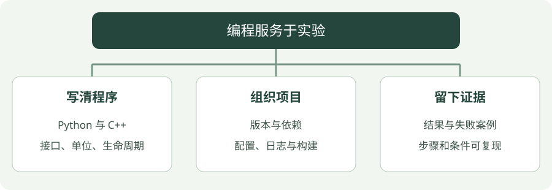

# 编程学习概览

围绕科研实验构建可读、可复现、便于排查的代码。

## 看图梳理

{ .learning-figure }

[打开大图](../assets/learning/programming-index.svg)

**写清程序**：Python 与 C++，接口、单位、生命周期；**组织项目**：版本与依赖，配置、日志与构建；**留下证据**：结果与失败案例，步骤和条件可复现。

## C++ 与现代 C++ 教程

从第一个程序开始，逐步学习函数、类、标准容器、资源管理与泛型编程，再进入 C++17、C++20 和 C++23。每个实践章节都有完整代码、运行结果、常见错误和练习答案；最后用一个放牧场景的数据处理小项目串起来。

[开始学习 C++ →](cpp/index.md){ .md-button .md-button--primary }

## 技术与用途

| 方向 | 主要用途 | 建议实践 |
| --- | --- | --- |
| Python | 数据处理、仿真和模型训练 | 将配置、环境、训练与评估分离 |
| C++ | 机器人模块与性能敏感计算 | 明确资源生命周期与接口约束 |
| Linux 与 Git | 开发环境和版本管理 | 保存依赖、启动步骤与代码版本 |
| 嵌入式与通信 | STM32、传感器和设备交互 | 定义协议、单位、超时与错误处理 |

## 一次实验应留下什么

1. **配置**：参数集中管理，记录随机种子。
2. **环境**：保存依赖版本与运行方式。
3. **日志**：区分训练指标、运行事件和错误信息。
4. **结果**：输出图表、评估数据和失败案例。
5. **说明**：写清如何复现以及当前已知限制。

## 代码整理原则

### 一个容易复现的记录，比一句“效果不错”更有用

假设某次实验输出 `distance = 2.5`。别人还不知道这是米还是像素、来自哪一帧、用了哪组参数。记录成“时间戳、坐标系、距离单位、参数版本、结果”后，才能判断它是否可与另一次实验比较。

学习代码也按这个顺序读：**输入是什么 → 如何处理 → 输出代表什么 → 哪里可能失败**。遇到长程序先圈出这四部分，不必从第一行开始逐字背。

优先让一个最小实验完整运行，再抽取复用模块。观测与动作接口要明确数据形状、坐标系和单位；训练与评估使用独立入口，避免把训练表现当作评估结果。

[查看实验记录要求](../herding/index.md)
