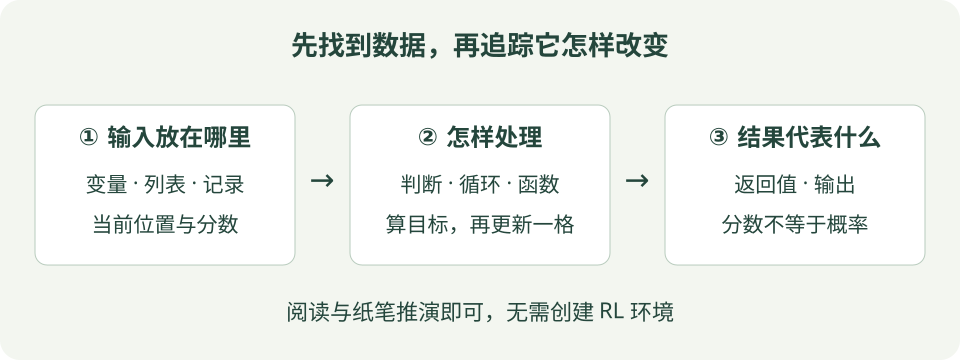

# Python 阅读入门：先看懂强化学习示例

这页写给还没学过 Python 的读者。目标是看懂教程里“数据放在哪里、判断怎样做、循环怎样推进”，不要求安装 Python、创建环境或运行训练。先用几行小代码认识语法，再去看算法的完整程序。

## 先看图：程序怎样处理一份数据

{ .learning-figure }

[打开大图](../assets/learning/python-reading.svg)

第一次阅读时只找三样：**原始数据、处理步骤、最后结果**。英文变量名先当作标签，不需要先记住所有库名。

## 1. 变量：给一份数据起名字

```python
# 保存当前位置；等号表示赋值，不是数学中的相等证明。
state = 3
# 保存收到的奖励；负数可以表示这一步有代价。
reward = -0.01
# 在旧值基础上计算，再把新值交回 state。
state = state + 1
```

从上往下读：state 先是 3，最后变成 4。右边的 `state + 1` 先计算，左边再保存结果。`#` 后面是注释，帮助人阅读，不参与计算。

| 写法 | 意思 |
| --- | --- |
| `3` | 整数 |
| `0.95` | 浮点数，适合表示折扣等带小数的量 |
| `True`、`False` | 真与假，常用来保存判断结果 |
| `"right"` | 字符串，一段文字 |

## 2. 列表：把多个值按顺序放在一起

```python
# 七个位置各存一个分数；开始时都为零。
values = [0.0] * 7
# 下标从 0 开始；这里修改“编号为 3 的位置”的分数。
values[3] = 0.4
# 只增加这一格，不会修改其他位置。
values[3] += 0.1
```

列表可以想成一排格子。七格的下标是 0～6，`values[7]` 已经超出范围。最后编号 3 的格子约为 0.5；浮点计算可能有很小的表示误差。

RL 中 `q[state][action]` 是两次查找：先找状态所在行，再找动作所在列。两列可分别存向左、向右的分数。例如 `q[3][1]` 是“在位置 3 向右走”的动作价值估计，不是动作选择概率。

!!! note "一行高级写法可以先拆开理解"

    `[[0.0, 0.0] for _ in range(7)]` 会创建七个各自独立的两格列表。不要写成 `[[0.0, 0.0]] * 7`：后者重复引用同一个内部列表，修改一行会影响其他行。`_` 表示这个循环变量在此不需要使用。

## 3. 判断：满足条件才执行

下面是来自算法更新的阅读片段，不是独立程序。先约定 done 表示真正终止，reward 表示本步奖励，gamma 是折扣，next_value 是下一状态的估计，再读分支。

```python
# 在终点时没有后续价值；先处理这个分支。
if done:
    target = reward
else:
    # 未终止时，把下一状态的估计加进目标。
    target = reward + gamma * next_value
```

这是**阅读片段**：done、reward、gamma、next_value 来自前面的数据，片段不是独立完整程序。`if` 后面的条件为 True 时，执行其下面缩进的语句；否则执行 else 下面的语句。缩进是 Python 结构的一部分，不能随意去掉。

`x = 3` 是赋值，`x == 3` 是比较，`x > 3` 是判断是否大于。`s in (0, 6)` 问“s 是 0 或 6 吗”，`s not in (0, 6)` 问相反的问题。

完整示例可能把上面的分支压成一行：

```python
# 条件表达式：终止时取 0，否则取折扣后的未来估计。
future = 0.0 if done else gamma * next_value
```

先读成“如果 done 为真，future 取 0；否则取乘积”，不要误以为两边都要累加。

## 4. 循环：同一处理做多次

```python
# range(3) 依次给出 0、1、2，不包括 3。
for t in range(3):
    print(t)  # 每次输出当前的 t。
```

按顺序会输出 0、1、2，各占一行。`for` 常用来遍历已知范围；`while` 则每次先检查条件，条件成立才继续。走廊程序里的 `while s not in (0, 6)` 表示“还没到两端，就继续走”。

`reversed(range(3))` 顺序是 2、1、0，适合从轨迹结尾向前算回报。`enumerate(episode)` 同时提供下标与对应记录，帮助把记录和回报表的同一时刻配起来。

## 5. 函数：给一段步骤起名字

```python
# def 是定义做法；此时并没有执行一次加法。
def add_reward(current, reward):
    return current + reward  # return 交回结果，并结束本次调用。

# 这一行才调用函数：把 0.4 和 0.1 分别传给两个参数。
result = add_reward(0.4, 0.1)
```

函数名后的圆括号里放输入参数，返回值由调用者接收。看到 `step(s, a)` 时，可以先读成“把当前位置与动作交给环境规则，取得结果”。

`ns, reward, done = step(s, a)` 表示函数交回三项，分别给三个名字；不是执行三次 step。缩写 ns 是 next state，即下一状态。

## 6. 集合与轨迹：记什么，怎样避免重复

`episode.append((s, reward))` 把一条记录追加到列表末尾。括号中的 `(s, reward)` 是元组，在这里把同一时刻的状态与奖励组合起来。

`visited = set()` 创建集合，用来回答“这个状态在本幕是否统计过”。`visited.add(s)` 做标记，`if s not in visited` 才吸收首次访问的回报。集合不负责保存轨迹顺序，轨迹顺序由 episode 列表保存。

### 字典：按名称找数据，不靠记住第几格

```python
# 花括号创建字典；每个“键: 值”给一项数据贴上标签。
record = {"state": 3, "reward": -0.01, "terminated": False}

# 用键取值，不是按列表下标取值。
current = record["state"]  # current 得到整数 3。

# get 的第二个参数是缺少该键时使用的默认值。
reason = record.get("reason", "未提供")
print(reason)  # 本例没有 reason 键，所以显示：未提供。
```

`record["unknown"]` 会因不存在这个键而出错；`get` 适合“这一项确实允许缺省”的场景。必须有的字段不应随便给零掩盖错误，例如缺失的羊位置不能自动当成世界原点。

### None：还没有值，不等于数值零

```python
# None 表示当前没有可用位置；0.0 则是一个真实数值。
position = None

if position is None:
    print("位置暂时未知")
else:
    print(position)
```

这里输出“位置暂时未知”。判断是否缺失用 `is None`。不要写 `if not position` 来区分缺失位置与零：数值 0 也被视为假。布尔判断与“是不是有测量值”并不总是一回事。[Python 数据结构教程](https://docs.python.org/3/tutorial/datastructures.html)可用于对照字典、元组和集合的区别。

## 7. 深度算法的库调用怎样读

先把 `import` 理解为引入别人已经写好的工具。`gym.make(...)` 创建教学环境；`PPO(...)` 创建算法对象；`model.learn(...)` 请求学习；`model.save(...)` 保存参数。它们不是语法关键字，而是相应库提供的接口。

`model` 像一个携带参数与操作的工作对象，点号选择它的功能。仅创建对象不等于已经学会任务；learn 的内部流程需要结合算法直觉与公式篇理解。

`try ... finally` 里，finally 用于收尾；示例借此关闭环境。`if __name__ == "__main__":` 可以先理解为入口保护：直接启动文件时才进入这一部分。基础算法有些步骤写在文件顶层，**导入它也会执行顶层步骤**，所以本教程只阅读与静态解析，不导入运行这些文件。

### 参数名、函数名、变量名分别看哪里

```python
# 这是语法阅读片段：假设前面已经定义 evaluate 函数和 model 对象。
# 第一个参数按位置传入，后两项通过名字说明含义。
score = evaluate(model, episodes=5, deterministic=True)
```

可以读成“请 evaluate 使用 model，评估 5 幕，以确定性动作选择方式评估，把返回结果交给 score”。这里的 `evaluate` 只是演示参数读法的假设函数，不能直接当作某个库真实存在的接口。

调用里的 `episodes=5` 是**按名字向函数传入参数值**，不是在全局创建一个叫 episodes 的变量。`deterministic=True` 说明动作选择方式，也不保证环境和最后得分没有随机性。遇到陌生接口先看定义和文档，再解释它的参数。

### 看到方括号，先判断它是列表还是数组

基础算法中的 Python 列表与 NumPy 数组外观可能很像，但运算规则不一样。

| 表达式 | 对普通 Python 列表的含义 | 阅读提示 |
| --- | --- | --- |
| `[1, 2] + [3, 4]` | 拼接成 `[1, 2, 3, 4]` | 不是按元素相加 |
| `[1, 2] * 2` | 重复成 `[1, 2, 1, 2]` | 不是每个数乘 2 |
| `values[1:3]` | 取下标 1、2，右端 3 不包含 | 切片得到一段数据 |
| `len(values)` | 最外层有多少项 | 二维数据并不是把全部格子一起数 |

`q[3][1]` 可用于嵌套列表；教程里的 `q[3, 1]` 则通常是支持多维索引的数组。若看到 `shape=(4,)`，通常表示一条含 4 个数的一维观测；`shape=(32, 4)` 表示 32 条这样的观测。**32 是样本数、4 是每条的特征数**，不能只看总共 128 个数就认为任何排法都相同。

这里先学习如何阅读维度说明；具体能否广播、能否相加，要按代码使用的数组或张量库确认。

## 8. 从入口跟一遍：函数并不是按排版顺序全部执行

下面是完整的小程序，输入已经写在代码里。它只演示“根据三次距离记录统计达标数量”，不是强化学习训练。先在纸上跟踪每个值，再看预期输出。

```python
def reached_goal(distance, radius=1.0):
    # distance 和 radius 使用相同单位：米。
    # radius=1.0 是默认参数；调用者不传时就用 1.0。
    # 比较表达式得到 True 或 False，并把结果交回调用位置。
    return distance <= radius


def main():
    # 三次测量，按记录顺序放在列表里。
    distances = [0.5, 1.5, 0.8]
    count = 0  # 从零开始统计，不是从第一条记录的下标开始。

    for distance in distances:
        # 每次循环只取一个数；函数的返回值决定是否执行加一。
        if reached_goal(distance):
            count += 1

    # len 返回记录条数；本例明确有 3 条，所以分母不为零。
    total = len(distances)
    ratio = count / total

    # f 字符串把花括号中的值放进文字；.1% 表示显示为百分数，保留 1 位小数。
    print(f"达标记录：{count}/{total}")
    print(f"达标比例：{ratio:.1%}")


if __name__ == "__main__":
    # 直接启动本文件时，从这里调用 main，再进入上面的函数体。
    main()
```

预期输出：

```text
达标记录：2/3
达标比例：66.7%
```

先遇到 `def reached_goal` 和 `def main` 时，Python 记住函数做法；走到最后的 `main()` 才进入 main 函数。函数定义中的默认参数会在定义时求值，但函数体要等调用才执行。调用 `reached_goal(distance)` 时，再暂时进入那个函数，拿回真假值后回到循环。

| 第几轮 | 取出的 distance | `distance <= 1.0` | 是否加 1 | count 最后是多少 |
| --- | --- | --- | --- | --- |
| 1 | 0.5 | True | 是 | 1 |
| 2 | 1.5 | False | 否 | 1 |
| 3 | 0.8 | True | 是 | 2 |

注意两处缩进：`count += 1` 在 if 里面，只有符合条件才加；最后两次 print 在 for 外面，所以统计完才输出一次。如果把 print 缩进循环里，它就会每轮输出中间结果。这就是缩进改变程序含义的具体例子。

`return` 和 `print` 也不同：return 把值交给调用者继续计算；print 把文字显示出来。只显示一个值、却没有 return 的函数，正常结束时返回 None，调用者不能把它当作原来的数值结果。

## 9. 遇到错误时，从哪一处开始看

| 提示或现象 | 常见原因 | 先检查什么 |
| --- | --- | --- |
| `NameError` | 使用了还没有定义的名字 | 是否漏了赋值，名字大小写是否一致 |
| `IndexError` | 访问越过列表边界的下标 | 长度 7 时，下标最大只能是 6 |
| `TypeError` | 当前类型不支持这种操作 | 是否把字符串、None、列表当成数字 |
| `IndentationError` | 缩进结构不合法 | 同一层是否使用一致的空格缩进 |
| 没报错但一直循环 | 条件一直成立 | 循环内是否更新状态，是否有合理退出条件 |

读报错通常先看最后一行的错误类型，再沿上方文件名与行号定位到自己的语句。修正最早导致问题的输入或步骤；不要为了“让报错消失”把所有检查都删掉。

例如 `"3" + "1"` 得到文字 `"31"`，而不是数字 4。它不一定报错，因此**有输出不代表含义正确**。检查输入类型、单位和预期结果，与检查语法同样重要。

## 先用纸笔检查自己

1. `values[3] = 0.4` 后执行 `values[3] += 0.1`，改变了几格？
2. reward = 1 且 done = True，一步目标是否还要加下一状态价值？
3. 定义了函数，没有调用，它是否已经处理过输入？
4. 把完整例子的第三个距离改为 1.2，达标记录和比例应是多少？
5. 把 `return distance <= radius` 改成 `print(distance <= radius)`，还能按原方法统计吗？

??? example "对照答案与理由"

    只改变编号 3 的一格，值约为 0.5；真正终止时目标只保留奖励 1；定义函数只给出做法，调用才执行函数体。

    第三条改为 1.2 后，只剩第一条符合条件，输出 1/3 和 33.3%。

    不能用 print 替代 return。改后函数虽然显示 True/False，但没有返回比较结果，正常结束会返回 None，if 不会按原预期增加 count。

不必读完这页就记住全部写法。去算法页时遇到列表、条件表达式或倒序循环，再回到对应小节查询。语法说明可对照 [Python 官方入门](https://docs.python.org/3/tutorial/introduction.html)与[流程控制教程](https://docs.python.org/3/tutorial/controlflow.html)。

[继续阅读 RL 代码 →](../rl/code/index.md){ .md-button .md-button--primary }
