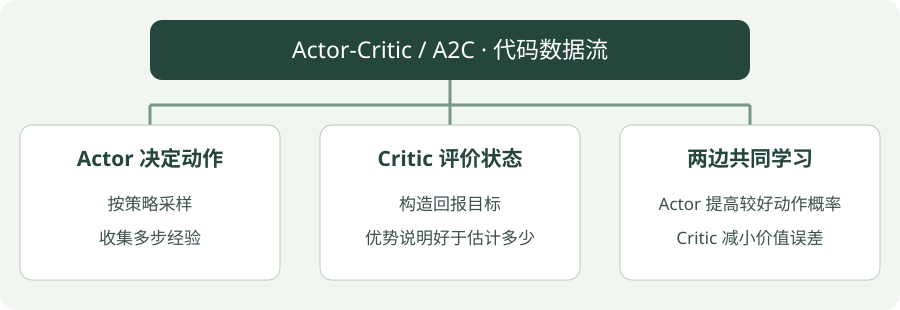

# Actor-Critic / A2C：Python 实践

[算法直觉](../intuition/a2c.md) · [公式讲解](../math/a2c.md) · [Python 实践](a2c.md)


!!! tip "读完这页，你应该能做到"

    找到输入、目标或训练调用，再对照公式解释关键注释。

    **先会这些就够了**：TD 误差、策略与价值。


## 看图梳理

{ .learning-figure }

[打开大图](../../assets/learning/rl-code-a2c.svg)

**Actor 决定动作**：按策略采样，收集多步经验；**Critic 评价状态**：构造回报目标，优势说明好于估计多少；**两边共同学习**：Actor 提高较好动作概率，Critic 减小价值误差。


还不认识 Python 的列表、循环或缩进？先查 [Python 阅读入门](../../programming/python-reading.md)，再回来读本页。

## 示例背景

**语言：Python 3.12；实现方式：使用 Stable-Baselines3 的真实算法实现。**

本页先学习如何调用算法、训练、保存与评估。网络结构与梯度更新由库实现。完整脚本用于阅读训练、保存与评估的调用顺序，内部算法细节要与前两部分对照。


本页以阅读代码为主，不要求安装依赖或运行训练。

## 示例任务

**CartPole-v1**：左右推动小车，让杆保持直立；动作是离散的，回报越高表示维持时间越长。

这是训练链路示例，不是放牧仿真，也不保证使用默认 10000 步就解决环境。

## 用中文顺着读代码

1. `gym.make(...)`：创建一个用来练习的环境。
2. `Monitor(...)`：记录每局拿了多少奖励、走了多少步。
3. 创建模型：选算法和它的配置，模型此时还没学会任务。
4. 第一次 `evaluate_policy(...)`：测一下未训练时的表现。
5. `model.learn(...)`：真正与环境交互，并更新网络。
6. `save` 与 `load`：把学到的参数保存，再从文件读回来。
7. 再次评估：使用独立环境检查保存后的策略表现。

环境的 `reset` 是开始新一局；`step` 是执行一次动作。这里库负责调用它们。`seed` 固定随机数起点，便于复现；它不意味着不同硬件一定得到完全相同的结果。

## 一次采集片段不等于一整局

示例 n_steps = 32，单个环境先采集 32 步，再用这一段数据更新。可能一局尚未结束，也可能中间已经结束并开始下一局；库会根据回合边界正确划分回报，不能把两局奖励接成一局。

`A2C("MlpPolicy", ...)` 同时建立动作策略与状态价值估计。MlpPolicy 表示用多层感知机处理向量观测；可以先把它当成“适合这份数字状态输入的网络配置名字”。

第一次评估、learn、保存、再评估是使用流程；Actor 和 Critic 内部损失仍要结合公式篇理解。每步 TD 的数字例子只是铺垫，当前库示例使用一段采样中的多步目标。

## 先用普通数字拆开 Actor 与 Critic

```python
import math

# 这是一条未终止样本的一步示意；完整 A2C 用采样片段计算多步目标。
reward, gamma, next_value = 0.1, 0.9, 0.5
old_value = 0.2
return_target = reward + gamma * next_value  # 0.55。
advantage = return_target - old_value        # 0.35，比旧预期好。
action_probability = 0.4                     # 当前策略给采样动作的概率。
actor_loss = -math.log(action_probability) * advantage  # 约 0.321。
critic_loss = (old_value - return_target)**2             # 0.1225。
# 在神经网络版中，优化 Actor 时把 advantage 当固定权重；
# 优化 Critic 时把 return_target 当固定目标，分别保留预测侧的梯度。
```

这里是损失数值的演算，没有梯度框架，也不更新策略。读懂后再看 `n_steps=32`：库会先收集一个环境的 32 步，算好这段中各时刻的回报与优势，再做一轮更新；不要求 32 步刚好是一局。

| 量 | 单条记录是什么 | 一段数据是什么 |
| --- | --- | --- |
| 观测 | CartPole 的 4 个数 | 32 条观测 |
| Actor 输出 | 左、右两个动作的分布参数 | 每条观测一组 |
| Critic 输出 | 当前状态的一个 V | 每条观测一个 |
| 回报目标与优势 | 各一个数 | 都与采样时刻一一对应 |

完整代码采用库默认的 `gae_lambda=1.0`，因此与上面一步演算的区别在于怎样算 return_target。Actor、Critic 各自要优化的含义相同。库的内部数组还可能带一个环境数量维度，这不意味着观测突然增加了新内容。

## 完整代码

```python
"""A2C 训练、保存与独立评估；默认 10000 步，可传 --steps 调整。"""
# 命令行参数工具；阅读算法时可先跳过参数解析部分。
import argparse
from pathlib import Path
# 环境接口库：提供 reset 开始一局、step 执行动作。
import gymnasium as gym
# 神经网络库；本示例的网络与梯度计算由 SB3 调用它完成。
import torch
# 导入库实现的算法；调用库并不等于从零实现算法内部。
from stable_baselines3 import A2C
from stable_baselines3.common.monitor import Monitor
from stable_baselines3.common.evaluation import evaluate_policy


def main(steps, seed):
    # 限制 CPU 计算线程数量，不代表启动机器人或仿真控制线程。
    torch.set_num_threads(1)
    # Path 表示文件路径；后面的 / 是拼接子路径，并非这里在做数字除法。
    output = Path("rl-output/a2c")
    # 只有主动运行脚本才创建输出目录；网站展示代码不会执行这一行。
    output.mkdir(parents=True, exist_ok=True)
    # 训练环境负责收集经验，Monitor 统计每幕奖励与步数。
    train_env = Monitor(gym.make("CartPole-v1"), str(output / "train"))
    # 另建评估环境，避免把训练过程中的奖励直接当作评估结果。
    eval_env = Monitor(gym.make("CartPole-v1"))
    # 评估随机种子单独设置；它不保证跨硬件逐位一致。
    # reset 返回初始观测和 info；评估器之后会自行按回合调用环境接口。
    eval_env.reset(seed=seed + 100)
    try:
        # 创建策略与价值网络；初始化完成不意味着模型已经学会任务。
        model = A2C(
            # 多层感知机策略；seed 控制随机初始化，device 指定 CPU。
            "MlpPolicy", train_env, seed=seed, device="cpu", verbose=0,
            # 每个环境先采集 32 步，再用这段数据更新 Actor 与 Critic。
            n_steps=32,
        )
        # 记录未训练策略的评估均值，作为观察起点。
        # 左边两个名字接收均值和标准差；这里用 _ 表示暂时不使用第二项。
        before, _ = evaluate_policy(model, eval_env, n_eval_episodes=5,
                                   deterministic=True)
        # 这行才触发训练；本教程只提供代码，不在项目中自动调用。
        model.learn(total_timesteps=steps)
        # 保存参数，便于理解模型持久化，不表示策略性能已达标。
        model.save(str(output / "model"))
        # 从磁盘重新加载模型，展示部署前参数恢复的步骤。
        loaded = A2C.load(str(output / "model"), device="cpu")
        # 评估随机种子单独设置；它不保证跨硬件逐位一致。
        eval_env.reset(seed=seed + 100)
        # 使用独立环境评估恢复的模型，输出平均回报与标准差。
        # std 是这些评估回合回报的标准差，不是训练结果可靠性的保证。
        after, std = evaluate_policy(loaded, eval_env, n_eval_episodes=5,
                                    deterministic=True)
        print(f"Actual training steps: {model.num_timesteps}")
        print(f"Before: {before:.2f} | After: {after:.2f} +/- {std:.2f}")
        print(f"Model saved to: {output / 'model.zip'}")
    # 即使中间发生异常，也尝试释放环境资源。
    finally:
        train_env.close()
        eval_env.close()


# 入口保护：被导入时不调用这里的 main；网站只展示文本。
if __name__ == "__main__":
    parser = argparse.ArgumentParser(description=__doc__)
    # steps 是训练预算示例，不是预期学会任务所需的精确步数。
    parser.add_argument("--steps", type=int, default=10000)
    parser.add_argument("--seed", type=int, default=7)
    # 把可选命令行文字转换为参数值；定义参数本身不会启动学习。
    args = parser.parse_args()
    if args.steps <= 0:
        parser.error("--steps must be positive")
    main(args.steps, args.seed)
```

## 参数如何对应算法

`n_steps=32` 表示每次采集一段轨迹后更新；Actor 与 Critic 的梯度由库计算，不是只调用预测接口。

`MlpPolicy` 是多层感知机策略，用于向量观测；如果改为图像或字典观测，需要选择相应策略与输入处理。脚本设置独立评估环境，使用固定的一组评估起始条件，并保存训练日志与模型。

## 看懂输出

- `Actual training steps`：实际交互步数。同策略方法可能为凑齐完整 rollout 超过请求步数。
- `Before`：未训练模型的确定性评估均值。
- `After`：保存并重新加载模型后，5 幕独立评估的均值与标准差。
- `rl-output/a2c/model.zip`：模型文件；同目录的 `train.monitor.csv` 保存训练回合记录。

运行成功只说明接口与训练链路正常。判断学习效果还需要更充分的训练、更多评估回合和多个训练种子。

## 阅读练习：不用运行，也能推演

<div class="practice-card" markdown="1">

<p class="practice-kicker">把代码与公式接起来</p>

<p class="practice-title">多步采样参数不等于一步公式</p>

正文的库示例每收集一段经验才更新。先区分采样长度和优势含义。

**沿用这些条件**：只读 n_steps=32；另给一步例子：奖励 0.1、下一 V 为 0.5、当前 V 为 0.2、折扣 0.9。

**你的任务**：手算一步优势，再解释为什么它不代表库内部只用一步回报。

??? example "查看推演与解释"

    一步优势为 0.35；当前 A2C 示例使用一段采样与多步回报，32 是每环境的采样步数，不是优势数值。

</div>


## 官方实现说明

[Stable-Baselines3：A2C](https://stable-baselines3.readthedocs.io/en/master/modules/a2c.html)
