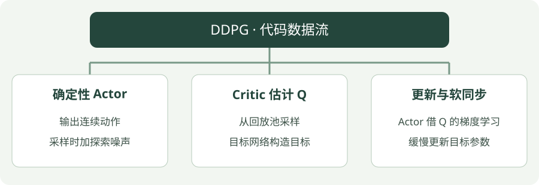

# DDPG：Python 实践

[算法直觉](../intuition/ddpg.md) · [公式讲解](../math/ddpg.md) · [Python 实践](ddpg.md)


!!! tip "读完这页，你应该能做到"

    找到输入、目标或训练调用，再对照公式解释关键注释。

    **先会这些就够了**：Q 网络、连续动作。


## 看图梳理

{ .learning-figure }

[打开大图](../../assets/learning/rl-code-ddpg.svg)

**确定性 Actor**：输出连续动作，采样时加探索噪声；**Critic 估计 Q**：从回放池采样，目标网络构造目标；**更新与软同步**：Actor 借 Q 的梯度学习，缓慢更新目标参数。


还不认识 Python 的列表、循环或缩进？先查 [Python 阅读入门](../../programming/python-reading.md)，再回来读本页。

## 示例背景

**语言：Python 3.12；实现方式：使用 Stable-Baselines3 的真实算法实现。**

本页先学习如何调用算法、训练、保存与评估。网络结构与梯度更新由库实现。完整脚本用于阅读训练、保存与评估的调用顺序，内部算法细节要与前两部分对照。


本页以阅读代码为主，不要求安装依赖或运行训练。

## 示例任务

**Pendulum-v1**：对摆杆施加连续扭矩，使其接近直立；奖励通常为负，数值越接近 0 越好。

这是训练链路示例，不是放牧仿真，也不保证使用默认 10000 步就解决环境。

## 用中文顺着读代码

1. `gym.make(...)`：创建一个用来练习的环境。
2. `Monitor(...)`：记录每局拿了多少奖励、走了多少步。
3. 创建模型：选算法和它的配置，模型此时还没学会任务。
4. 第一次 `evaluate_policy(...)`：测一下未训练时的表现。
5. `model.learn(...)`：真正与环境交互，并更新网络。
6. `save` 与 `load`：把学到的参数保存，再从文件读回来。
7. 再次评估：使用独立环境检查保存后的策略表现。

环境的 `reset` 是开始新一局；`step` 是执行一次动作。这里库负责调用它们。`seed` 固定随机数起点，便于复现；它不意味着不同硬件一定得到完全相同的结果。

## 先区分三处“动作从哪里来”

交互时，当前 Actor 给动作，再加 action_noise 探索；计算 Critic 目标时，目标 Actor 给下一动作；独立确定性评估时，使用学到的 Actor 输出，不添加这份探索噪声。

示例用 Pendulum，动作是一维扭矩，不是放牧机器人的速度。`action_space.shape[0]` 获取动作向量长度，让噪声向量有相同维数；这里维数为 1。

回放、目标网络和动作梯度由库完成。先在代码里找 noise 的创建及传入，再对照公式区分目标 Actor 与当前 Actor，不必先研究库的每个内部类。

## 先读“这条经验的目标”，再读训练配置

```python
# 目标 Actor 已经给下一状态输出动作，目标 Critic 对它的评分为 2。
reward, gamma, next_target_q = -1.0, 0.9, 2.0
terminated = False
target = reward + (0.0 if terminated else gamma * next_target_q)  # 0.8。
current_q = 1.3  # 当前 Critic 对经验中实际执行动作的预测。
critic_loss = (current_q - target)**2  # 0.25，训练当前 Critic 用的误差。

# 单独演示目标网络一个参数的软更新，和动作大小无关。
old_target_parameter, current_parameter, tau = 10.0, 14.0, 0.01
new_target_parameter = (1 - tau) * old_target_parameter + tau * current_parameter
# 结果为 10.04；真实 tau 由算法配置决定，这里 0.01 只用于手算。
```

这段只展示 Critic 目标与软更新。Actor 还要通过当前 Critic 的“评分如何随动作变化”取得梯度，不能把 critic_loss 当作速度改变量。

| 输入或输出 | 本例是什么 | 别混淆成什么 |
| --- | --- | --- |
| Pendulum 观测 | cos(角度)、sin(角度)、角速度，共 3 个数 | 不是只有一个角度 |
| 动作 | 长度 1 的数组，扭矩范围 [−2, 2] | 不是离散动作编号 |
| Actor 输出 | 一个连续动作 | 不是该动作的概率 |
| Critic 输入 | 观测与动作一起输入 | 不能只给观测却说已评估任意动作 |
| `dim` | 动作维数 1 | 不是观测维数 3 |

输入和单位见 [Pendulum 环境说明](https://gymnasium.farama.org/environments/classic_control/pendulum/)。SB3 会在内部缩放连续动作；示例 `sigma=0.1` 是噪声配置，不能不看缩放过程就直接解释成真实机器人 0.1 米每秒。

## 完整代码

```python title="ddpg · 完整学习代码"
"""DDPG 训练、保存与独立评估；默认 10000 步，可传 --steps 调整。"""
# 命令行参数工具；阅读算法时可先跳过参数解析部分。
import argparse
from pathlib import Path
# 环境接口库：提供 reset 开始一局、step 执行动作。
import gymnasium as gym
# 数组计算工具；这里主要用于连续动作的探索噪声。
import numpy as np
# 神经网络库；本示例的网络与梯度计算由 SB3 调用它完成。
import torch
# 导入库实现的算法；调用库并不等于从零实现算法内部。
from stable_baselines3 import DDPG
from stable_baselines3.common.monitor import Monitor
from stable_baselines3.common.evaluation import evaluate_policy
from stable_baselines3.common.noise import NormalActionNoise


def main(steps, seed):
    # 限制 CPU 计算线程数量，不代表启动机器人或仿真控制线程。
    torch.set_num_threads(1)
    # Path 表示文件路径；后面的 / 是拼接子路径，并非这里在做数字除法。
    output = Path("rl-output/ddpg")
    # 只有主动运行脚本才创建输出目录；网站展示代码不会执行这一行。
    output.mkdir(parents=True, exist_ok=True)
    # 训练环境负责收集经验，Monitor 统计每幕奖励与步数。
    train_env = Monitor(gym.make("Pendulum-v1"), str(output / "train"))
    # 另建评估环境，避免把训练过程中的奖励直接当作评估结果。
    eval_env = Monitor(gym.make("Pendulum-v1"))
    # 评估随机种子单独设置；它不保证跨硬件逐位一致。
    # reset 返回初始观测和 info；评估器之后会自行按回合调用环境接口。
    eval_env.reset(seed=seed + 100)
    dim = train_env.action_space.shape[0]
    # 为 DDPG/TD3 的确定性动作添加探索噪声，不是评价时的噪声。
    noise = NormalActionNoise(mean=np.zeros(dim), sigma=0.1 * np.ones(dim))
    try:
        # 创建策略与价值网络；初始化完成不意味着模型已经学会任务。
        model = DDPG(
            # 多层感知机策略；seed 控制随机初始化，device 指定 CPU。
            "MlpPolicy", train_env, seed=seed, device="cpu", verbose=0,
            # 经验回放容量、开始学习前的采样步数、每批样本数。
            buffer_size=20000, learning_starts=100, batch_size=64,
            # 每交互一步后进行一次梯度更新；训练初期先积累经验。
            train_freq=1, gradient_steps=1, action_noise=noise,
        )
        # 记录未训练策略的评估均值，作为观察起点。
        # 左边两个名字接收均值和标准差；这里用 _ 表示暂时不使用第二项。
        before, _ = evaluate_policy(model, eval_env, n_eval_episodes=5,
                                   deterministic=True)
        # 这行才触发训练；本教程只提供代码，不在项目中自动调用。
        model.learn(total_timesteps=steps)
        # 保存参数，便于理解模型持久化，不表示策略性能已达标。
        model.save(str(output / "model"))
        # 从磁盘重新加载模型，展示部署前参数恢复的步骤。
        loaded = DDPG.load(str(output / "model"), device="cpu")
        # 评估随机种子单独设置；它不保证跨硬件逐位一致。
        eval_env.reset(seed=seed + 100)
        # 使用独立环境评估恢复的模型，输出平均回报与标准差。
        # std 是这些评估回合回报的标准差，不是训练结果可靠性的保证。
        after, std = evaluate_policy(loaded, eval_env, n_eval_episodes=5,
                                    deterministic=True)
        print(f"Actual training steps: {model.num_timesteps}")
        print(f"Before: {before:.2f} | After: {after:.2f} +/- {std:.2f}")
        print(f"Model saved to: {output / 'model.zip'}")
    # 即使中间发生异常，也尝试释放环境资源。
    finally:
        train_env.close()
        eval_env.close()


# 入口保护：被导入时不调用这里的 main；网站只展示文本。
if __name__ == "__main__":
    parser = argparse.ArgumentParser(description=__doc__)
    # steps 是训练预算示例，不是预期学会任务所需的精确步数。
    parser.add_argument("--steps", type=int, default=10000)
    parser.add_argument("--seed", type=int, default=7)
    # 把可选命令行文字转换为参数值；定义参数本身不会启动学习。
    args = parser.parse_args()
    if args.steps <= 0:
        parser.error("--steps must be positive")
    main(args.steps, args.seed)
```

## 参数如何对应算法

`action_noise` 让确定性 Actor 在采样时探索；回放池复用经验。`deterministic=True` 的评估不附加训练噪声。

`MlpPolicy` 是多层感知机策略，用于向量观测；如果改为图像或字典观测，需要选择相应策略与输入处理。脚本设置独立评估环境，使用固定的一组评估起始条件，并保存训练日志与模型。

## 看懂输出

- `Actual training steps`：实际交互步数。同策略方法可能为凑齐完整 rollout 超过请求步数。
- `Before`：未训练模型的确定性评估均值。
- `After`：保存并重新加载模型后，5 幕独立评估的均值与标准差。
- `rl-output/ddpg/model.zip`：模型文件；同目录的 `train.monitor.csv` 保存训练回合记录。

运行成功只说明接口与训练链路正常。判断学习效果还需要更充分的训练、更多评估回合和多个训练种子。

## 阅读练习：把理解分成三小步

<div class="practice-card" markdown="1">

<p class="practice-kicker">纸笔演算，不需要运行训练</p>

<p class="practice-title">Critic 误差不能当作速度改变量</p>

**沿用这些条件**：奖励 −1、折扣 0.9、下一目标 Q=2，未终止；当前 Q=1.3。另给软更新：旧目标参数 10、当前参数 14、tau=0.01。

**从哪里开始**：回到本页的核心短片段，先圈出输入和旧预测，再计算临时目标；最后才判断要修改什么。

**按这几步做**：

1. 算 Critic 目标与平方损失。
2. 算软更新后的参数。
3. 能否据此断言 Actor 要把动作减小 0.5？说明它还需要什么信息。

??? tip "先要一点提示？"

    给每个数写上名字，区分奖励、旧预测、目标、参数或动作。每算完一步，把中间结果写下来，再进入下一步，不只抄最后答案。

??? example "对照完整推理"

    Critic 目标为 0.8，预测减目标为 0.5，平方损失 0.25。软更新为 0.99×10+0.01×14=10.04；被混合的是参数，而不是环境动作。

    不能据此让动作减小 0.5。Actor 需要 Q 随动作怎样变化的梯度，再接上动作随 Actor 参数的变化关系；一个拟合误差没有提供这条动作方向信息。

</div>


## 官方实现说明

[Stable-Baselines3：DDPG](https://stable-baselines3.readthedocs.io/en/master/modules/ddpg.html)
