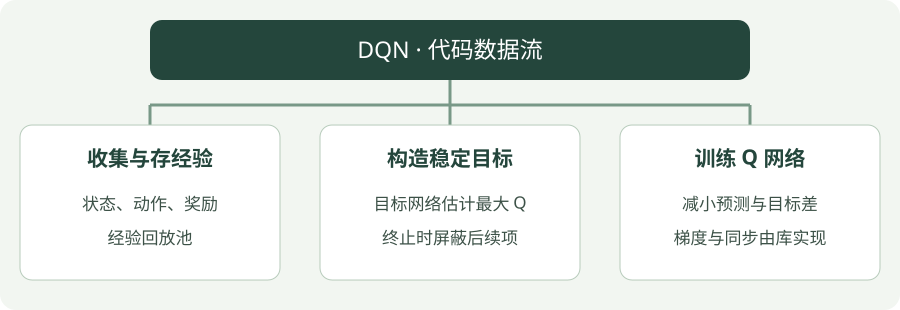

# DQN：Python 实践

[算法直觉](../intuition/dqn.md) · [公式讲解](../math/dqn.md) · [Python 实践](dqn.md)


## 看图梳理

{ .learning-figure }

[打开大图](../../assets/learning/rl-code-dqn.svg)

**收集与存经验**：状态、动作、奖励，经验回放池；**构造稳定目标**：目标网络估计最大 Q，终止时屏蔽后续项；**训练 Q 网络**：减小预测与目标差，梯度与同步由库实现。


## 示例背景

**语言：Python 3.12；实现方式：使用 Stable-Baselines3 的真实算法实现。**

本页先学习如何调用算法、训练、保存与评估。网络结构与梯度更新由库实现，完整脚本可运行，但它不是从零手写算法。

[下载带中文注释的 Python 文件](../examples/dqn.py){ .md-button }

本页以阅读代码为主，不要求安装依赖或运行训练。

## 示例任务

**CartPole-v1**：左右推动小车，让杆保持直立；动作是离散的，回报越高表示维持时间越长。

这是训练链路示例，不是放牧仿真，也不保证使用默认 10000 步就解决环境。

## 用中文顺着读代码

1. `gym.make(...)`：创建一个用来练习的环境。
2. `Monitor(...)`：记录每局拿了多少奖励、走了多少步。
3. 创建模型：选算法和它的配置，模型此时还没学会任务。
4. 第一次 `evaluate_policy(...)`：测一下未训练时的表现。
5. `model.learn(...)`：真正与环境交互，并更新网络。
6. `save` 与 `load`：把学到的参数保存，再从文件读回来。
7. 再次评估：使用独立环境检查保存后的策略表现。

环境的 `reset` 是开始新一局；`step` 是执行一次动作。这里库负责调用它们。`seed` 固定随机数起点，便于复现；它不意味着不同硬件一定得到完全相同的结果。

## 完整代码

```python
"""DQN 训练、保存与独立评估；默认 10000 步，可传 --steps 调整。"""
# 命令行参数工具；阅读算法时可先跳过参数解析部分。
import argparse
from pathlib import Path
# 环境接口库：提供 reset 开始一局、step 执行动作。
import gymnasium as gym
# 数组计算工具；这里主要用于连续动作的探索噪声。
import numpy as np
# 神经网络库；本示例的网络与梯度计算由 SB3 调用它完成。
import torch
# 导入库实现的算法；调用库并不等于从零实现算法内部。
from stable_baselines3 import DQN
from stable_baselines3.common.monitor import Monitor
from stable_baselines3.common.evaluation import evaluate_policy


def main(steps, seed):
    # 限制 CPU 计算线程数量，不代表启动机器人或仿真控制线程。
    torch.set_num_threads(1)
    output = Path("rl-output/dqn")
    # 只有主动运行脚本才创建输出目录；网站展示代码不会执行这一行。
    output.mkdir(parents=True, exist_ok=True)
    # 训练环境负责收集经验，Monitor 统计每幕奖励与步数。
    train_env = Monitor(gym.make("CartPole-v1"), str(output / "train"))
    # 另建评估环境，避免把训练过程中的奖励直接当作评估结果。
    eval_env = Monitor(gym.make("CartPole-v1"))
    # 评估随机种子单独设置；它不保证跨硬件逐位一致。
    eval_env.reset(seed=seed + 100)
    try:
        # 创建策略与价值网络；初始化完成不意味着模型已经学会任务。
        model = DQN(
            # 多层感知机策略；seed 控制随机初始化，device 指定 CPU。
            "MlpPolicy", train_env, seed=seed, device="cpu", verbose=0,
            # 经验回放容量、开始学习前的采样步数、每批样本数。
            buffer_size=20000, learning_starts=100, batch_size=64,
        # 决定多频繁学习与每次做多少梯度更新；SAC auto 自动调节熵系数。
        train_freq=1, gradient_steps=1, target_update_interval=250,
        exploration_fraction=0.3,
        )
        # 记录未训练策略的评估均值，作为观察起点。
        before, _ = evaluate_policy(model, eval_env, n_eval_episodes=5,
                                   deterministic=True)
        # 这行才触发训练；本教程只提供代码，不在项目中自动调用。
        model.learn(total_timesteps=steps)
        # 保存参数，便于理解模型持久化，不表示策略性能已达标。
        model.save(str(output / "model"))
        # 从磁盘重新加载模型，展示部署前参数恢复的步骤。
        loaded = DQN.load(str(output / "model"), device="cpu")
        # 评估随机种子单独设置；它不保证跨硬件逐位一致。
        eval_env.reset(seed=seed + 100)
        # 使用独立环境评估恢复的模型，输出平均回报与标准差。
        after, std = evaluate_policy(loaded, eval_env, n_eval_episodes=5,
                                    deterministic=True)
        print(f"Actual training steps: {model.num_timesteps}")
        print(f"Before: {before:.2f} | After: {after:.2f} +/- {std:.2f}")
        print(f"Model saved to: {output / 'model.zip'}")
    # 即使中间发生异常，也尝试释放环境资源。
    finally:
        train_env.close()
        eval_env.close()


# 入口保护：被导入时不调用这里的 main；网站只展示文本。
if __name__ == "__main__":
    parser = argparse.ArgumentParser(description=__doc__)
    # steps 是训练预算示例，不是预期学会任务所需的精确步数。
    parser.add_argument("--steps", type=int, default=10000)
    parser.add_argument("--seed", type=int, default=7)
    args = parser.parse_args()
    if args.steps <= 0:
        parser.error("--steps must be positive")
    main(args.steps, args.seed)
```

## 参数如何对应算法

`buffer_size` 是经验池容量；`learning_starts` 是开始更新前的采样步数；`target_update_interval` 是目标网络同步间隔；探索设置控制随机动作比例的变化。

`MlpPolicy` 是多层感知机策略，用于向量观测；如果改为图像或字典观测，需要选择相应策略与输入处理。脚本设置独立评估环境，使用固定的一组评估起始条件，并保存训练日志与模型。

## 看懂输出

- `Actual training steps`：实际交互步数。同策略方法可能为凑齐完整 rollout 超过请求步数。
- `Before`：未训练模型的确定性评估均值。
- `After`：保存并重新加载模型后，5 幕独立评估的均值与标准差。
- `rl-output/dqn/model.zip`：模型文件；同目录的 `train.monitor.csv` 保存训练回合记录。

运行成功只说明接口与训练链路正常。判断学习效果还需要更充分的训练、更多评估回合和多个训练种子。

## 动手修改

观察训练步数变多时，评估回报是否提升，再改变目标同步间隔。

若要连接放牧任务，先实现并检查自己的 Gymnasium 环境，再替换 `gym.make` 创建的环境。保持动作空间、奖励定义与终止条件明确，不直接套用本页的超参数作为科研结论。

## 官方实现说明

[Stable-Baselines3：DQN](https://stable-baselines3.readthedocs.io/en/master/modules/dqn.html)
