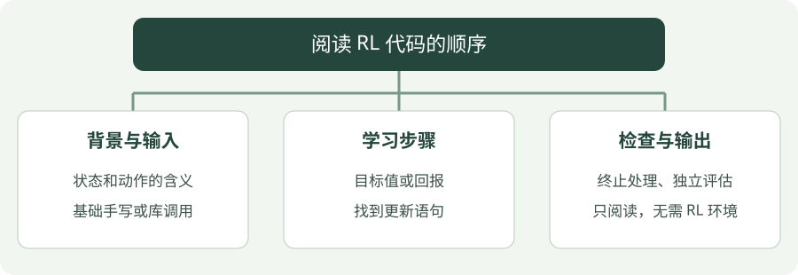

# 第三部分：编程实践

统一使用 **Python**。基础算法直接手写，便于对照公式；深度算法使用成熟库，通过代码认识训练与评估的数据流。每个算法都有完整代码和可下载文件。

## 看图梳理

{ .learning-figure }

[打开大图](../../assets/learning/rl-code-index.svg)

**背景与输入**：状态和动作的含义，基础手写或库调用；**学习步骤**：目标值或回报，找到更新语句；**检查与输出**：终止处理、独立评估，只阅读，无需 RL 环境。

## 两类示例

| 实现方式 | 算法 | 环境 | 依赖 |
| --- | --- | --- | --- |
| 手写更新 | 价值迭代、MC、TD、SARSA、Q-learning、REINFORCE | 一维走廊 | Python 标准库 |
| 库实现训练 | DQN、A2C、PPO | CartPole-v1 | Gymnasium、Stable-Baselines3、PyTorch |
| 库实现训练 | DDPG、TD3、SAC | Pendulum-v1 | Gymnasium、Stable-Baselines3、PyTorch |

基础代码展示价值或策略怎样更新；深度代码展示训练、保存和恢复的调用顺序。使用库实现不等于从零实现深度算法，各页会标明这一点。

## 按数据流阅读，不需要运行

本部分只提供 **Python 学习代码**：不需要创建 RL 虚拟环境，也不需要安装训练依赖。网页和构建过程不会执行这些示例。

先读输入、环境和变量，再找目标值或 learn 调用，最后读输出与资源释放。中文注释解释关键变量、公式对应关系、终止处理和库负责的部分。

基础六种算法展示手写更新；深度六种算法展示库调用流程，算法内部更新请配合公式篇阅读。依赖名称用于说明代码来源，不是学习前的安装任务。

## 每个算法的代码

- [价值迭代：Python 实践](value-iteration.md)
- [蒙特卡洛（MC）：Python 实践](mc.md)
- [时序差分 TD(0)：Python 实践](td.md)
- [SARSA：Python 实践](sarsa.md)
- [Q-learning：Python 实践](q-learning.md)
- [DQN：Python 实践](dqn.md)
- [REINFORCE：Python 实践](reinforce.md)
- [Actor-Critic / A2C：Python 实践](a2c.md)
- [PPO：Python 实践](ppo.md)
- [DDPG：Python 实践](ddpg.md)
- [TD3：Python 实践](td3.md)
- [SAC：Python 实践](sac.md)

## 阅读后检查是否理解

- 基础例子用纸笔代入一次更新，检查价值、动作或概率如何改变。
- 深度例子指出哪行创建模型、哪行触发训练、哪行单独评估。
- `learn` 只是触发学习流程，不等于已经学会任务或回报必然增加。
- 正式比较需要相同环境、训练预算、评估条件和多个训练种子。

[依赖版本文件](../examples/requirements.txt) · [Gymnasium 环境接口](https://gymnasium.farama.org/api/env/) · [SB3 算法支持表](https://stable-baselines3.readthedocs.io/en/master/guide/algos.html)
