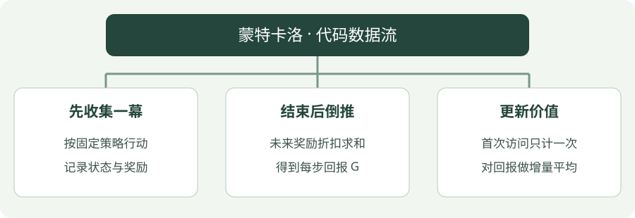

# 蒙特卡洛（MC）：Python 实践

[算法直觉](../intuition/mc.md) · [公式讲解](../math/mc.md) · [Python 实践](mc.md)


!!! tip "读完这页，你应该能做到"

    找到输入、目标或训练调用，再对照公式解释关键注释。

    **先会这些就够了**：奖励与回报、平均数。


## 看图梳理

{ .learning-figure }

[打开大图](../../assets/learning/rl-code-mc.svg)

**先收集一幕**：按固定策略行动，记录状态与奖励；**结束后倒推**：未来奖励折扣求和，得到每步回报 G；**更新价值**：首次访问只计一次，对回报做增量平均。


## 示例背景

**语言：Python 3.12 或以上；依赖：仅标准库；实现方式：手写更新。**

环境是一条走廊：非终止状态为 1～5，起点为 3，左端 0 奖励 −1，右端 6 奖励 +1，中间每步奖励 −0.01。动作 0 向左，动作 1 向右。这是帮助理解算法的小环境，不是羊群仿真。

[下载完整 Python 文件](../examples/mc.py){ .md-button }

本页只提供带注释的代码，按步骤阅读即可，无需创建环境或执行脚本。

## 用中文顺着读代码

先看 `step`：它规定“往哪走、得到什么奖励、什么时候结束”。再看存分数的列表或存偏好的 `logits`，最后找更新语句。你可以暂时跳过打印与列表推导式，先对照公式看分数如何改变。

`state` / `s` 是当前位置，`ns` 是下一位置；`done` 表示这局是否真正结束；`gamma` 控制未来奖励打几折。固定随机种子是为了让同一配置更容易复现。

## 完整代码

```python
"""标准库教学代码：对照注释理解更新过程，无需运行。"""
import random

# 固定随机数起点，便于对照不同步骤；随机种子不保证跨硬件完全一致。
rng = random.Random(7)
# gamma 给未来奖励打折；MC 的增量平均步长是 1 / 访问次数。
gamma = 0.95

# 小走廊模型：输入当前位置与动作，返回下一位置、奖励、终止标记。
def step(state, action):
    # 动作 1 向右一步，动作 0 向左一步。
    ns = state + (1 if action == 1 else -1)
    # 走到两端才是真正终止；终止状态没有后续奖励。
    done = ns in (0, 6)
    # 右端奖励 +1、左端 -1，其余每步 -0.01，鼓励尽快到达右端。
    reward = 1.0 if ns == 6 else -1.0 if ns == 0 else -0.01
    return ns, reward, done


# V 表按状态存分数；两个终止位置也占位，但不更新它们。
values = [0.0] * 7
# 记录每个状态被纳入平均的次数，用于首次访问 MC。
counts = [0] * 7
# 外层控制迭代或采样幕数；数值只是教学配置，不是收敛保证。
for _ in range(10000):
    # 一幕从状态 3 开始，并记录这一幕经历的数据。
    s, episode = 3, []
    # 持续与环境交互，直到走到左端或右端。
    while s not in (0, 6):
        a = rng.randrange(2)  # 只评估随机策略，不改进策略
        # 执行一次动作，获得下一状态、奖励和真正终止的标记。
        ns, reward, done = step(s, a)
        # 保存这一时刻的数据，方便在结束后从后往前计算回报。
        episode.append((s, reward))
        s = ns
    returns, total = [0.0] * len(episode), 0.0
    # 从最后一步倒推 G：当前奖励 + gamma × 后面已经算好的回报。
    for t in reversed(range(len(episode))):
        total = episode[t][1] + gamma * total
        returns[t] = total
    # 同一幕内用集合标记出现过的状态，保证首次访问 MC 不重复计数。
    visited = set()
    for t, (s, _) in enumerate(episode):
        if s not in visited:
            visited.add(s)
            counts[s] += 1
            # 用增量平均吸收这一幕的回报；步长是 1 / 访问次数。
            values[s] += (returns[t] - values[s]) / counts[s]
print("Random-policy values:", [round(x, 3) for x in values[1:6]])
```

## 对照公式看代码

从回合结尾反向计算 `returns`；`visited` 只统计第一次访问；`counts` 让更新等价于历史回报均值。

## 如何理解输出

输出均匀随机策略下的价值，而不是最优价值。右侧通常为正，左侧通常为负，中间还受到每步代价影响。

## 阅读练习：不用运行，也能推演

<div class="practice-card" markdown="1">

<p class="practice-kicker">把代码与公式接起来</p>

<p class="practice-title">给原平均再加入一个回报样本</p>

正文等一幕结束才更新。这次不采样，直接给一个新回报，理解增量平均。

**沿用这些条件**：已有两次平均 0.5，第三次回报设为 0.8。

**你的任务**：在 values[s] 的更新处标出 counts[s] 何时增加；手算新平均。

??? example "查看推演与解释"

    先将次数变为 3，再算 0.5 + (0.8 − 0.5) / 3 = 0.6。

</div>
