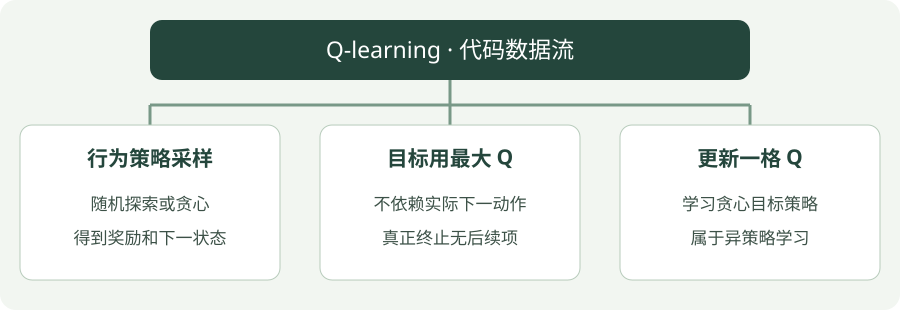

# Q-learning：Python 实践

[算法直觉](../intuition/q-learning.md) · [公式讲解](../math/q-learning.md) · [Python 实践](q-learning.md)


!!! tip "读完这页，你应该能做到"

    找到输入、目标或训练调用，再对照公式解释关键注释。

    **先会这些就够了**：Q 表、贪心选择。


## 看图梳理

{ .learning-figure }

[打开大图](../../assets/learning/rl-code-q-learning.svg)

**行为策略采样**：随机探索或贪心，得到奖励和下一状态；**目标用最大 Q**：不依赖实际下一动作，真正终止无后续项；**更新一格 Q**：学习贪心目标策略，属于异策略学习。


还不认识 Python 的列表、循环或缩进？先查 [Python 阅读入门](../../programming/python-reading.md)，再回来读本页。

## 示例背景

**语言：Python 3.12 或以上；依赖：仅标准库；实现方式：手写更新。**

环境是一条走廊：非终止状态为 1～5，起点为 3，左端 0 奖励 −1，右端 6 奖励 +1，中间每步奖励 −0.01。动作 0 向左，动作 1 向右。这是帮助理解算法的小环境，不是羊群仿真。


本页只提供带注释的代码，按步骤阅读即可，无需创建环境或执行脚本。

## 用中文顺着读代码

先分清 choose 的动作选择与 target 中的 max：前者决定怎样走，后者决定用哪个未来分数更新。接着找到只修改一格的 q[s][a]。

`state` / `s` 是当前位置，`ns` 是下一位置；`done` 表示这局是否真正结束；`gamma` 控制未来奖励打几折。固定随机种子是为了让同一配置更容易复现。

## 行为选择与目标计算在代码里是两处

choose 决定这一步实际执行哪一个动作，里面包含随机探索。step 执行选好的动作。target 再查 `max(q[ns])`：它不重新让环境走一步，只从已保存的下一行分数里取最大值。

假设 q[ns] 是 [0.3, 0.9]，这个 max 结果总为 0.9，不因稍后探索选左而变为 0.3。更新的是 q[s][a]，下一行只是提供参考。

先圈出 choose、step、target、Q 更新四处，分别用“选动作、获得经验、算参考答案、改分数”复述。最后打印贪心动作时不探索，因此它与训练中的每一步走法不必相同。

## 先把表格索引读成中文

```python
q = [[0.0, 0.0] for _ in range(7)]  # 7 个位置，每个位置有左右两格。
s, a, ns = 3, 1, 4                  # 在位置 3 向右，来到位置 4。
q[s][a] = 0.4                       # 当前这格更新前的预测。
q[ns] = [0.3, 0.9]                  # 下一位置两个动作的预测。
reward, gamma, alpha = 0.1, 0.9, 0.2
target = reward + gamma * max(q[ns])  # 未终止：用下一整行的最大值 0.9。
q[s][a] += alpha * (target - q[s][a])  # 仅 q[3][1] 改为 0.502。
```

片段为了展示计算，手动填入 Q 值；完整代码由多条经历逐渐学出这些值。`q[3]` 是一整行，`q[3][1]` 才是其中一格。`max(q[4])` 返回分数 0.9，不是动作编号。

| 变量 | 一次循环中的职责 | 什么会被修改 |
| --- | --- | --- |
| `a` | 本次实际执行的动作 | 下次循环重新选择 |
| `ns` | step 返回的新位置 | 更新前作为查未来分数的索引 |
| `target` | 奖励加下一行最高分 | 每次经历重新计算 |
| `q[s][a]` | 当前动作旧分数 | 被本条经验修正，跨局保留 |

Q-learning 不需要在构造目标前选 `next_action`，因此与 SARSA 的循环顺序不同。完整代码的 `s = ns` 仍必须放在本次更新之后，否则会写错格子。

## 完整代码

```python title="q-learning · 完整学习代码"
"""标准库教学代码：对照注释理解更新过程，无需运行。"""
import random

# 固定随机数起点，便于对照不同步骤；随机种子不保证跨硬件完全一致。
rng = random.Random(7)
# gamma 给未来奖励打折；alpha 决定每次向目标修正多少。
gamma, alpha = 0.95, 0.1

# 小走廊模型：输入当前位置与动作，返回下一位置、奖励、终止标记。
def step(state, action):
    # 动作 1 向右一步，动作 0 向左一步。
    ns = state + (1 if action == 1 else -1)
    # 走到两端才是真正终止；终止状态没有后续奖励。
    done = ns in (0, 6)
    # 右端奖励 +1、左端 -1，其余每步 -0.01，鼓励尽快到达右端。
    reward = 1.0 if ns == 6 else -1.0 if ns == 0 else -0.01
    return ns, reward, done

# epsilon-greedy：少量随机探索，多数时候选择当前高分动作。
def choose(q, state, epsilon=0.15):
    # 以 epsilon 的概率探索，防止一直停在当前看起来最好的选择。
    if rng.random() < epsilon:
        return rng.randrange(2)
    # 取当前状态的最高 Q 值；相同分数的动作随机打破平局。
    best = max(q[state])
    return rng.choice([a for a in range(2) if q[state][a] == best])

# Q 表每行对应状态，两列分别对应向左与向右。
# 每行分别创建新列表；不能写 [[0.0, 0.0]] * 7，那会让七行共用同一列表。
q = [[0.0, 0.0] for _ in range(7)]
# 外层控制迭代或采样幕数；数值只是教学配置，不是收敛保证。
for _ in range(3000):
    # 每一局从位置 3 重新出发；外面的 V/Q 表不重置，所以能积累经验。
    s = 3
    # 持续与环境交互，直到走到左端或右端。
    while s not in (0, 6):
        a = choose(q, s)
        # 执行一次动作，获得下一状态、奖励和真正终止的标记。
        ns, reward, done = step(s, a)
        # 目标 = 本步奖励 + 折扣后的后续估计；done 时后续项归零。
        target = reward + (0.0 if done else gamma * max(q[ns]))
        # Q 更新：旧值 + 学习率 ×（目标 - 旧值），只改刚执行的状态动作格。
        q[s][a] += alpha * (target - q[s][a])
        # 本步更新完以后，再移动当前位置；提前赋值会把旧状态的信息丢掉。
        s = ns
print("Q:", [[round(x, 3) for x in row] for row in q[1:6]])
print("Greedy actions:", [max(range(2), key=lambda a: q[s][a]) for s in range(1, 6)])
```

## 对照公式看代码

`max(q[ns])` 是下一状态的最高分；选动作时仍然随机探索。这对应采样策略与目标策略不同。

## 如何理解输出

输出 Q 表与贪心动作。当前设置下，五个状态应学到向右；这不表示所有环境都能用 3000 幕学会。

## 阅读练习：把理解分成三小步

<div class="practice-card" markdown="1">

<p class="practice-kicker">纸笔演算，不需要运行训练</p>

<p class="practice-title">给同一条经验换两种后续参考</p>

**沿用这些条件**：当前 Q=0.4，下一 Q=[0.3, 0.9]，下一次探索准备选左；奖励 0.1、折扣 0.9、步长 0.2，未终止。

**从哪里开始**：回到本页的核心短片段，先圈出输入和旧预测，再计算临时目标；最后才判断要修改什么。

**按这几步做**：

1. 先算 Q-learning 的目标与新 Q。
2. 再算 SARSA 使用实际下一动作时的目标与新 Q。
3. 解释哪种算法需要提前选好 next_action 并沿用。

??? tip "先要一点提示？"

    给每个数写上名字，区分奖励、旧预测、目标、参数或动作。每算完一步，把中间结果写下来，再进入下一步，不只抄最后答案。

??? example "对照完整推理"

    Q-learning 先取 max=0.9，目标 0.91，新 Q=0.502。SARSA 读取选左的 0.3，目标 0.37，新 Q=0.394。同一经历得到不同参考，来自对后续策略的不同定义。

    本页 Q-learning 不需要提前选择下一动作来构造 max 目标；SARSA 必须选择并交接下一动作。因此只把 max 换成一个任意下标，还不能完成 SARSA 的改写。

</div>
