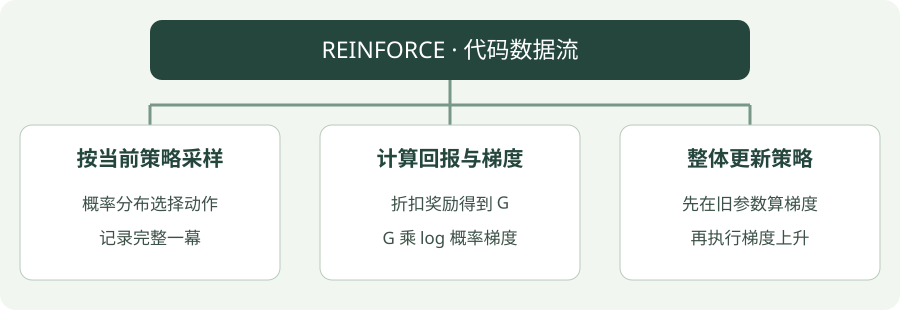

# REINFORCE：Python 实践

[算法直觉](../intuition/reinforce.md) · [公式讲解](../math/reinforce.md) · [Python 实践](reinforce.md)


!!! tip "读完这页，你应该能做到"

    分清偏好、概率和梯度；先汇总整幕贡献，再改变策略参数。

    **先会这些就够了**：概率、回报；梯度可以先按“变化方向”理解。

## 看图梳理

{ .learning-figure }

[打开大图](../../assets/learning/rl-code-reinforce.svg)

**按当前策略采样**：概率分布选择动作，记录完整一幕；**计算回报与梯度**：折扣奖励得到 G，G 乘 log 概率梯度；**整体更新策略**：先在旧参数算梯度，再执行梯度上升。


还不认识 Python 的列表、循环或缩进？先查 [Python 阅读入门](../../programming/python-reading.md)，再回来读本页。

## 示例背景

**语言：Python 3.12 或以上；依赖：仅标准库；实现方式：手写更新。**

环境是一条走廊：非终止状态为 1～5，起点为 3，左端 0 奖励 −1，右端 6 奖励 +1，中间每步奖励 −0.01。动作 0 向左，动作 1 向右。这是帮助理解算法的小环境，不是羊群仿真。


本页只提供带注释的代码，按步骤阅读即可，无需创建环境或执行脚本。

## 先读一个动作给偏好带来的贡献

```python
# 当前状态向左、向右的概率均为 0.5，这次抽到了右（编号 1）。
probs = [0.5, 0.5]
action, total_return, learning_rate = 1, 1.0, 0.02
preference_change = []
for j in range(2):
    selected = 1.0 if j == action else 0.0  # 选中的动作为 1，其余为 0。
    direction = selected - probs[j]        # 左 -0.5，右 +0.5。
    preference_change.append(learning_rate * total_return * direction)
# 结果为 [-0.01, 0.01]，是偏好的变化量，还需要 softmax 才得到新概率。
# 此处只看 t=0 的一项贡献，所以 gamma**t = 1；完整代码保留该时间权重。
```

| 完整代码变量 | 内容 | 生命周期 |
| --- | --- | --- |
| `logits` | 7×2 的动作偏好；不是 Q，也不是概率 | 跨回合保留的策略参数 |
| `probs` | 某状态两个动作概率，和为 1 | 使用当前参数临时计算 |
| `episode`、`returns` | 一局经历与每个时刻之后的回报 | 每局重建 |
| `grad` | 这局对每个偏好的累计梯度 | 每局归零，算完整局后用于更新 |

完整代码的 `(j == a)` 是布尔判断，在 Python 算术中 True、False 分别按 1、0 参与计算，对应上面更直白的 selected。`rng.choices(...)[0]` 先返回只含一个采样结果的列表，再取第一个元素。

先收集完整一局，再算回报，再累计 grad，最后改 logits。这个顺序确保本局所有梯度都基于生成这局经历时的同一套概率，而不是边计算边换基准。

## 完整代码

```python title="reinforce · 完整学习代码"
"""标准库教学代码：对照注释理解更新过程，无需运行。"""
import math
import random

# 固定随机数起点，便于对照不同步骤；随机种子不保证跨硬件完全一致。
rng = random.Random(7)
# gamma 给未来奖励打折；本算法的更新步长在更新语句中定义。
gamma = 0.95

# 小走廊模型：输入当前位置与动作，返回下一位置、奖励、终止标记。
def step(state, action):
    # 调用者只传动作 0 或 1；先按动作找到下一位置。
    if action == 1:
        ns = state + 1  # 向右。
    else:
        ns = state - 1  # 向左。
    # 两端才是真正终点；0、6 不再作为下一次 step 的输入。
    done = ns in (0, 6)
    # 奖励描述刚发生的结果；进入终点时不再额外扣中间步进代价。
    if ns == 6:
        reward = 1.0
    elif ns == 0:
        reward = -1.0
    else:
        reward = -0.01
    return ns, reward, done


# 将动作偏好转换成概率；先减最大值可减少指数溢出的风险。
def softmax(row):
    largest = max(row)  # 同一行都减去同一个最大值，概率比例不变。
    weights = [math.exp(x - largest) for x in row]
    total = sum(weights)
    return [x / total for x in weights]

# 保存每个动作的偏好值，不是概率；softmax 后才得到概率。
logits = [[0.0, 0.0] for _ in range(7)]
# 采集 3000 个回合；每局结束后才整体更新一次策略偏好。
# 这些数量是教学设置，不构成收敛保证。
for _ in range(3000):
    # 一幕从状态 3 开始，并记录这一幕经历的数据。
    s, episode = 3, []
    # 持续与环境交互，直到走到左端或右端。
    while s not in (0, 6):
        # logits[s] 是当前状态的偏好；softmax 才把它转换为左右选择概率。
        probs = softmax(logits[s])
        # choices 返回列表；[0] 取出这一次抽到的动作编号，并非取最高概率。
        a = rng.choices([0, 1], weights=probs)[0]
        # 执行一次动作，获得下一状态、奖励和真正终止的标记。
        ns, reward, done = step(s, a)
        # 保存这一时刻的数据，方便在结束后从后往前计算回报。
        episode.append((s, a, reward))
        # 先保存动作前的位置，再推进当前位置；本局学习要等回合结束。
        s = ns
    # 只创建本局的回报表；最后一步之后回报为 0，便于从末尾递推。
    returns, total = [0.0] * len(episode), 0.0
    # 从最后一步倒推 G：当前奖励 + gamma × 后面已经算好的回报。
    for t in reversed(range(len(episode))):
        total = episode[t][2] + gamma * total
        returns[t] = total
    # 为这一幕创建梯度累积表；先不改变策略偏好。
    grad = [[0.0, 0.0] for _ in range(7)]
    for t, (s, a, _) in enumerate(episode):
        # logits[s] 是当前状态的偏好；softmax 才把它转换为左右选择概率。
        probs = softmax(logits[s])
        for j in range(2):
            # softmax 的 log 概率梯度是“是否选了 j - j 的概率”，再乘折扣权重与回报。
            grad[s][j] += gamma**t * returns[t] * ((j == a) - probs[j])
    # 算完一整幕的旧策略梯度后再更新参数。
    for s in range(1, 6):
        for a in range(2):
            # 梯度上升提高期望回报；这里学习率 0.02 是教学参数。
            logits[s][a] += 0.02 * grad[s][a]
print("P(right):", [round(softmax(logits[s])[1], 3) for s in range(1, 6)])
```

## 对照公式看代码

`logits` 是策略参数；`softmax` 转成动作概率；`grad` 累计回报加权梯度，然后整体更新。

## 如何理解输出

每个数都是某位置向右的概率；对应向左概率等于 1 减去它。初始偏好均为 0，所以初始右概率全是 0.5。训练目标倾向提高更有利的走法，但有限采样和策略梯度的波动不保证每个位置的概率都单调增加。

打印保留三位小数：即使显示 1.0，也可能只是 0.9996 被四舍五入，而非策略已变成严格确定性。概率不是 Q 分数，也不是该位置“成功率”的直接测量。

## 阅读练习：把理解分成三小步

<div class="practice-card" markdown="1">

<p class="practice-kicker">纸笔演算，不需要运行训练</p>

<p class="practice-title">分清梯度、偏好增量和新概率</p>

**沿用这些条件**：本状态左右概率各 0.5，这次选右；只考虑 t=0 这一项，回报 1、步长 0.02。

**从哪里开始**：回到本页的核心短片段，先圈出输入和旧预测，再计算临时目标；最后才判断要修改什么。

**按这几步做**：

1. 计算两个动作的 selected−probability。
2. 乘回报与步长，得到偏好变化量。
3. 偏好都从 0 开始，解释新右概率是否为 0.51，整局何时更新。

??? tip "先要一点提示？"

    给每个数写上名字，区分奖励、旧预测、目标、参数或动作。每算完一步，把中间结果写下来，再进入下一步，不只抄最后答案。

??? example "对照完整推理"

    左方向为 0−0.5=−0.5，右为 1−0.5=0.5；偏好变化为 −0.01、+0.01。它们不是概率直接加减的量。新右概率经 softmax 计算约为 0.505，而不是 0.51。

    完整代码先收集一局，计算所有回报与同一旧策略上的梯度，再累计修改 logits。回报为负时，本条贡献方向翻转；同一状态出现多次时，最终还需合计这些贡献。

</div>
