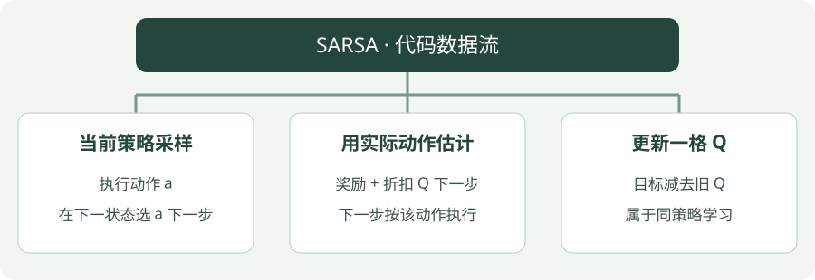

# SARSA：Python 实践

[算法直觉](../intuition/sarsa.md) · [公式讲解](../math/sarsa.md) · [Python 实践](sarsa.md)


!!! tip "读完这页，你应该能做到"

    找到输入、目标或训练调用，再对照公式解释关键注释。

    **先会这些就够了**：Q 表、epsilon-greedy。


## 看图梳理

{ .learning-figure }

[打开大图](../../assets/learning/rl-code-sarsa.svg)

**当前策略采样**：执行动作 a，在下一状态选 a 下一步；**用实际动作估计**：奖励 + 折扣 Q 下一步，下一步按该动作执行；**更新一格 Q**：目标减去旧 Q，属于同策略学习。


还不认识 Python 的列表、循环或缩进？先查 [Python 阅读入门](../../programming/python-reading.md)，再回来读本页。

## 示例背景

**语言：Python 3.12 或以上；依赖：仅标准库；实现方式：手写更新。**

环境是一条走廊：非终止状态为 1～5，起点为 3，左端 0 奖励 −1，右端 6 奖励 +1，中间每步奖励 −0.01。动作 0 向左，动作 1 向右。这是帮助理解算法的小环境，不是羊群仿真。


本页只提供带注释的代码，按步骤阅读即可，无需创建环境或执行脚本。

## 用中文顺着读代码

先找到当前动作 a 从哪里来，再找到 next_action 怎样选；把目标中的下标与最后的 s, a = ns, next_action 连起来读。

`state` / `s` 是当前位置，`ns` 是下一位置；`done` 表示这局是否真正结束；`gamma` 控制未来奖励打几折。固定随机种子是为了让同一配置更容易复现。

## 把“选好下一动作”与“执行下一动作”连起来

第一幕开始先选 a。一次循环中，step 执行当前 a；choose 选好下一动作 next_action；target 使用它的分数；Q 更新后，`s, a = ns, next_action` 把两项一起交给下一轮。

例如当前 Q 为 0.4，收到 0.1，next_action 对应 0.3，折扣 0.9、步长 0.2，则目标为 0.37，新 Q 为 0.394。这些是单次阅读用的数字，完整脚本的默认配置另见代码。

Q 表不会在每轮清空。每次只修改执行过的那一格，未执行的动作分数这次保持不变。先追踪一格，再看跨回合如何重复。

## 完整代码

```python
"""标准库教学代码：对照注释理解更新过程，无需运行。"""
import random

# 固定随机数起点，便于对照不同步骤；随机种子不保证跨硬件完全一致。
rng = random.Random(7)
# gamma 给未来奖励打折；alpha 决定每次向目标修正多少。
gamma, alpha = 0.95, 0.1

# 小走廊模型：输入当前位置与动作，返回下一位置、奖励、终止标记。
def step(state, action):
    # 动作 1 向右一步，动作 0 向左一步。
    ns = state + (1 if action == 1 else -1)
    # 走到两端才是真正终止；终止状态没有后续奖励。
    done = ns in (0, 6)
    # 右端奖励 +1、左端 -1，其余每步 -0.01，鼓励尽快到达右端。
    reward = 1.0 if ns == 6 else -1.0 if ns == 0 else -0.01
    return ns, reward, done

# epsilon-greedy：少量随机探索，多数时候选择当前高分动作。
def choose(q, state, epsilon=0.15):
    # 以 epsilon 的概率探索，防止一直停在当前看起来最好的选择。
    if rng.random() < epsilon:
        return rng.randrange(2)
    # 取当前状态的最高 Q 值；相同分数的动作随机打破平局。
    best = max(q[state])
    return rng.choice([a for a in range(2) if q[state][a] == best])

# Q 表每行对应状态，两列分别对应向左与向右。
q = [[0.0, 0.0] for _ in range(7)]
# 外层控制迭代或采样幕数；数值只是教学配置，不是收敛保证。
for _ in range(3000):
    s = 3
    a = choose(q, s)
    # 持续与环境交互，直到走到左端或右端。
    while s not in (0, 6):
        # 执行一次动作，获得下一状态、奖励和真正终止的标记。
        ns, reward, done = step(s, a)
        # SARSA 用下一步实际准备执行的动作；终止时的占位动作不参与目标。
        next_action = choose(q, ns) if not done else 0
        # 目标 = 本步奖励 + 折扣后的后续估计；done 时后续项归零。
        target = reward + (0.0 if done else gamma * q[ns][next_action])
        # Q 更新：旧值 + 学习率 ×（目标 - 旧值），只改刚执行的状态动作格。
        q[s][a] += alpha * (target - q[s][a])
        s, a = ns, next_action  # 下一步执行的就是这个 next_action
print("Q:", [[round(x, 3) for x in row] for row in q[1:6]])
print("Greedy actions:", [max(range(2), key=lambda a: q[s][a]) for s in range(1, 6)])
```

## 对照公式看代码

`next_action` 先选好；Q 更新使用它的分数；下一步沿用同一动作。

## 如何理解输出

输出 Q 表与贪心动作。固定种子与当前设置下，贪心动作应倾向向右；Q 值仍反映持续探索的影响。

## 阅读练习：不用运行，也能推演

<div class="practice-card" markdown="1">

<p class="practice-kicker">把代码与公式接起来</p>

<p class="practice-title">圈出下一步真的执行哪个动作</p>

读懂 SARSA 的关键不只是替换一个数组下标，还要让选定的下一动作在下一步继续执行。

**沿用这些条件**：下一状态 Q 分别为 0.3、0.9，next_action 选中低分动作。

**你的任务**：找到目标中的 q[ns][next_action]，再找到 s, a = ns, next_action。

??? example "查看推演与解释"

    目标用 0.3 对应的实际下一动作；下一轮沿用它，才与这里的 SARSA 数据流程对应。

</div>
