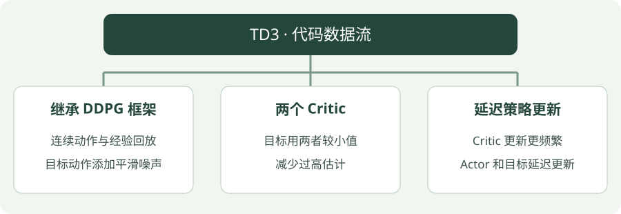

# TD3：Python 实践

[算法直觉](../intuition/td3.md) · [公式讲解](../math/td3.md) · [Python 实践](td3.md)


!!! tip "读完这页，你应该能做到"

    先裁目标噪声再裁动作，计算双 Q 共同目标，并说清延迟更新计数。

    **先会这些就够了**：DDPG 的 Actor / Critic。

## 看图梳理

{ .learning-figure }

[打开大图](../../assets/learning/rl-code-td3.svg)

**继承 DDPG 框架**：连续动作与经验回放，目标动作添加平滑噪声；**两个 Critic**：目标用两者较小值，减少过高估计；**延迟策略更新**：Critic 更新更频繁，Actor 和目标延迟更新。


还不认识 Python 的列表、循环或缩进？先查 [Python 阅读入门](../../programming/python-reading.md)，再回来读本页。

## 示例背景

**语言：Python 3.12；实现方式：使用 Stable-Baselines3 的真实算法实现。**

本页先学习如何调用算法、训练、保存与评估。网络结构与梯度更新由库实现。完整脚本用于阅读训练、保存与评估的调用顺序，内部算法细节要与前两部分对照。


本页以阅读代码为主，不要求安装依赖或运行训练。

## 示例任务

**Pendulum-v1**：对摆杆施加连续扭矩，使其接近直立；奖励通常为负，数值越接近 0 越好。

这是库调用流程示例，不是放牧仿真。完整脚本的折扣固定为 0.99，默认请求 10000 个环境步；短片段的折扣另行给定用于演算，不能直接当作库日志。

## 同样叫噪声，传入的位置决定用途

`action_noise` 是在环境交互时探索用的；`target_policy_noise = 0.2` 是构造学习目标时的动作平滑；`target_noise_clip = 0.5` 限制这份目标噪声的幅度。后两项不会要求机器人真的执行那份目标动作。

`policy_delay = 2` 表示这里 Actor 与目标网络每两次 Critic 梯度更新跟进一次。它不等于每两幕才训练，也不表示执行动作时停一帧。

先给这四个配置分别标注“收集经验、平滑目标、限制目标噪声、更新节奏”，再读完整流程。其余保存与评估步骤与 DDPG 相似。

## 先拆开目标噪声、双 Q 与共同目标

```python
# 假设在归一化动作坐标 [-1, 1] 中计算，不是环境扭矩单位。
target_action, noise, noise_limit = 0.9, 0.4, 0.2
bounded_noise = min(max(noise, -noise_limit), noise_limit)  # 0.2。
smoothed_action = min(max(target_action + bounded_noise, -1.0), 1.0)  # 1.0。
# 将这个相同动作送给两个目标 Critic；这里直接给出假想网络预测。
target_q1, target_q2 = 2.4, 1.8
reward, gamma = 0.1, 0.9
target = reward + gamma * min(target_q1, target_q2)  # 未终止时目标 1.72。
# 两个当前 Critic 都对齐 target；Actor 的更新通常使用当前 Q1 的梯度。
```

完整训练中，smoothed_action 只供计算目标，不能拿它替换回放记录中的实际动作。回放记录描述已经发生的经验；目标动作描述对未来的估计，是不同字段。

| 完整代码参数 | 管哪件事 | 在哪里起作用 |
| --- | --- | --- |
| `action_noise` | 交互时试一试别的动作 | 改变真正送入环境的控制量 |
| `target_policy_noise` | 目标动作平滑噪声的标准差 | 算未来 Q 之前 |
| `target_noise_clip` | 限制目标噪声幅度 | 先裁噪声，后裁动作 |
| `policy_delay=2` | Critic 更新两次后再更新策略和目标网络 | 按训练更新计数 |

本例 Pendulum 观测 3 维、动作 1 维，两个 Critic 各输出一个 Q 分数。`batch_size=64` 表示一批 64 条经验；每条经验都形成自己的目标，再汇总误差，不是先把 64 个状态平均成一个。

## 代码里的 0.1、0.2、0.5 都是什么单位

这份 SB3 实现内部使用 [−1, 1] 动作坐标；Pendulum 的环境扭矩为该数值乘 2：

| 参数 | 归一化坐标中的意思 | 换回本例扭矩坐标 |
| --- | --- | --- |
| 探索 sigma=0.1 | 交互噪声标准差 0.1 | 未裁剪前相当于标准差 0.2 |
| target_policy_noise=0.2 | 目标平滑噪声标准差 0.2 | 未裁剪前相当于标准差 0.4 |
| target_noise_clip=0.5 | 目标噪声裁剪到 [−0.5, 0.5] | 对应扰动范围 [−1, 1] |

标准差不是固定每次添加的值。短片段故意把 noise_limit 设成 0.2，让裁剪可见；**完整脚本的上限是 0.5**，不能把两段配置混当成一个计算。

按完整配置另算一次：目标动作 0.9，抽到目标噪声 0.4，它未超过 0.5 上限；相加 1.3，再把动作裁为 1.0。这个 1.0 只用于两个目标 Critic 查询，不是在这次学习时把扭矩 2.0 真的发给环境。交互探索和目标平滑发生在两条不同数据流程中。

## 看懂输出

- `Actual training steps`：实际交互步数；本例单环境、逐步采样，不需要凑齐 A2C/PPO 的固定长度片段。
- `Before`：未训练模型的确定性评估均值。
- `After`：保存并重新加载模型后，5 幕独立评估的均值与标准差。
- `rl-output/td3/model.zip`：模型文件；同目录的 `train.monitor.csv` 保存训练回合记录。

运行成功只说明接口与训练链路正常。判断学习效果还需要更充分的训练、更多评估回合和多个训练种子。

## 阅读练习：把理解分成三小步

<div class="practice-card" markdown="1">

<p class="practice-kicker">纸笔演算，不需要运行训练</p>

<p class="practice-title">先裁噪声，再裁动作，最后查两份评分</p>

**沿用这些条件**：归一化动作范围 [−1, 1]；目标动作 0.9、目标噪声 0.4、噪声裁剪上限 0.2；两份目标 Q=2.4、1.8；奖励 0.1、折扣 0.9，未终止。

**从哪里开始**：回到本页的核心短片段，先圈出输入和旧预测，再计算临时目标；最后才判断要修改什么。

**按这几步做**：

1. 依次算有界噪声和最终目标动作。
2. 计算两个当前 Critic 共同追赶的参考。
3. 解释 policy_delay=2 是推迟执行动作两步，还是按学习更新计数。

??? tip "先要一点提示？"

    给每个数写上名字，区分奖励、旧预测、目标、参数或动作。每算完一步，把中间结果写下来，再进入下一步，不只抄最后答案。

??? example "对照完整推理"

    噪声先从 0.4 裁成 0.2，加动作得到 1.1，再裁到合法范围得到 1.0。两份目标 Critic 都查询这个动作，取较小 Q=1.8，目标为 1.72。

    policy_delay 按训练更新计数：通常每两次 Critic 更新才更新一次 Actor 与目标网络。它不要求机器人晚执行动作。目标噪声也不是回放经验中已经执行的探索动作。

</div>

## 第二遍再读完整脚本

先用上面的短片段和练习弄清更新目标，再展开脚本追踪“创建模型 → 训练 → 保存 → 重新加载 → 独立评估”。保存文件与命令行参数不参与算法公式。

??? note "展开带注释的完整脚本"

    ```python title="td3 · 完整学习代码"
    """TD3 训练、保存与独立评估；默认 10000 步，可传 --steps 调整。"""
    # 命令行参数工具；阅读算法时可先跳过参数解析部分。
    import argparse
    from pathlib import Path
    # 环境接口库：提供 reset 开始一局、step 执行动作。
    import gymnasium as gym
    # 数组计算工具；这里主要用于连续动作的探索噪声。
    import numpy as np
    # 神经网络库；本示例的网络与梯度计算由 SB3 调用它完成。
    import torch
    # 导入库实现的算法；调用库并不等于从零实现算法内部。
    from stable_baselines3 import TD3
    from stable_baselines3.common.monitor import Monitor
    from stable_baselines3.common.evaluation import evaluate_policy
    from stable_baselines3.common.noise import NormalActionNoise


    def main(steps, seed):
        # 限制 CPU 计算线程数量，不代表启动机器人或仿真控制线程。
        torch.set_num_threads(1)
        # Path 表示文件路径；后面的 / 是拼接子路径，并非这里在做数字除法。
        output = Path("rl-output/td3")
        # 只有主动运行脚本才创建输出目录；网站展示代码不会执行这一行。
        output.mkdir(parents=True, exist_ok=True)
        # 训练环境负责收集经验，Monitor 统计每幕奖励与步数。
        train_env = Monitor(gym.make("Pendulum-v1"), str(output / "train"))
        # 另建评估环境，避免把训练过程中的奖励直接当作评估结果。
        eval_env = Monitor(gym.make("Pendulum-v1"))
        # 评估随机种子单独设置；它不保证跨硬件逐位一致。
        # reset 返回初始观测和 info；评估器之后会自行按回合调用环境接口。
        eval_env.reset(seed=seed + 100)
        dim = train_env.action_space.shape[0]
        # 探索噪声加在 [-1, 1] 归一化动作上；换回 Pendulum 扭矩需再乘 2。
        noise = NormalActionNoise(mean=np.zeros(dim), sigma=0.1 * np.ones(dim))
        try:
            # 创建策略与价值网络；初始化完成不意味着模型已经学会任务。
            model = TD3(
                # 多层感知机策略；seed 控制随机初始化，device 指定 CPU。
                "MlpPolicy", train_env, seed=seed, device="cpu", verbose=0,
                # 完整示例折扣固定为 0.99；正文短算例另给折扣，便于口算。
                gamma=0.99,
                # 经验回放容量、开始学习前的采样步数、每批样本数。
                buffer_size=20000, learning_starts=100, batch_size=64,
                # 每交互一步后进行一次梯度更新；训练初期先积累经验。
                train_freq=1, gradient_steps=1, action_noise=noise,
                # 这些目标噪声数值位于 [-1, 1] 归一化动作坐标中。
                policy_delay=2, target_policy_noise=0.2, target_noise_clip=0.5,
                # Actor 与目标网络每两次 Critic 更新跟进一次。
                tau=0.005,
            )
            # 记录未训练策略的评估均值，作为观察起点。
            # 左边两个名字接收均值和标准差；这里用 _ 表示暂时不使用第二项。
            before, _ = evaluate_policy(model, eval_env, n_eval_episodes=5,
                                       deterministic=True)
            # 这行才触发训练；本教程只提供代码，不在项目中自动调用。
            model.learn(total_timesteps=steps)
            # 保存参数，便于理解模型持久化，不表示策略性能已达标。
            model.save(str(output / "model"))
            # 从磁盘重新加载模型，展示部署前参数恢复的步骤。
            loaded = TD3.load(str(output / "model"), device="cpu")
            # 评估随机种子单独设置；它不保证跨硬件逐位一致。
            eval_env.reset(seed=seed + 100)
            # 使用独立环境评估恢复的模型，输出平均回报与标准差。
            # std 是这些评估回合回报的标准差，不是训练结果可靠性的保证。
            after, std = evaluate_policy(loaded, eval_env, n_eval_episodes=5,
                                        deterministic=True)
            print(f"Actual training steps: {model.num_timesteps}")
            print(f"Before: {before:.2f} | After: {after:.2f} +/- {std:.2f}")
            print(f"Model saved to: {output / 'model.zip'}")
        # 即使中间发生异常，也尝试释放环境资源。
        finally:
            train_env.close()
            eval_env.close()


    # 入口保护：被导入时不调用这里的 main；网站只展示文本。
    if __name__ == "__main__":
        parser = argparse.ArgumentParser(description=__doc__)
        # steps 是训练预算示例，不是预期学会任务所需的精确步数。
        parser.add_argument("--steps", type=int, default=10000)
        parser.add_argument("--seed", type=int, default=7)
        # 把可选命令行文字转换为参数值；定义参数本身不会启动学习。
        args = parser.parse_args()
        if args.steps <= 0:
            parser.error("--steps must be positive")
        main(args.steps, args.seed)
    ```

## 官方实现说明

[Stable-Baselines3：TD3](https://stable-baselines3.readthedocs.io/en/v2.9.0/modules/td3.html)
