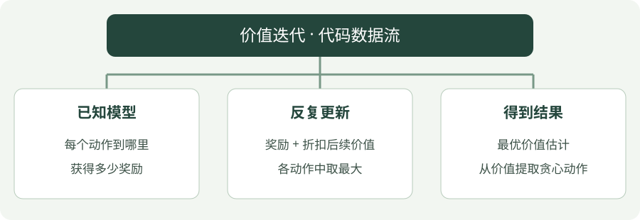

# 价值迭代：Python 实践

[算法直觉](../intuition/value-iteration.md) · [公式讲解](../math/value-iteration.md) · [Python 实践](value-iteration.md)


!!! tip "读完这页，你应该能做到"

    找到输入、目标或训练调用，再对照公式解释关键注释。

    **先会这些就够了**：已知模型、奖励、价值。


## 看图梳理

{ .learning-figure }

[打开大图](../../assets/learning/rl-code-value-iteration.svg)

**已知模型**：每个动作到哪里，获得多少奖励；**反复更新**：奖励 + 折扣后续价值，各动作中取最大；**得到结果**：最优价值估计，从价值提取贪心动作。


还不认识 Python 的列表、循环或缩进？先查 [Python 阅读入门](../../programming/python-reading.md)，再回来读本页。

## 示例背景

**语言：Python 3.12 或以上；依赖：仅标准库；实现方式：手写更新。**

环境是一条走廊：非终止状态为 1～5，起点为 3，左端 0 奖励 −1，右端 6 奖励 +1，中间每步奖励 −0.01。动作 0 向左，动作 1 向右。这是帮助理解算法的小环境，不是羊群仿真。

[下载完整 Python 文件](../examples/value-iteration.py){ .md-button }

本页只提供带注释的代码，按步骤阅读即可，无需创建环境或执行脚本。

## 用中文顺着读代码

先看 step 规定的已知规则，再看 values 与 old 如何保存新旧价值；接着只追踪一个位置的 candidates。这个算法不使用随机采样，因此没有随机种子需要解释。

`state` / `s` 是当前位置，`ns` 是下一位置；`done` 表示这局是否真正结束；`gamma` 控制未来奖励打几折。本例用已知规则枚举结果，不需要随机数。

## 先追踪一个状态，不急着读两个循环

把本轮旧价值设为：位置 3 为 0.2，位置 5 为 0.8。只看位置 4，折扣取代码中的 0.95：向左目标 −0.01 + 0.95 × 0.2 = 0.18；向右目标 −0.01 + 0.95 × 0.8 = 0.75。candidates 收集这两个数，max 选出 0.75 写回位置 4。

`old = values[:]` 复制上一轮的列表。这样本轮先改了位置 1，也不会让位置 2 偷用刚改过的新值。外层循环重复轮次，内层两个循环分别遍历位置和动作，三层各有不同职责。

这里只是已知模型的枚举计算，不需要随机策略、轨迹或回放池。先指出这三个循环各干什么，再读最后提取动作的那一段。

## 完整代码

```python
"""标准库教学代码：对照注释理解更新过程，无需运行。"""

# gamma 给未来奖励打折；价值迭代每轮直接采用最大的动作目标。
gamma = 0.95

# 小走廊模型：输入当前位置与动作，返回下一位置、奖励、终止标记。
def step(state, action):
    # 动作 1 向右一步，动作 0 向左一步。
    ns = state + (1 if action == 1 else -1)
    # 走到两端才是真正终止；终止状态没有后续奖励。
    done = ns in (0, 6)
    # 右端奖励 +1、左端 -1，其余每步 -0.01，鼓励尽快到达右端。
    reward = 1.0 if ns == 6 else -1.0 if ns == 0 else -0.01
    return ns, reward, done


# V 表按状态存分数；两个终止位置也占位，但不更新它们。
values = [0.0] * 7
# 外层控制迭代或采样幕数；数值只是教学配置，不是收敛保证。
for _ in range(10000):
    # 复制上一轮的 V；本轮所有目标都使用旧表，进行同步更新。
    old = values[:]
    for s in range(1, 6):
        candidates = []
        for a in range(2):
            # 用已知规则计算候选动作的结果；这里是在枚举，不是采样。
            ns, reward, done = step(s, a)
            # 比较两种动作的“一步奖励 + 下一状态价值”，不是随机采样。
            candidates.append(reward + (0.0 if done else gamma * old[ns]))
        # 价值迭代选择当前最大的候选目标，逼近最优状态价值。
        values[s] = max(candidates)
    # 比较新旧表的最大变化；足够小则停止迭代。
    if max(abs(x - y) for x, y in zip(values, old)) < 1e-10:
        break
policy = []
for s in range(1, 6):
    candidates = []
    for a in range(2):
        # 用已知规则计算候选动作的结果；这里是在枚举，不是采样。
        ns, reward, done = step(s, a)
        # 比较两种动作的“一步奖励 + 下一状态价值”，不是随机采样。
        candidates.append(reward + (0.0 if done else gamma * values[ns]))
    policy.append(max(range(2), key=lambda a: candidates[a]))
print("Values:", [round(x, 3) for x in values[1:6]])
print("Actions (0=left, 1=right):", policy)
```

## 对照公式看代码

`candidates` 对应每个动作的即时奖励与未来价值；`max` 执行贪心备份；`old` 让本轮使用上一轮价值。

## 如何理解输出

输出五个非终止位置的价值，以及全向右的最优动作。这里知道转移模型，调用 `step` 来枚举结果不是通过采样估计模型。

## 阅读练习：不用运行，也能推演

<div class="practice-card" markdown="1">

<p class="practice-kicker">把代码与公式接起来</p>

<p class="practice-title">只改变一个候选动作的后续价值</p>

正文使用已知规则比较两个动作。现在只在纸上改变一个后续价值，看看选择是否改变。

**沿用这些条件**：把奖励固定为 −0.01、折扣为 0.95，下一状态价值设为 0.8 与 0.2。

**你的任务**：先各算一个候选目标，再取最大；分别说明 max 和 argmax 返回什么。

??? example "查看推演与解释"

    两个目标为 0.75 与 0.18；max 返回 0.75，argmax 返回第一个动作。

</div>
