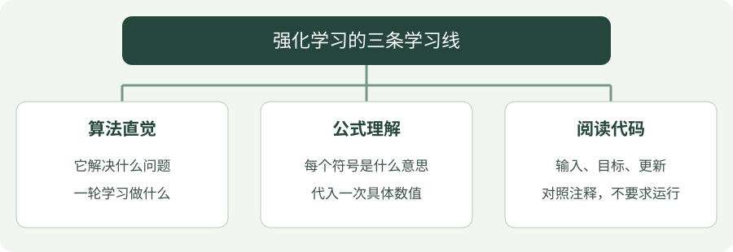

# 强化学习

强化学习是在与环境交互中学习决策：观察当前情况，尝试动作，收到奖励，再调整下一次的选择。

本栏目按 **算法直觉 → 公式讲解 → 编程实践** 组织。三个部分覆盖同一组算法，可以顺着读，也可以直接查某个算法。

-   **01 · 算法直觉**

    先用走廊、决策与反馈的例子，理解算法解决什么问题、怎样学习以及有什么限制。

    [从通俗解释开始 →](intuition/index.md)

-   **02 · 公式讲解**

    每个符号都有解释，每个核心更新都有数字例子，并说明目标与损失的区别。

    [读懂公式 →](math/index.md)

-   **03 · 编程实践**

    阅读带中文注释的 Python：基础算法看手写更新，深度算法看训练、保存与独立评估的调用流程。无需安装 RL 环境或运行训练。

    [阅读代码 →](code/index.md)

!!! tip "第一次接触强化学习？"

    先读[入门第一课](start.md)：用一条走廊分清奖励、回报、价值和策略，再算一次更新。不必先背公式。

## 零基础第一次怎么读

先走一条短路线：**入门第一课 → TD 的直觉 → TD 的数字更新 → Python 阅读入门 → TD 的代码追踪**。同一个问题来回对照，比连续浏览十二个算法名字更容易建立联系。

- 不认识奖励、价值：回到 [入门第一课](start.md)。
- 会算术但看不懂公式符号：先看 [公式导读](math/index.md)。
- 看不懂方括号、缩进和循环：先看 [Python 阅读入门](../programming/python-reading.md)。
- 基础概念清楚之后，再比较 SARSA 与 Q-learning；最后逐步进入网络和连续控制。

一次学习可以只完成一条更新：说清“用了哪些数字、改了什么、为什么这样改”，就是进展。完整推导、库内部实现和论文可以留到后续阅读。

## 看图梳理

{ .learning-figure }

[打开大图](../assets/learning/rl-index.svg)

**算法直觉**：它解决什么问题，一轮学习做什么；**公式理解**：每个符号是什么意思，代入一次具体数值；**阅读代码**：输入、目标、更新，对照注释，不要求运行。

## 算法索引

先覆盖以下 12 类经典方法。强化学习还包含其他算法与扩展，这张表是本栏目的学习范围。

| 算法 | 通俗解释 | 公式讲解 | 编程实践 |
| --- | --- | --- | --- |
| 价值迭代 | [根据已知规则反复计算每一步的长期价值。](intuition/value-iteration.md) | [公式](math/value-iteration.md) | [Python](code/value-iteration.md) |
| 蒙特卡洛（MC） | [先走完整条路，再用真实回报给经过的状态打分。](intuition/mc.md) | [公式](math/mc.md) | [Python](code/mc.md) |
| 时序差分 TD(0) | [走一步就更新：眼前奖励加上对下一步的估计。](intuition/td.md) | [公式](math/td.md) | [Python](code/td.md) |
| SARSA | [按实际下一步会选的动作，更新当前动作的价值。](intuition/sarsa.md) | [公式](math/sarsa.md) | [Python](code/sarsa.md) |
| Q-learning | [按下一步最好的估计，更新当前动作的价值。](intuition/q-learning.md) | [公式](math/q-learning.md) | [Python](code/q-learning.md) |
| DQN | [用神经网络代替 Q 表，学习每个动作的分数。](intuition/dqn.md) | [公式](math/dqn.md) | [Python](code/dqn.md) |
| REINFORCE | [提高带来好回报的动作概率，直接学习决策规则。](intuition/reinforce.md) | [公式](math/reinforce.md) | [Python](code/reinforce.md) |
| Actor-Critic / A2C | [一个模块做决定，另一个模块评估决定好不好。](intuition/a2c.md) | [公式](math/a2c.md) | [Python](code/a2c.md) |
| PPO | [改进策略时克制一点，避免一次更新改变太大。](intuition/ppo.md) | [公式](math/ppo.md) | [Python](code/ppo.md) |
| DDPG | [直接给出连续动作，用价值网络指导动作改进。](intuition/ddpg.md) | [公式](math/ddpg.md) | [Python](code/ddpg.md) |
| TD3 | [用双重价值估计、延迟更新与目标平滑改进 DDPG。](intuition/td3.md) | [公式](math/td3.md) | [Python](code/td3.md) |
| SAC | [兼顾回报与探索，学习带随机性的连续控制策略。](intuition/sac.md) | [公式](math/sac.md) | [Python](code/sac.md) |

## 建议学习顺序

### 先分清：学分数，还是学选择规则？

| 学习对象 | 可以怎样理解 | 本栏目例子 |
| --- | --- | --- |
| 状态价值 V | “站在这里，之后平均能得多少分？” | MC、TD(0) 先评估固定策略 |
| 动作价值 Q | “站在这里，先做这个动作，之后能得多少分？” | SARSA、Q-learning、DQN |
| 策略 π / μ | “遇到这种情况，应该怎样选动作？” | REINFORCE；A2C、PPO 同时学习价值 |
| 连续动作策略与 Q | “直接给一个速度，再用长期评分改进它。” | DDPG、TD3、SAC |

价值迭代比较特别：它先知道环境转移与奖励规则，再计算价值并提取策略，属于规划。MC 和 TD(0) 在本栏的示例是**评估已有策略**，不自动产生最优策略；把评估与策略改进结合起来，才构成控制方法。

“同策略 / 异策略”说的是**收集数据的策略与要学习的策略是否相同**；“有模型 / 无模型”说的是是否利用环境转移和奖励模型。它们是不同维度，不能当作互斥的四个盒子。分类及适用边界可对照 [Spinning Up 的算法分类](https://spinningup.openai.com/en/latest/spinningup/rl_intro2.html)。

1. **建立概念**：状态、动作、奖励、回报、策略与价值。
2. **理解价值更新**：价值迭代 → MC → TD(0)。其中 MC 与 TD 的示例先评估固定策略。
3. **学会选动作**：SARSA → Q-learning → DQN。
4. **直接学策略**：REINFORCE → Actor-Critic / A2C → PPO。
5. **理解连续控制**：DDPG → TD3 → SAC。

## 和放牧机器人研究的关系

目前研究方向是放牧机器人，强化学习是相关技术学习的一部分。离散的高层动作与连续的速度指令适用的方法不同；先明确任务和动作空间，再选候选算法做对照实验。本栏目代码先使用小环境学习算法，不宣称已完成放牧实验。
