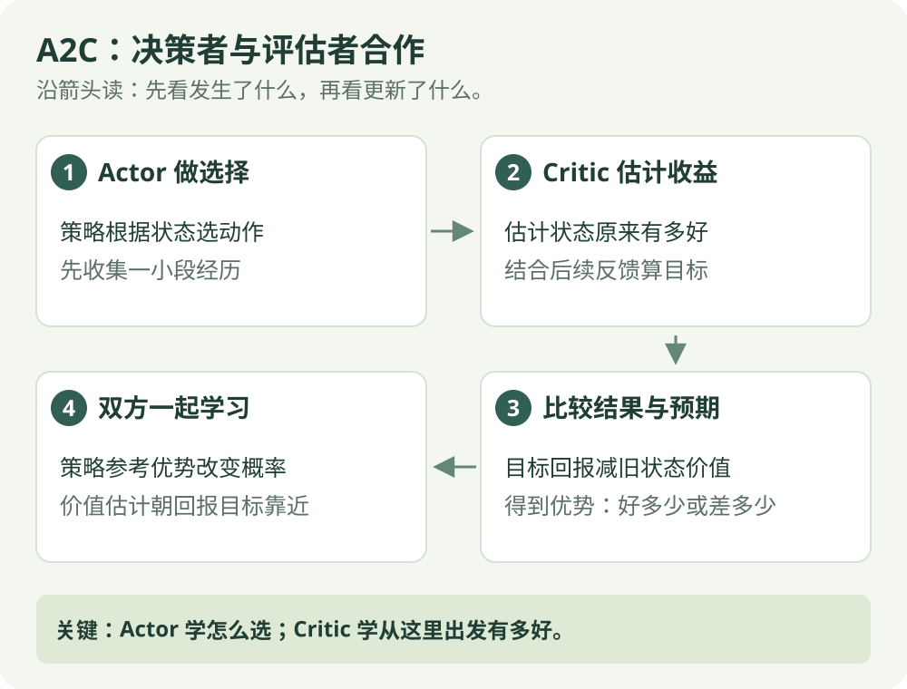

# Actor-Critic / A2C：算法直觉

[算法直觉](a2c.md) · [公式讲解](../math/a2c.md) · [Python 实践](../code/a2c.md)

同策略 / 策略与价值

## 一句话理解

一个模块做决定，另一个模块告诉它结果比预期好多少。

## 先看这张图

{ .rl-figure loading=lazy }

[打开图示大图](../assets/a2c.svg)

图中每个框只展示主要学习关系，完整细节见后面的公式与代码。

## 这几个词是什么意思

**Actor**：选择动作的策略。**Critic**：估计从当前情况出发能拿多少收益。**优势**：动作的结果相对原先预期好多少，训练时用估计值。

## 用走廊举例

Critic 原来觉得当前状态值 0.2；走一步后的奖励与未来估计合计 0.55，于是差值为 +0.35。Actor 用这个正反馈提高相关动作概率，Critic 同时修正自己的估计。

## Actor 与 Critic 分别学什么

- Actor 学策略：在这个状态下，各动作应该有多大概率。
- Critic 学价值：按照当前策略，从这里出发大概能拿多少回报。
- 优势表示动作带来的结果相对状态平均预期的好坏。

## A2C 是哪个版本

Actor-Critic 是方法家族。A2C 是同步 Advantage Actor-Critic，通常收集一段或多个环境的数据后统一更新；A3C 则采用异步工作方式。本栏目代码使用 A2C，不能把所有 Actor-Critic 实现都叫 A2C。

## 决策者需要怎样的反馈

Actor 负责决定向左还是向右，Critic 负责估计当前局面往后能得多少分。Critic 原来预期 0.2；设奖励 0.1、下一状态估计 0.5、折扣 0.9且未终止，则“奖励加未来估计”为 0.1 + 0.9 × 0.5 = 0.55，比原先预期高 0.35，这个差就能给 Actor 反馈。

两个模块不是轮流指挥机器人：动作由 Actor 给出，Critic 在学习时评价。Critic 也需要学习，它的评分不一定正确；优势估计会受奖励随机性和价值误差影响。

A2C 常收集一小段数据再统一更新，未必等整局结束。把“结果是否好于预期”与“实际拿了多少奖励”分开，才能读懂它为什么用优势。

## 学习流程

采集一段轨迹 → 估计回报与优势 → 更新策略 → 更新价值函数 → 再采样。相对于纯 MC 策略梯度，它可以用自举缩短等待，但价值估计误差也会影响策略更新。

## 在放牧研究里如何理解

状态价值能帮助判断一次驱赶动作是否比当前预期更有效。A2C 可作为策略梯度方法的基础比较，不意味着它必然优于 PPO。

## 奖励是正的，为什么动作仍可能得到负反馈

优势比较的是“比预期好多少”。比如两条假想经历都得到奖励 +1，但它们发生在不同局面，后续估计也不同。

| 这次经历 | 原来状态价值 | 奖励加后续估计 | 优势 |
| --- | --- | --- | --- |
| 原来就很有希望 | 5 | 4 | −1：比原来预期差 |
| 原来不太有希望 | 1 | 2 | +1：比原来预期好 |

Actor 看优势的正负来调整采样动作的概率倾向；Critic 则分别把原预测 5 向 4 修正、把 1 向 2 修正。不能只看到正奖励，就断言 Actor 一定增加该动作概率。

与 REINFORCE 等完整结局不同，A2C 可以收集一段经历后，用段末的价值估计补上还没看到的收益，再计算各时刻优势。如果途中已经真正终止，就不需要补后续收益。

这两个模块可以想成“做决定的人”和“估计结果的人”，但它们都是程序中的可学习函数；评价者不是人类裁判，也不会天然知道正确答案。

## 检查自己是否看懂

**Actor 与 Critic 都是在学动作概率吗？**

??? success "展开答案"

    Actor 学如何选动作；这里的 Critic 学状态价值。它们的任务和损失不同。

## 进一步阅读

[Stable-Baselines3：A2C](https://stable-baselines3.readthedocs.io/en/master/modules/a2c.html)
