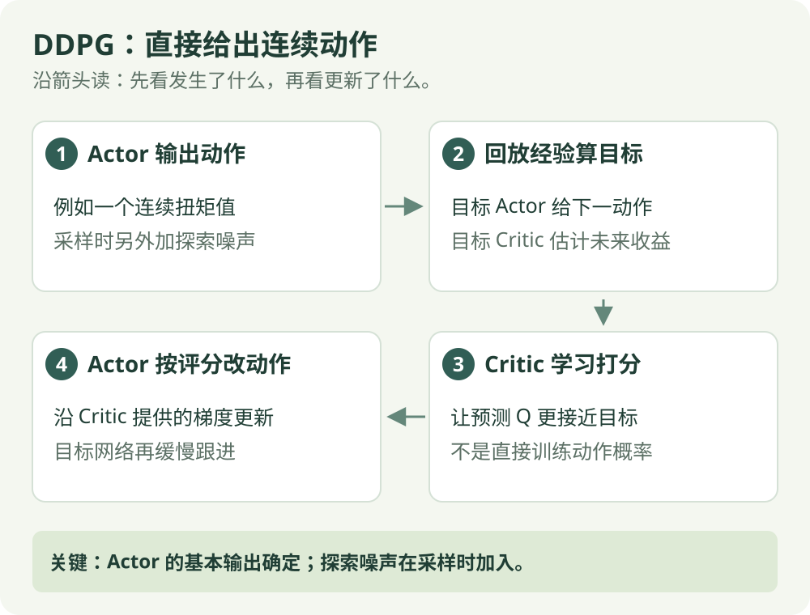

# DDPG：算法直觉

[算法直觉](ddpg.md) · [公式讲解](../math/ddpg.md) · [Python 实践](../code/ddpg.md)

异策略 / 连续动作

## 一句话理解

直接输出连续动作，再沿着评分更高的方向调整动作。

## 先看这张图

{ .rl-figure loading=lazy }

[打开图示大图](../assets/ddpg.svg)

图中每个框只展示主要学习关系，完整细节见后面的公式与代码。

## 这几个词是什么意思

**连续动作**：区间内的任意数值，例如扭矩。**确定性策略**：同一输入下基本动作固定。**动作梯度**：告诉你动作小幅改变时，Critic 分数怎样变化。

## 为什么不能简单挑最高分

离散动作可以把几个分数全部比较。连续速度有无限多种取值，无法逐一枚举。DDPG 用策略网络产生动作，再沿着价值网络提供的梯度调整策略。

## 连续动作不能照搬“从两列里挑一个”

如果机器人速度可以是 0.1、0.11、0.113 等区间内数值，无法把所有候选都列成两列 Q 表。DDPG 的 Actor 直接给一个连续动作，Critic 再估计这个动作的长期收益。

改 Actor 时，利用 Critic 对动作的梯度，问“动作向哪边小幅调整，估计分数会变高”。这是局部变化方向，不保证一步就找到全局最好动作；Critic 估错时，方向也可能不可靠。

基本 Actor 给相同状态一个固定输出，采集经验时另加噪声试新动作。噪声不是策略概率表，动作范围仍需遵守环境边界。

## 它怎么工作

1. Actor 输出动作，训练采样时加探索噪声。
2. 把转移存入经验回放池。
3. 用目标 Actor 和目标 Critic 算学习目标。
4. 更新 Critic，让它更接近目标。
5. 更新 Actor，让它输出的动作获得更高的 Critic 分数。
6. 缓慢更新目标网络。

## 确定性是什么意思

给定同一状态，Actor 的基本输出是固定的，不是动作概率分布。训练探索噪声在外部加入；评估时通常去掉噪声。

## 限制

Critic 估错时，Actor 可能主动利用错误的高分区域，因此对价值估计和超参数比较敏感。TD3 与 SAC 为连续控制提供了进一步的设计。

## 在放牧研究里如何理解

连续速度是合适的动作类型，但必须定义尺度和边界。示例先用 Pendulum 检查连续控制训练，不将摆杆成绩解释为放牧效果。

## 检查自己是否看懂

**既然 Actor 是确定性的，训练怎么尝试新动作？**

??? success "展开答案"

    采样时在 Actor 输出上加探索噪声；评估时通常去掉这份噪声。

## 进一步阅读

[Spinning Up：DDPG](https://spinningup.openai.com/en/latest/algorithms/ddpg.html)
