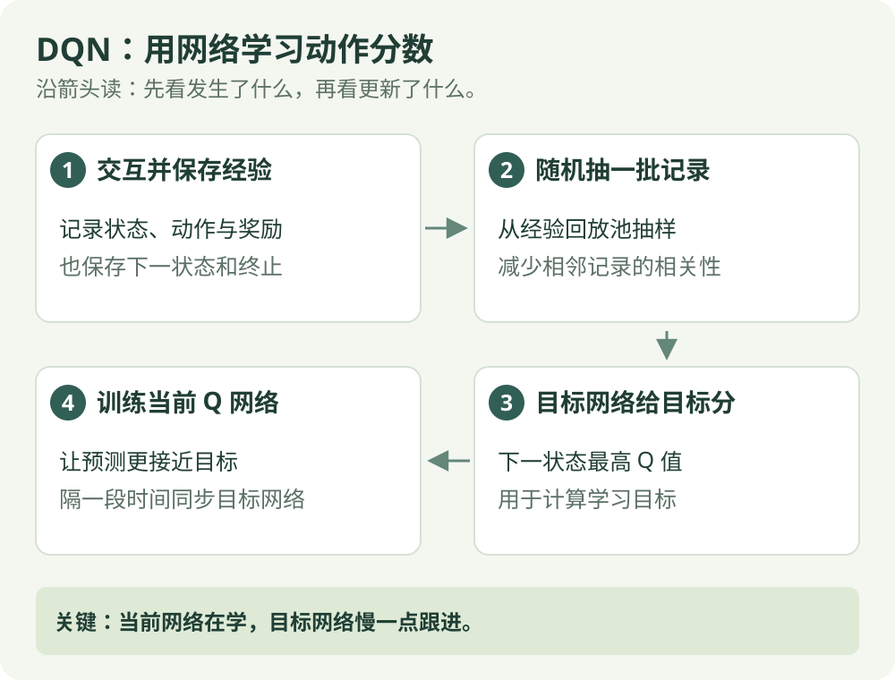

# DQN：算法直觉

[算法直觉](dqn.md) · [公式讲解](../math/dqn.md) · [Python 实践](../code/dqn.md)

异策略 / 离散动作

## 一句话理解

用神经网络预测每个动作的分数，再用经验修正这些分数。

## 先看这张图

{ .rl-figure loading=lazy }

[打开图示大图](../assets/dqn.svg)

图中每个框只展示主要学习关系，完整细节见后面的公式与代码。

## 这几个词是什么意思

**神经网络**：一个带可调参数的预测函数。**回放池**：保存过去交互记录的集合。**目标网络**：更新较慢的一份网络，用来提供学习目标。

## 为什么需要网络

走廊只有几个位置，查表很容易。图像、位置和速度组成的状态空间却很大。网络让相似观测共享参数，避免为每个状态单独存一格，但也带来估计与训练不稳定的问题。

## 两个关键设计

- **经验回放**：把交互记录存起来，随机抽一批训练，减少连续样本的相关性并复用数据。
- **目标网络**：用更新较慢的另一份网络算目标，避免预测值与目标同时快速变化。

## 它怎么工作

选动作 → 收集转移 → 存入回放池 → 抽样 → 计算 TD 目标 → 更新网络 → 定期同步目标网络。

## 能做什么，不能做什么

本篇讲原始 DQN，动作必须能列举，比如向左或向右。直接输出任意实数速度不是标准 DQN 的用法。Double DQN、Dueling DQN 与优先经验回放是扩展，不属于本篇示例的实现内容。

## 在放牧研究里如何理解

若高层动作是“靠近羊群左侧、右侧、后侧”这样的离散选项，可以考虑 DQN 作比较。若动作是连续速度，应查看连续控制算法。这里的 CartPole 示例先用简单环境检查训练链路。

## 检查自己是否看懂

**本篇网络能直接从无限多个速度值中选一个吗？**

??? success "展开答案"

    标准 DQN 输出能列举的动作分数。连续速度需要先离散化，或使用连续动作算法。

## 进一步阅读

[DQN 原始论文](https://arxiv.org/abs/1312.5602)
