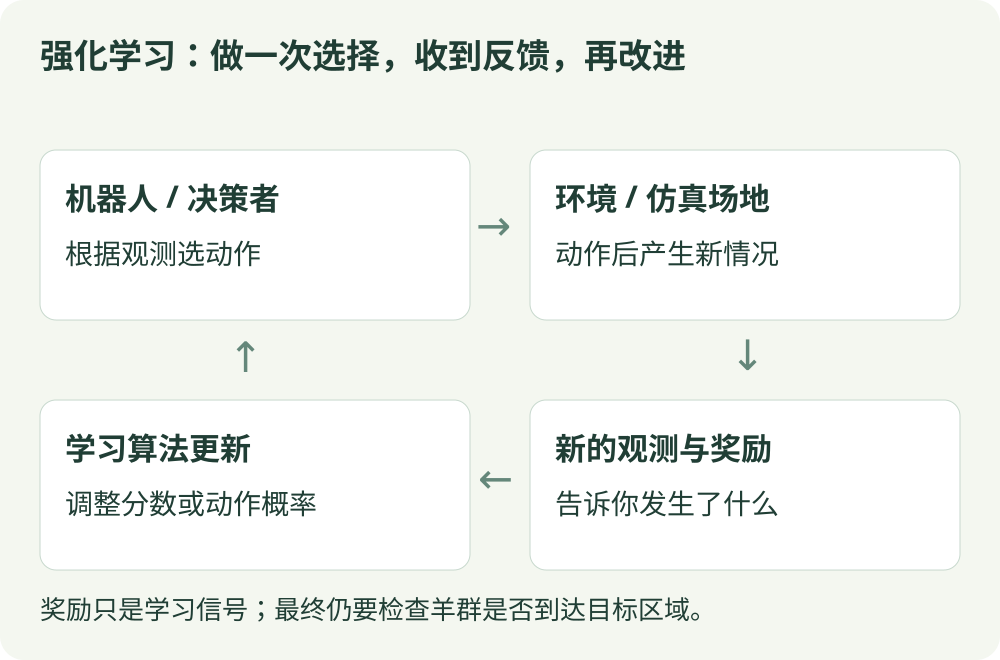

# 第一部分：算法直觉

先不急着记公式。先弄清楚：算法学什么、用什么反馈、什么时候更新、如何选动作。

## 先看一次学习发生了什么

{ .rl-figure loading=lazy }

[打开图示大图](../assets/interaction-loop.svg)

例如机器人先看到羊群位置，选择向某一侧移动。环境随后给出新的观测与奖励，学习算法再调整动作分数或选择概率。一次动作的好坏，要结合它后面带来的影响判断。

## 六个基础概念

| 概念 | 通俗理解 | 放牧任务中的可能例子 |
| --- | --- | --- |
| 状态 / 观测 | 当前情况；观测不一定包含完整状态 | 机器人位置、羊群估计位置 |
| 动作 | 当前可以做的选择 | 选择引导方向，或输出速度 |
| 奖励 | 环境给这一步的反馈 | 羊群接近目标的程度 |
| 回报 | 之后一段时间奖励的累计 | 整次引导的累计收益 |
| 策略 | 看到情况后如何选动作 | 根据羊群位置决定移动方向 |
| 价值 | 从这里出发，未来预计有多好 | 某个位置或动作的长期收益 |

奖励需要人为设计。算法优化奖励，不会自动理解“放牧成功”的全部含义，因此还要单独设计评估指标。

## 用同一条走廊比较算法

从位置 3 出发，左端 0 的奖励为 −1，右端 6 为 +1，中间每走一步为 −0.01。

- 价值迭代拿着已知规则计算最优走法。
- MC 走完整局再回看；TD 走一步就修正价值。
- SARSA 与 Q-learning 学动作分数，但对下一步的假设不同。
- REINFORCE 直接调整向左与向右的概率。
- 深度算法将表格换为网络，或增加更稳定的训练设计。

{ .rl-figure loading=lazy }

[打开图示大图](../assets/corridor.svg)
## 阅读时遇到这些词

| 术语 | 先这样理解 |
| --- | --- |
| 回合 / 一幕 | 从开始到终止的一次完整经历 |
| 轨迹 | 把这一段的状态、动作和奖励按顺序记下来 |
| 采样 / rollout | 按策略实际走一段，收集经历；这段未必是一整局 |
| 自举 | 用下一步的估计，帮助更新当前估计 |
| 优势 | 某个动作的结果相对于原先预期好多少 |
| 参数 | 算法能够调节的数字，例如表格偏好或网络权重 |
| 梯度 | 告诉参数往哪边小幅改变，会让某个目标上升 |
| 熵 | 描述动作分布有多分散 |

## 四组容易混淆的词

**评估与控制**：评估问某套策略好不好；控制问如何改进策略。MC 和 TD 本篇示例是评估，不负责求最优动作。

**价值方法与策略方法**：前者先学分数再选动作，后者直接学决策规则；Actor-Critic 结合二者。

**同策略与异策略**：同策略主要学习产生当前数据的策略；异策略允许采样策略与学习目标策略不同。异策略不是没有数据覆盖要求。

**离散与连续动作**：离散动作可以列举；连续动作是区间内的实数或实数向量。状态是否连续是另一回事，不能仅凭状态类型选算法。

## 逐个算法学习

| 算法 | 类型 | 先记住这句话 |
| --- | --- | --- |
| [价值迭代](value-iteration.md) | 已知模型 / 规划 | 根据已知规则反复计算每一步的长期价值。 |
| [蒙特卡洛（MC）](mc.md) | 完整回合 / 价值评估 | 先走完整条路，再用真实回报给经过的状态打分。 |
| [时序差分 TD(0)](td.md) | 逐步更新 / 价值评估 | 走一步就更新：眼前奖励加上对下一步的估计。 |
| [SARSA](sarsa.md) | 同策略 / 表格控制 | 按实际下一步会选的动作，更新当前动作的价值。 |
| [Q-learning](q-learning.md) | 异策略 / 表格控制 | 按下一步最好的估计，更新当前动作的价值。 |
| [DQN](dqn.md) | 异策略 / 离散动作 | 用神经网络代替 Q 表，学习每个动作的分数。 |
| [REINFORCE](reinforce.md) | 同策略 / 策略梯度 | 提高带来好回报的动作概率，直接学习决策规则。 |
| [Actor-Critic / A2C](a2c.md) | 同策略 / 策略与价值 | 一个模块做决定，另一个模块评估决定好不好。 |
| [PPO](ppo.md) | 同策略 / 限制更新 | 改进策略时克制一点，避免一次更新改变太大。 |
| [DDPG](ddpg.md) | 异策略 / 连续动作 | 直接给出连续动作，用价值网络指导动作改进。 |
| [TD3](td3.md) | 异策略 / 连续动作 | 用双重价值估计、延迟更新与目标平滑改进 DDPG。 |
| [SAC](sac.md) | 异策略 / 最大熵 | 兼顾回报与探索，学习带随机性的连续控制策略。 |

[进入第二部分：公式讲解 →](../math/index.md)
