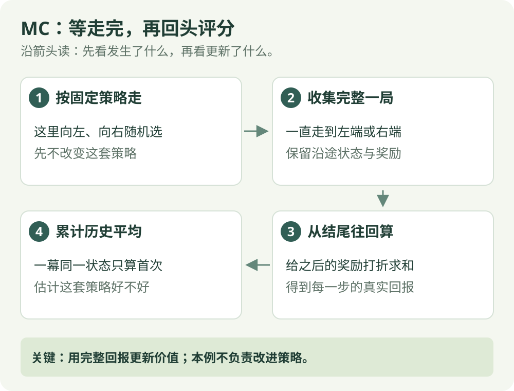

# 蒙特卡洛（MC）：算法直觉

[算法直觉](mc.md) · [公式讲解](../math/mc.md) · [Python 实践](../code/mc.md)

完整回合 / 价值评估

## 一句话理解

一局走完，再用实际拿到的奖励给沿途位置打分。

## 先看这张图

{ .rl-figure loading=lazy }

[打开图示大图](../assets/mc.svg)

图中每个框只展示主要学习关系，完整细节见后面的公式与代码。

## 这几个词是什么意思

**一局 / 一幕 / 回合**：从开始到终止的一次完整经历。**回报**：把当前时刻之后的奖励加起来，可以对更远的奖励打折。

## 用走廊举例

你用随机策略从中间出发，经过几个位置后到达右端。把这一路的折扣奖励加起来，给沿途状态打分。多走几局，再取平均，得到“使用这套策略时，从这里出发通常会怎样”。

## 跟着一局经历，看看它到底记了什么

假设这一次碰巧从 3 连续向右走，到 4、5、6，奖励依次是 −0.01、−0.01、1。为方便口算，这里折扣取 0.9；完整代码取 0.95。走到终点以后，才开始给经过的位置结账。

| 从哪个位置开始算 | 之后的奖励 | 这次回报 |
| --- | --- | --- |
| 位置 5 | 1 | 1 |
| 位置 4 | −0.01、1 | −0.01 + 0.9 × 1 = 0.89 |
| 位置 3 | −0.01、−0.01、1 | −0.01 + 0.9 × 0.89 = 0.791 |

为什么位置 3 的分数更低？它更早出发，多付出两步代价，而且终点奖励要等两步，所以权重更小。

这一局的 0.791 只是一次成绩。下一局从 3 出发可能向左结束，成绩会不同；MC 把多局成绩平均，才得到“按这套策略从 3 出发通常有多好”的估计。这里的策略仍然随机向左或向右，并没有因为一次成功就改成永远向右。

一局如果出现 `3 → 4 → 3 → …`，首次访问 MC 只给第一次出现的 3 计一次样本；它的回报仍包含这次访问之后的全部奖励。

## 为什么要等到这一局走完

刚到位置 4 时，你只知道已经收到的奖励；接下来可能向左到失败终点，也可能继续向右到成功终点，还可能绕路。完整回报尚未确定，所以本例等到真正终止、奖励清单完整后再结账。下一局结果可能不同，之后还要把多局成绩取平均。

想象一局中路线是 3 → 4 → 3 → 4 → 5 → 6。位置 3 出现两次：首次访问 MC 使用第一次站在 3 时往后的回报，不使用第二次的回报。选的是轨迹顺序里的第一次，不是倒序计算时首先遇见的那次。

这页保持左右各半的随机走法不变，研究这套走法值多少。给位置打分与改进走法是两件事；当前示例只做前者。

## 本篇讲哪个版本

本篇与代码对应的是 **首次访问 MC 状态价值评估**：一局中某个状态出现多次，只用第一次出现的回报。每次访问 MC 则会统计所有出现。MC 控制进一步估计动作价值并改进策略，不要把评估与控制混为一谈。

## 它怎么工作

1. 固定一套策略，收集完整回合。
2. 从结尾向前累计每个时间点的回报。
3. 把回报加入状态的历史平均。
4. 不断采样，改善对策略价值的估计。

## 优点与限制

不需要环境模型，也不需要用下一状态的估计来给当前状态打分。但是必须等回合结束，长回合反馈慢，回报的随机波动也可能很大。

## 在放牧研究里如何理解

把一次完整驱赶作为一幕，可以回看中途各阶段的收益。但如果一幕很长或经常只因时间限制结束，直接使用完整回报就需要更仔细地定义任务边界。

## 检查自己是否看懂

**同一局经过同一个位置三次，本篇代码统计几次？**

??? success "展开答案"

    一次。首次访问 MC 使用这局第一次来到该状态时的回报。

{ .rl-figure loading=lazy }

[打开图示大图](../assets/mc-vs-td.svg)

## 进一步阅读

[Sutton 与 Barto 教材，第 5 章](https://incompleteideas.net/book/the-book-2nd.html)

[David Silver 对应课程讲义](https://davidstarsilver.wordpress.com/wp-content/uploads/2025/04/lecture-4-model-free-prediction-.pdf)
